# Close Action: The Age of Fighting Sail, Vol. 1 (1997)

> **Transcription notes** (delete this block once the text has been cleaned up)
>
> - Source: `docs/CoA_-_Close_Action_the_Age_of_Fighting_Sail_vol_1_1997.pdf`. The PDF is a scan with no text layer, so this text was produced by OCR (Tesseract 5) and reflowed. Two-column pages are read left column first, then right column; the column layout is not kept.
> - <mark>Highlighted text</mark> (`<mark>...</mark>`) is low-confidence OCR: check it against the scan. Search for `<mark>` to find all of it.
> - `**TODO**` marks a place that needs a human decision.
> - `<!-- pdf p.N, Rules Book p.M -->` comments record the original page boundaries (invisible when rendered). `pdf p.N` is the page in the PDF; `Rules Book p.M` / `Scenario Book p.M` is the printed page number.
> - Tables, diagrams, forms, counters and maps are **not** transcribed. They are cropped from the scan into `images/` and shown inline.
> - References to page numbers were replaced by links to the closest section heading. Table-of-contents page numbers were dropped and the entries link to their headings.

<!-- pdf p.1 -->

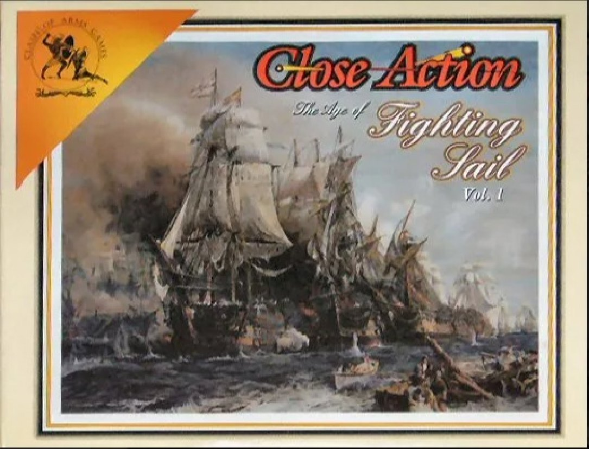

<!-- pdf p.2 -->

## Rules Book

### CLOSE ACTION™

Naval Tactical Warfare in the Age of Sail, 1740-1815

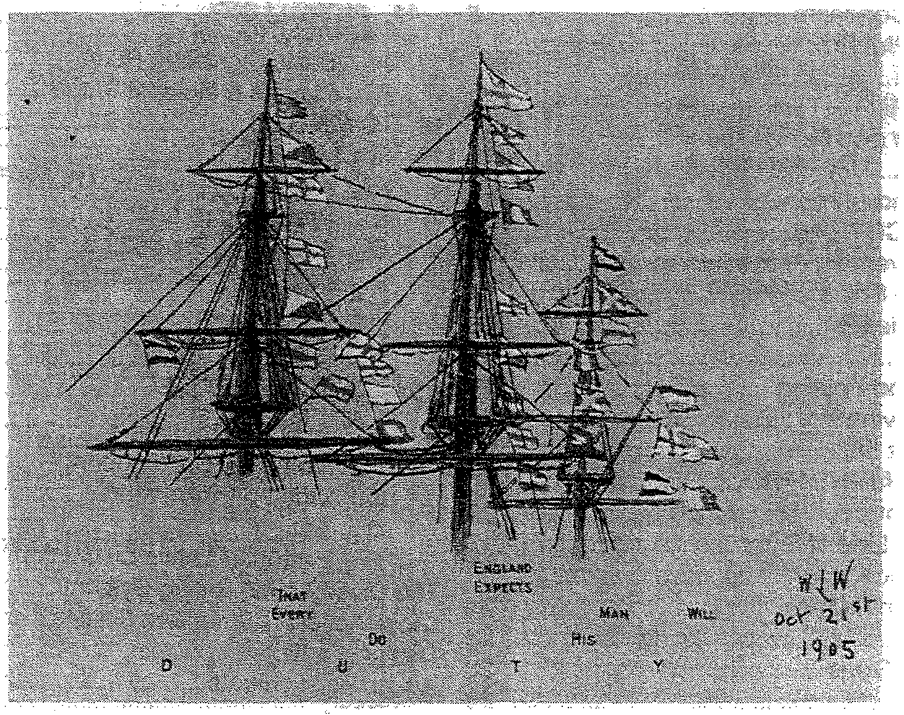

By Mark A. Campbell

<!-- pdf p.3 -->

### TABLE OF CONTENTS

- [1. INTRODUCTION](#1-introduction)
  - [A. Historical introduction](#1a-historical-introduction)
  - [B. Game Overview](#1b-game-overview)
  - [C. Game Scale](#1c-game-scale)
  - [D. Game Components](#1d-game-components)
  - [E. Counters](#1e-counters)
  - [F. The Ship Loc](#1f-the-ship-log)
  - [G. Filling in the Ship Log](#1g-filling-in-the-ship-log)
- [2. SEQUENCE OF PLAY](#2-sequence-of-play)
  - [A. The Game-Turn](#2a-game-turns)
  - [B. Phases](#2b-phases)
- [3. REINFORCEMENT & WEATHER PHASE](#3-reinforcement--weather-phase)
  - [A. Reinforcements](#3a-reinforcements)
  - [B. Weather](#3b-weather)
  - [C. Wind Direction](#3c-wind-direction)
  - [D. Wind Speed](#3d-wind-speed)
  - [E. Sea State](#3e-sea-state)
- [4. PLOT PHASE](#4-plot-phase)
  - [A. Plotting](#4a-plotting)
  - [B. Assigning Crew to Tasks](#4b-assigning-crew-to-tasks)
- [5. MOVEMENT](#5-movement)
  - [A. Movement Concepts](#5a-movement-concepts)
  - [B. Movement Plot Procedure](#5b-movement-plot-procedure)
  - [C. Turning](#5c-turning)
  - [D. Turning at MA=0, Tacking, In <mark>Irons</mark>](#5d-turning-at-ma0-tacking-in-irons)
  - [E. Acceleration and Deceleration](#5e-acceleration-and-deceleration)
  - [F. Sail State](#5f-sail-state)
  - [G. Blocked Wind](#5g-blocked-wind)
- [6. MOVEMENT EXECUTION](#6-movement-execution)
  - [A. General Movement Procedure](#6a-general-movement-procedure)
  - [B. Overlapping Ships](#6b-overlapping-ships)
  - [C. Contested Hexes](#6c-contested-hexes)
  - [D. Bearing Off](#6d-bearing-off)
  - [E. Collisions and Fouling](#6e-collisions-and-fouling)
  - [F. Poor Maneuvering](#6f-poor-maneuvering)
  - [G. <mark>Illegal</mark> Moves](#6g-illegal-moves)
- [7. GUN FIRE AND MARINE FIRE](#7-gun-fire-and-marine-fire)
  - [A. Gun Fire — Introduction](#7a-gun-fire--introduction)
  - [B. Fire Arc and Line of Sight](#7b-firing-arc-and-line-of-sight)
  - [C. Gun Fire Procedure](#7c-gun-fire-procedure)
  - [D. Damage from Gunfire](#7d-damage-from-gun-fire)
  - [E. Rakes](#7e-rakes)
  - [F. Lower Deck Guns](#7f-lower-deck-guns)
  - [G. Marine Fire](#7g-marine-fire)
- [8. MAINTENANCE PHASE](#8-maintenance-phase)
  - [A. Drifting and Veering](#8a-drifting--veering)
  - [B. Anchoring](#8b-anchoring)
  - [C. Grappling and Ungrappling](#8c-grappling-and-ungrappling)
  - [D. Unfouling](#8d-unfouling)
  - [E. Fires and Explosions](#8e-fires-and-explosions)
  - [F. Repairs](#8f-repairs)
  - [G. Reconciliation](#8g-reconciliation)
- [9. CREW QUALITY AND MORALE](#9-crew-quality-and-morale)
  - [A. Crew Quality, Skill and Morale](#9a-crew-quality-skill-and-morale)
  - [B. Morale Checks](#9b-morale-checks)
  - [C. Striking](#9c-striking)
- [10. BOARDING](#10-boarding)
  - [A. Introduction](#10a-introduction)
  - [B. Forming Boarders](#10b-forming-boarders)
  - [C. Boarding Procedure](#10c-boarding-procedure)
  - [D. Boarding Combat](#10d-boarding-combat)
  - [E. Winning Boarding Actions](#10e-winning-boarding-actions)
  - [F. Multi-Ship Boarding Actions](#10f-multi-ship-boarding-actions)
  - [G. Reorganizing](#10g-reorganizing)
  - [H. Operation of Captured Ships](#10h-operation-of-captured-ships)
- [11. SIGNALLING](#11-signalling)
  - [A. Basic Signalling Rules](#11a-basic-signalling-rules)
  - [B. Players & Multiple Ships](#11b-players--multiple-ships)
- [12. TOWING](#12-towing)
- [13. ANCHORING](#13-anchoring)
  - [A. Anchoring — General Rules](#13a-anchoringgeneralrules)
  - [B. Preparing to Anchor](#13b-preparing-to-anchor)
  - [C. Anchoring-Procedure](#13c-anchoring-procedure)
  - [D. Anchoring with Springs "..](#13d-anchoring-with-springs)
  - [E. <mark>Veering</mark>](#13e-veering)
  - [F. Cutting the Anchor](#13f-cutting-the-anchor)
  - [G. Shallow Water and Land](#13g-shallow-water--land)
- [14. OPTIONAL RULES](#14-optional-rules)
  - [A. Impulse Movement](#14a-impulse-movement)
  - [B. Voluntary Surrendering](#14b-voluntary-surrendering)
  - [C. Limited Information](#14c-limited-information)
  - [D. Fatigue](#14d-fatigue)
  - [E. Historical Limits on Gunfire](#14e-historical-limits-on-gunfire)
- [The Close <mark>Action</mark> Rating System](#the-close-action-rating-system)
- [Close Action Tournament Games](#close-action-tournament-games)
- [<mark>Designer's</mark> Notes](#designers-notes)
- [Acknowledgements](#acknowledgements)
- [Glossary](#glossary)
- [Sequence of Play](#sequence-of-play)

Copyright © 1997 Clash of Arms Games (All rights reserved)  
Send questions and comments to:  
Clash of Arms Games (atin: CA) .  
The Byrne Building #205  
Lincoln & Morgan Sis.  
Phoenixville, PA 19460  
Email: clashotarm@acl.com

<!-- pdf p.4, Rules Book p.1 -->

### 1. INTRODUCTION

"The world bas never seen a more impressive demonstration of the influence of sea power upon its <mark>history.</mark> Those far distant, storm-beaten ships, upon which the Grand Army [of Napoleon] never looked, stood between it and the dominion of the world."

<mark>a5"</mark> Alfred Thayer Mahan: The Influence of Seapower Upon the French Revolution and Empire

#### 1.A HISTORICAL INTRODUCTION

CLOSE ACTION (hereafter referred to as CA) is a realistic game system that allows you to refight naval battles from the wars of the French Revolution and Empire (1793-1815), better known as the Napoleonic wars. During this quarter-century of nearly continuous <mark>warfare,</mark> the warships of France, Spain, the Netherlands, Denmark, Russia and the United States fought against the British Royal Navy and each other for supremacy on all the seas of the world. Through calm and storm, wind and wave, the great wooden sailing ships of this era decided the fate of nations and empires. In a thousand actions large and small, the British navy usually triumphed against the best that France and her allies could send to sea. By 1815, the <mark>"far-cistant,</mark> storm-beaten ships\* of which Mahan wrote, had time and again frustrated <mark>Napoleon's</mark> plans for world dominion, and set the stage for the empire "on which the sun never set."

Unlike earlier wars, in which all navies emphasized the column formation, or "line ahead," as the key to victory in naval battles, in the Napoleonic era the <mark>Britisn</mark> navy discovered that ship-for-ship they were generally so superior to their enemies (except the Americans) that what mattered was simply getting as close to the enemy as possible. Nelson's famous last signal at Trafalgar, "Engage the Enemy More Closely (Close Action)," set the tone for the age, and is thus appropriately chosen as the title of this game.

#### 1.B GAME OVERVIEW

**1.B.1 Description of Play.** Close Action is a simultaneous movement game requiring at least two <mark>players;</mark> but, unlike many other war games, with CA it's "the more players, the <mark>better."</mark> Each player takes the role of the commanding officer of one or more warships. "Simultaneous movement" means that all ships move at the same time, as ships do in real life. At the beginning of each round of play, known as a game-turn (g-t), players plot their actions for that game-turn on ship <mark>fogs,</mark> one for each ship. The plots are then revealed and executed simultaneously. After movement comes combat, which includes gunfire, small arms fire, and <mark>boarding.</mark> At the end is the Maintenance Phase, in which events which occurred during the game-turn are wrapped up. If neither side has won by the end of the game-turn, the next game-turn begins.

**1.B.2 How to Study the Rules.** CA is necessarily a complex game, because correctly simulating the movement and combat capabilities and limitations of wooden sailing warships is difficult. However, careful compromises have made the game both historically accurate and playable, and the rules are arranged in logical order to help you learn the game. The rules are divided into two parts, the standard rules and the advanced rules. The standard rules comprise the most important rules you need to know to play CA; read them carefully.

The advanced rules cover events which occur less often. These include boarding (historically an important threat in some situations, but much less useful than depicted in movies and popular fiction), signalling (always used in multi-player games, but unnecessary for learning the game mechanics), towing, and anchoring. These rules should be read as soon as you are comfortable with the standard rules, but are less central to CA and can be ignored for your first few games. After learning the standard <mark>tules,</mark> read the boarding and signalling sections first, then towing; the anchoring rules can wait until you play a scenario which permits anchoring.

An optional rules chapter presents rules which add extra realism to the game system but also add complexity. CA can be played perfectly well without them, but they may add some extra flavor for purists. Do not try any of the optional rules until you are familiar with all the other rules.

**1.B.3 Abbreviations.** Several abbreviations are found in the body of the rules. They are explained in the glossary on the inside back cover of this book. A few of the more important abbreviations are explained in the appropriate location in the rules; the most important is <mark>"game-turn",</mark> always abbreviated "g-t" to avoid confusion with "turn", which is what a ship does when it changes direction.

#### 1.C GAME SCALE

One Hex = 67.5 yards <mark>(380</mark> hexes = 1 nautical mile). One Game-Turn = 200 seconds (3.33 minutes) of real time. One Movement Point = .6 knots (about .7 miles per hour). One Crew Box = 20 men.

One Long or Medium Gun Factor = 45 English pounds of adjusted weight of round shot (adjusted for damage-causing efficiency by gun caliber). One Carronade Factor = 80 English pounds of adjusted weight of round shot (adjusted for damage-causing efficiency by gun caliber).

#### 1.D GAME COMPONENTS

**1.D.1 Inventory.** Everything you need to play CA is included. You should have the following components: @ One Close Action Rules Book (this book). @ One Close Action Scenario Book. ® Four cardstock sheets of tables (blue for gunfire, red for movement, yellow for critical hits, green for ship data). # Two sheets of die-cut cardboard playing pieces, con- taining the 210 counters used to play the game. @ Two 22" x 34" mapsheets (labelled "A" and <mark>"B").</mark> ¢ Two filled-in Ship Logs, completed with all the informa- tion for a British 74 and a French 80. @ Two blank Ship Logs.

- One sample Ship Log showing a hypothetical battle. @ One Signal Form for multi-player games.

<!-- pdf p.5, Rules Book p.2 -->

- One registration card to register you with Clash of Arms. ® Four dice; two six-sided <mark>("d6")</mark> and two ten-sided <mark>(°d10°).</mark>

**1.D.2 Die <mark>Roiling (DRs).</mark>** The dice are roiled either singly or in pairs: d6 means "roll one six-sided die"; 2d6 means "roll two six-sided dice and add the values", which gives a range of 2-12; <mark>d10</mark> means "roll one ten-sided die"; 2d10 means "roll two ten-sided dice, and add the values." Note: a 0 is always read as <mark>"0\*,</mark> not "10°, so rolling 2d10 gives a range of results from 0 (2 zeros) to 18 (2 x 9). The abbreviation for die roll is <mark>"DR".</mark>

#### 1.E COUNTERS

**1.G.1 Counters.** CA includes cardboard <mark>playing</mark> pieces (called counters) that represent the ships and various information about them. The rectangular ship counters represent the warships themselves, while the square status counters are mostly used to keep track of important information about the ships.

**1.E.2 Ship Counters.** Each ship counter represents a single vessel, and occupies two hexes. CA includes 69 two-sided ship counters divided into two groups by the different background colors (yellow and red) in the boxes at top left and top right of each ship counter. The box at top left contains the ship's class number (1-4), while the box at top right contains the ship's /D letter (A-Z). The combination of color scheme, class number, and ID letter uniquely identifies each ship in the game. (The ship counters shown in diagrams in the rules are simplified for greater clarity.)

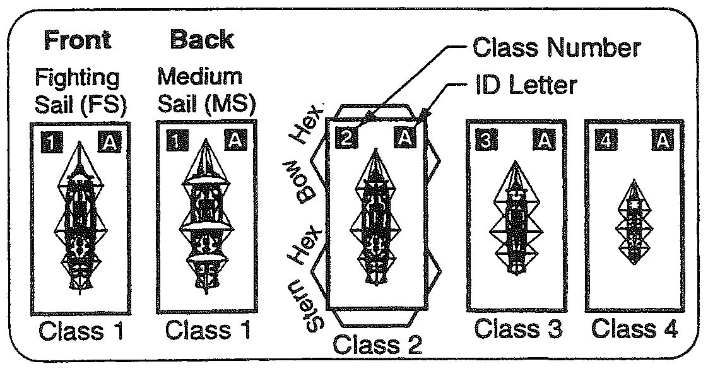

*DIAGRAM 1: Ship Counters*

**1.E.3 Using Miniatures.** Although a full set of ship counters is included, many players prefer 1:1200 or 1:2000 scale miniature ship models instead, for greater visual appeal. Guidelines for using such ships (including painting, rigging, and mounting) with CA may be obtained by sending a SASE to me (Mark Campbell), C/O Clash of Arms Games (see address on the inside of the front cover).

**1.E.4 Status Counters.** Status counters are used to track the condition of ships during games. CA <mark>includes 14%</mark> status counters of the types shown below; the shore battery, gunboat, and ship's boats counters are not used in CA, but future modules will includes rules for them. There are also a number of flag counters (not shown), which are used to mark flagships in multi-player games.

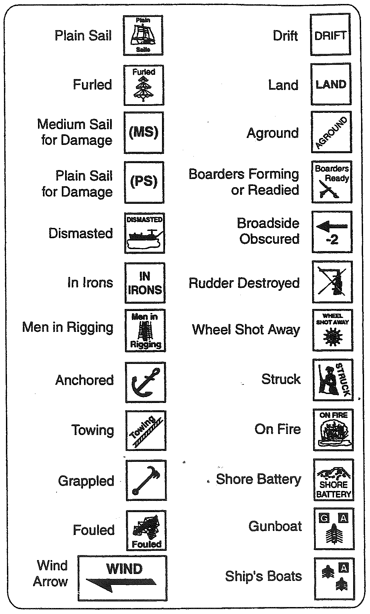

*DIAGRAM 2: Status Counters*

#### 1.F THE SHIP LOG

**1.F.1 Introduction.** Before you play CA, you must fill out one ship log for each ship in the scenario; each log has space to record the necessary information for one ship. Five ship logs are provided with CA for your use:

**1.F.2 Sample Ship Log.** The sample ship log shows the status of the British 74c Majestic at the end of a hypothetical game. The back side of the sample ship log describes. the plotted and executed' moves, damage inflicted and absorbed, crew task plots, and other notes for a complete game. This should give you an excellent idea of how movement and other plots should be written. Keep the sample log handy while reading the rest of the rules, since it is referred to frequently.

<!-- pdf p.6, Rules Book p.3 -->

**1.F.3 Filled-in Ship Logs.** In addition to the sample ship log, two completely filled-in ship logs are included. One shows a British 74; the other shows a French 80. They are provided for two reasons: first, to give you two ready-to-use ship logs for two commonly used ship types in the game; and second, to provide two ships you can use to play an enjoyable and balanced scenario for your first CA game. You are hereby granted permission to photocopy these logs for your personal use; be sure to copy them before you use them! Use the Tournament rules at the back of this book to set up and play your first CA game.

**1.F.4 Blank Ship Logs.** Finally, two completely blank ship logs are provided with CA. You will find it necessary to make copies to play the scenarios in CA, and are hereby granted permission to photocopy these ship logs for personal use; be sure to copy them before you use them!

#### 1.G FILLING IN THE SHIP LOG

**1.G.1 Introduction.** Before you begin a game, you must fill out one ship log for each ship in the scenario. For the scenarios included in CA, you will find the information about each ship in the order of battle (OB) section in the Scenario book. If you are creating your own battle, you will find information for most common ship types on the Ship Data Chart (SDC) (green sheet) (they are referred to henceforth as SDC/OB). Use pencil to fill out the ship logs, because ship status constantly changes during a game.

**1.G.2 Status Line.** At the top of each ship <mark>Iog</mark> is a status line, giving some basic information about each ship:

a. Class: CA divides sailing warships into four classes. The Class determines ships' sailing, drifting, marine fire, and boarding qualities. The class number is found in the <mark>"C:"</mark> column in the Scenario Book OBs, and the <mark>"C-M"</mark> column on the SDC. Class roughly relates to a <mark>ship's</mark> actual size and mass; see Designer's Notes.

b. <mark>1D:</mark> Write the ship counter's ID letter (A-Z) here.

c. Country: Enter nationality here (Br = British, etc.).

d. Rate: This is the number of guns nominally carried (the <mark>actual</mark> number could vary considerably); it is found in the "rate" column of the SDC/OB.

e. Ship Name: If you are playing a scenario from the Scenario Book, the ship's name will be found in the OB; if you are fighting a "free build" scenario, choose a suitable name and enter it here.

f. Player Name: Write the name of the player commanding the ship here.

g. Draft: This is the depth of water the ship requires to float (this matters in scenarios involving shallow water). It is found in the "D:\* column of the SDC/OB.

h. CH mod (Critical Hit Die Roll Modifier): This value (+1 to —4) indicates how resistant the ship is to special damage. Write this value in the "CH mod" box at the top right of the ship log.

I. V.P. Cost: Each ship is worth a certain number of Victory Points, based on its overall fighting power. This value is shown in the "VP" column in the Scenario book

OBs, and in the "Cost to purchase ship..." area of the SDC. Write this value in the <mark>"V.P. Cost</mark> box at the right edge of the ship log.

**1.G.3 Crew Quality (CQ) and Morale Rating (MR).** Below the Draft and "CH mod" boxes at the top right of the log is an area with boxes labeled "Initial CQ\* and "MR". Between them is a group of three columns of data, labelled <mark>\*CQ/SK'</mark> (Crew Quality/Skill Modifier) at the top and "CQ Gunnery Modifier" along the right edge.

The ship's initial crew quality (CQ) is a letter from <mark>Ato</mark> E; the MR is a number from 2 to 6 (usually 3-5). Both are found in the SDC/OB. After writing the CQ letter, cross out each <mark>"CQ/SK®</mark> row above the row for the ship's initial CQ. Then write the MR number in the "MR" box.

**EXAMPLE (see Sample Log):** The Majestic has a CQ of "B", so the <mark>\*CCYSK-CQ</mark> Gunnery Modifier" row for CQ=A is crossed out.

**1.G.4 Rigging.** All ships have four rigging sections (labelled 1 through 4 on the ship log). The number of boxes in each section is found in the \*RIGGING' column of the SDC <mark>(RIGG"</mark> in the OB). Give your ship the correct number of boxes for each section by crossing out <mark>al!</mark> but the number of boxes specified in each section.

Also note that directly above each rigging section are letters showing the maximum Sail state allowed when that rigging section is the one currently taking damage.

**EXAMPLE (see Sample Log):** Majestic (a British <mark>74c)</mark> has 7 rigging boxes in each rigging section; thus 2 boxes in each section are marked out before starting play. (The numbers in the boxes show the g-ts on which battle damage happened in the hypothetical battle.

**1.G.5 Hull.** All ships have four hull sections. The number of boxes per section is found in the "HULL" column of the SDC/OB. Cross out excess boxes as you did for rigging.

**EXAMPLE (see Sample Log):** The Majestic has 8 boxes in hull sections 1 and 2, and 9 boxes in hull sections 3 and 4. As with the rigging, the boxes with numbers in them show battle damage suffered in a hypothetical battle.

**1.G.6 Crew.** All ships have five crew sections (CS). The four sailor crew sections (S1 to <mark>$4)</mark> represent the seamen who manned the guns. The marine CS (M) represents both the ship's marines and the topmen, who did much of the actual sail handling. The number of boxes in each section is shown in the "CREW\* column of the SDC/OB. Cross out the excess boxes in each section, as with rigging and hull.

**EXAMPLE (see Sample Log):** The Majestic has six <mark>boxes.in</mark> each sailor section, and five boxes in the marine section.

**4.G.7 Gunnery Area.** The area in the center of the log below the crew section) is for gunnery data. Three types of guns were used aboard ship in this era: <mark>jong</mark> guns <mark>("LG"</mark> on the log), medium guns ("MG") and carronades <mark>("CR").</mark> Most ships in CA have both LGs and CRs, but some have only one or the other (only one ship in the CA Scenario Book has medium guns, but later modules will include others). The SDC/OB shows long guns in the "LG" column and carronades in the "CR" column. The numbers given are the LG and CR factors for each side of the ship. The numbers in the parentheses to the right of the "CR® column are °F"

<!-- pdf p.7, Rules Book p.4 -->

(freeboard) and \*L' (lower-deck gunfire modifier) (LDGM). Enter these numbers in the correct boxes on the ship <mark>log.</mark>

**EXAMPLE (see Sample Log):** The Majestic has 16 long gun factors, no medium gun factors, and 4 carronade factors per side. Her freeboard is 4, and her LDGM is —5.

**1.G.8 Filling in the Basic Gunfire Numbers (BGN) Row.** The row of 15 boxes labeled "BGN" at the top of the Gunnery area of the ship log is for the ship's basic gunnery numbers at ranges 1-15. The BGN for each range is determined by using the <mark>ship's</mark> gunnery factors and the Gunnery Factor Calculation and Basic Gunfire Number (BGN) Determination tables (blue sheet). Refer to Diagram 3 and the blue sheet as you read the following:

a. Determining Gunnery Factor (see Gunnery Factor Calculation table). Start at range 1. Multiply the number of factors for each type of gun by its Effectiveness <mark>Multiplier</mark> (shown by the number after the "x" in each box of the table) at range 1; add the numbers together to get the <mark>ship's</mark> total gunnery factor (TGF) for range 1.

b. Determining BGN. On the BGN Determination table, go down to the row corresponding to the TGF you have just determined. Cross-index this row with the range and you will find a number. Enter this number in the range 1 BGN box on the ship <mark>fog.</mark>

c. Repeat this procedure for each range. If the gunnery Factor Calculation table has a <mark>"——"</mark> in the box, it means that that type of gun can't fire at that range. If the BGN Determination table has a gray box at a given range, the ship cannot fire at that range; put an °X" in that BGN range box on the ship <mark>fog.</mark> At ranges 11-15 on the BGN Determination table, there are two numbers at each range; the numbers in smaller type are for French-gunned ships; <mark>aif</mark> other navies use the numbers in larger type. For ships built by one navy but used by another navy, the BGN numbers of the navy using the ship apply.

**EXAMPLE (see Diagram 3):** Most British 38-gun frigates, like the one shown in Diagram 3, have 6 long gun factors and 4 carronade factors. At range 1, the 6 long guns are worth one gunnery factor (GF) each (=6), while the 4 carronades are worth 2 GFs each (=8): the TGF is thus 14 (6+8). Cross-indexing the 13-14 row on the BGN Determination table with range 1 yields 24. Write this number in the BGN box for range 1. Diagram 3 shows the BGN row filled out for ranges 1 to 7; notice that the number of GFs provided by carronades falls as the range increases, until they provide no GFs at range 7+.

**EXAMPLE 2:** A British 74 is captured by the French (the ship rate will then be shown as 874). It uses French BGN values for ranges 11-15. A French ship captured by the <mark>British</mark> uses British BGN values for ranges 11-15.

d. Gunnery Modifiers Columns. Below the BGN row are two columns labelled PORT and STARBOARD. These columns are used to record the port and starboard gunfire modifiers to the BGN during play. At the start of a game the only modifier normally written is the CQ gunnery modifier; this number is found in the "CQ Gunnery Modifier" box corresponding to the ship CQ row at upper right. Enter this number in both the PORT and STARBOARD "CQ Gunnery Modifier" boxes.

**EXAMPLE (see Sample Log):** The British 74 Majestic has CQ=B, so its "Crew <mark>Quality</mark> gunfire modifier is initially +4.

**1.G.9 Movement.** To the right of the Gunnery area on the ship log is the Movement area. It contains all the information necessary for determining the <mark>ship's</mark> movement:

**1.G.10 Maneuver Type.** All ships are divided into one of four maneuver types, from A to D. The maneuver type can be found on the SDC/OB just to the right of the class number. Generally, class 1 ships = maneuver type A, class 2=B, class 3=C, and class 4=D, but there are variations. The maneuver type determines the following factors:

a. Acceleration and Deceleration (Accel." and "Decel." on the ship log). Acceleration and deceleration values for each maneuver type are found on the Speed Change table (red sheet).

b. Turning (Same Direction). The numbers entered in each box in this column are found on the "Turning (Same <mark>Direction)"</mark> table (red sheet).

c. Turning (Opposite Direction). The numbers entered in each box in this column are found on the "Turning (Opposite <mark>Direction)</mark> table (red sheet).

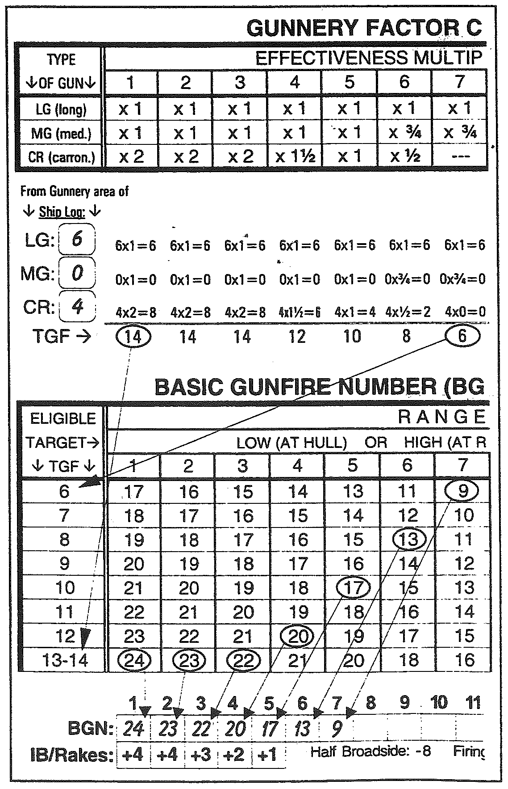

*DIAGRAM 3: Gunnery <mark>Calculation</mark> Example*

<!-- pdf p.8, Rules Book p.5 -->

**1.G.11 Speed Type.** The letters from the column labeled "Speed Type" on the SDC, or "ST" in the Scenario Book OBs, are entered in this box. For the purpose of determining movement, all ships fall into one of three major categories — L (for "Ship of the Line"), F (for <mark>"Erigate"),</mark> or C (for <mark>"Corvette").</mark> Within each category, there are three possible speeds — f (fast), s (slow), and vs (very slow). All ships in the game have one of the following speed types — L-f, L-s, L-vs; F-f, F-s, F-vs; C-f, C-s, and C-vs.

**1.G.12 Movement Allowance (MA).** The ship's speed type determines the Movement Allowance (MA) of the ship, which is expressed as a number of movement points (MPs) the ship may use in each wind facing at each sail state. The MA values are entered in the boxes under the headings FS, MS, and PS in the movement <mark>area.of</mark> the ship log. Look at the Movement table (red sheet). Find the ship's speed type (e.g., L-f) and cross-index it with the initial wind speed for the scenario (see Scenario Book). Immediately under each wind speed are bold numbers from <mark>"4°</mark> down to <mark>"4":</mark> they show the number of rigging sections remaining. Since a ship usually starts a game with <mark>ail</mark> four rigging sections remaining, use the group of nine numbers under the "4" to fill in the ship's MA boxes (one for each sail state and WF); see Diagram 4. WF=L MAs are not given on the Movement table because all ships have MA=0 in WF=L.

**EXAMPLE (see Diagram 4):** A ship with a speed type of L-f ("Line — fast") at WS=3 with all 4 rigging sections remaining has an MA of: 0- 3-5-4 at FS, 0-4-7-6 at MS, and 0-6-9-8 at PS.

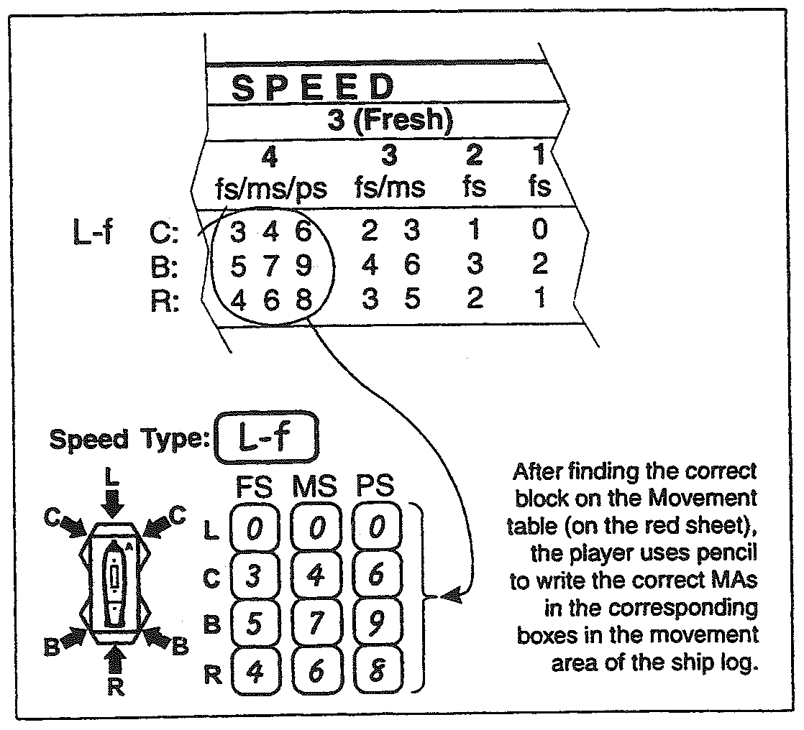

*DIAGRAM 4: Movement Allowance*

### 2. SEQUENCE OF PLAY

#### 2.A GAME-TURNS

**2.A.1 Introduction.** Each CA game is divided into a series of game-turns (g-t's), each of which is divided into five phases. After one g-t is completed, the next <mark>g-t</mark> begins, and they are repeated until both sides agree to end the game, one side has fulfilled the victory conditions of the scenario being played, or only one side has any ships which can move and fight. Note that although the ship log and <mark>signal</mark> form contain room for only 30 g-t's, a game can continue indefinitely past that point until one of the victory conditions given above is met. Use additional logs or lined paper to record additional g-t's.

**2.A.2 Phases and Sub-Phases.** Each <mark>g-t</mark> is divided into five phases, and each phase is likewise divided into two or more sub-phases. Each phase is discussed below in the order in which it is performed. Refer frequently to the Sequence of Play on the back cover of this book while reading this and later chapters.

#### 2.B PHASES

**2.B.1 Phase 1 — Reinforcements and Weather Phase.** First place any reinforcing ships which enter the game on this g-t in their specified entry hexes (see Scenario book). Next any wind speed and wind direction changes rolled the previous g-t take effect. Finally, roll for future wind speed and wind direction changes. !f any occur, they will take effect at the start of the Weather Phase of the next g-t. See Chapter 3.

**2.B.2 Phase 2 — Plot Phase.** Most actions a ship desires to perform in a g-t must be plotted in this phase. These include moving, altering sail state, preparing to tow and anchor, all boarding actions, making repairs, fighting fires, and writing signals. A few actions, such as gun fire, marine fire, grappling, and most unfouling efforts, do not have to be plotted. See Chapters 4 and 5.

<mark>2.38.3</mark> Phase 3 — Movement Phase. All ships now execute the moves which they plotted in the Plot Phase. Each ship uses MPs simultaneously, one MP at atime, until all ships have used all plotted MPs. Announce all plotted alterations of sail state. See Chapter 6.

**2.B.4 Phase 4 — Combat Phase.** Resolve combat by performing the following steps in order:

a. Announce all plotted boarding attempts. Targets of boarding attempts must react by replotting marine sections to FB if not already formed. See Chapter 10.

b. Resolve all gun fire (and resulting critical hits) and marine fire. See Chapter 7.

c. <mark>Resolve</mark> all boarding combat, one pair (or connected group) of ships at atime. See Chapter <mark>10.</mark>

<!-- pdf p.9, Rules Book p.6 -->

**2.B.5 Phase 5 — Maintenance Phase.** Other actions are now done in the specific order given in the Sequence of Play. Below is a short overview; see Chapter 8 for details.

a. Drifting & Veering. All drifting and veering is done in this sub-phase. Roll for fouling if a drifting or veering ship collides with another ship.

b. Anchoring & Towing. Ships plotted to anchor, cut anchor cables, or cut tow cables, do so.

c. Grappling. Each ship may try to grapple each adjacent ship except those to which it is already <mark>grappled.</mark>

d. Ungrappling. Each ship may now attempt to ungrapple from each ship to which it is grappled. Note: ungrappling attempts come after all grappling attempts.

<mark>e,</mark> Unfouling & Fixing. Make DRs for actions requiring rolling on the Unfouling table. Most such actions may be rolled for on the same g-t that they occur, as they do not require CSs to be plotted.

f. Fires & Explosions. All firefighting, fire damage, fire spreading and growing, and explosions is handled in this sub-phase. See Sequence of Play and Chapter 8.

g. Reconciliation. In this sub-phase, players first note all repairs. Next, all ships which either fulfilled escape conditions in this g-t or exploded are removed from the mapboard. Morale checks are then taken and signals are delivered. Finally, each player checks their ship logs to make sure that the ship log and any status counters on the ship counter match in status, and that all ship status changes are accurately tracked. See Chapter 8.

### 3. REINFORCEMENT & WEATHER PHASE

"The winds and waves are always on the side of the ablest navigators."

<mark>a"</mark> Edward Gibbon: Decline and Fall of the the Roman Empire

#### 3.A REINFORCEMENTS

**3.A.1 Introduction.** Reinforcements may enter the game after g-t 1 in some scenarios. In such cases, the g-t of entry and the entry hex and direction are listed in the Order of Battle section of each scenario. Place <mark>ail</mark> ships which enter on the current g-t on the indicated mapboard, hex, and direction. Note: the hex given is the hex in which the bow of the reinforcing ship is placed. See the Scenario Book for more information.

#### 3.B WEATHER

**3.B.1 Introduction.** Variations in wind direction and speed occur constantly at sea, and had major tactical implications in the age of sail. Every captain had to be prepared for the hazards and opportunities that wind and wave presented. To simulate weather effects, CA incorporates wind direction, wind speed, and sea state.

**3.B.2 Upwind and Downwind.** One feature distinguishing most naval battles from land battles is the absence of terrain at sea. There are no mountains, rivers, or forests on the water. However, in the age of sail the direction of the wind furnished a sort of terrain, as being upwind ("to windward") of the enemy was considered generally better than being downwind ("to leeward"). Downwind or "to leeward" means in the same direction that the wind is blowing, relative to the ship or other object under discussion. "Upwind" or <mark>"to</mark> windward" means the opposite — closer to the wind's source. Another way to think of it is this: the windward side of a ship is the side of the ship which the wind strikes first; the leeward side is the opposite side. A ship in WF=L or <mark>WF=R</mark> has neither windward nor leeward sides.

**EXAMPLE (see Diagram 5):** Ship B is upwind of (to windward of) Ship A; ship C is downwind of (to leeward of} ship A.

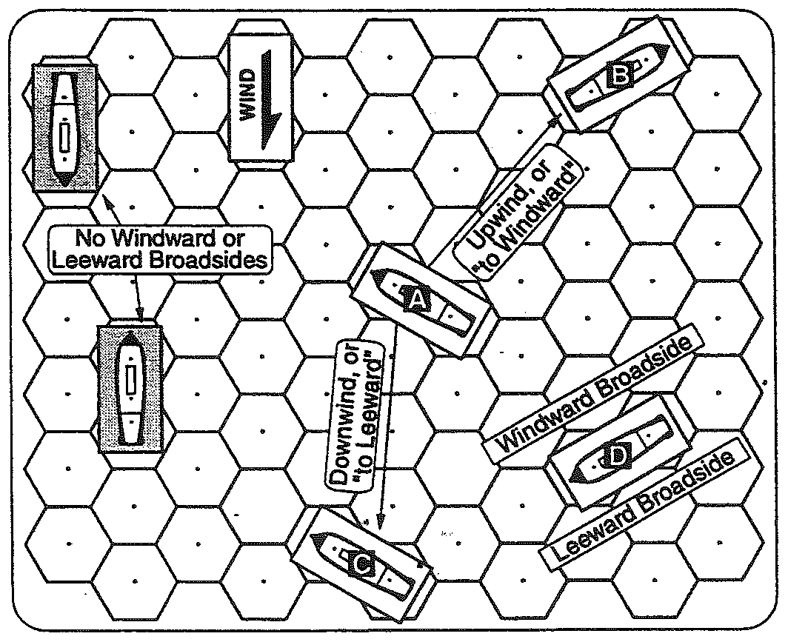

*DIAGRAM 5: Upwind and Downwind*

**3.B.3 Wind Direction.** The initial wind direction (WD) is defined in each scenario, or in the tournament rules. Point the wind arrow in this direction using the wind rose on the mapboard (see Diagram 6). The WD defines the Wind Facing (WF) of all ships in the scenario. The WD may or may not vary during a game, depending on the scenario rules (the WD should never vary in tournament games). If it is variable, the WD is checked with a 2d10 die roll.

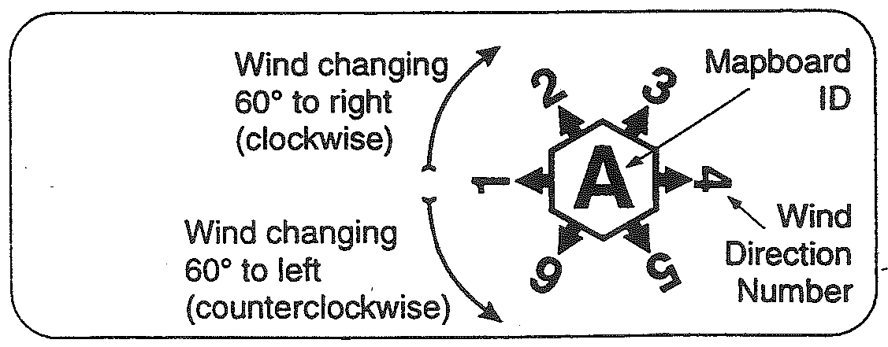

*DIAGRAM 6: Wind Direction Rose*

**3.B.4 Wind Speed.** The initial wind speed (WS) is also defined in each scenario or tournament game. Like WD, the WS may vary during the scenario, unless the scenario <!-- pdf p.10, Rules Book p.7 --> text specifies otherwise. WS is one factor which influences the sailing <mark>abilities</mark> of ships. Wind speeds of 2 or 3 are most common, but the WS may vary from 0 (calm) to 4 (heavy breeze). If it is variable, the WS is checked with another 2d10 DR.

**3.B.5 Sea State.** The sea state is a number from 1 to 5, which when compared to a <mark>ship's</mark> freeboard can adversely affect gun fire. Sea state never changes during a scenario.

**EXPLANATION:** The greater the sea state number, the rougher the sea and the higher the waves. If the sea state is high enough, a ship might have had to keep its lower deck gunports closed, and thus its lower deck guns could not fire. The reason sea state never changes is that on the open ocean it generally takes hours for a sustained change in wind speed or direction to be reflected in wave action.

**3.B.6 When Changes Take Effect.** Any changes take effect at the start of the Weather Phase of the following g-t.

**EXAMPLE:** <mark>If</mark> the WS or WD die rolls for g-t 2 result in one or both changing, the changes take effect at the start of the Reinforcements & Weather Phase in g-t 3.

#### 3.C WIND DIRECTION

**3.C.1 Wind Direction Change Frequency.** The frequency of WD change can be either Oceanic (representing the steadier winds found far out to sea) or Coastal (representing the more variable winds usually found near coastlines). The WD change frequency is specified in each scenario.

**3.C.2 Wind Direction Change Procedure.** Roll 2d10 on the Wind Direction table (red sheet). If the <mark>result</mark> is <mark>"changes",</mark> an additional d10 die roll is required; roll accordingly and note the results; the wind arrow will turn to face the new direction in the Weather Phase of the next g-t.

**EXAMPLE (see Diagram 6):** ff the wind changes direction from WD=5 60° to the sight (clockwise), the wind would then blow in <mark>WD=6;</mark> if it changed direction 60° to the <mark>/eft</mark> (counter-clockwise), it would then blow in WD=4.

**3.C.3 Wind Direction in Wind Speed 0:** Even if the WS falls to 0, continue <mark>rolling</mark> for wind direction change and record any changes that occur. This is important, because if the wind increases to WS=1, the WD is used again, and it might be quite different from the WD before the WS fell to 0.

#### 3.D WIND SPEED

**3.D.1 Wind Speed Change Frequency.** The WS change frequency can either be Steady (representing trade winds, which did not vary much in velocity) or Gusty (representing more variable winds). The WS change frequency is specified in each scenario.

**3.D.2 Wind Speed Change Procedure.** Roll another 2d10 on the Wind Speed table (red sheet). If the result is "changes", roll an additional d10 and note the results. The Wind Speed may never go above 4 nor below 0: such results are treated as "No Change."

**3.D.3 Wind Speed Drops to Calm (WS 0).** The WS may drop to 0 only if the scenario starts at <mark>WS<1.</mark> In other scenarios, when the WS=1, treat a result of <mark>-1</mark> Speed' on the Wind Speed Change table as "No <mark>Change".</mark> If the WS does drop to 0, do not remove the Wind Arrow, because it is used to track potential variations in WD, as noted above.

**3.D.4 Effects of WS=0.** Ships cannot move or turn <mark>ai</mark> all in WS=0, but may fire. During WS=0 a result of <mark>"changes"</mark> automatically means that the WS increases to WS=1 (there is no need to roll d10 again as shown on the table). If the WS increases to WS=1, ships in WF=L are not considered to be "in irons" for the first <mark>g-t.</mark>

#### 3.E SEA STATE

**3.E.1 Sea State Effects.** A high sea state <mark>(=3)</mark> can havea significant negative effect on gun fire. See 7.F.2.

### 4. PLOT <mark>PHASE</mark>

#### 4.A PLOTTING

**4.A.1 Introduction.** All ships must secretly and simultaneously p/ot (write down) most actions they will perform in a game-turn during the Plot Phase of that g-t. A few actions, such as gun fire, marine fire, and some Maintenance Phase activities such as grappling, ungrappling, and attempts to-unfoul, do not have to be plotted, because whether they occur depends on what happens in the Movement Phase.

**4.A.2 Plotting Movement.** The most important thing every ship must do during the <mark>Pilot</mark> phase is to plot its movement for the current <mark>g-t.</mark> Because this is such an important part of CA, ship movement plotting is covered separately in Chapter 5.

**4.A.3 Assigning Crew to Tasks.** All tasks require one or more crew sections; the CSs must plot to perform the task during the Plot Phase. The Crew Task Order Code area of the ship log indicates the number of crew sections required for each task and the number of g-t's needed to complete each task. Note: all tasks requiring one or more CSs for more than one g-t must be performed by the same CS(s) for all required g-t's. If a CS stops plotting a task, all <mark>g-t's</mark> spent working on that task are lost (cross them out).

**4.A.4 Signalling.** Each player may write one <mark>"signal"</mark> to other players on his side now, but signals are not delivered until the end of the <mark>g-t.</mark> See Chapter 11.

#### 4.B ASSIGNING CREW TO TASKS

**4.B.1 Plotting.** Crew sections must be plotted to perform tasks. In general, how each task is plotted is covered in the appropriate place in the rules. The most important rule is that any CS may be plotted to perform any task, except for boarding. When a ship is boarding or defending against <!-- pdf p.11, Rules Book p.8 --> boarding, any sailor CSs used must plot to board using the lowest-numbered sections first. See Chapter 10.

**4.B.2 One Task per CS.** Each CS may only perform one task in a single g-t. If a CS has been plotted to do one task, it may not be plotted for any other task in the same <mark>g-t.</mark>

**EXAMPLE:** A ship which has <mark>ail</mark> crew sections available wishes to form boarders, reduce sail from MS to FS, and prepare to anchor with springs, at the same time. The player wants to plot one sailor section to form boarders, and must use <mark>Si</mark> for that purpose. S3 is plotted to alter sail, while <mark>$4</mark> prepares to anchor with springs. S2 could have substituted for S3 or S4.

**4.B.3 Effect of Casualties on Assigned Tasks.** If a CS is completely eliminated (marked out), the task it was working on is not completed; cross out all g-t's of accumulated progress on that task.

**4.B.4 Unplotted Crew.** Sailor CSs not plotted to a task may be used to fire the ship's guns; similarly, if the marine CS is not plotted to a task, it may use marine fire against adjacent enemy ships. Note: even if all crew sections are assigned to tasks, a ship may still move normally.

### 5. MOVEMENT

#### 5.A MOVEMENT CONCEPTS

**5.A.1 Movement Allowance.** The movement allowance (MA) is the maximum number of MPs a ship can use in the course of a g-t, before considering acceleration and deceleration. Each ship's MA is determined during the Plot Phase of each g-t. Except for restrictions imposed by acceleration and deceleration, the ship may use none, some, or <mark>all</mark> of its MA.

**5.A.2 Determining MA.** The MA for a ship is determined by the following five factors:

a. Speed Type. The ship's speed type is given on the SDC/OB. See 1.G.11.

b. Wind Speed (0-4). Variations in WS affect ships differently, depending on their class, sail state, and wind facing (generally, large ships do better in heavy winds, while smaller ships perform better in lighter breezes).

c. Wind Facing (WF). A sailing ship's movement capability is greatly affected by its "point of sail," or angle to the wind, which CA calls wind facing (WF). A ship can be in one of four possible WFs: WF=L (Luffing), WF=C (Close-Hauled), WF=B (Broad-Reaching), and WF=R (Running Downwind). Each ship must fully occupy two hexes, and must always point towards another hex. Ships may never lie along hex spines.

**EXAMPLE (see Diagram 7):** The white ships labeled <mark>"L", "C", "B",</mark> and "R® show ships correctly aligned to the hexgrid, and in those respective WFs. Ships in gray are incorrectly aligned to the hexgrid.

d. Sail State. A ship may be at one of five possible sail states; PS (plain sail), MS (medium sail), FS (fighting sail), furled (sails furled), or dismasted (all rigging boxes marked out). These represent the different amounts of sail that a ship might set in a typical battle. . Rigging damage. A ship loses some of its movement capability with each rigging section lost (the loss of individual rigging boxes counts only by bringing the loss of that section closer). For each rigging section lost, a ship's MA is usually reduced.

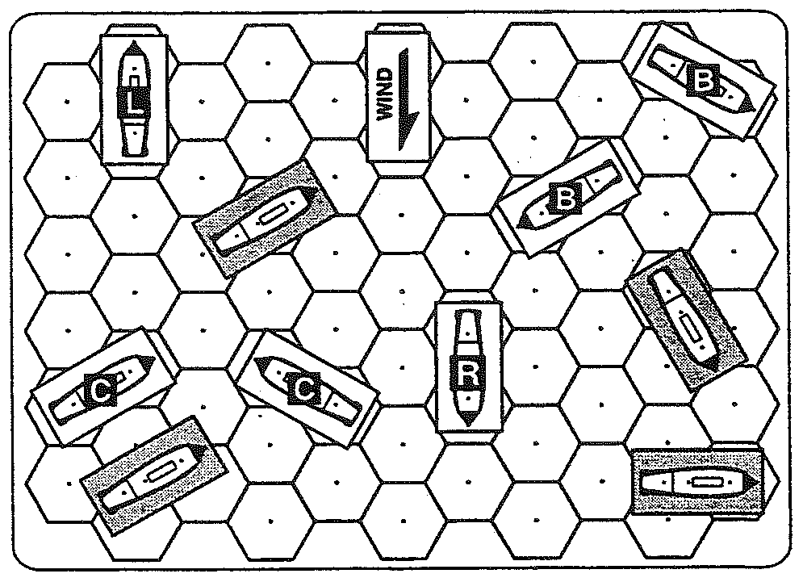

*DIAGRAM 7: Hexgrid Alignment and Wind Facings*

**5.A.3 Using the Movement Table.** A ship's MA can always be found by cross-indexing the five factors from 5.A.2 on the Movement table; the result is a block of numbers (see Diagram 4). The Movement table is used often during the game, because changing conditions (loss of rigging sections, a different wind speed, etc.) will often alter the ship's MA compared to previous g-t's.

**EXAMPLE (see Movement table):** A fast frigate (F-f) which is close-hauled (WF=C) in a fresh breeze (WS=3) with 4 rigging sections remaining at medium sail (MS) has an MA of 5. Assuming no deceleration or acceleration problems, the frigate could expend from © to & <mark>MPs</mark> in that g-t.

**5.A.4 Movement Range.** The MA block shows the theoretical maximum movement for a ship. The number of MPs the ship may plot in a g-t is also restricted by acceleration and deceleration (see 5.E). To find the allowed movement range, first add the ship's current acceleration to last <mark>g-t's</mark> actual speed (i.e., the number of MPs actually used) and subtract the deceleration from <mark>fast</mark> g-t's actual speed. When combined with the ship's current MA, the result is the allowed movement range. Note: there are cases in which a ship will have to spend exactly a certain amount of MPs. Note: a ship that does not move ahead in a <mark>g-t</mark> (even if it turns) is "stopped"; its speed is 0 for computing acceleration and deceleration. See <mark>5.E.2.</mark>

**EXAMPLE (see Sample Log):** On g-t 8 Majestic plots <mark>1S,</mark> using 2 MPs. On g-t 9 she could choose to use from 0 to 4 MPs (acceleration of 2, deceleration of 3). In the event, Majestic plots 3.

#### 5.B MOVEMENT PLOT PROCEDURE

**5.B.1 Using MPs.** After deciding how many MPs it will spend, a ship plots those MPs in the plot column of the <mark>g-t</mark> record area of the ship log. MPs may not be accumulated from g-t to g-t and may not be transferred from ship to ship.

<!-- pdf p.12, Rules Book p.9 -->

**5.B.2 Plot Procedure.** A ship may perform any one of three possible actions with each MP; each action uses one MP. These actions (with the proper way to plot them on the ship log) are:

a. Move ahead <mark>(°1',</mark> "2", etc.). For each MP spent on ahead movement, the ship moves into the hex towards which its bow is currently pointing. To go ahead several hexes in a row, write the number of consecutive ahead moves.

**EXAMPLE 1 (see Diagram 8):** Position A shows a ship moving ahead one hex. Position <mark>B</mark> shows a ship moving ahead two hexes. GENERAL NOTE ON DIAGRAMS: in diagrams showing moving ships, the arrows shown usually trace the path followed by the ship's stern hex. This may appear confusing at first, but if you set up a ship on the mapboard and try to duplicate the ship movements on the diagrams, you will soon see that this is the most useful way to portray their movement.

**EXAMPLE 2 (see Sample Log):** On g-t 2, Majestic moves 6 hexes ahead. The <mark>plot</mark> for this move is <mark>°6",</mark> NOT <mark>°111111".</mark>

b. Turn to starboard (\*S"). The ship turns clockwise so that its bow faces 60° to the right of its previous course.

c. Turn to port (P). The ship turns counterclockwise so that its bow faces 60° to the /eft of its previous course.

**EXAMPLES (see Diagram 8):** Ships shown as P are turning to port; ships shown as S are turning to starboard.

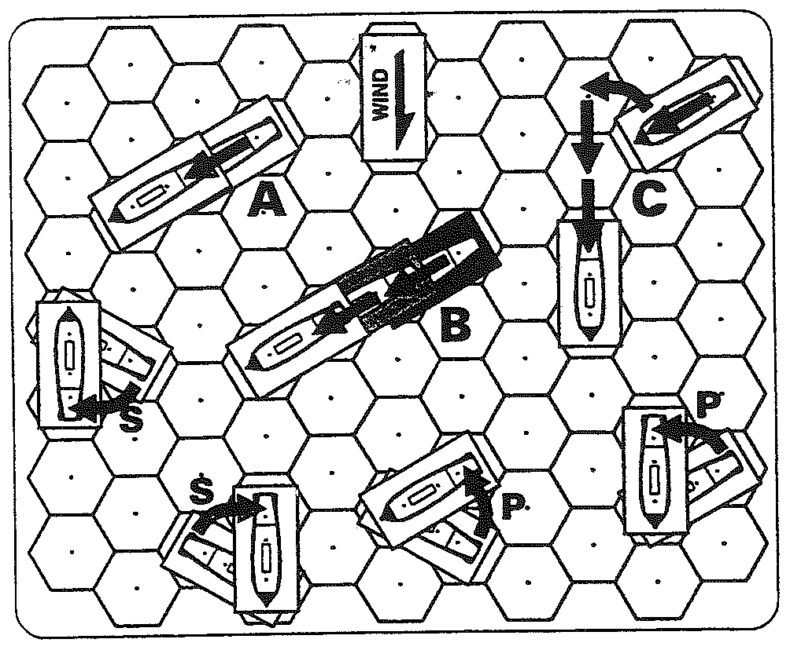

*DIAGRAM 8: Movement and Turning*

**5.B.3 <mark>WE</mark> Restriction.** The MA shown on the Movement table for each WF is the maximum number of hexes ahead a ship may move in that WF, even if the ship began the g-t in a different WF with a higher MA. If a ship moves ahead the maximum possible number of hexes in any WF, it may not move any further, even if it has MPs remaining. However, if the ship moves ahead /ess than its MA in a WF, it may turn to a new WF and continue moving until its has used all MPs. Note: a ship never gains MPs during a Movement Phase by turning into a faster WF.

**EXAMPLE 1 (see Diagram 9, position D):** A fast class 2 ship <mark>(L-f)</mark> broad reaching <mark>(WF=8)</mark> under fighting sail (FS) in a light breeze (WS=2) with all 4 rigging sections remaining has an MA of 4. If it turns to WF=C, it may move only 2 hexes in that direction as its MA for WF=C (at FS and WS=2) is 2. Thus a move of P2 is allowed (position D1), while P3 (position D2, in gray) is not.

**EXAMPLE 2 <mark>(ee</mark> Diagram 9, position <mark>E):</mark>** The same ship at WS=3 (fresh breeze) has an MA of 5. It could move P1S1 (position E1) or P2S1 (position E2) because its maximum ahead movement in WF=C is 3 MPs (because WS=3). However, a move of P3S is not allowed, because the ship would have used the 3 ahead MPs permitted in WF=C to move 3, so the 4th MP (required to turn S) is not allowed.

**5.B.4 Turning into WF=L.** A ship which turns into WF=L must immediately stop, and may not move nor turn for the remainder of the Movement Phase, even if it has MPs left.

**5.B.5 MA=0.** A ship with MA=0 may never move ahead, but may try to turn. See 5.D.

#### 5.C TURNING

**5.C.1 Introduction.** Ships are rated for maneuverability by their maneuver type (a letter from A to D), with A representing the <mark>/east</mark> and D the most maneuverable ships. The main effect of a <mark>ship's</mark> maneuver type is to control how tightly the ship may turn. As you might expect, the faster the ship moves, the wider its turns will be. Regardless of their maneuver type, all ships may make a maximum of two turns (each of 60° [one hexside]) per g-t; in some cases a ship may be allowed only one 60° turn per g-t. Each turn is exactly 60°; a ship may turn up to 120° in a g-t, but has to make two 60° turns to do so. All future references to turns are to be understood to mean turns of exactly 60° each.

**5.C.2 Executing a Turn.** A ship counter turns by pivoting on its bow hex so that the bow turns towards the direction plotted. Thus, as the ship's bow pivots 60°, the stern will swing into a new hex (see Diagram 8, ships marked P and <mark>S$);</mark> the ship's bow remains in the same hex. (Exception: Anchored with Springs by the Stern. See 13.D.)

**5.C.3 Subsequent Turns.** After a turn, a ship must move ahead 1 to 3 hexes (depending on its speed), or use 0 MPs for 1 g-t, before it is able to make another turn. A ship may never turn on two consecutive MPs, even if the two MPs are on different g-t's. (Exception: <mark>5.D.3,</mark> Tacking.) The number of hexes of ahead movement required before the ship is able to turn again is found by cross-indexing the <mark>ship's</mark> plotted speed for the current <mark>g-t</mark> with the appropriate <mark>\*turning'</mark> column in the movement area of the ship log. Note that g-t boundaries do not matter for calculating hexes moved ahead. Thus, hexes moved ahead at the end of the previous g-t do count towards the number of ahead hexes required before being able to turn again.

**EXAMPLE:** A ship moves <mark>3S1</mark> on <mark>g-t</mark> 1. On <mark>g-t</mark> 2, it could move P4, <mark>regardless</mark> of its maneuver type, because the last MP of g-t 1 was ahead, thus fulfilling the requirement to move ahead 1 hex or use no movement for 1 g-t between turns.

**5.C.4 Direction of Previous Turn.** A ship's ability to turn in a particular MP depends on whether the ship is turning in the same direction or opposite direction as its previous turn, because there are two turning <mark>tables,</mark> labelled "Turning (Same Direction)" and "Turning (Opposite Direction". Notice that the two tables have different requirements for the number of hexes ahead that must be moved between <!-- pdf p.13, Rules Book p.10 --> turns; see explanation below. Which g-t the previous turn occured in is unimportant; the player simply scans backward in the g-t record area of his ship log until he comes to the previous plotted turn (P or S); that is the ship's "previous turn".

**EXAMPLE <mark>1:</mark>** If a ship plots <mark>Sf</mark> and <mark>Si</mark> in successive g-t's, it has made two turns in the same direction; if the ship plots Si followed by <mark>P41</mark> in successive g-t's, the second turn is in the opposite direction from the first (starboard followed by port).

**EXAMPLE 2 (see Diagram 9, position A):** A ship moves <mark>S15</mark> (position <mark>A1);</mark> this is a turn in the same direction. If the same ship moves <mark>S1P,</mark> it would be a turn in the opposite direction (position A2).

**EXPLANATION:** Ships actually turn in smooth ares, not by swinging their sterns out, but CA has to deal with the limitations of hexgrids, and so cannot show all the possible points of sail ships actually could steer. Accordingly, at higher speeds ships are allowed to maneuver more freely when turning in opposite directions than when turning in the same direction, to account for the intermediate or diagonal courses that ships could actually steer.

**5.C.5 Same Direction Turns.** The number of hexes a ship must move ahead before turning in the same direction is shown for each speed in the "Turning (Same Direction)" column in the movement area of the ship log.

**EXAMPLE 1:** Here are some legal plots for maneuver type A ships:

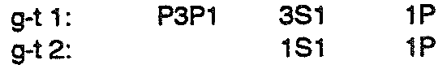

In contrast, the following plots are not allowed:

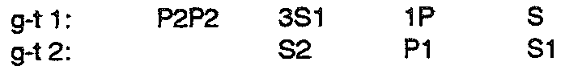

**EXAMPLE 2 (see Diagram 9, positions B and C):** Two ships — one maneuver type B and the other maneuver type C — want to turn as tightly as possible in the same direction using 4 MPs. The Turning (Same Direction) table (red sheet) shows that maneuver type B ships plotting 4 MPs must move ahead 2 hexes between turns in the same direction, while maneuver type C ships using 4 MPs need only move ahead 1 hex before turning in the same direction. Thus the maneuver type B ship must turn P2P (position B), while the more maneuverable maneuver type C ship can plot <mark>P1P1</mark> (position C).

**5.C.6 Opposite Direction <mark>Turns.</mark>** The number of hexes which a ship must move ahead before turning in the opposite direction are shown for each speed band in the "Turning (Opposite Direction)" column in the movement area of the ship log.

**EXAMPLE:** The following plots are legal for maneuver type A ships: Ship Name:

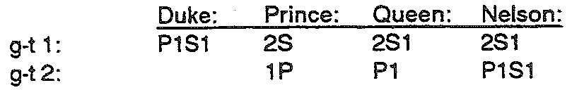

- while these are not:

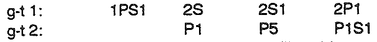

Explanation: Duke's lower <mark>pilot</mark> is illegal because she has piotted two turns in successive MPs. Prince's lower plot is illegal because she, like Duke, has plotted two consecutive turns; the fact that those turns are in different g-t's does not matter. Queen's lower plot is illegal because at a speed of 6, maneuver type A ships must move two hexes ahead between turns in the opposite direction, and Queen has only moved one hex ahead (the last MP from g-t 1). <mark>Nelson's</mark> lower plot is illegal because at a speed of 4, maneuver type A ships must move ahead 2 hexes before turning in opposite directions, and Nelson has only moved 1 hex ahead <mark>(ie.,</mark> the last MP from <mark>g-t</mark> 1).

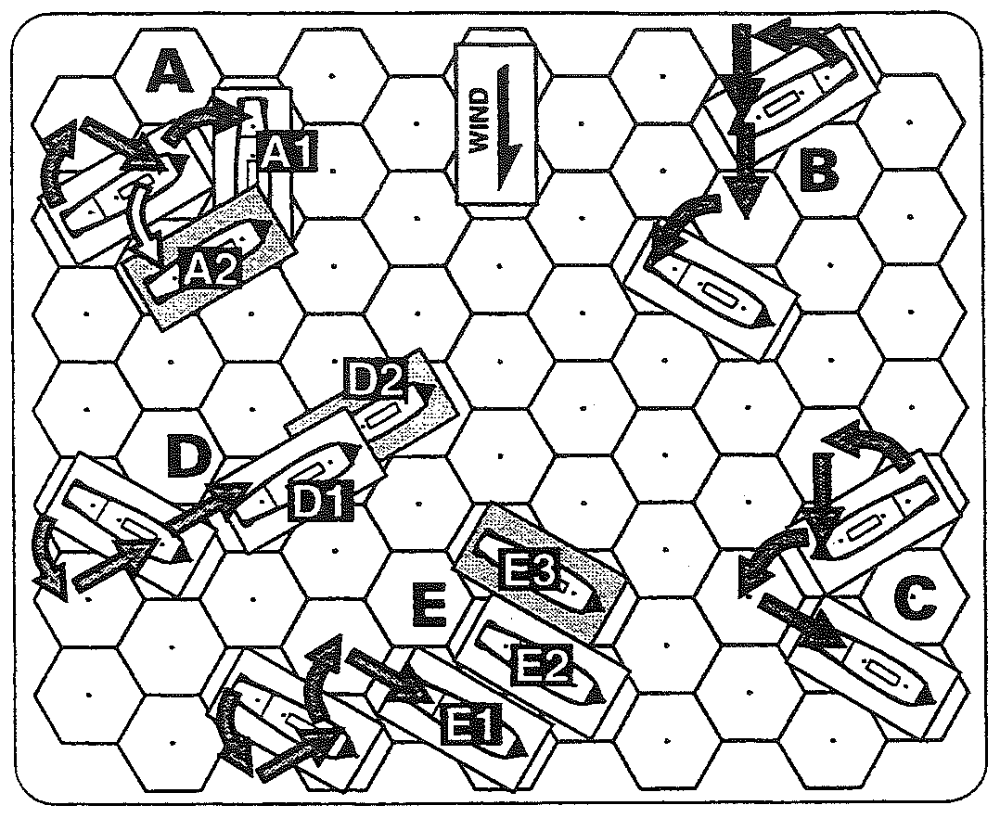

*DIAGRAM 9: Movement Examples*

**5.C.7 Turns at Speed 1.** At a speed of one, <mark>all</mark> ships have a notation of "1\*\* on both the Same and Opposite Direction columns in the movement area. This means that the ship must either move one MP ahead between turns, or not move at all for one g-t between turns. Remember that ships may never turn twice in consecutive MPs, even if the turns occur in different g-t's.

**EXAMPLE:** The following are legal plots for all ships, regardless of their maneuver type:

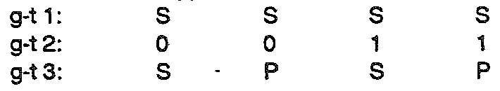

- <mark>.while</mark> these are illegal, regardless of their maneuver type:

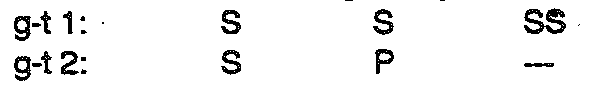

#### 5.D TURNING at MA=0, TACKING, IN IRONS

**5.D.1 Turning with an MA <mark>ef</mark> 0.** Any non-dismasted ship with a MA=0 (the ship's WF does not matter) may plot one turn, so long as the turn does not violate any other movement rules. Unlike other movement, the ship does not automatically succeed, but must roll on the Tacking table. If unsuccessful, the ship may try again next g-t. The plotted turn is erased, since it did not actually occur, and 0 is plotted instead.

a. Ships may not turn in calm (WS=0).

b. Dismasted ships may not <mark>voluntarily</mark> turn; they will turn, however, while under tow or when partially <mark>drifting.</mark>

**5.D.2 MA=0 Turning Procedure.** On the <mark>g-t</mark> a ship tries to turn, roll d10 on the Tacking table (red sheet). If the result is < the number required, the turn succeeds.

a. Number of CSs plotted. The table assumes that 3 CSs-are plotted to <mark>"T\*</mark> on the g-t that the ship tries to turn at MA=0. For each CS not so plotted, add +2 to the DR, up to a maximum of +6 if no CSs are plotted. Note: one Tacking table DRM reads "(up to +8)". This is a mistake; it should read \*(up to +6)". Change it on your red sheet.

b. One DRM is missing from the Tacking table. Add <mark>\*Ship</mark> not at WF=L: —2° to the existing modifiers under the

<!-- pdf p.14, Rules Book p.11 -->

Tacking table. This means that if the <mark>MA=0</mark> ship is at <mark>WFEsC,</mark> B, or R, the ship applies a <mark>—-2</mark> DRM to the DR.

**5.D.3 Options in WF=L (Tacking).** A ship which turns into WF=L immediately stops, even if it has MPs remaining and/or the move violates the deceleration <mark>limit. It</mark> may plot one of three actions on the next g-t:

a. Try to continue <mark>tuming</mark> in the same direction. This act (turning the ship's bow across the eye of the wind) is called tacking. <mark>It</mark> is an exception to the general rule that ships cannot turn twice on successive MPs. Tacking is one form of turning at <mark>MA=0.</mark> | '

b. Try to turn back to the same direction from which it just turned. This is called a <mark>"false"</mark> or reverse tack, and also constitutes an exception to the general rule that ships cannot turn twice in successive MPs. Ships attempting to reverse tack must apply the "Reversing Tack" DRM.

c. Plot a move of 0 (it would then be in irons).

**EXAMPLE of Tacking (see Diagram 10):** The British 98 Prince (CQ=B and maneuver type A) is in WF=C and wishes to tack in WS=3. On g-t 1 it moves 1S (turning into WF=L) and immediately stops for that g-t (position A). On the next g-t Prince tries to complete <mark>the tack</mark> by turning to starboard again; she plots 3 CSs (the maximum possible) to <mark>"T".</mark> The base chance for success is <6 on a d10, or 70%; but, since there is a -2 SK mod for CQ=B, Prince actually has a 90% chance of success. Prince rolls a 8, succeeds in tacking, and turns to WF=C (position B, <mark>"tack");</mark> it cannot move any further in g-t 2, and, since it was stopped (see 5.E.2), it must roll for drifting. It has now tacked. On g-t3, Prince may move ahead again: a move of 1 is shown (positidn C), but she could have used up to 2 MPs (remember that Prince is accelerating from 0).

**EXAMPLE of Reverse Tack (see Diagram 10, position B):** The ship in gray is attempting a reverse tack after having moved <mark>15</mark> the previous g-t (position A).

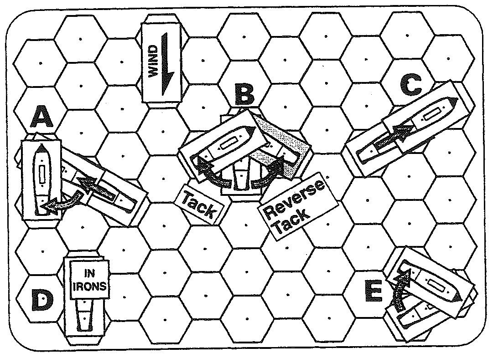

*DIAGRAM 10: Turning at MA=0 (Tacking)*

**5.D.4 In Irons.** Any ship that enters WF=L and does not turn out of WF=L in the next Movement Phase is in irons. There are three exceptions to this rule:

a. Anchored ships are never in irons.

b. <mark>A ship</mark> which cuts its anchor cable is not in irons on the <mark>g-t</mark> immediately following the g-t on which it cut the anchor cable.

c. A ship is never in irons when WS=0, because there is no <mark>WF</mark> then. Also, ships in WF=L are not in irons on the first g-t after the WS increases from 0 to 1; however, they must use the MA=0 turning rules.

**EXAMPLE (see Diagram 10):** <mark>{f</mark> a ship in WF=L in g-t 12 either chooses not to tack, or fails to tack or reverse tack, it remains in <mark>WEe=L,</mark> and is then in irons (position D) in <mark>g-t</mark> 13.

**5.D.5 Colliding/Grappling in WF=L.** A ship in WF=L which is either collided with, or is grappled to another ship (even momentarily), is automatically in irons, even if the ship just turned into WF=L.

**5.D.6 Turning out of <mark>Irons.</mark>** Like any ship with <mark>MA=0,</mark> a ship in irons may not automatically turn out of WF=L; instead, it must plot a turn during the Plot Phase, then must roll d10 the Tacking table to determine whether the <mark>piotted</mark> turn succeeds (add the +1 DRM for being in irons).

**EXAMPLE:** A maneuver type B ship with CQ=C, no rigging sections missing, and WS=3, tries to turn out of irons. It plots "T° for three CSs (for maximum chance of success), so its base chance is <mark>s7</mark> +1 for being in irons, <mark>—1</mark> for CQ=C; it thus succeeds on a DR of $7.

**5.D.7 Continuing In Irons.** A ship which fails to tack or get out of irons may try again on the next g-t. The ship may not turn or move at <mark>ai!</mark> (except to drift) until it succeeds, until the wind direction changes, it is towed out of irons, or it drops anchor.

#### 5.E ACCELERATION AND DECELERATION

**5.E.1 Introduction.** Sailing warships could not achieve full speed from a standing start in the 200 seconds represented by a <mark>g-t.</mark> It took much time to set the sails properly and gradually overcome the tremendous inertia of the ship. Similarly, sailing ships could not instantly slow from full speed to a dead stop. Rather, their momentum would carry them forward a great distance. The following rules reflect this reality.

**5.E.2 Momentum.** A ship may be at one of two possible momentum states, depending on whether it (a) moves ahead in a g-t, or (b) only turns (or does not move at all).

a. Ships which moved ahead at least one hex during the Movement Phase are "under way".

b. Ships which only turned or did not plot any MPs at all are <mark>"stopped".</mark>

**5.E.3 Other Stopped Situations.** A ship is also stopped if any of the following apply:

a. The ship was grappled or fouled at any time in the previous g-t, even only momentarily.

b. The ship was involved in a collision at any time in the previous g-t.

c. The wind speed falls to 0.

**EXAMPLE 1:** A ship plots 0 on g-t 1. Itis stopped.

**EXAMPLE 2:** A ship plots P2 on g-t 1, but only moves <mark>P71</mark> and then collides with another ship. It is stopped.

**EXAMPLE 3:** A ship moves 5 hexes and collides and fouls with another ship during the Movement Phase of g-t 1. It manages to unfoul during the Maintenance Phase of <mark>g-t 1.</mark> Itis stopped.

**EXAMPLE 4:** A ship moves 2P1S1 on g-t 1, then the wind falls to <mark>WS<=0</mark> at the start of g-t 2. The ship is stopped.

<!-- pdf p.15, Rules Book p.12 -->

**5.E.4 Speed Change Table.** The Speed Change table (red sheet) shows the amount by which each ship can accelerate or decelerate in a single <mark>g-t.</mark>

**EXAMPLE 1:** Maneuver type <mark>8</mark> ships accelerate by 2 MPs and decelerate by 3. Thus a maneuver type B ship that moved <mark>1S</mark> in the previous g-t (2 MPs) could use up to 4 MPs in the current g-t (assuming her MA allowed her that many MPs).

**EXAMPLE 2:** A maneuver type A ship that used 8 MPs in the previous g-t would have to use <mark>af</mark> /east 6 MPs in the current g-t (assuming its sail state and WF permitted it to do so), because it can only decelerate by 2.

**5.E.5 Acceleration Reduction.** A <mark>ship's</mark> acceleration is reduced by 1 if the ship is missing two rigging sections, if it is towing another ship, or if the WS=1. The "Braces Cut" rigging critical hit reduces a ship's accel. to 1, no matter what the original acceleration of the ship.

**EXAMPLE:** A maneuver type B ship could <mark>normally</mark> accelerate by 2 MPs per g-t, but if she had only 2 rigging sections remaining, could only accelerate by 1. The same ship could also tow another ship, and still accelerate by 1, because acceleration can never be reduced to 0, unless 5.E.6 applies.

**5.E.6 Acceleration of 0.** The "Sheets Cut" rigging critical hit reduces a ship's accel. by 1, and can reduce accel. to 0.

**EXAMPLE 1:** A ship of maneuver type B (accel. = 2) has only 1 rigging section remaining ("accel. <mark>—1°);</mark> with sheets cut, it could not accelerate at all for one g-t ("sheets cut" are automatically fixed, so it would be able to accelerate in the following g-t).

**EXAMPLE 2:** A ship of maneuver type C (accel. = 3) with only 1 rigging section remaining (accel. —1), with braces cut (accel. = 1), and with "sheets cut", would be unable to accelerate until the next g-t.

**5.E.7 Stopped Ships.** For accel. purposes, a stopped ship is considered to have used 0 MPs the previous <mark>g-t.</mark>

**5.E.8 Accelerating from Stopped.** A stopped ship which uses its first MP to turn can move no further that <mark>g-t.</mark>

**EXAMPLES:** The following plots are legal (assuming acceleration limits are not violated):

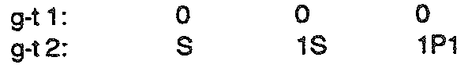

- While these are not:

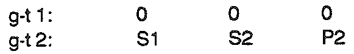

**5.E.9 Exceptions to Deceleration Limit.** Deceleration limits do not apply to a ship which must cease movement because it uses all allowable MPs in a WF (See 5.B.2) or is involved in a collision (see 6.E).

**EXAMPLE:** A L-f maneuver type A ship (deceleration = 2) in WF=B, at PS, at WS=3, has an <mark>MA=9.</mark> On g-t 1 it moves 9, and finishes altering sail to MS. On g-t 2 it turns into WF=C and goes ahead 4, using <mark>a total</mark> of <mark>5</mark> MPs (plot is P4). According to deceleration it must use at least 7 MPs, but this requirement is over-ridden by the fact that its MA in WFSC is 4. Since it moved 4 ahead in WF=C, the ship cannot move further, and the move <mark>(P4)</mark> is legal.

#### 5.F SAIL STATE

**5.F.1 Introduction.** A ship may be at one of four possible sail states for movement ~ Furled (Furl) or Dismasted, fight ing sail (FS), medium sail (MS) or plain sail (PS). The more sail a ship sets, the faster it moves; but its rigging is damaged more easily and there are other adverse effects.

**5.F.2 Plain Sail (PS).** This represents a ship with most of its sails set. Place a plain sail counter on the MS (back) side of a ship counter to indicate that the ship is at PS. A ship is able to use PS until it has lost its first rigging section.

**5.F.3 Medium Sail (MS).** MS represents a ship with more Sails set than for FS, and is represented by the back side of the ship counter (showing white sails on the yards). A ship is able to use MS until it has lost its second rigging section.

**EXAMPLE (see Sample Log):** The Majestic has a total of 28 rigging boxes (rigging = 7-7-7-7) and may use MS until it loses its 14th rigging box (it would then be 0-0-7-7).

**5.F.4 Fighting Sail (FS).** FS represents a ship prepared for battle, with only enough sail spread to provide good maneuverability. A ship at FS is represented by the front side of the ship counter (i.e., without sails). A ship may use FS until it is dismasted (has lost all rigging boxes).

**5.F.5 Furled or Dismasted.** When not needed to propel the ship, the sails were <mark>bundled</mark> up against the yards and masts; this state was called <mark>"furied".</mark> A ship at furled or dismasted cannot sail. A ship can be in this state voluntarily or involuntarily (by being dismasted).

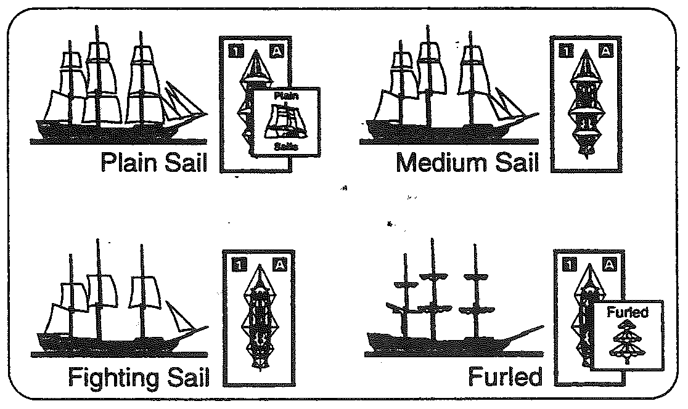

*DIAGRAM 11: Sail States*

**5.F.6 Altering Sail.** Ships may only change from one sail State to the next higher or lower state. Allowed changes are from PS to MS (and vice-versa), MS to FS (and <mark>vice</mark> versa), and FS to Furl (and vice-versa). Note the alteration by writing the sail state that the ship is going <mark>fo</mark> in the crew use area of the ship log during the Plot Phase (see Sample Log). Sail alterations require from one to three consecutive <mark>H's;</mark> the same CS or CSs must plot for <mark>a/f</mark> required <mark>g-t's</mark> for an alteration, and may do nothing else during that time. Place a "Men in Rigging" counter on the ship to show that it is altering sail.

a. A ship may alter sail from <mark>FS->MS, MS->FS, FS—>Furl,</mark> or Furl->FS, by plotting one CS for one g-t (CQ=E/F/G require two <mark>g-t's).</mark>

b. <mark>A ship</mark> may change from <mark>MS->PS</mark> or <mark>PS->MS</mark> by plotting two CSs for two g-t's (CQ=E/F/G require three <mark>g-t's).</mark>

<!-- pdf p.16, Rules Book p.13 -->

**5.F.7 Announcing Alteration of Sail.** Announce sail state alterations during the Movement Phase, at the same time the ship's movement is announced. Place "Men in Rigging" counters on all ships altering sail at this time. Failure to announce \*men in rigging" means the ship does not alter sail; cross out the sail alteration plot. .

**5.F.8 Completing Altering Sail.** Sail alteration does not take effect until the Status Update portion of the Maintenance Phase of the g-t on which the change is completed. Until that time the ship uses the previous sail state for both movement and damage. | '

**EXAMPLE (see Sample Log):** The Majestic (CQ=B) alters sail from PS to MS by <mark>plotting</mark> the marines and S4 to "MS" on g-t's 4 and 5. Until the end of <mark>g-t</mark> 5 Majestic moves and takes damage at PS; starting on g-t 6 she moves and takes damage at MS.

**5.F.9 Cancelling Sail Alteration.** Each CS which has begun altering sail must continue plotting until the sail change is completed, unless one of the following situations occur (in which case the other CSs abandon their work):

a. (One of) the CS(s) altering sail state gets a reorganize critical hit or is completely marked out.

b. The ship becomes dismasted during the sail change.

c. The ship suffers a "Lines <mark>Jammed"</mark> critical hit.

#### 5.G BLOCKED WIND

**5.G.1 Introduction.** Dowriwind of every sailing ship is a zone of reduced wind strength called a "wind shadow". Any ship in the wind shadow of another ship will have its sailing impaired by the wind shadow.

**5.G.2 Definition.** A ship's wind is blocked only if the one or two hexes directly to windward of (and adjacent to) the ship are occupied by another ship or ships, who are <mark>ail</mark> at sail state FS or higher. A ship in WF=C or WF=B must have both hexes directly to windward occupied by other ships for its wind to be blocked, while a ship in <mark>WF=R</mark> need only have the one hex directly to windward occupied (but note that a ship in WF=R never blocks its own wind). Furled or dismasted ships do not block wind.

**EXAMPLE:** In Diagram 12, the ships in gray have their wind blocked. Note: dismasted ship A does not block the wind of ship B.

**5.G.3 Movement Effect.** A ship subject to blocked wind has its MA reduced by 1. A ship's MA may never be reduced to 0 by blocked wind; therefore blocked wind is determined after all other modifications to a ship's MA.

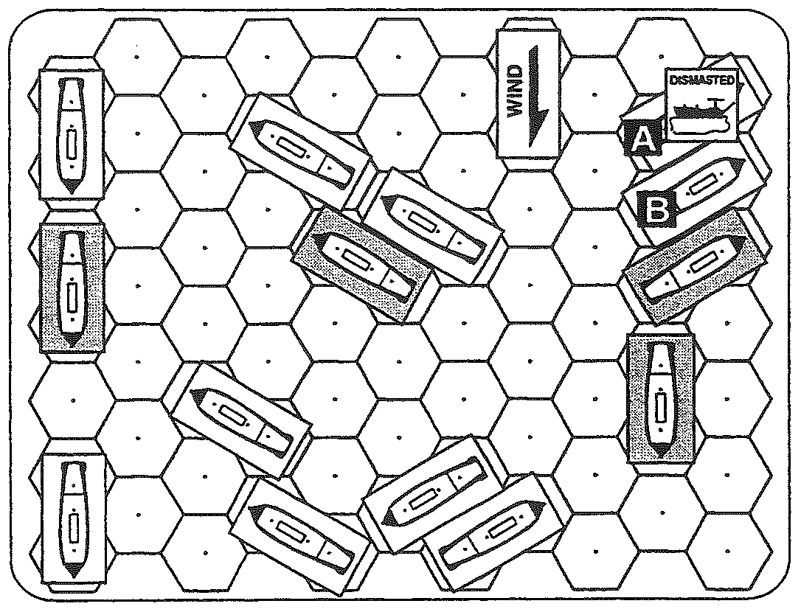

*DIAGRAM 12: Blocked Wind*

### 6. MOVEMENT EXECUTION

"A collision at sea can ruin your entire day."

<mark>es"</mark> Attributed to Thucydides [Greek Admiral and Historian, 5th century B.C.]

#### 6.A GENERAL MOVEMENT PROCEDURE

**6.A.1 Introduction.** During the Movement Phase, all ships execute the moves plotted in the Plot Phase. Ships must move exactly according to their plotted movement, except when permitted to deviate (bearing off) or when forced to deviate (collisions).

**6.A.2 Movement Segments.** There are 10 movement segments in each Movement Phase. Since the maximum possible MA=10, this means that there is one MP per segment. All ships move simultaneously, one MP at a time, starting on segment <mark>1.</mark>

**EXAMPLE:** A ship plotted to use three MPs would expend one MP each on movement segments <mark>1,</mark> 2 and 3. A ship plotted to use five MPs would expend one MP on movement segments 1 through 5. A ship plotted to use eight MPs would expend one MP on movement segments 1 through 8.

**6.A.3 How to Move Ships.** While in theory all ships move Simultaneously, in practice it is usually most efficient to complete each ship's movement before going on to the next ship, retracing steps when necessary to resolve possible collisions. However, this makes it very important that each ship's movement plot be carefully followed, and that any mandated changes in the movement plot due to interference from other ships are accurately and immediately recorded on the ship <mark>log.</mark>

**6.A.4 One Ship per Hex.** The general rule in CA is that only one ship may occupy a hex in any given movement <!-- pdf p.17, Rules Book p.14 --> segment. For this reason, special rules are required to handle cases in which two or more ships attempt to occupy the same hex in the same movement segment. Such situations are called movement conflicts. There are three possible variations, as follows:

a. When one ship's stern turns into an already occupied hex, or a hex just being occupied by another ship, it is called an overlapped hex situation. If either of the ships is continuing movement, often the overlapped situation will be resolved in the next movement segment. See 6.B.

b. When the bows of two or more ships simultaneously try to enter the same hex, it is a contested hex situation. Only one of the ships may enter the hex, and the ship which <mark>/oses</mark> the contested hex DR has a potential collision to resolve. See 6.C.

Note: there is one special contested hex situation which occurs when two or more ships use their last plotted MP to turn their sterns into the same hex (i.e., a stern vs. stern encounter in which neither ship is moving any further this g-t). See 6.C.5.

c. When one <mark>ship's</mark> bow moves ahead into a hex already occupied by another ship, it is a potential collision. The ramming ship may attempt an emergency turn if the turn would not exceed its turning limits; this emergency turn is called bearing off. <mark>\\f</mark> the bearing off attempt fails, or if the ramming ship chooses not to bear off, a collision results. See 6.D and 6.E.

**6.A.5 Simultaneity of Movement.** <mark>A/l</mark> movement for each segment must be completed before checking for collisions or contested hex situations.

**EXAMPLE (see Diagram 13):** Positions A and B are not movement conflicts. In each case, ship 1 vacates the hex at the same time as ship 2 enters; since movement conflicts are resolved at the end of each movement segment, ship 1 will not be in the same hex as ship 2. The ships in gray (positions C, D, E, and F), on the other hand, do show movement conflicts. Position C is an overlapped hex. Position D is also an overlapped hex, and may be a contested hex, if neither ship moves further in that g-t. Position E is a contested hex. Position F is a potential collision.

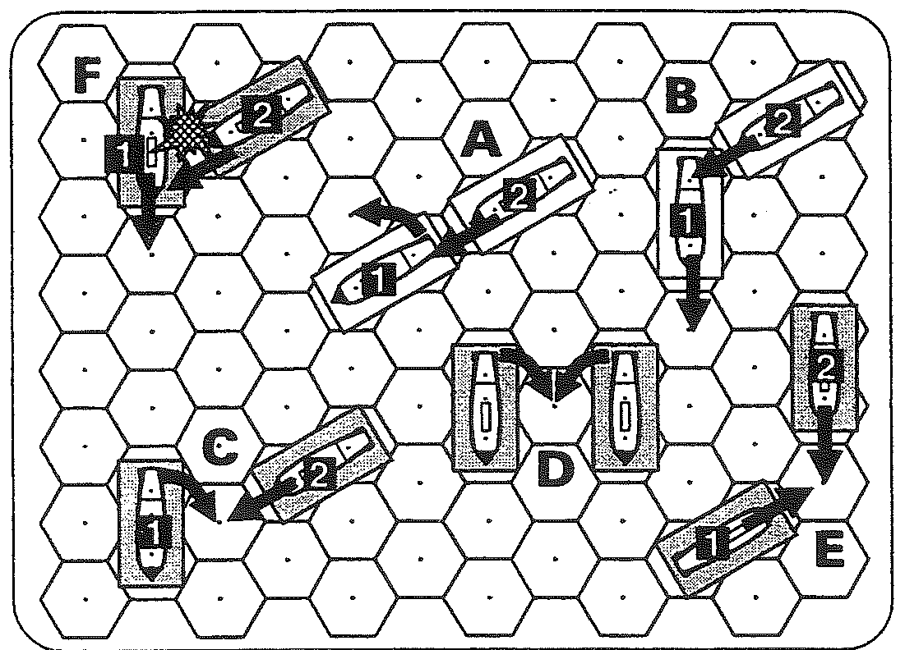

*DIAGRAM 13: Movement Conflicts*

#### 6.B OVERLAPPING SHIPS

**6.B.1 Introduction.** Special rules are necessary to allow ships to temporarily overlap each other; without such rules, close maneuvers would become very awkward on the hexgrid. Adjacent ships might become <mark>"locked"</mark> next to each other, constantly bumping their sterns into one another when they try to turn away.

**6.B.2 Turning Stern into a Hex Occupied by Another Ship.** A ship may turn its stern into a hex that is occupied or being occupied by another ship, provided that the overlap is corrected on the very next movement segment of the same g-t. This is a temporary exception to the <mark>mule</mark> which prohibits two ships from occupying the same hex.

**6.B.3 Moving Out of the Occupied Hex.** If either the turning ship or the other ship, or both, vacate the overlap hex on the next movement segment of the same g-t, then both ships continue their movement normally.

**EXAMPLE (see Diagram 14, position A):** Ship 1 executes a turn away from the adjacent ship by moving <mark>P1.</mark> Ship 2 does not move. This move is allowed, because ship 1 vacates the overlap hex on the next segment.

**6.B.4 Failure to Vacate on Next Segment.** If the overlap hex is not vacated on the next segment of the current g-t (or if the ships move simultaneously in such a way that they remain overlapped), then one or both ships must back up to the position before the overlap. One or both ships must then change its plot as indicated below:

a. Already occupied. If one ship was occupying the overlap hex before the overlap'occurs, then the turning ship <mark>(i.e,</mark> the ship not previously occupying the overlap hex) stops her movement in the position immediately preceding the overlap.. If this violates deceleration limits, the ship moves ahead the minimum necessary to meet the deceleration limit. Change all ship logs to reflect the actual moves,

b. Bows vs. Sterns. When resolving overlaps, the bow of a moving ship has precedence over the stern of a <mark>tuming</mark> ship. When the ship turning its stern does not have further MPs plotted, it cannot enter the hex, and returns to its original position. This is not a contested hex; bows always enter a hex against sterns.

c. Sterns Turning Together (see Diagram 14, position B). If both ships turn into a hex simultaneously, treat it as a contested hex (see 6.C.2 to resolve). Only one ship gets the hex, but there is no collision. Movement for both ships ends at that point. If this violates deceleration limitations, the ship(s) move ahead the minimum necessary to meet their deceleration. Change all ship logs to reflect actual moves.

EXAMPLE 1 - Already Occupied Hex (see Diagram 14, position C): Ship 1 plots <mark>$1;</mark> so does ship 2. At the end of their moves, there is still an overlap (movement of ship 2 is shown by white arrows to avoid confusion). This is not allowed, so both ships go back to the position before the overlap (the original position). Ship 1 now stops, since she can decelerate from 2 MP down to 0. Ship 2 turns S, but then is faced with a movement conflict, since ship 1 is in the way. In <mark>tact,</mark> ship 2 must collide with ship 1, since ship 2 is not eligible to

<!-- pdf p.18, Rules Book p.15 -->

"bear off" (she has just turned, and so cannot immediately turn again).

EXAMPLE 2 ~ Bow vs. Stern (see Diagram 14, position D): Ship 2 plots S, and turns its stern into the hex being occupied by the bow of ship 1, which has plotted 2 (arrows). The first movement segment results in the stern of ship 2 overlapping the bow of ship 1. Since ship 2 has not plotted any additional MPs, the overlap situation would still exist at the end of the next movement segment, so either ship 1 or ship 2's move is illegal. Since the bows of ships moving ahead take precedence over swinging sterns in overlaps, ship 2's move becomes invalid and her plot is amended to 0. Ship 2 continues moving; there is no collision.

**EXAMPLE 3 — <mark>MuRiple</mark> Overlaps (see Diagram 14, position E):** Ship 1 plots <mark>Pt,</mark> while ships 2 and 3 both <mark>ptot</mark> 1. If ship 3 were not present, ship 1 could move <mark>P1</mark> as plotted, because ship 1 may swing its stern into the hex being entered by ship 2 as long as ship 7 immediately vacates the overlap hex (which it is doing). Unfortunately, ship 3 is present, and reaches hex <mark>°x"</mark> before ship 1. If ship 2 were not present, ship <mark>1's</mark> move ahead into the side of ship 3 would be resolved as a collision. However, that would leave ship 1 overlapped with ship 2's bow! Since bows moving ahead take precedence over swinging sterns, the overlap hex "belongs" to the bow of ship 2. The result is that ship 1's entire move is rendered invalid, and her plot is amended to 0.

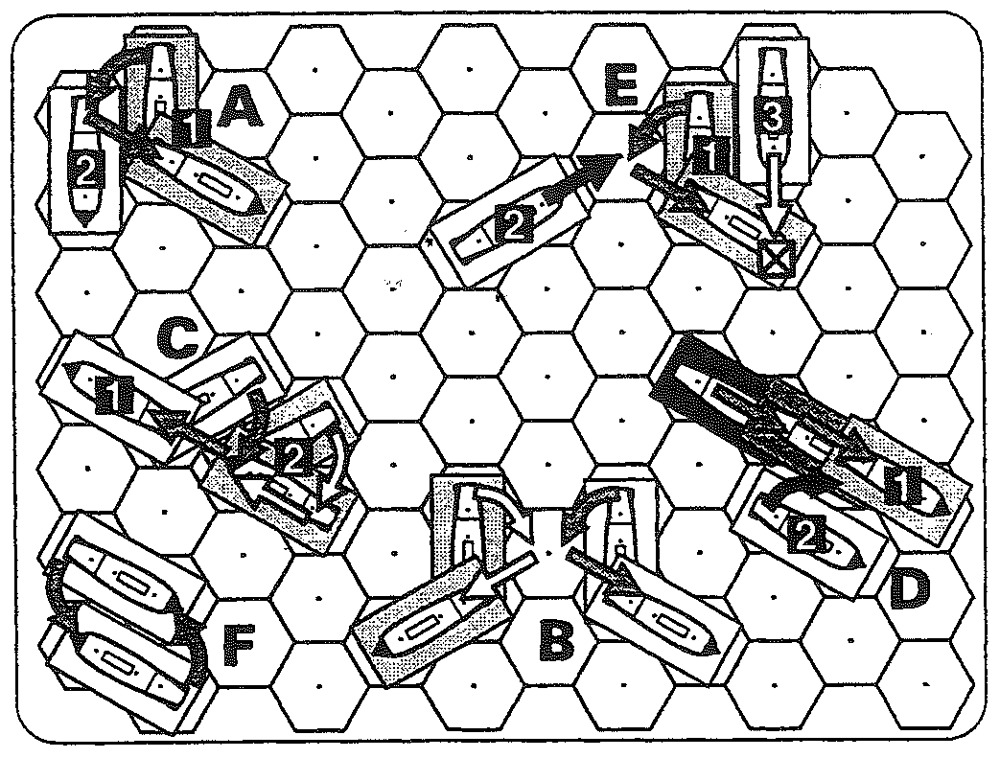

*DIAGRAM 14: Overlapped Hexes*

**6.B.5 Complete Overlap.** If two ships simultaneously turn so that they overlap each other completely (see Diagram 14, position F), only one of the ships is allowed to execute its plotted turn. Treat this as a contested hex (see 6.C). The ship which wins the contested hex DR is allowed to choose which ship gets to turn. The ship which does not get to enter the hex ceases all movement for the g-t except as necessary to comply with deceleration (see 6.B.4.a).

#### 6.C CONTESTED HEXES

**6.C.1 Introduction.** Contested hexes occur in two ways:

a. Bow vs. Bow. The bows of two or more ships are at- tempting to enter the same hex in the same segment.

b. Stern vs. Stern. The sterns of two ships are trying to turn into the same hex in the same segment, and neither of the two ships has plotted any further MPs for that <mark>¢-t.</mark>

**6.C.2 Winning Contested Hexes.** Each ship involved in the contested hex rolls a d6. The ship with the highest ad- justed DR enters the hex. If the adjusted DRs are the same, the ships roll again, until one ship or the other gets a higher DR. The following modifiers apply:

a. +1 for every CQ level better than the opposing ship.

<mark>b.</mark> +1 to the ship with the faster plotted speed.

c. +1 for every class larger than the opposing ship.

**<mark>EXAMPLE:</mark>** The Orion, a CQ=A class 2 ship with a plotted speed of 4 contests a hex with <mark>Imperial,</mark> a CQ=E class 1 ship which also has a plotted speed of 4. The Orion has a net +3 DRM to the DR (+4 for being 4 CQ levels better, <mark>—-1</mark> for being one class smaller).

**6.C.3 Winner vs.** Loser. The ship that wins the contested hex DR may choose either to enter the contested hex, or to force the loser of the DR to enter the hex.

**6.C.4 Bow vs.** Bow. If the situation is a bow-to-bow collision, the ship that does not enter the hex must bear off or collide with (ram into) the winner. See 6.D and 6.E.

**EXAMPLE (see Diagram 13, position E):** Two ships are attempting to enter the same hex at the same time. Each ship rolls one d6 to determine which ship actually enters the contested hex. Ship 1 rolls higher {including all DRMs) and chooses to enter the hex. Ship 2 may then attempt to bear off.

**6.C.5 Stern vs.** Stern. This can only happen if neither ship has plotted any further movement in the current <mark>g-t.</mark> Stern vs. stern contested hexes never result in collisions. The ship which does not get to turn into the contested hex adjusts its plot to reflect its actual move.

**6.C.6 More Than Two Ships.** <mark>If</mark> more than two ships attempt to enter the same hex in the same segment, the same procedure is followed as for two ships, with each contesting ship rolling a d6. The highest adjusted DR among the ships attempting to enter gets the hex. If all ships obtain the same adjusted DR, all roll again. If two or more ships tie for the highest adjusted DR, only they roll again; the other ships lose the hex. This process continues until one ship gets the hex. The losing ships must try to bear off or collide with the ship that entered the hex.

#### 6.D BEARING OFF

**6.D.1 Potential Collision.** A potential collision occurs when one ship attempts to move ahead into a hex occupied by another ship. This may occur either because the ship is attempting to enter a hex already occupied by the second ship at the start of the current segment, or because the first ship has lost a contested hex DR to the second ship. In either case, the first ship may attempt to bear off to avoid actually colliding with the second ship.

**6.D.2 Eligibility and Procedure.** Determine if the ship can bear off by consulting the ship's plotted move and the turning charts (red sheet). If a turn is allowed (the ship has not turned twice in this g-t, has not just turned in the previous MP, etc.) the ship may roll d10 on the Bearing Off table (red sheet). If the ship rolls < the indicated number, the ship succeeds and turns in any eligible direction.

**EXAMPLE 1:** A ship which has already turned twice in a g-t cannot bear off during the same g-t.

<!-- pdf p.19, Rules Book p.16 -->

**EXAMPLE 2:** A ship of maneuver type A which plots 1P4 but encounters a potential collision situation after moving only 1P1 could not bear off to port, as this would violate the turning (same direction) rules. <mark>It could</mark> however bear off to starboard, as, if it succeeded, its final move would be <mark>1P15.</mark>

**EXAMPLE 3:** If however the same maneuver type A ship plotted P7, it could not bear off in either direction after moving P1, because to move <mark>P1P3</mark> (the minimum move with deceleration) is too tight a turn in the same direction, while P1S3 is not allowed because at speed 6 (the minimum possible speed), a maneuver type A ship is required to move 2 hexes ahead before turning in the opposite direction.

**6.D.3 Deciding to Bear Off.**

a. Ships deciding whether to bear off, and in which direction, must be told the plotted movement for all other ships (if they desire).

b. If two or more bearing off situations occur in the same game-turn but in different segments, the ships in the Situation occurring in the earlier segment must decide whether to bear off first. Fully resolve this bearing off attempt before resolving any later attempts.

c. In the rare case that two bearing off situations occur on the same segment, roll a d10 to determine which one is resolved first.

**6.D.4 Successfully Bearing Off.** If successful, the ship immediately turns in whichever direction the controlling player desires (and which is allowed by turning radius considerations) and then stops, unless that violates deceleration limits, the ship must move ahead the minimum necessary to meet its deceleration limits.

**EXAMPLE:** The Constellation (a CQ=B class 3 ship) has a speed of <mark>9in</mark> gti. <mark>It</mark> plots <mark>6P1</mark> (a speed of 8) for g-t 2, but has a movement conflict with another ship after moving 2. Constellation decides to bear off; its chance to do so is <5 on d10 (+2 DRM for "plotted speed =7+"). <mark>It rolls</mark> a2 and succeeds. <mark>Constellation</mark> now chooses to bear off to starboard; its actual movement so far is thus 2S. Class 3 ships may decelerate by 3 MPs, so she must move ahead for 3 more MPs, bringing her total move to <mark>283</mark> (9-3=6). The player corrects his log to show the new move, and Constellation ends her movement.

**6.D.5 Limits on Bearing Off.** A ship may bear off only once per <mark>g-t.</mark>

**EXAMPLE (see <mark>6.D.4):</mark>** After having succeeded in bearing off, the frigate now potentially collides with another ship after moving <mark>1S2.</mark> It cannot bear off because it has already done so once, so it automatically collides with the other ship.

**6.D.6 Failure to Bear Off.** If a ship either chooses not to bear off or attempts to bear off and fails, it collides with the other ship (see 6.E).

#### 6.E COLLISIONS and FOULING

**6.E.1 Definition.** A potential collision situation is created when one ship attempts to enter a hex already occupied by another ship. If the ship either fails to bear off, or chooses not to try to bear off, the potential collision becomes an actual collision.

**6.E.2 Collisions <mark>Step</mark> Movement.** Both ships involved in the collision stop moving for the remainder of the Movement Phase, even if doing so violates normal deceleration limits. In addition, both ships are stopped for purposes of future movement plotting.

**6.E.3 Rigging Loss Due to Collision.** A ship which collides with another ship and which is pointing at the other ship loses d6-1 (0-5) rigging boxes if at FS, <mark>d6+1</mark> (2-7) rigging boxes if at MS, and 2d6 (2-12) rigging boxes if at PS. <mark>If</mark> the two ships run into one another, both ships must roll for "extra rigging lost". A ship which drifts into another ship (even <mark>"bow-first")</mark> does not lose extra rigging. The effects of losing rigging due to collision are in all ways the same as losing rigging to gunfire (rigging check DRs, etc.).

Note: This rigging loss recreates the sudden "whiplash" effect on the masts (especially the fragile jibboom and bowsprit) and lines of a ship which ran into another ship.

**6.E.4 Possible Fouling.** After subtracting the collision damage, roll <mark>d10</mark> on the Collision table (red sheet}. If the adjusted DR is 6+, the two ships involved in the collision are fouled. Place a <mark>"fouled\*</mark> counter between the two ships on the mapboard to indicate this and write "fouled" in the notes column of g-t record area of the ship log. The chance for fouling is based on the sail state before taking rigging damage from the collision.

**6.E.5 Dismasted Ships.** A ship already dismasted at the start of a g-t may never foul other ships. A ship which is already fouled, then becomes dismasted, remains fouled., Ships which become dismasted as the result of a collision may become fouled due to that collision.

**6.E.6 Unfouling.** Fouled ships may attempt to unfoul by rolling on the Unfouling table during the Maintenance Phase. Each unfouling attempt must be recorded on the "Notes" area of the log for that g-t as <mark>"UF\*,</mark> because subsequent unfouling attempts are progressively easier.

#### 6.F POOR MANEUVERING

**6.F.1 Introduction.** The steering mechanism of a ship consisted of the rudder and steering wheel, and the lines and tiller connecting them. Damage to either component (wheel shot away or rudder destroyed critical hits) severely reduces a ship's ability to maneuver.

**6.F.2 Which Ships Use Poor Maneuvering.** Ships must use Poor Maneuvering when specified on the Hull Critical Hits table ("rudder destroyed" or "wheel shot away"), or if called for by scenario special rules.

**6.F.3 Procedure.** A ship designated "poor maneuvering" must roll a d10 whenever it is plotted to make a turn, and consult the Poor Maneuvering table (red sheet). If the DR is < the number shown, it may turn as plotted. Otherwise, the ship moves an additional hex ahead, then makes the turn. Adjust the log to show the actual plot, and delete the last MP plotted for the Movement Phase, thus remaining at the same speed as originally plotted.

**<mark>EXAMPLE:</mark>** A maneuver type B ship with CQ=E and subject to poor maneuvering has plotted <mark>S28. It</mark> must roll <4 in order to make the <!-- pdf p.20, Rules Book p.17 --> first turn plotted. It rolls a 5, and so must move an additional hex ahead before it gets to turn to starboard as desired. The log is amended to show a movement plot of <mark>1S2S.</mark> But now the movement plot shows a total expenditure of 5 MPs, when the original plot was for 4 MPs, so the last MP is erased, leaving the actual move as <mark>1S2.</mark>

**6.F.4 Last MP Plotted a Turn.** A ship which plots a turn using its last MP in a g-t and subsequently tries but fails to turn as plotted (and moves ahead instead), must plot that turn for its first MP for the next g-t. This turn automatically succeeds, as it is "left over\* <mark>from</mark> the current g-t.

**EXAMPLE 1:** A poor maneuvering ship plots 4S, but fails to make the starboard turn. Its plot is changed to 5, and <mark>S</mark> is written in as the first MP expended in the next g-t.

**EXAMPLE 2:** A poor maneuvering ship <mark>plots PiP,</mark> but fails to make the first turn. <mark>Its</mark> plot is now amended to read 1P1. Since it never rolled for the second turn, the ship is unrestricted in its plotting for the next g-t <mark>(Le.,</mark> it does not have to plot P as its first MP used).

**6.F.5 Poor Maneuvering and Turning at MA=0.** A ship which is both poor maneuvering and which has an MA=0 must <mark>roil</mark> on both the Poor Maneuvering table and Tacking table. Only if successful at both rolls does the ship get to turn as plotted. Otherwise the ship must wait until the <mark>fol-jowing</mark> g-t, when it would have to roll on the Tacking table (with the "in <mark>irons\*</mark> DRM if in WF=L), but not the Poor Maneuvering table (because Poor Maneuvering ships automatically succeed the next MP after they first tried to turn). However, if the ship failed to turn on the Tacking table on this second g-t, its Condition is "reset", and it would have to begin trying to turn again from the beginning.

Note that failure to turn <mark>does</mark> not mean that the poor maneuvering ship must move one hex ahead, because the ship is at MA=0.

#### 6.G ILLEGAL MOVES

**6.G.1 Introduction.** It is a player's responsibility to ensure that his plotted moves are legal. If he either plots an illegal move, or fails to plot at all, the following rules determine how his ship moves.

**6.G.2 Failure to Plot.** If a player fails to plot any movement at all for the current g-t, his ship moves ahead at the same <mark>actual</mark> speed as the previous g-t. If that is impossible due to battle damage, a WD or WS change, or other limits, it moves ahead at the speed closest to last g-t's plotted speed that it can legally reach.

**6.G.3 Correction of Illegal Plots.** If a movement plot is discovered to be illegal, the move is executed up to the point of illegality. The illegal action and the remainder of the move is not executed.

Example: A class 1 ship plots P1P1. This is illegal, as class 1 ships must move two hexes between turns at speed 4; thus the ship's move is amended to <mark>Pi,</mark> unless this is too few MPs (violating deceleration); see 6.G.4 below.

**6.G.4 Exceeding Deceleration Limits.** If cessation of a plotted move at the point of illegality would violate deceleration limits (or if excess deceleration is the reason the move is illegal), additional ahead moves are added to the end of

Its' move to bring the ship up to the minimum legal movement. Note: It is very important to change the plotted move to conform to the actual move, so that the acceleration, deceleration, and turning capabilities can be tracked.

**EXAMPLE <mark>1:</mark>** A maneuver type A ship moves <mark>S431</mark> for a speed of 7 in the previous g-t. The ship only plots to move <mark>1P</mark> in the current <mark>g-t,</mark> thus exceeding its legal deceleration limit of 2. The ship's actual movement becomes 1P3.

**EXAMPLE 2:** A maneuver type A ship at MS moves <mark>S4Si1</mark> for a speed of 7. In the next <mark>g-t the</mark> ship plots <mark>$2.</mark> This move is illegal for two reasons; first because it is turning too tightly for its speed, and second because it cannot decelerate that quickly. The <mark>S</mark> is illegal and thus nullified, leaving it with a plotted move of 0. But it must use 5 MPs, so its plotted move is amended to 5. However, the ship has turned into WF=C, where its maximum legal speed is 4, so its plotted move becomes <mark>4.</mark>

### 7. GUN FIRE AND MARINE FIRE

"Engage <mark>tbe</mark> Enemy More Closely."

<mark>@8" Nelson's</mark> last order to the fleet at Trafalgar

#### 7.A GUN FIRE — INTRODUCTION

**7.A.1 Introduction:** During the age of sail, there were three principal ways to defeat an enemy ship. The first was firing the "great guns" to reduce the enemy ship to a sinking or dismasted state (the "great guns" were iron or bronze cannon of three types — "long guns", "medium <mark>guns",</mark> and <mark>"carronades").</mark> The second was small arms fire (primarily musketry from the marines) and <mark>"swivel®</mark> gun fire, to kill enemy crewmen. The third was "boarding® the enemy ship <mark>(.e.,</mark> hand-to-hand combat) with cutlasses, pistols, etc.) to capture the enemy ship outright. Chapter 7 covers gun fire and marine fire; boarding is covered in Chapter 10.

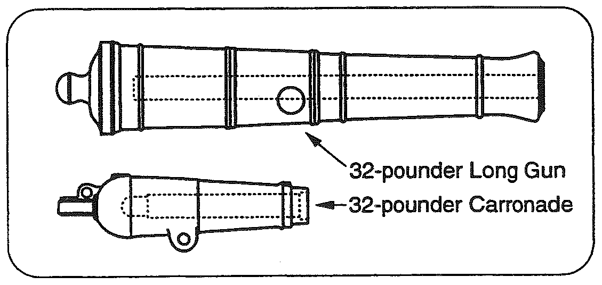

*DIAGRAM 15: Long Gun vs. Carronade*

**7.A.2 Gun Fire Procedure.** At the start of each Combat Phase each ship independently & simultaneously decides:

a. Whether it will fire (firing guns is never mandatory).

b. Which enemy ship or ships it will fire at, if there is more than one available target.

c. Whether it is firing <mark>fow</mark> (at the hull) or high (at rigging).

d. What type of ammunition to use.

**7.A.3 Plotting Gunfire.** To ensure that gunfire choices are simultaneous, either side may insist that all fire be plotted at <!-- pdf p.21, Rules Book p.18 --> the beginning of the Combat Phase. New players should always plot their fire, because they will learn the combat process faster. To plot gunfire, write the following data in the "gunfire" column in the g-t record area of the ship log:

a. First letter of the target ship (or other identifier).

b. Modified Gunnery Number (MGN).

c. Type of ammunition (roundshot or dismantling shot).

d. Aim point (high or low).

e. The Die Roll.

**7.A.4 Maximum Number of Targets.** A ship can fire guns at one or two enemy ships in the same Combat Phase. (Marines may fire at any one adjacent ship; see 7.G.)

**7.A.5 Aim Point.** At short and medium range (< 9 hexes), a ship can aim at the <mark>target's</mark> rigging (firing high) or hull (firing <mark>Jow).</mark> All gunfire at range =10 hexes must be high. At range 1-9 the aim point is <mark>/jow</mark> unless the firing ship declares "firing high".

HINT: Generally firing low is the more effective tactic, but aiming high at ships at PS can be devastating.

#### 7.B FIRING ARC and LINE OF SIGHT

**7.B.1 Bow and Stern Batteries.** Each ship counter spans two hexes (see Diagram 1). For gunnery purposes, the ship is divided into four batteries, one bow and one stern battery on each of the port and starboard broadsides. Although a full broadside (bow and stern batteries firing at the same target) is the most efficient use of the guns, each battery may fire independently, and the firing arc and lines of sight for each battery are judged separately.

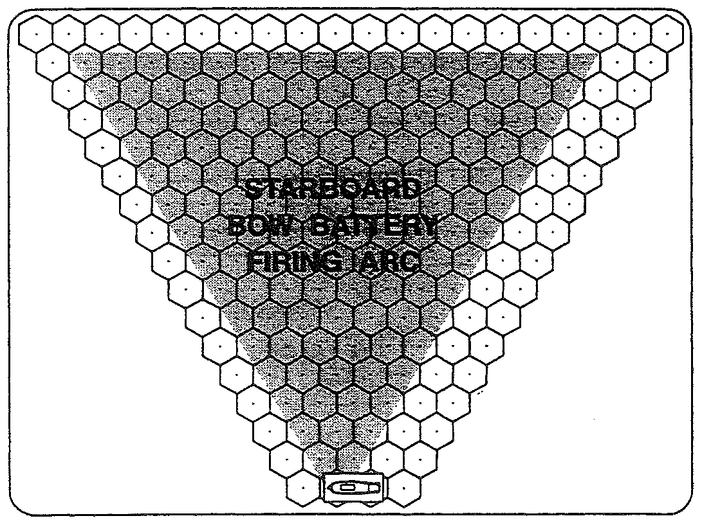

*DIAGRAM 16: Firing Arc*

**7.B.2 Firing Arc and Line of Sight.** To be <mark>able</mark> to fire at an enemy ship, a battery must meet two conditions:

a. At least part of the target ship must be within the battery's firing arc (abbreviated as arc).

b. The firing battery must be able to trace a line of sight to the hex(s) of the target ship that are within its firing arc.

**7.B.3 Firing Arc.** The firing arc of each battery is a 60° pie slice ranging out to 15 <mark>nexes.</mark> The starboard bow battery arc is shown in Diagram 16; the stern arcs are identical, except that they emanate from the stern hex, rather than the bow hex. To be a target, an enemy ship must be wholly or partially within at least one battery's arc. If there is no enemy ship within any of its firing arcs, the ship cannot fire.

**7.B.4 Line of Sight.** If at least one enemy ship is within a battery's arc, the firing ship next determines whether it has lines of sight (LOS) to the target. Each battery of the firing ship <mark>independently</mark> traces LOS to the target ship. Note: it is often the case that one battery can trace LOS to a target, while the other battery on the same broadside cannot.

**7.B.5 Tracing LOS.** LOS are determined by tracing straight lines from the center of the firing battery's hex to the centers of both the bow and stern hexes of the target ship. A firing battery must have a clear LOS to each hex of the target ship within its firing arc to be allowed to fire.

**EXAMPLE (see Diagram 17):** Ship A wants to fire at ship B. Both of the following lines of sight must be unblocked for the port bow battery to be able to fire:

<mark>1.</mark> From its bow to ship B's bow.

\2. From its bow to ship B's stern.

Similarly, both of the following LOSs must be unblocked for the port stern battery to be able to fire:

\1. <mark>From</mark> its stern to ship B's bow. \_

\2. From its stern to ship B's stern. ©

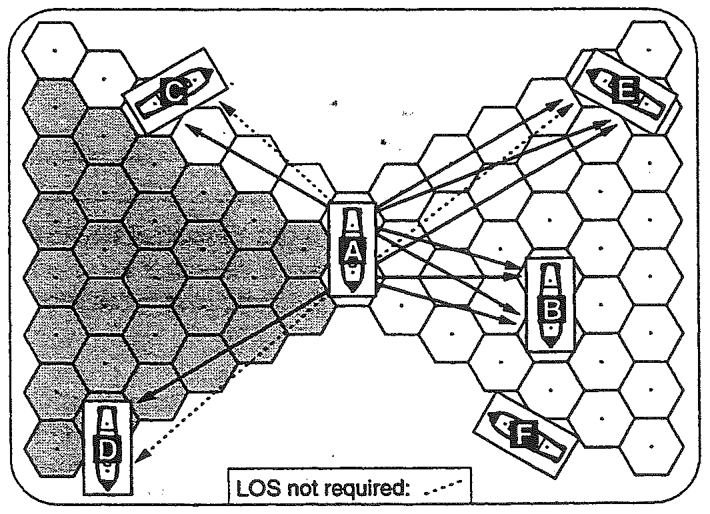

*DIAGRAM 17: Tracing LOS*

**7.B.6 Partial Targets.** As noted above, a battery only has to trace LOS to hexes within its arc; the battery may ignore any portion of the target ship which is not within its arc.

**EXAMPLE 1 (see Diagram 17):** Ship A may fire only its starboard stern battery at ship C, and only its starboard bow battery at ship D (the gray hexes indicate the starboard bow arc). Note that A may fire at C and D even though part of each target ship is outside the firing <mark>are</mark> of the respective batteries. The solid lines show the required LOS; the dotted lines show the LOS which are ignored because they pass outside the firing arc of their respective batteries.

**EXAMPLE 2 (see Diagram 17):** Ship A wants to fire at ship E. A may clearly fire its port stern battery at ship E, because the that battery may trace a clear LOS to both hexes of E. Further, the port bow battery of A may trace LOS to the stern of E. Since batteries only <!-- pdf p.22, Rules Book p.19 --> have to trace LOS to portions of ships within their arcs, A's port bow battery does not need to trace LOS to E's bow, because E's bow is outside <mark>A's</mark> port bow battery firing arc. A's port bow battery thus can fire at E, so A can fire a full broadside at E.

**EXAMPLE 3 (see Diagram 17):** Ship A cannot shoot at ship F because neither hex of F is in the arc of any of A's batteries.

**7.B.7 Blocked LOS.** LOS is blocked when it passes through a land hex, along a blocked hex spine, through a hex containing a ship other than the target ship, or too close to a friendly ship. <mark>It</mark> is thus possible that both, one, or none of a ship's batteries can fire at a target ship.

Note: One hex of a target ship never blocks the LOS to the other hex of the same ship.

**7.B.8 Hex Spines.** LOS <mark>along</mark> a hex spine is blocked only when both hexes adjacent to the hex spine are blocked.

**7.B.9 Hex Vertices.** LOS which pass exactly through the junction point between three hexes (called a hex vertex) is not blocked unless it actually enters a blocking hex, as defined in 7.B.7.

**7.B.10 Friendly Ships Blocking LOS.** There are limits on how close to friendly ships a ship can fire at some ranges:

a. Medium Range. A friendly ship in the firing battery's arc and 5-9 hexes away creates blocking hexes in all hexes adjacent to the ship which are at least as far from the firing ship as itself.

b. Long Range. A friendly ship in the firing battery's arc and 10-15 hexes away creates blocking hexes in all hexes up to two hexes away from itself which are at least as far from the firing ship as itself.

c. Any LOS which passes through a blocking hex is blocked. An LOS may enter a blocking hex, however.

**7.B.11 Friendly Ships Outside of Arc.** Only friendly ships at least partly inside a battery's arc create blocking hexes for that battery. Friendly ships entirely outside a battery's arc do not create blocking hexes for that battery.

**EXAMPLE (see Diagram 18):** (All ships are friendly to ship A.) Ships B and C do not create blocking hexes, because they are too close to A (C's stern [the nearest part of C to ship A] is at range 4, so C's bow hex, which is in blocking range [5 hexes}) is ignored). Ships D, E, and F each create one blocking hex, because they are all at medium range from the firing ship). Ships G and H cause two blocking hexes, because they are at long range from ship A. Ships marked X do not cause blocking hexes because they are outside the fire arc of all of A's batteries.

**EXPLANATION:** Once a large battle began, hundreds of cannon firing the primitive black powder propellent of the time quickly gener-ated dense smoke clouds that could sharply curtail visibility. There was a natural reluctance to fire near possible friendly ships in such cases, and even in good visibility, there was an understandable reluctance to fire at enemy ships that were close to friendly ships.

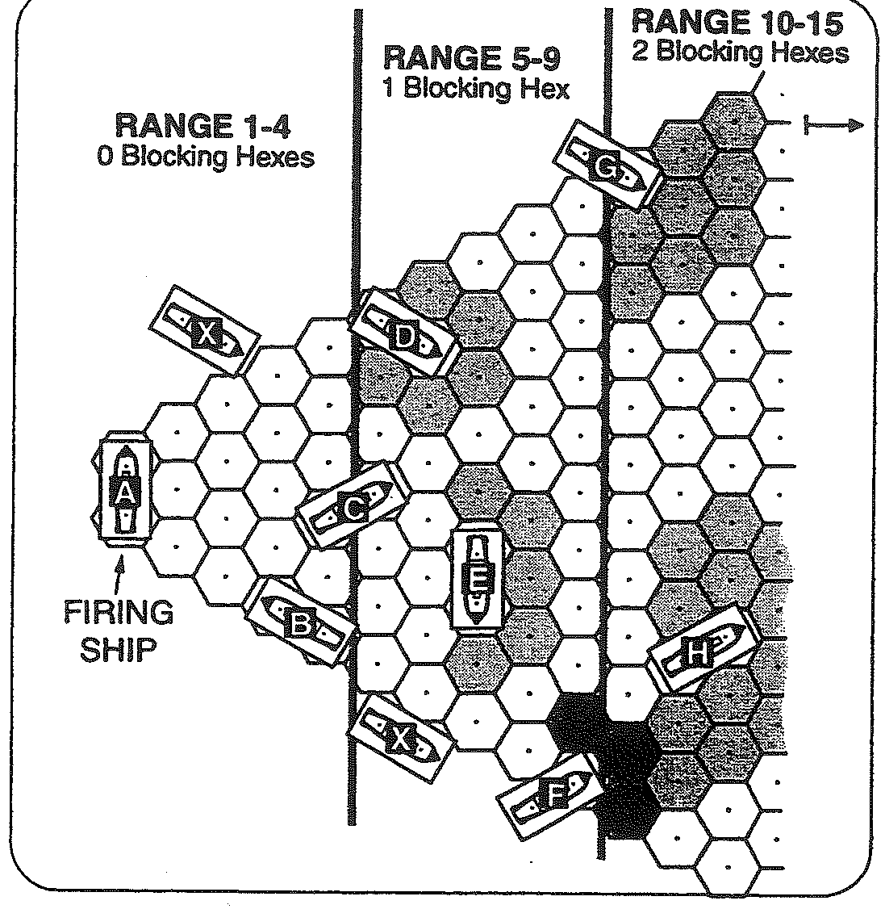

*<mark>DIAGRAM</mark> 18: Blocking Hexes*

**7.B.12 Ranges of Blocking Hexes.** As with normal gun fire (see 7.C.4), the range for application of blocking hexes is calculated from the firing ship to the nearest hex of the blocking ship.

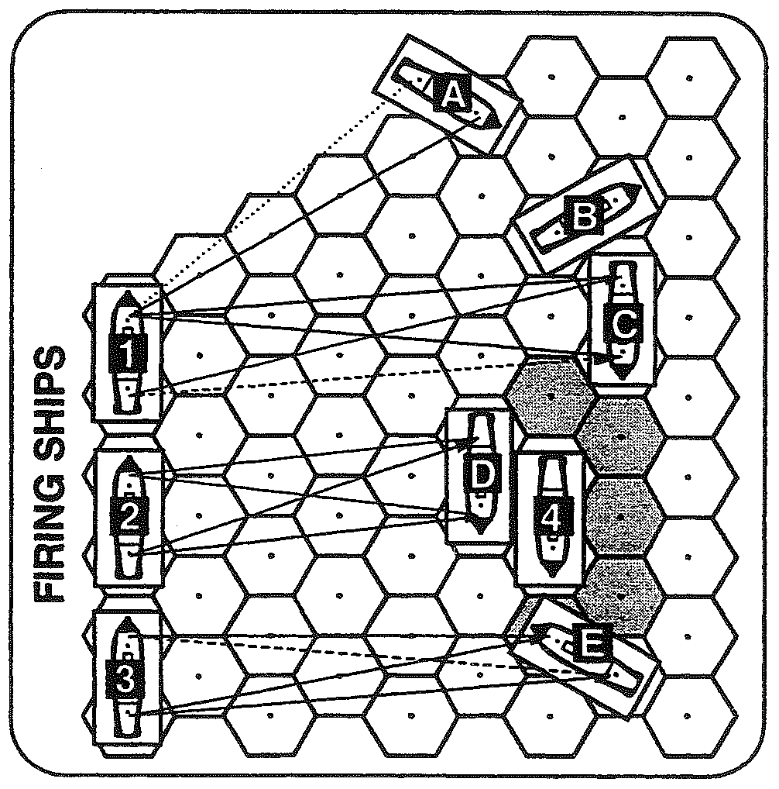

*DIAGRAM 19: Examples of Line of Sight*

**7.B.13 Combining LOS and Blocking.** Diagram 19 com-bines the fire arc, LOS, and <mark>blocking</mark> rules to illustrate gun fire determination in action.

**EXAMPLE (See Diagram 19):** Ships 1, 2, 3, and 4 are friendly to one another. Ship 1 can fire both batteries at B, but can only fire its starboard bow battery at ships A and C. 1's stern does not have A in its firing arc, and can not fire its stern battery at C because the LOS from 1's stern to C's bow is blocked by the blocking hex from friendly ship 4 (dashed line).

<!-- pdf p.23, Rules Book p.20 -->

Ship 2 can fire both batteries at ship <mark>B,</mark> because 4's blocking hexes do not extend nearer to 2 than ship 4 does itself. Ship 3 can fire both batteries at <mark>BD</mark> (not shown), but can only fire her starboard stern battery at ship <mark>E.</mark> 3 appears to be able to fire both batteries at E because E's bow hex does not block fire to E's stern hex (see

**7.B.7).** However, <mark>E's</mark> bow is in a blocking hex from ship 4, so > the LOS from 3's bow to E's stern is blocked (dashed line).

#### 7.C GUN FIRE PROCEDURE

**7.C.1 Introduction.** A firing ship's effect on a target ship depends on many factors, including the firing ship's BGN, damage previously suffered by the firing ship, ammunition type, and other considerations. Every factor that influences gun fire is found in the gunnery area of the <mark>ship's</mark> log.

**7.C.2 Simultaneous Fire.** All gun fire and marine fire is simultaneous, so damage suffered by a ship during the Combat Phase does not affect its fire in the same Combat Phase. Thus, after all gunfire has been announced, it can be resolved in any convenient order, except that on any particular target ship, all stern rakes are resolved first, then bow rakes, then <mark>ail</mark> other fire (including marine fire).

**7.C.3 Procedure.** Resolve each ship's gunfire as follows:

a. Range Determination. Determine the range. See 7.C.4.

b. BGN Determination. Find the Basic Gunfire Number (BGN) of the firing ship. See 7.C.5.

c. MGN Determination. Find the Modified Gunnery Number (MGN) of the firing ship. See 7.C.6.

d. Roll a d6 to obtain the Final Gunnery Number (FGN).

e. Gunfire Damage. Cross-index the FGN with the aim point and target sail state on the Gunfire Results table to determine the damage inflicted on the target. See 7.D.

**7.C.4 Range Determination.** Count the number of hexes from the firing ship to the <mark>closest</mark> hex of the target ship, counting all intervening hexes and the target hex (do not count the firing ship), using the shortest possible path (i.e., that which requires the fewest hexes).

**EXAMPLE (see Diagram 19):** The distance from 1 to A and D is five hexes. The distance from 1 to B, 4, and E is six hexes.

**7.C.5 BGN Determination.** Find the appropriate range box on the BGN track in the gunnery area of the ship <mark>log.</mark> The number in that box is the BGN.

**EXAMPLE (See Sample Log):** At a range of 3, a British 74 has a BGN of 25.

**7.C.6 MGN Determination.** Add and subtract all gunnery modifiers for the firing broadside or battery from the BGN; the <mark>result</mark> is the MGN. The gunnery modifiers are recorded in the <mark>"port®</mark> and <mark>'starboard"</mark> columns in the gunnery area of the log. Note: keep the "Total Modifier to BGN" box up to date with the correct total modifier for each broadside, so that you can calculate the MGN quickly. Each of the modifiers is addressed in its own rules section:

a. CQ Gunnery Modifier <mark>(.e.,</mark> Crew Quality): see 7.C.7.

b. Number of Sailor Sections Firing Guns: see 7.C.8.

c. Guns Dismounted: see 7.C.9.

d. Initial Broadside bonus: see 7.C.10.

e. Broadside Obscured (temp.): see 7.C.11.

f. Other modifiers: see 7.C.12.

g. Rakes: see 7.E.

**7.C.7 CQ Gunnery Modifier.** The CQ modifies the BGN by +6 to —6, as shown on the <mark>°"CQ</mark> Gunnery Modifier' column at top right of the ship log. Also see the right-hand side of the Gunfire Results table (blue sheet).

**7.C.8 —3 per Sailor CS Missing.** The <mark>normal</mark> situation is that all four sailor CSs man the guns. For each sailor CS not available to fire the guns, a <mark>-3</mark> modifier is applied to the BGN; if all four sailor CSs are unavailable, the ship cannot fire. Sailor CSs plotted to perform any task cannot fire the guns. Note: the marine CS cannot fire the guns.

**7.C.9 Guns Dismounted.** Guns are dismounted when a ship loses a hull section and when called for by hull checks or hull critical hits (see Hull Critical Hits table). Depending on the position of the firing ship, guns dismounted may affect the port side, starboard side, or both. All guns dismounted results are cumulative.

**EXAMPLE:** A ship has "guns dismounted" modifiers of ~3 on the port side and —4 on the starboard side. It receives additional guns dismounted damage of —1 on the port side and -2 on the starboard side. The new guns dismounted modifiers would be —4 on the port side and —6 on the starboard side.

**7.C.10 Initial Broadside <mark>(IB)</mark> Bonus.** When a ship fires <mark>its</mark> port or starboard side for the first time in a game (whether whole broadside or just one battery), and the target ship is <mark>ss</mark> 5 hexes away, the BGN is increased by an amount which varies with the range, from +4 at range 1 to +1 at range 5. If the range is = 6 when the broadside is first fired, there is no IB bonus; it is simply lost. Each ship may receive this modifier once for each broadside. As soon as an IB is fired, cross out the "IB" circle in the gunnery area of the log for that broadside.

**7.C.11 Broadside Obscured (temporary).** A "broadside <mark>obscured" resuit</mark> on the Rigging Critical Hit table causes a —2 modifier on one of the target ship's broadsides, indicated as <mark>\*-2P"</mark> or \*-2S". This penalty lasts until it is fixed by rolling on the Unfouling table during the Unfouling & Fixing sub-phase of the Maintenance Phase. Each broadside obscured result must be marked on the target ship with a broadside obscured counter and must also be noted in the notes part of the g-t record area of the ship log.

**7.C.12 Other Modifiers.** A variety of other gunfire modifiers may modify the BGN, as explained below:

a. Firing Ship at Plain Sail. A ship at PS at WS=2 or greater has a —1 modifier, because it would be heeled over further than normal (see Diagram 21).

b. Dismantling Shot. A ship firing <mark>Dismantling</mark> shot gets a +1 modifier, but causes only R and C hits, and does not cause any hull critical hits; some rigging critical hits are also exempt (See yellow sheet). Dismantling Shot has a range of 7 hexes. A ship may fire either type of ammo at different targets; roundshot is assumed unless the firing ship plots DS in the gunfire column.

<!-- pdf p.24, Rules Book p.21 -->

c. Anchored. A ship anchored either normally or with springs gets <mark>a +1</mark> to the BGN.

d. Wind Speed 4. WS=4 causes a—1 modifier to the BGN.

**EXPLANATION:** High winds heeled a ship over to leeward, making it more difficult to fire accurately. See Diagram 21.

e. Dismasted. <mark>If</mark> the firing ship was dismasted at the <mark>start</mark> of the <mark>g-t,</mark> the BGN is reduced by the sea state number.

**EXAMPLE:** In sea state 1, subtract 1 from the BGN. In sea state 4, subtract 4 from the BGN.

**EXPLANATION:** This represents the quick and hard roll that resulted from the loss of the stabilizing mass of a ship's masts.

f. \*Full Broadside' vs. "Half Broadside". A full broadside is when both bow and stern batteries on the same side of a ship fire at the same target. If only one battery fires at a target ship, it is called a half broadside. A half broadside incurs a—8 modifier to the BGN.

**EXAMPLE:** A British 74¢ with CQ=B (see Sample Log) fires its bow battery at a enemy ship at a range of 7. The BGN for range 7 is 17; 17 — 8 (for half bdsd.) +4 (for CQ=B) = 13; the MGN = 13.

g. Firing at Two Targets. If the ship fires at two targets, regardless of whether full broadsides or half-broadsides are used, there is a—10 modifier to each shot.

**EXAMPLE:** A ship fires her starboard bow battery at one target and her entire port broadside at another target. .Both shots are <mark>calculated</mark> normally, modifying the BGN by each <mark>side's</mark> gunnery modifiers; then <mark>a—10</mark> modifier is applied to each BGN. The starboard bow battery does not suffer a —18 modifier to the BGN!

**EXPLANATION:** The factor-limiting firepower in almost all cases was the number of crew available to serve the guns, not the number of guns themselves. Thus even if a full broadside could bear on a target, the -10 modifier means that only half of the guns on that side would be manned or firing effectively.

**7.C.13 Cumulative Effect of Modifiers.** All modifiers are cumulative. Positive and negative modifiers can be combined; this may result in a net effect of 0.

**EXAMPLE 1:** A CQ=B ship (+4) with one sailor CS not firing (-3) would modify its BGN by +1.

**EXAMPLE 2:** A CQ=A ship (+6) firing an initial broadside at range 2 (+4) while raking the enemy (+4) and anchored (+1) would modify its BGN by +15.

**EXAMPLE 3:** A CQ=F ship (—4) with three sailor CSs not firing <mark>(-9),</mark> -6 guns dismounted on its port side, and a range 4 rake (+2}, has a modifier of —17 to its port broadside BGN.

**7.C.14 Voluntarily Reducing MGN.** A firing ship may reduce its MGN by any amount before rolling the d6. This adjustment must be made before any gunfire is <mark>resolved.</mark> HINT: One reason to do this would be to inflict minimum damage to a ship expected to be captured anyway.

**7.C.15 Gunfire Die Roll and FGN.** After determining the MGN, roll a d6 and add the <mark>result</mark> to the MGN; the result is the Final Gunfire Number (FGN). Look down the Gunfire Results table (blue sheet) until you see the row with the same number as the FGN. Cross-index this row with the aim point and sail state of the target ship. The result is the amount of damage done to the target ship.

#### 7.D DAMAGE FROM GUN FIRE

**7.D.1 Types of Damage.** A ship can incur rigging, hull, and crew damage, which reduce the ability of the ship to move and fight as complete sections are lost.

**7.D.2 Applying Damage.** Each letter represents a different type of damage: r = Rigging, h = Hull, c = Crew (Sailor or Marine), and . = no damage. A number in front of a letter indicates how many boxes of the that damage type which must be marked out. A letter alone means that only one box of that type is marked out.

**EXAMPLE:** If the result is 3r-4h-2c, the target ship marks out 3 rigging boxes, 4 hull boxes, and 2 crew boxes (the type of crew boxes lost ~ sailor or marine - must be determined). Rigging, hull, and sailor boxes must marked out from the lowest-numbered section which is not already completely marked out.

**7.D.3 "Slashed" Results.** Two values separated by a slash, like this — r/¢ — means that one of the two results will occur, but not both. Roll another d6: 1-3= use result on left of slash; <mark>4-G=</mark> use result on right of <mark>slash.</mark>

a. <mark>If</mark> two or more slashed results occur on the same line, roll for each separately.

b. The slashed results apply only to the values separated by the slash; thus <mark>h-c/.</mark> = lose one hull box and either

(a) one crew box or (b) no additional damage.

**7.D.4 How to Mark Out Boxes.** <mark>Ail</mark> hits are taken from the lowest numbered section of the appropriate damage type which is not already completely marked out. Write the current g-t number in any box belonging to the correct section.

**EXPLANATION:** Writing the g-t in each damage box is useful to forestall arguments concerning on which g-t damage was taken. In addition, writing the g-t numbers in the damage boxes provides a nice historical record of the battle. See Sample Log.

**7.D.5 Rigging Damage — Sail States.** Ships suffer rigging damage according to their sail state:

a. Dismasted. A dismasted ship obviously cannot take any rigging hits, because it has no rigging remaining. However, any rigging hits taken while dismasted cancel any ongoing rigging repair. See 8.F.6.

b. Furled. This is the least vulnerable state. A ship at furled sail consults the <mark>"FS"</mark> column for the correct aim point (high or low) and divides the indicated rigging damage in half. For <mark>"half</mark> boxes, roll d6; 1-3= the box is lost; 4-6= no effect.

**EXAMPLE:** A FGN result of 36 (firing low on the FS column) indicates that the target ship loses 3R. Since the target ship is furled, however, the actual loss is <mark>114A.</mark> The ship loses one rigging box and rolls d6 to see if it loses a second box. The DR is 3, so the ship loses a total of 2 rigging boxes.

c. FS. The rigging damage done to a ship at FS is shown in the "FS" column for the correct aim point.

d. MS. If the target is at MS, combine the damage in the "MS® and "FS" columns (for the correct aim point) to get the total <mark>rigging</mark> damage done.

e. PS: If the target is at PS, combine the damage in the "PS", "MS", and "FS" columns (for the correct aim point) to get the total rigging damage <mark>Gone.</mark>

<!-- pdf p.25, Rules Book p.22 -->

**7.D.6 Sail State for Damage.** There is sometimes a difference between the sail state for damage and the sail state for movement. A ship that loses PS (or MS) capability while at PS (or MS) continues to suffer damage at the sail state it has plotted, regardless of the ship's maximum permitted sail state (indicated by the "Max. Sail State" letters above each rigging section on the ship log).

To show the sail state for damage when different from the sail state for movement, place a <mark>\*(PS)\*</mark> or \*(MS)\* counter on the ship. Remember that the "(PS)" and <mark>\*(MS)"</mark> counters do not indicate the ship's movement capability, but only indicate the sail state for determining damage. The sail state for all other purposes (movement, drifting, blocked wind, etc.) Is determined by the sail state markings on the ship log and Movement table. The higher sail state for damage lasts until it is changed by the normal sail state alteration procedures, i.e. plotting crew sections to alter sail. (Exception: when a ship is dismasted, it is dismasted for all purposes; any (PS) or (MS) markers are removed.)

**7.D.7 Rigging Damage — Rigging Checks.** When <mark>a rigging</mark> section is completely marked out, the ship must immediately <mark>roll</mark> a Rigging Check. <mark>Roil</mark> d6 on the Rigging Critical Hits table (yellow sheet), using the left-hand <mark>("RC")</mark> column. Apply the results and cross out the "R® in the diamond-shaped box to indicate that the check was made.

**7.D.8 Hull Damage.** When each hull section is completely marked out, the ship:

a. Must immediately take a Hull Check. Roll d6 on the Hull Critical Hits table (yellow sheet), using the left-hand <mark>("HC")</mark> column. Apply the indicated results and cross out the "H" in the diamond-shaped box to indicate that the hull check was made.

b. Must immediately add —1, —2, or —3 (depending on which hull section has been lost) to the "guns dismounted" modifiers for both port and starboard broadsides in the gunnery area of the ship log.

c. Must take one or two MCs (each @ attached to the hull section means that one MC must be taken). Note the number of MCs to be taken in the <mark>"MCs\*</mark> column of the g-t record area of the ship fog.

**7.D.9 Crew Damage.** Each crew box lost must be either a sailor or a marine box. Roll one d6 on the proper line of the Crew Loss table (blue sheet) for each crew box lost. Use the "Gunfire at Hull row if firing low with roundshot; use the 'All Other Causes" row for every other cause of crew loss <mark>(e.g.,</mark> firing high, firing low with <mark>dismantling</mark> shot, marine fire, and boarding combat). (Exception: See 10.D.7.) If only one type of crew remains, then all crew hits are automatically that type. All sailor crew losses (from any cause) come from the <mark>jowest-numbered</mark> sailor CS.

**7.D.10 <mark>Loss</mark> of Gunnery Effectiveness.** As a ship loses rigging, hull, and crew during a battle, it inevitably loses gunnery effectiveness. This is reflected in the gunnery modifier columns in the gunnery area of the ship <mark>jog.</mark> See

**7.D.6 to <mark>7.D.12.</mark>**

**7.D.11 Critical Hits.** In addition to damage taken according to the above rules, a ship may also suffer critical hits. If the gunnery DR is a 6, then roll another d6 immediately. If the second DR (= the <mark>target's</mark> "CH mod" value) is < the critical hit number on the FGN row, a critical hit occurs.

a. If the second DR resulted in a critical hit, roll 2d6 and consult either the Hull or Rigging Critical Hits tables, depending on the firing ship's aim point.

b. All critical hits take effect immediately during the Combat Phase. Of course, like all other gunfire damage, the critical hit does not affect the target's return gunfire.

**7.D.12 Losses of Extra Boxes due to Critical Hits.** Some critical hits call for the loss of extra damage boxes, over and above those lost due to gunfire damage. The number and type of boxes specified must be immediately marked out, just as if they were hit by gun or marine fire. If the boxes marked out result in any sections being entirely marked out, the appropriate number of rigging, hull, and morale checks must be taken, exactly as if the sections were lost to gunfire.

**EXAMPLE:** A class 2 ship receives a Hull critical hit result of 11, and must therefore send 3 sailor boxes to "man the <mark>pumps"</mark> (it marks out 3 sailor boxes). The ship only has 2 sailor boxes remaining in S2, however, and marks out both of them and one box in $3. S2 has a @ next to it, so the ship must take one MC, and must also add <mark>~3</mark> to the "-3 per Sailor CS missing" gunnery modifier boxes (both port and starboard sides).

#### 7.E RAKES

**7.E.1 Introduction.** A rake is when the firing ship is able to fire more or less along the length of the target ship. This does much more damage than normal, because each can-nonball penetrates the ship at its weakest points and smashes its way down the length of the ship, hitting more men and guns than a shot into the side of the ship would.

**7.E.2 Rake Definition.** A rake in CA occurs when the target ship is < 5 hexes from the firing ship and either of the following is true about the firing ship:

a. It may fire at the target and is outside of all of the target's fire arcs.

b. It occupies the hex adjacent to and immediately ahead or astern of the target and may fire at the target (the target may be <mark>abie</mark> to return fire in this orientation).

**EXPLANATION:** Clause (b) above is required because of the <mark>limitations</mark> of the hexgrid, as otherwise it would be impossible to ever obtain a range 1 full broadside rake.

**EXAMPLE (see Diagram 20):** (Note: assume that only the ship being talked about at the current moment is present; imagine that all other ships in Diagram 20 are temporarily missing.) Ship A has a stern rake on all ships labelled S, and a bow rake on all ships labelled B and X. Ships labeled C are not being raked because their orientation does not place them in rakes. Ships labelled R are not being raked because they are out of rake range (5 hexes, shown by the gray hexes). G is not being raked because it is outside A's firing arc. Ship X is being raked, but can also return fire from her port bow battery.

<!-- pdf p.26, Rules Book p.23 -->

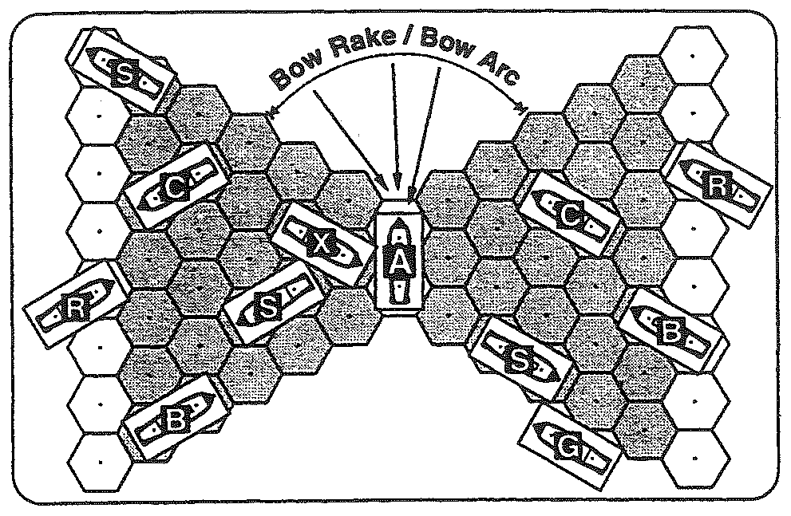

*DIAGRAM 20: Rakes*

**7.E.3 Rake Determination by Orientation.** A shot is a rake if the conditions above are met, regardless of how many batteries the firing ship can fire at the target. The orientation of the two ships is the key point.

**7.E.4 Rake Bonus.** Rakes cause a favorable modifier to the BGN at < 5 hexes; the bonus is the same as for an IB. Both rake and |B bonuses may apply on the same <mark>¢-t.</mark>

**7.E.5 Special Stern Rake Effects.** If a rake is being fired at the target's stern, the fire,is called a stern rake. Stern rakes were especially deadly, because the sterns of most warships consisted of light planking and glass.

a. When the gunfire is a stern rake, all Crew hits indicated on the GRT are doubled. Crew casualties from critical hits or rigging/hull checks are not doubled.

b. If <mark>a "guns</mark> dismounted" result occurs from the stern rake, whether from a hull check or a critical hit, then both sides of the ship receive the "guns dismounted" modifier (normally only one side of the ship would be affected).

**7.E.6 Bow Rakes and "Rudder Destroyed/Jammed.** The critical hit "rudder destroyed/rudder jammed" (Hull Critical Hit #2) cannot be caused by gunfire from a ship entirely in the bow arc of the target ship. If this result occurs in such a circumstance, the critical hit converts to one extra hull hit. See Diagram 20 and Hull Critical Hit table (yellow sheet).

#### 7.F LOWER DECK GUNS

**7.F.1 Lower Deck Gunfire Modifier.** As shown in Diagram 21 below, a ship under sail heels over to leeward: as the wind speed increases, so does the <mark>angle</mark> of heel. If the heel is sharp enough, the seas rough enough, and the ship's freeboard low enough, opening the lowest row of gunports (especially on the leeward side) would let the sea flood in, with the risk that the ship would capsize (turn over and sink). Of course, the lowest gunports were normally closed before wind and sea conditions got that dangerous.

**7.F.2 Freeboard Calculation.** Compare each ship's freeboard to the sea state. If the sea state is:

a. Less than (<) the ship's freeboard number: no effect.

b. Equal to (=) the <mark>ship's</mark> freeboard number: subtract the LDGM from the leeward broadside BGN (ships in WF=L or WF=R are not affected).

c. Greater than (>) the freeboard number: subtract the LDGM from <mark>ail</mark> gunfire, <mark>regardiess</mark> of WF.

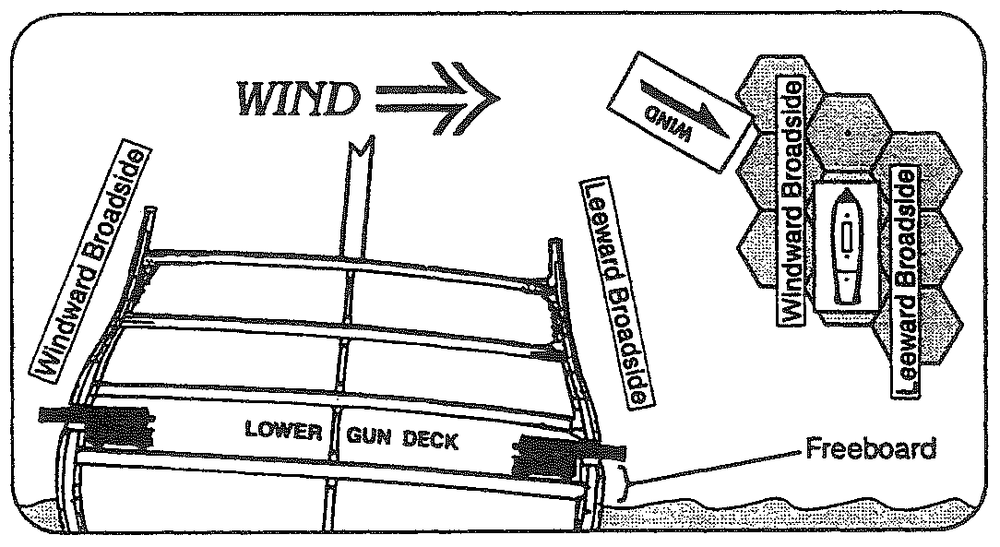

*<mark>DIAGRAM</mark> 21: Heel of Ship & Leeward Broadsides*

#### 7.G MARINE FIRE

**7.G.1 Who May Fire.** Only marine sections may use marine fire. They may fire only at adjacent ships (the orientation of the firing ship to the target ship is immaterial). (See Diagram 22.) [Optional Rule: for slightly more realism, allow marines to fire to range 2, with a DRM of +1.] Marine sections plotted to perform any non-boarding tasks in a g-t cannot use marine fire in the same g-t. Marine sections plotted to FB, BR, or BD may use marine fire, but marines BA or engaged in a continuing boarding action may not.

**7.G.2 Number of Targets.** The marine section can only fire at one enemy ship per g-t.

**7.G.3 Procedure.** Count the number of marine boxes available at the beginning of the g-t and roll one d6 on the Marine Fire table (blue sheet), applying the appropriate DRMs. The <mark>resuit</mark> is the number of crew boxes marked out by the target ship. Roll d6 on "All other Causes" line of the Crew Loss table for each box lost (unless the ship has only one type of crew remaining, in which case the losses obviously come from that type, or unless the target ship has boarders forming or formed, in which case see 10.D.7).

**7.G.4 Die Roll Modifiers.** The marine fire DRMs are cumulative. <mark>\\f</mark> the firing ship class is larger than the target ship class (firing class # < the target ship class #), the firing ship gets a —1 DRM, regardless of how much larger the firing ship is. Note: there is no modifier when firing from a smaller class to a larger.

**EXAMPLE:** A class 1 ship firing at a class 2, 3 or 4 ship would have <mark>a~i</mark> DRM in all cases. A class 3 ship firing at a class 4 ship would also <mark>geta-1</mark> DRM. <mark>A class</mark> 4 ship firing at a class 1, 2, 3, or 4 ship has a DRM of 0.

<!-- pdf p.27, Rules Book p.24 -->

**7.G.5 Gunfire and Marine Fire Simultaneous.** Marine fire is simultaneous with gun fire. Therefore, marine crew losses inflicted by gun fire do not reduce the number of marine boxes which can use marine fire in the same turn.

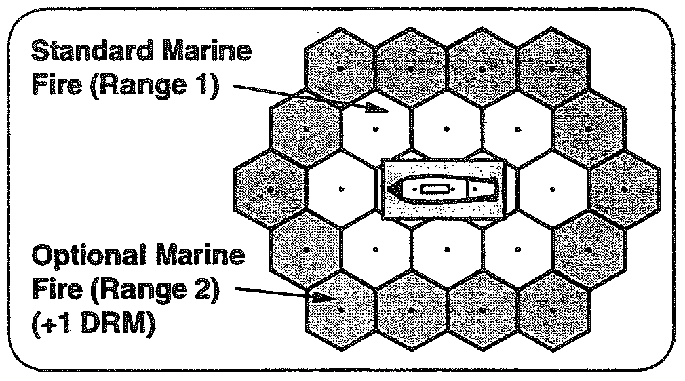

*DIAGRAM 22: Marine Fire (Standard and Optional)*

### 8. MAINTENANCE PHASE

Introduction: During the Maintenance Phase, ships perform a variety of actions. The rules below are listed in the order in which they are done (see Sequence of Play).

#### 8.A DRIFTING & VEERING

**8.A.1 When to Drift.** A ship which is stopped in a g-t (and which is not aground) may drift; its chance to drift depends on its sail state and the wind speed. Roll <mark>d10</mark> on the Drift table (red sheet); If the result = the number shown, the ship drifts. Note that smaller ships are more likely to drift.

**EXAMPLE:** A class 2 ship at MS in WS=3 does not move ahead. On a DR = 4, it drifts. If the ship was a class 4 ship, it would drift on <mark>aDRe2.</mark>

**8.A.2 Order of Rolling for Drift.** Always check for drift starting with the <mark>downwino-most</mark> Ships first; then proceed in order to the most windward ships.

**8.A.3 Drift Execution.** A ship which drifts moves one hex directly to leeward. <mark>Its</mark> WF does not change. [Exception:

**8.A.5,** Partial Drift] | /

**EXAMPLE (see Diagram 23):** Positions A and B show drift.

**8.A.4 Blocked Path.** If a drifting ship would drift into a hex or hexes occupied by another ship, it cannot drift and therefore remains in its current location <mark>(Exception:</mark> 8.A.5, partial drift]. It may foul with the ship which is blocking its path unless either ship is dismasted, in which case fouling is impossible. Roll on the Collision table to see if the ships are fouled. Note: drifting ships never suffer <mark>"extra</mark> rigging lost", even if the drifting ship drifts into the occupying ship bow-first.

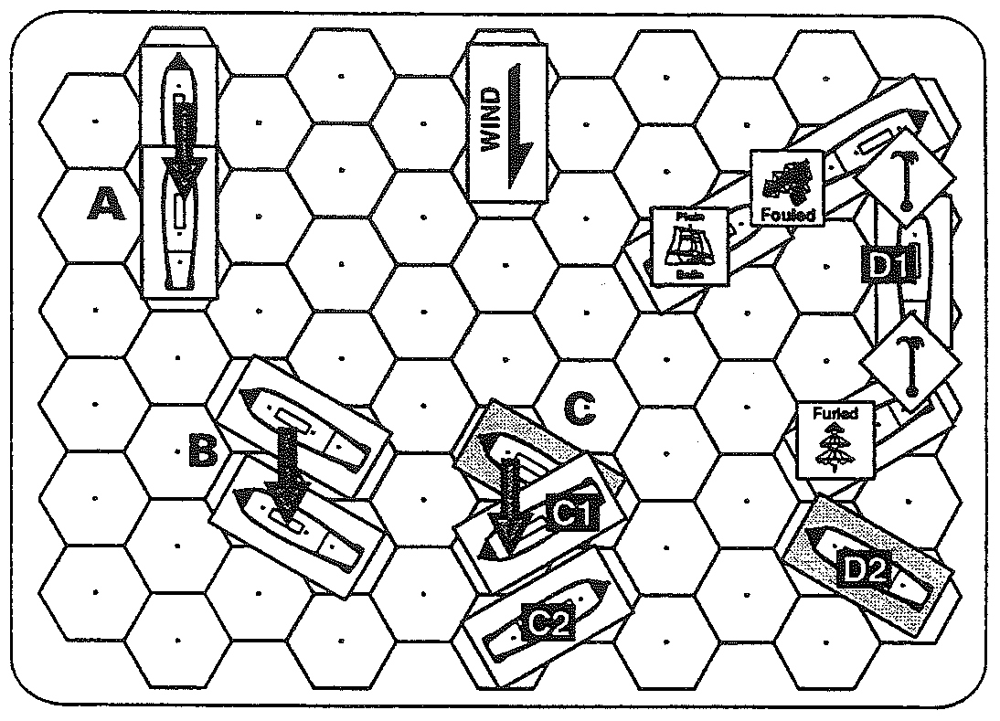

*<mark>DIAGRAM</mark> 23: Drifting*

**8.A.5 Partial Drift.** If a drifting ship is partially blocked (i.e., its bow or stern hex can drift, but not the whole ship), then the part of the ship that may drift does so. The ship's WF will change: this is an exception to <mark>8.A.3.</mark> Roll on the Collision table to see if the ships are fouled, but do not check for "extra rigging lost". Note: fouled <mark>and-grappied</mark> ships do not partially drift.

"EXAMPLE 1 (see Diagram 23, position C): Ship 1 drifts, but is partially blocked by ship 2; thus ship 1 partially drifts to the position shown, turning on its stern to do so.

**8.A.6 Groups of Ships.** A group of ships grappled or fouled together (including towing/towed ships) always drifts as a group. Ships in that group may not alter their WF, and so cannot "partial drift". Thus if any hex into which one of the ships in the group must drift is blocked, the entire group remains in place; check for fouling. Only one drift DR is made for the group; the ship least likely to drift calcu-lates her chance of drifting and rolls d10 using that number on the Drift table, and that DR is used to determine the entire <mark>group's</mark> drift.

**EXAMPLE <mark>1</mark> (see Diagram 23, position <mark>D1):</mark>** Four ships are grappled or fouled together, as shown. One ship is at PS, another at MS, a third at FS, and one is Furled. The ships check for drifting using the Furled row on the Drifting table.

**EXAMPLE 2 (see Diagram 23, position D):** The group of ships marked <mark>D1</mark> drifts, but its path is blocked by ship D2. Since grappled and fouled ships cannot partially drift, the entire group does not drift.

**EXAMPLE 2:** A ship moves 2P1 and then collides and fouls with a second ship. The second ship did not move during that g-t, so neither ship has any chance to drift, because drifting proceeds at the rate of the slowest-drifting ship, which in this case is a ship which moved and thus cannot drift.

**8.A.7 Veering.** Veering is a special type of "controlled drift" by anchored ships. See Chapter 13 for details.

<!-- pdf p.28, Rules Book p.25 -->

#### 8.B ANCHORING

**8.B.1 Introduction.** As anchoring is rare, occurring in only a few scenarios, all anchoring rules are given in Chapter 13. However, placing and removing anchors occurs during the Anchoring sub-phase of the Maintenance Phase.

#### 8.C GRAPPLING AND UNGRAPPLING

**8.C.1 Basic Rules.** At the start of the Grappling sub-phase, ships may attempt to grapple each adjacent ship once, provided that both the grappling ship and the target ship each used < <mark>fvo</mark> MPs in the Movement Phase (the orientation and movement paths of the two ships with respect to one another do not matter). Note: whether ships are fouled with one another does not affect their grappling chance. Friendly ships may grapple each other, but must roll to do so, just like grappling between enemy ships.

**EXAMPLE 1:** A ship which expended 3 MPs cannot attempt to grapple another ship, <mark>regardiess</mark> of the other ship's speed (or even if the enemy ship did not move at all).

**EXAMPLE 2:** A ship moves S1P2 (using 5 MPs) and collides with another ship; the two ships foul. Neither ship can try to grapple the other because one of them used more than 2 MPs.

**8.C.2 Grappling Procedure.** A ship attempts to grapple by rolling d10 on the Grappling table (red sheet). If the attempt is successful, place a "grapple" counter between the ships. Note: Only-one grapple counter can connect each pair of ships.

**8.C.3 Restrictions on Grappling.** Burning ships, or ships at CQ=F or G, or struck, cannot grapple.

**8.C.4 Ungrappling.** After all grappling attempts are done, grappled ships may try to ungrapple by rolling d10 on the Unfouling table; remember to apply the modifiers in the <mark>"DRMs</mark> (Ungrappling Only)\* column as <mark>well</mark> as the "DRMs (All Uses)\* column. Ungrappling does not require a CS. Ships (even friendly ships) may not automatically ungrapple and must roll on the table, even if the ship attempting to ungrapple is the ship that originally initiated the grapple!

**8.C.5 Ungrappling During Boarding Actions.** A ship fighting a boarding action with an enemy ship may not try to ungrapple from that ship until the boarding action is resolved. The ship may attempt to ungrapple from all enemy ships with whom it is not in a boarding action. There is <mark>a +1</mark> DRM if the marine section is "unavailable" (i.e., is fighting in a boarding action).

**8.C.6 Ungrappling from Struck Ships.** A struck ship is considered to be CQ=G. A ship trying to ungrapple from a struck ship will almost certainly have a higher CQ than the struck ship, and will thus receive one or more —1 DRMs for the ungrappling DR.

**8.C.7 Movement & Turning While Grappled.** Grappled ships cannot move or turn. They do drift, but cannot partially <mark>drift.</mark>

#### 8.D UNFOULING

**8.D.1 Procedure.** After all grappling and ungrappling attempts have been resolved, fouled ships may try to unfoul from each ship with which they are fouled. Each ship rolls d10 for each ship from which it wishes to unfoul and consults the Unfouling table, applying the appropriate DRMs. No CSs are required to attempt to unfoul.

**8.D.2 Mutual Unfouling Attempts.** If two ships are fouled to each other, either or both ships may attempt to unfoul from each other. These attempts never automatically succeed, even if the two ships are friendly.

**8.D.3 Recording Unfouling Attempts.** A ship must record the number of times it attempts to unfoul from each separate ship because the chance of success increases with each succeeding attempt. The ship records unfouling attempts by writing UF in the notes column of the log, once per fouled ship per g-t.

**EXAMPLE:** The British 74 Superb (CQ=B3) is fouled to two enemy ships. Superb tries to unfoul from both enemy ships, and needs to roll <2 (she receives a <mark>—-2</mark> CQ DRM for CQ=B3).

**8.D.4 Unfouling During Boarding Actions.** A ship fighting a boarding action with an enemy ship may not try to unfoul from that ship until the boarding action is resolved. It may however attempt to unfoul from all enemy ships with whom the friendly ship is not in a boarding action.

**8.D.5 <mark>°Fixing"</mark> During Unfouling Sub-Phase.** In addition to ungrappling and unfouling, the Unfouling table is also used for "fixing" a variety of critical hits. These include obscured broadsides, braces cut, lines jammed, signal halyards cut, and rudder jammed. Roll <mark>d10</mark> on the Unfouling table; a result of "action <mark>succeeds"</mark> fixes the problem.

#### 8.E FIRES AND EXPLOSIONS

**8.E.1 Causes of Fire.** A ship may catch fire from the following causes:

a. Critical Hits. Hull critical hits #10 and #12 may set ships on fire.

b. Spreading Fires. There is a 50% chance per g-t that a fire will spread to any ship grappled to or fouled with a burning ship.

c. Exploding Ships. When a ship explodes, it casts burning debris for a <mark>6-hex</mark> radius; all ships within that radius may be set on fire.

**8.E.2 Fighting Fires.** A ship on fire must fight the fire. Fighting fires is noted by plotting one CS to FF in the Plot Phase. Every fire must be fought by one and only one CS. A CS must be plotted to fight the fire even if it requires aborting another plotted task (such as repairing) before that task is completed. Exception: CSs currently engaged in boarding or RO do not stop to fight the fire. However, all CSs which have plotted FB or BR but are not yet engaged are automatically disbanded, and one CS would have to plot FF in the next Plot Phase. See 10.B.5.

<!-- pdf p.29, Rules Book p.26 -->

HINT: Ships not yet on fire may voluntarily plot FF. The advantage to doing this is if a fire breaks out, they get a head start on putting it out, and may put it out before losing any damage.

**8.E.3 Rolling for Extinguishing the Fire.** During the Maintenance Phase of each g-t, a ship which has plotted FF rolls one <mark>d10</mark> on the Unfouling table for each fire it is fighting. If the DR < the indicated number, the fire is out. Note: struck ships still fight fires.

**8.E.4 Fires Spreading.** Fires may spread from a ship on fire to all ships grappled and fouled to the ship on fire. During the "Fire <mark>Spreading"</mark> portion of the Fire and Explosions sub-phase, roll a <mark>d10</mark> for each ship grappled or fouled to a ship on fire. If the DR is <4 (+ SK of the ship being spread to), the fire spreads to the grappled/fouled ship. Note that fires can spread to ships already on fire.

**8.E.5 Multiple Fires.** A ship can have more than one fire burning aboard her at the same time; there is no theoretical maximum number of fires. In addition to the normal causes of fires (hull critical hits #10 and #12, spreading from a burning ship, flaming debris), additional fires grow from existing fires if the original fires are not extinguished.

<mark>If</mark> a fire has been burning for five g-t's <mark>(including</mark> the g-t on which it started), the existing fire generates an additional fire. An additional CS must be assigned to fight the new fire, and the ship must take another MC as well. (The new CS <mark>should</mark> plot FF2, to keep track of which fire is being fought by which CS.) The ship loses 1R and 1H per g-t for each fire. Each existing fire generates another fire every five <mark>g-t's.</mark>

**EXPLANATION:** This models the tendency of fires to quickly spread and eventually go out of control if not extinguished.

**EXAMPLE:** A ship on fire catchs on fire on g-t 7, plots S3 to fight the fire, but does not extinguish it before the end of g-t 11. At that moment a second fire begins burning. During the Plot Phase of g-t <mark>12,</mark> a second CS must plot FF2 to fight the second fire. During the Firefighting portion of the Fire and Explosions sub-phase, the ship rolls d10 on the Unfouling table twice, once to put out each fire. The ship loses 1R and 1H per fire per g-t until one or both fires are extinguished.

**8.E.6 Not Enough CSs.** A ship which does not have enough CSs to fight all existing fires must take one MC every g-t for each unfought fire until the ship either strikes or all fires can be simultaneously fought.

**8.E.7 Effects of Fire — Fear.** A ship must take one morale check each time a fire breaks out on that ship.

**EXPLANATION:** Next to foundering or shipwreck, the greatest fear of any sailor aboard a wooden sailing ship was fire, due to the mass of combustible materials (like pitch, tarred rigging — and especially gunpowder!) on board.

**8.E.8 Effects of Fire — Fire Damage and Explosions.** Each g-t a ship is burning, including the g-t it catches fire, it "loses 1H and 1R for each fire. Mark out this damage during the Fire & Explosions sub-phase of the Maintenance Phase (see Sequence of Play). If the ship loses its last hull box and a fire is still burning, the ship strikes and begins rolling to explode. Roll 2d6; a result of <2 causes the ship to ex- plode. Otherwise the ship continues to burn; roll again for <mark>exploding</mark> during the Fire & Explosions sub-phase of the Maintenance Phase of the subsequent g-t; there is a —1 DRM each additional <mark>g-t</mark> it is on fire.

**EXAMPLE:** A ship begins rolling to explode on g-t 12. On that <mark>g-tit</mark> needs a 2 to explode. On g-t 13, it would need a 2 or 3; on <mark>g++</mark> 14, a 2 through 4, etc.

**8.E.9 Effects of Exploding Ships.** Exploding ships affect other ships in two ways: blast damage and flaming debris.

**8.E.10 Blast Damage.** Blast damage represents the shock wave from the explosion. Blast damage affects all ships at a range of one or two hexes. Calculate blast damage using the table below: cross-index the exploding ship's class with the range to the target ship, and roll on the "firing <mark>high\*</mark> side of the GRT, using the number shown in the table below as the MGN. There are no modifiers to this DR; i.e., nO rake bonuses, etc. Ships three or more hexes from the exploding ship suffer no blast damage.

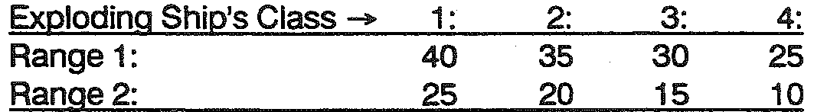

**8.E.11 Flaming Debris.** All ships within six hexes of the <mark>exploding</mark> ship must roll a d6 to see if they catch fire. Each ship catches fire if the DR = its range from the exploding ship, except that a DR of <mark>"1°</mark> never causes a fire. <mark>Ships:</mark> grappled or fouled to the exploding ship <mark>a/ways</mark> catch fire.

**EXAMPLE:** A ship <mark>5</mark> hexes away is on fire if it rolls <mark>aS</mark> or 6. A ship adjacent to the exploding ship is afire on a DR of 2-6 (unless it is grappled or fouled to the <mark>expleding</mark> ship; it would then automatically catch fire).

#### 8.F REPAIRS

**8.F.1 Types of Repairs.** Two types of damaged boxes may be repaired, rigging boxes and hull boxes. In addition, one type of rigging critical hit ("shrouds severed") must also be repaired by a CS.

**8.F.2 Plotting Repairs.** Repairs are plotted during the Plot Phase, and are noted as RR (rigging), RH (hull), or RS (shrouds). Each type of repair requires one CS for several g-t's.

**8.F.3 Repair Limitations.** A ship cannot begin repairing a type of damage until the g-t after the ship has marked out at least one box of that type, or has received a \*shrouds severed Critical hit.

a. Rigging Repairs. Ships at FS, Furled, or Dismasted, may plot to repair rigging boxes.

b. Hull Repairs. Ships which move < 4 MPs in a <mark>g-t</mark> may plot to repair hull boxes.

**8.F.4 Crew Assignment.** Only one CS may repair a given damage type on a given <mark>g-t.</mark> Different CSs may repair different damage types at the same time. (Thus one CS could plot RR while another plots RH; but two CSs could not both plot RR.) The number of g-t's required to repair is modified <!-- pdf p.30, Rules Book p.27 --> by the repairing <mark>ship's</mark> SK. Failing to plot a repair continuously <mark>(cr</mark> being unable to plot, due to exceeding limits in 8.F.3) negates the repair; cross out accumulated repairs.

**EXAMPLE:** A ship with CQ=A requires 3 consecutive g-t's of RR by the same CS to repair one rigging box, or 7 g-t's of RH by the same CS to repair one <mark>hull</mark> box.

**8.F.5 Completing Repairs.** After the required number of g-t's of plotted repairs, the repairing ship regains one box of the indicated type; draw in a box of the appropriate type next to (attached to) the section currently taking damage (do not erase old <mark>damage!).</mark> If the current section has as many boxes as it started with, then one box in the next-lowest-numbered section is repaired. Note: if a newly restored section is lost again, the ship will not have to take another Rigging Check, Hull Check, or morale check(s), since it has already taken them once before.

**EXAMPLE:** A ship loses the last box in rigging section 1, and rolls the required Rigging Check; the result is "mast may fall", but no further damage is incurred. The ship then finishes one rigging box repair in the same g-t; there being no damaged boxes in rigging section 2, the repair is applied to rigging section 1, giving the ship four sections for movement again. The next g-t it suffers another rigging hit and marks out the "new" box of rigging section 1 again, but does not take a Rigging Check, because it has already taken one for rigging section 1.

**8.F.6 Rigging Repairs to Dismasted Ships.** Dismasted ships (ships with all rigging boxes marked out) had a much <mark>harder</mark> time repairing rigging than ships with at least some spars remaining. Therefore, a dismasted ship which suffers a rigging hit has <mark>all</mark> accumulated rigging repairs <mark>cancelled.</mark> This only applies to dismasted ships.

**EXAMPLE:** A dismasted CQ=D ship needs 6 g-t's to repair one rigging box. Unfortunately, on the fifth g-t it suffers one rigging hit. Although it has no rigging to lose, the hit has the effect of cancelling the five <mark>g-t's</mark> of rigging repairs, and the dismasted ship must begin repairing all over again.

#### 8.G RECONCILIATION

**8.G.1\_ Introduction.** At the end of a g-t, every player should take care that status counters and log notations are in accordance with one another, and are both correct. The following activities should be performed:

a. Status Counter Update. Place or remove status counters to reflect changed ship status, like rigging alteration, obscured broadsides fixed, etc.

b. Record Repairs. Each ship which has completed a repair notates this correctly.

c. Crew Adjustment. Mark all changes in crew status due to completed reorganization and prize crew formation.

d. Morale Checks <mark>(@).</mark> Roll all morale checks. Place a "struck" counter on ships which strike.

e. Deliver Signals. All signals written during the Plot Phase are now delivered. See Chapter 11, Signalling.

f. Remove Ships. Remove all escaped and exploded ships from the mapboard.

**8.G.2 Reconciliation.** After all other actions in the Maintenance Phase have been completed, make sure that all variable data on the ship log is updated to reflect changed conditions. <mark>In</mark> particular, make sure that the port and starboard gunnery modifier columns reflect changes in: CQ, CSs, guns dismounted, etc.; and that new MAs (due to missing rigging sections, braces cut, etc.) are listed in the proper boxes.

### 9. CREW QUALITY AND MORALE

Captain Pearson: "Have you Struck?"

Jobn Paul jones: "I bave not yet begun to fight!"

<mark>$8"</mark> Attributed to Jones but probably apocryphal

#### 9.A CREW QUALITY, <mark>SKILL, AND</mark> MORALE

**9.A.1 Introduction.** A <mark>ship's</mark> overall efficiency is a mixture of her crew quality (CQ) and morale rating (MR). CQ measures how efficient the crew is at operating a sailing warship, including such tasks as firing the guns, repairing, grappling and ungrappling, altering sail, etc. A ship's skill modifier (SK or SK mod.) Is derived directly from her CQ; see Boarding Combat and Skill Factors table (red sheet). There are seven possible CQ levels from A to G, with <mark>"A"</mark> representing the best crews and "G\* the worst.

A ship's morale rating (MR) is the measure of how willing the men are to fight. The CQ and MR are usually but not always correlated; that is, ships with better CQs will tend to have better MRs as well. Note that while CQ will tend to decrease during a battle, the MR never changes.

**9.A.2 SK Use.** A <mark>ship's</mark> SK modifier often determines how long various tasks will take (repairs, preparing to anchor with springs, reorganizing CSs, etc.). SK also affects a ship's chance to grapple or unfoul. SK ranges from -3 (best) to +3 (worst). When the CQ drops, that ship's SK also worsens in direct proportion.

**EXAMPLE:** A ship with <mark>CO=E</mark> (the MR number doesn't matter) has an SK of +1. If the CQ drops to F, the SK also drops, to +2.

**9.A.3 MR Use.** In contrast to the SK, the ship's MR is used for only one purpose: checking the willingness of the ship's crew to continue fighting through morale checks. The MR number of a ship never changes during a scenario.

#### 9.B MORALE CHECKS

**9.B.1 When to Take Morale Checks.** A ship must take a MC after any morale check condition is reached (noted on the ship log by @). Note that an MC is required by drawing a hash mark in the "MCs" column in the <mark>g-t</mark> record area of the ship log; make one hash mark for each MC required. Most MCs are caused by losing hull and crew sections; the loss of any section with @ next to it requires one MC for each @. After noting that an MC is needed, mark out each @. Morale checks also occur when:

a. A ship is dismasted (the last box in rigging section 4 is marked out).

b. A ship already dismasted at the start of a g-t is raked. A dismasted ship under tow does not need to take an MC <!-- pdf p.31, Rules Book p.28 --> unless the towing ship is also dismasted. Raking a dismasted anchored ship does cause an MC.

c. A ship catches fire. Burning ships which catch fire again do take another MC for each new fire.

d. Aship doesn't have enough CSs to fight all its fires.

e. <mark>An MC</mark> is specified by a Critical Hits table result.

**9.B.2 Repairs and Morale Checks.** If a completed repair adds a box to a previously completely eliminated hull or rigging section, the ship does not take a MC for losing these sections if they are eliminated again.

**9.B.3 Passing Morale Checks.** A ship passes MCs by rolling = its MR on a <mark>d10.</mark> Remember that the MR never changes during a game.

**EXAMPLE:** A ship with an MR of 4 passes all morale checks on DRs of <mark>4-9,</mark> and fails on DRs of 0-3.

**9.B.4 Failing Morale Checks.** A ship which fails a MC drops one CQ level. Cross out the current line on the <mark>"CQ/SK-CQ</mark> Gunnery <mark>Modifier"</mark> portion of the ship log and adjust the CQ modifier in the gunnery area. The ship uses its new CQ (and its new SK) for <mark>all</mark> purposes, unless and until it fails another MC.

**EXAMPLE:** A ship with a CQ/MR of <mark>B3</mark> rolls a 1 on its first MC; its new CQ is C (MR stays at 3, of course). If it fails 5 more morale checks, its CQ is progressively reduced to D, E, F, G and finally to struck. Its MR remains 3.

#### 9.C STRIKING

**9.C.1 Definition.** Prior to the 20th century, it was normal and honorable for a ship to "strike her colors (flag)" (i.e., surrender) when confronted with what her commander judged was an unwinnable situation.

**9.C.2 When Ships Strike.** A ship strikes if it:

a. Has lost all hull boxes.

b. Has lost all crew boxes.

c. Fails a morale check at a CQ of G.

**9.C.3 Actions of Struck Ships.** Struck ships cannot do anything for the rest of the game except fight fires. Note that if the ship struck due to complete elimination of all crew boxes, it cannot fight fires and will eventually explode.

**9.C.4 Crew Quality of Struck Ships.** Struck ships have a nominal CQ of G; this is used to determine the success of actions such as fighting fires and other ships ungrappling.

### 10. BOARDING

"At this time the [HMS] Captain, baving lost ber foretopmast, not a sail <mark>shroud</mark> or rope left, ber wheel shot away, and incapable of further service in the line or in chase, I ordered Captain Miller to put the belm <mark>a-starboard,</mark> and calling for boarders, ordered them to board."

<mark>@""</mark> Horatio Nelson, relating his capture of two Spanish SOLs by boarding at the battle of Cape St. Vincent

#### 10.A INTRODUCTION

**10.A.1 Historical Introduction.** Boarding combat represents the type of hand-to-hand fighting with cutlass, boarding pike, and pistol! often depicted in pirate movies. Errol Flynn notwithstanding, boarding attempts were rare, and (especially against SOLs) usually unsuccessful.

**10.A.2 Boarding Eligibility.** Boarding may only occur between enemy ships which were fouled or grappled at the beginning of the current g-t. Ships with a CQ=F or G may not board. Ships on fire may neither board nor be boarded. Friendly ships may not board each other.

**10.A.3 Boarding Struck Ships.** Struck ships may be boarded; in such cases the boarders automatically win and do not have to reorganize (see 10.G). One reason to do. this is to stop the struck ship from later unsurrendering.

#### 10.B FORMING BOARDERS

**10.B.1 Introduction.** It took time to organize the men detailed as. boarders; they had to come up from below, obtain boarding weapons, and go to their stations. CA simulates this by requiring crew sections to form boarders before they can board or defend against boarders.

**10.B.2 Forming Boarders.** A ship forms boarders by plotting FB for one or more CSs during the Plot Phase. The sailor CSs must FB in order, lowest-numbered CS first. The marine CS is a special case, and may FB <mark>regardless</mark> of which sailor CSs are forming; also see <mark>10.C.3.</mark> Each cs must plot FB for one g-t; those CSs are then able to defend against enemy boarders during the boarding phase of the same g-t, and may board enemy ships on any later <mark>g-t.</mark>

**10.B.3 Boarders Ready.** CSs which have plotted FB are <mark>"readied,</mark> and remain ready to board until they either board an enemy ship or are disbanded. Each CS which formed boarders on a previous g-t must plot BR (for "Boarders Ready") in subsequent <mark>g-t's</mark> unless they either board (BA; see 10.C.1), or disband (BD; see 10.B.5).

**10.B.4 Restrictions on Readied Boarders.** CSs plotted to FB or BR may do nothing except board or defend against enemy boarders. <mark>(Exception:</mark> Marines may use marine fire and are "available" for grappling/ungrappling attempts. ]

<!-- pdf p.32, Rules Book p.29 -->

**10.B.5 Disbanding.** A readied CS may disband by plotting BD (for "Boarders Disband"). It takes one g-t to disband; during this g-t the disbanding CS may not perform any other tasks. [Exception: Marines may use marine fire, and are <mark>available"</mark> for grappling/ungrappling; see 10.C.3.] In the next g-t the CSs may be plotted normally. NOTE: A <mark>"readied\*</mark> CS disbanded by a combat result is considered disbanded immediately, and may plot normally the next g-t.

**10.B.6 Reporting Boarders.** Any ship forming boarders must announce the number of CSs forming to all players and place a boarders counter on the ship. The counter remains until the ship has no FB, BR, or BA CSs aboard.

#### 10.C BOARDING PROCEDURE

**10.C.1 "Boarders Away".** A ship (a) with readied boarders and (b) grappled or fouled to an enemy ship at the start of a g-t may plot BA (for "Boarders Away") for one or two readied CSs per g-t. No more than two readied CSs may plot BA (for the first time) in a single g-t, even if more sections are readied. Sailor CSs plotted to BA must attack in numerical order beginning with the lowest-numbered section that still contains crew boxe: es. CSs which have <mark>plotted</mark> BA must board. [Exception: <mark>CS'4</mark> may FB and BR but may not BA; it represents the essential minimum crew for a ship.]

**EXAMPLE:** A ship <mark>has:plotted</mark> | FB for every CS that can attack — <mark>Si, S2,</mark> $3, and the marines. It desires to board with all its CSs as quickly as possible, so the next g-t it plots BA for the marines and <mark>Si,</mark> then, on the next g-t, BA for S2 and <mark>$3.</mark>

**10.C.2 Repelling Boarders.** To defend against boarders, a ship must plot CSs to <mark>FB.</mark> The CSs so readied can defend in the g-t in which they formed, but could not attack until the next g-t (when they could plot BA).

**10.C.3 Marines Automatically Defend.** If the marine CS is plotted for any non-boarding task (i.e., anything but FB, BR, or BA) and the ship is boarded, the existing plot is automatically erased and FB is retroactively plotted instead.

**10.C.4 When Boarding Occurs.** Boarding occurs after all gunnery and marine fire; thus all losses from gunnery and marine fire are deducted before boarding combat is resolved.

**10.C.5 Determining the Attacker.** There is an attacker and a defender in every boarding action:

a. If only one ship plots BA, that ship is the attacker.

b. If both ships plot BA on the same g-t, the ship with the higher Total Boarding Combat Factor (TBCF) is the attacker; if both ships' TCBFs are identical, the side with better CQ becomes the attacker. If still identical, roll randomly to determine attacker.

#### 10.D BOARDING COMBAT

**10.D.1 Calculating Odds.** Each side <mark>calculates</mark> its Total Boarding Combat Factor (TBCF) by using the values given in the Boarding Combat and Skill Factors table (red sheet). The number of BCFs each sailor and marine box is worth depends on the ship's current CQ. Add up <mark>all</mark> boxes <mark>involved</mark> in the boarding action to determine the <mark>ship's</mark> TBCF.

**EXAMPLE (see Sample Log):** On g-t 20 the French 74 Heureux (CQ=D) boards the British 74 Majestic (now CQ=C [she failed an MC on g-t 18]). Heureux plots BA for the marines (6 boxes remaining) and Si (4 boxes remaining). Each sailor box is worth 5 BCFs and each marine box is worth 7 BCFs; thus her sailors are worth <mark>4 x 5</mark> = 20 BCFs, and her marines are worth 6 x 7 = 42 BCFs; the TBCF = 62. Majestic plots only S1 <mark>(2</mark> boxes remaining) to FB, plotting the marines (4 boxes remaining) to RR (repair rigging) instead. But the marines are automatically replotted to <mark>FB</mark> when Heureux boards (see

**10.D.3).** so Majestic defends with 2 sailor boxes x 6 BCFs each = 12 BCFs, and 4 marine boxes x 8 BCFs each = 32 BCFs; the TBCF = 44.

**10.D.2 Applying <mark>DRMs.</mark>** Each side now consults the TBCF Odds <mark>DRAMs</mark> table (red sheet), calculates the odds (F:E = Friendly:Enemy) and applies the applicable DRMs to itself. Round all odds down to the next lowest ratio (note that the 1:1 odds ratio was accidently omitted from the table, and has a DRM of 0). The attacker also applies any other applicable DRMs from the "Other DRMs\* list.

**EXAMPLE (continued from <mark>10.D.1):</mark>**

Heureux's DRMs: 62 to 44 is 1.41:1, rounded down to <mark>1:1,</mark> so Heureux gets a 0 DRM for that. However, Heureux receives a -2 DRM for boarding a class 2 ship. Her total DRM is thus —2.

Majestic's DRMs: 44 to 62 is .709:1, rounded down to 2:3, so Majestic receives a DRM of <mark>-1</mark> for that. Since she is defending, no other modifiers apply. Her total DRM is —1.

**10.D.3 Resolving Boarding.** After determining their own DRMs, each side simultaneously <mark>roils</mark> 2d6 on the Boarding Combat table. The result is divided into two parts, crew casualties and possible special results.

**EXAMPLE (continued from <mark>10.D.2):</mark>** Heureux roils a 9, which is modified to 7. Majestic also rolls a 9, which is modified to 8.

**10.D.4 Crew Casualties.** Crew losses are measured as a percentage of the friendly TBCF which the enemy CSs involved in boarding combat lose (round fractions to the nearest whole number), measured in BCFs.

a. Convert the BCF loss into crew boxes. Roll on the "All Other Causes" row of the Crew Loss <mark>table</mark> and mark out one of the specified type of crew box. <mark>(If</mark> there is only one type of crew in the boarding action, lose that type.) Subtract the number of BCFs which that crew box is worth from the number of BCFs which must be lost.

b. Repeat this procedure until the BCF loss requirement has been satisfied. Usually more BCF's are lost than required; this is normal and expected.

**EXAMPLE (continued from 10.D.3):** Heureux's modified DR of 7 means that Majestic loses 8% of Heureux's TBCF. 62 x .08 = 4.96 (rounded to nearest whole number = 5 BCF). Majestic has both sailors and marines participating, so either a sailor box or a marine box must be lost. Since a sailor box is worth 6 BCFs and a marine box is worth 8 BCFs, either loss will satisfy the requirement to lose 5 BCFs, so Majestic loses only one crew box. Roll on the Crew Loss - table (blue. sheet) on the "All Other Causes" line to determine which type of crew box is lost; in the event she loses one sailor box.

<!-- pdf p.33, Rules Book p.30 -->

Majestic's modified DR of 8 means that Heureux has to lose 10% of 58, or 5.8 (rounded up to 6) BCFs. Heureux now rolls on the Crew Loss table; a sailor box is lost, but it is worth only 5 BCFs of the required loss of 6, so she must roll again. (If she had lost a marine box [worth 7 BCFs], that would have entirely fulfilled the required loss.) If the second DR is 1-3, Heureux will lose another sailor box, for a total loss of two sailor boxes (10 BCFs); if the second DR is 46, Heureux will lose a sailor and a marine box <mark>(totalling</mark> 12 BCFs) to fulfill the required loss of 6 BCFs.

**10.D.5 Special Results.** Only one side can receive a spe cial result in a given g-t. If both sides roll special results, only the one caused by the higher modified DR occurs; the other result is ignored. If both sides get the same modified DR, then the side with the higher TBCF (before losses) gets the result. If the TCBFs are identical, neither side gets the result. The special results are:

a. Attacker Repulsed. Attacking CSs are disbanded and must plot FB again before being able to board. Any other of the attacker's CSs plotted FB or BR are also disbanded; cross out their plots. The attacking ship may also have to take one or more morale checks.

b. Defending ship is captured.

**EXAMPLE (continued from <mark>10.D.4):</mark>** Heureux gets no special result, but Majestic receives a special result of "Attacker Repulsed and takes 1 MC". All Heureux's CSs are automatically disbanded, and Heureux must take an MC at the end of the g-t.

**10.D.6 Boarders and Their Parent Ship.** CSs involved in a boarding action suffer all negative results to their parent ship, and they surrender if their ship strikes.

**EXAMPLE:** After one g-t of boarding combat, an attacking ship loses a MC, and its CQ drops from C to D. The boarding CSs from that ship must then recalculate their total BCF for the next g-t's Boarding combat.

**10.D.7 Gunfire Casualties.** If a ship has only sailor CSs FB, BR, BA, or engaged in boarding combat <mark>{(i.e.,</mark> the marine CS is not plotted for any of these tasks), use the "Gunfire at Hull line to determine losses from gunfire and marine fire. In <mark>ail</mark> other cases where boarding tasks are plotted, use the "All Other <mark>Causes"</mark> line on the Crew Loss table to determine crew box losses. For the purpose of this rule, the gunfire target (high or low) does not matter.

**10.D.8 Ungrappling/Unfouling During Boarding.** Once locked into a boarding action, the two ships involved may not attempt to ungrapple or unfoul from each other until the boarding action is resolved (see 10.E below).

#### 10.E WINNING BOARDING ACTIONS

**10.E.1 Continuation of Boarding Combat.** Once begun, boarding actions continue until one side wins. CSs engaged in boarding are <mark>"locked"</mark> into combat, and may not withdraw; only the defeat of one side releases them. Additional CSs may be added to boarding; of course, they must first FB (if defending) and then BA (if boarding).

**10.E.2 Attacker Wins.** The attacker can win in 5 ways:

a. If the defending ship is already struck.

b. If the defending ship does not or cannot assign at least one CS to form boarders (FB).

c. If the defending ship strikes due to <mark>hull</mark> loss or morale failure during the boarding action.

d. If the attacker captures the defending ship on a <mark>"Defending</mark> Ship Captured" special result on the Boarding Combat table.

e. If all defending crew boxes are eliminated.

**10.E.3 Defender Wins.** A victory by the defender means that they have driven off the attacker; the boarding action is over, with both sides back aboard their respective ships. The defender can win in 2 ways:

a. If it eliminates all attacking boarders' crew boxes.

b. If it gets an "Attacker <mark>Repuised"</mark> result.

**10.E.4 Counter-Boarding.** On the <mark>g-t</mark> after the attacker is repulsed, the former defender may plot those CSs which defended in the boarding combat to counter-board. The plot for this is still BA, like normal, and all BA rules apply with one exception: ALL CSs involved in the previous boarding combat [except <mark>S4,</mark> of course] may BA, not just 2. [This represents the victorious defenders closely following the defeated boarders back aboard their own ship.]

#### 10.F <mark>MULTI-SHIP</mark> BOARDING ACTIONS

**10.F.1 Historical Introduction.** It almost never happened that more than one ship per side took part in a single boarding action. For completeness, however, the following, rules allow multi-ship boarding actions.

**10.F.2 Main Principle.** Whenever more than one ship per side is engaged in a single -boarding action, all boarding combat must be divided into a number of separate boarding combats, each of which involves one attacking and one defending ship. Each of these combats is fought and resolved separately from <mark>aii</mark> others. Ships board-ing/boarded by more than one enemy ship must carefully designate which CS(s) are engaged with which enemy ship; each CS must be engaged with a single, specific, enemy ship. Thus a single ship could engage up to five enemy ships in boarding by allocating one CS to fight each enemy ship. (if a sixth enemy ship managed to board the <mark>friendly</mark> ship, the friendly ship would be overwhelmed and would automatically be captured.)

**10.F.3 Resolving Multi-ship Boarding.** Like single-ship boarding, multi-ship boarding actions once begun cannot be broken off until resolved. All boarding actions are resolved separately and simultaneously, and the results of one boarding action does not affect any other boarding action on the same <mark>g-t.</mark>

**EXAMPLE:** The British 74 Mars is boarding the French frigate Themis with <mark>Si</mark> and marines, and is being boarded herself by three other French frigates (she is defending against the <mark>Ahin</mark> with <mark>S2,</mark> Hortense with S3, and Hermione with S4. Mars captures the Themis, but on the same g-t, the boarders from Hermione entirely eliminate Mars' <mark>84.</mark> The result of this boarding action is that Themis is now British-controlled, while Mars has been captured by the French, and <mark>$2</mark> and <mark>$3</mark> are accordingly taken prisoner. All French CSs boarding the Mars must now reorganize according to 10.G; Mars' CSs S1 and marines aboard Themis are victorious, and must likewise reorganize.

<!-- pdf p.34, Rules Book p.31 -->

#### 10.G <mark>REORGANIZING</mark>

**10.G.1 Introduction.** After a victorious boarding action, the defeated ship would be a scene of complete chaos, with crew members from both ships intermingled on ail the decks from the hold to the poop. <mark>It</mark> took time to gather the prisoners, mount a guard over them and vital points like the magazines and liquor stores, and to detail the prize crew. The victorious boarders were unable to do much until this reorganization was completed.

**10.G.2 All Attacking CSs Must Reorganize.** All attacking CSs which win a boarding action must immediately begin reorganizing and may not stop until finished, unless they are attacked by boarders themselves. Since the attacking CSs are now aboard the captured ship, if the boarders' parent ship and the captured ship become unfouled or ungrappled during the reorganizing period, all of the attacking CSs are crossed out on the parent <mark>ship's</mark> log sheet.

**10.G.3 Defending CSs Do Not Need to Reorganize.** A defending ship which repulses enemy boarders does not reorganize; instead, the defending CSs can simply plot to disband instead.

**10.G.4 Plot.** To reorganize, each attacking CS plots "RO". The time required is 5 + SK g-t's.

**EXAMPLE:** Crew sections from a CQ=A ship require 2 g-t's to reorganize, while those from a CQ=E ship need 6 g-t's.

**10.G.5 Actions While Reorganizing.** Reorganizing boarders may do nothing except defend the prize against enemy boarders. If boarded while reorganizing, the reorganization is aborted, and the captured <mark>ship's</mark> original crew may participate in the new boarding action at CQ=G. If the boarders which captured the ship succeed in defending their prize <mark>against-the</mark> new boarders, they would have to begin reorganizing again from the beginning as soon as the new boarding action was completed.

**10.G.6 Minimum Prize Crew.** The minimum prize crew depends on the captured ship's class. Class 1= 4 crew boxes, Class 2= 3, Class 3= 2, Class 4= 1 box. The capturing ship may always allot more crew boxes than the minimum; the main reason to do so is to prevent the captured ship from being recaptured if the prize crew suffers casualties in later fighting. After allocating <mark>aif</mark> crew boxes from surviving boarders, additional crew boxes for the prize crew may be taken from non-boarding CSs from the parent ship, but then those CSs must also reorganize.

**10.G.7 Assigning Prize Crew.** During the Status Update Phase of the g-t in which reorganization is completed, the prize crew boxes are crossed off from the parent ship's marine CS and/or lowest-numbered sailor CS (just like gunfire or marine losses). The crew boxes making up the prize crew are formed into CSs of identical size to the original crew sections of the captured ship. Indicate the prize crew by drawing the proper number of CSs and boxes on the back side of the captured ship log. Note that CSs lost due to prize crew assignment do not require MCs.

**10.G.8 Prize Crew CQ/MR.** A Prize crew receives the current CQ and MR of the capturing ship. If simultaneously captured by more than one ship, the prize crew may be drawn from any or all capturing ships, but receives the lowest CQ and MR (calculated separately) of any of the crew boxes making up the prize crew.

**10.G.9 Disposition of Remaining Boarders.** At the start of the g-t after reorganization is completed, the boarding CSs (minus the crew boxes crossed off for the prize crew) are again aboard their original ship and are fully functional.

**10.G.10 Reorganization Example.**

**EXAMPLE:** The British 74 Majestic counter-boards the French 74 Heureux with Si, <mark>$2,</mark> $3, and marines, and captures her after a short boarding action (see sample <mark>log).</mark> After losses, Majestic has a remaining crew of 1-6-6-6:2. Heureux is a class 2 ship, so the minimum prize crew is 3, but Majestic decides to leave a prize crew of 9 to absorb gunfire damage from other French ships nearby and fend off possible counter-boarding attempts. Majestic chooses to cross off 8 sailor boxes and 1 marine box, leaving her with a crew of 0-0-5- 6:1. Since the loss of Si and S2 were caused by prize crew allocation, <mark>morale</mark> checks are not taken, but a gunfire DRM of <mark>-6</mark> is subtracted. The Heureux's original crew was <mark>6-6-7-7:7,</mark> so the prize crew

Is allocated as follows: 0-0-1-7:1.

#### 10.H OPERATION OF CAPTURED SHIPS

**10.H.1 Definition.** A captured ship is one which loses a defensive boarding action; from that time on it is friendly to the capturing side. The side originally controlling the ship is now the enemy, and may fire at the captured ship.

**10.H.2 Possible Actions of Captured Ships.** Captured ships were normally unable to sail or fight for hours after their capture. To reflect this, captured ships may not move or plot any other tasks except boarding and repairing for the remainder of the game. They may also unfoul and grapple/ungrapple. Captured ships may also be towed by friendly ships.

**10.H.3 Crews of Captured Ships.** A captured <mark>ship's</mark> original crew would be locked belowdecks and the hatches battened down to prevent them recapturing the ship from the prize crew. For this reason the original crew of the captured ship cannot do anything except man the pumps ("waterline damage" critical hit) and fight fires.

**10.H.4 Prize Crew Losses.** All crew losses suffered by the captured ship are taken by the prize crew. If the prize crew is reduced below the minimum number (see 10.G.6), the original crew of the captured ship regains control of the ship at the start of any g-t when it has at least twice the number of crew boxes as the prize crew. The ship is now CQ/MR=G6, but it otherwise performs actions normally.

<!-- pdf p.35, Rules Book p.32 -->

### 11. SIGNALLING

"Captains are to look to their particular lines as their rallying point. But in case signals can neither by seen nor perfectly understood, no captain can do very wrong if be places bis ship alongside that of any enemy."

<mark>98"</mark> From Nelson's orders before Trafalgar

#### 11.A BASIC SIGNALLING RULES

**11.A.1 Introduction.** The most difficult problem facing admirals during the age of sail was coordinating the actions of their fleets without instantaneous communications. Signalling with flags proved to be the only practical method of communication in this era, but such a cumbersome system placed severe limits on how much control admirals actually had over their fleets. This fact alone largely explains why the often-derided "line of battle" remained the standard combat formation for warships for 250 years.

**11.A.2 When to Use.** These signalling rules apply only to <mark>multi-player</mark> sides (i.e., games in which there are at least two players on one of the sides). As noted elsewhere, more than one player per side is highly recommended.

**11.A.3 Signals.** Players on the same side may transmit information relevant to the scenario in writing only, the Signal Form included with CA is used for this purpose. Signals must follow strict rules for both content and format. Each player may send only one signal per g-t. Talking between players on opposite sides is not restricted, but should be limited to threats and insults!

**11.A.4 Signalling Sequence.** Signals must be written during the Plot Phase. At the end of the <mark>g-t,</mark> each signal must be given to the player(s) commanding the ship(s) addressed in that signal. Players are allowed to read any signals sent by any other players on the same side.

**11.A.5 Signal Format.** Each signal consists of two parts; the address and the message (see Signal Form). Signals can only be addressed to certain groupings of ships, reflecting the signalling inflexibility which was one hallmark of the age. Signals must be addressed to one of these groups:

a. The entire friendly side's force, noted as <mark>\*Fleet'.</mark>

b. A subdivision of the friendly side's force. Acceptable subdivisions include Van, Center, or Rear (squadrons), Windward or Leeward (divisions), and color-coded groups. Players may agree to allow other divisions.

c. Aship. Each signal must be addressed to a <mark>single</mark> ship.

**11.A.6 Message Length.** The message area contains the actual information being sent. Messages may have a maximum of 3 to 7 words:

a. Flagships. Up to 1802, all flagships (identified by B® or <mark>Pm</mark> in scenarios) may write 5-word messages. From 1803 onwards, British flagships may send 7-word mes- sages: all other navies' flagships are still limited to 5- word messages.

b. Players commanding all other ships (representing individual captains) are allowed only 3-word messages.

**11.A.7 Message Style.** Each "word" space in the message must contain either a standard English word or a number; contractions and hyphenated words are not allowed. (Note that a ship's name, no matter how long — Principe de Asturias, for example — counts as a single word.) Words must be written entirely in capital letters. No emphasis is permitted, including but not limited to <mark>underlining,</mark> bold, italics, etc. Punctuation marks (e.g., periods, commas, parentheses, exclamation marks, etc.) are allowed, but each mark uses up one word space. References to either the movement plot system, the hex grid, or speeds in MPs are specifically prohibited. On the other hand, numbers may be used to indicate <mark>distances</mark> (terms such as <mark>"musket-shot\*</mark> existed, allowing distances to be specified reasonably closely).

**EXAMPLE:** The following are legal five-word signals: "SET SPACiNG BETWEEN SHIPS 2", "CLOSE TO 5 HEXES\*, "ATTACK THREE LEADING SHIPS", "DECREASE SPEED TO MINIMUM", "MAKE YOUR COURSE DIRECTION 3", and "BREAK ENEMY LINE ASTERN PRINCIPE DE ASTURIAS".

The following are illegal signals: "GOTO HEX 1712", "MOVE P 2 S$ 1", "MOVING 3P2 FOLLOW ME", and "FLEET SPEED IS NOW 6".

#### 11.B PLAYERS & MULTIPLE SHIPS

**11.B.1 Introduction.** In the ideal CA game, each player would command only one ship, but in the real <mark>world</mark> players will more likely command two or three ships. This chapter prevents players from taking advantage of multiple-ship commands to coordinate better than was historically pos- <mark>sible.</mark>

**11.B.2 One Signal Per Player.** No matter how many ships a player commands, he may send only one signal per g-t. If he controls a flagship (see 11.A.6), he may send five-or seven-word signals; if not, he may only use three words.

a. A player may only send one signal per g-t, but that signal may be sent from any of his ships. He may also read signals sent to any of his ships.

b. Struck or dismasted ships cannot send signals.

c. If any of the <mark>player's</mark> ships gets a "signal halyard cut", the player cannot send any messages until it is fixed.

**EXPLANATION:** Without this rule, <mark>°signal</mark> halyard cut" would be meaningless in most multi-player games, because players would simply send signals from their other ship(s).

**11.B.3 Talking Between Ships.** When the sterns of two ships occupy adjacent hexes at the start of a g-t, the players commanding those ships may communicate directly in the next Plot Phase., One of the two players may write one five-word message which they immediately show to the other player; the other player may then respond similarly. Direct communication between them is limited to this one exchange of messages. Roll randomly to see which player writes first.

<!-- pdf p.36, Rules Book p.33 -->

### 12. TOWING

#### 12.A TOWING

**12.A.1 Introduction.** Towing was a frequent occurance, as it was relatively efficient and saved many ships that would otherwise be lost to the enemy or to the hazards of the sea. In fact, several actions were fought partially or entirely to protect ships under tow.

**12.A.2 Towing Restrictions.** Only friendly ships (including ships captured from the enemy) may be towed. A ship may tow only one ship. A ship may be towed only by a single ship. A towed ship cannot itself tow another ship.

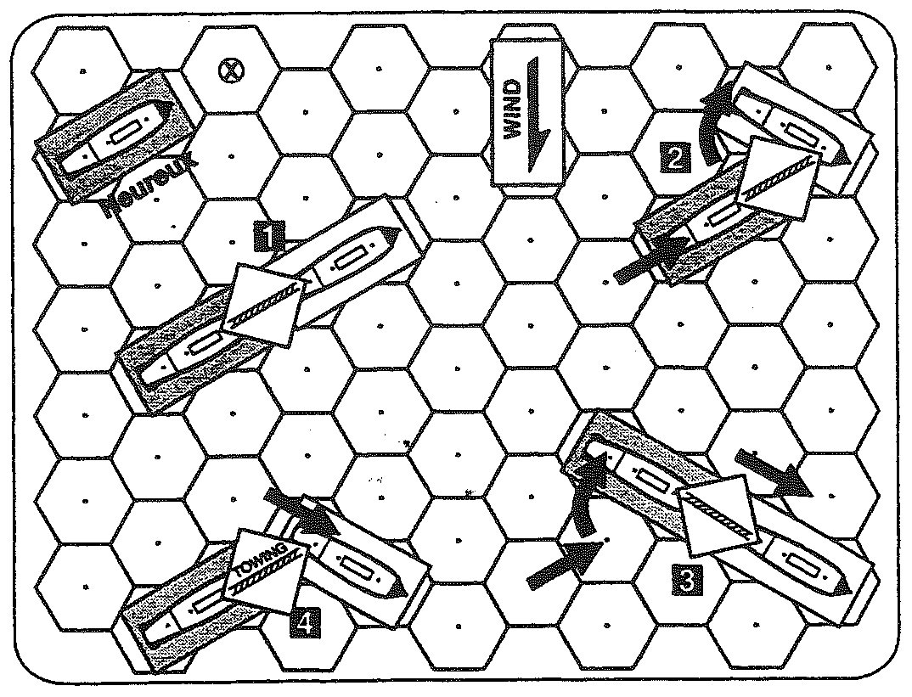

*DIAGRAM 24: Towing*

**12.A.3 Preparing to Tow.** A ship must prepare for <mark>54SK</mark> consecutive g-t's before it is able to tow. One CS must plot PT ("Preparing to <mark>Tow")</mark> in the Plot Phase to indicate this, and may do nothing else during those <mark>g-t's.</mark>

**12.A.4 Beginning Tow.** To tow, the towing ship must first send the tow line to the ship to be towed. This procedure is simulated as follows:

a. The stern of the towing ship must be in the hex ahead of the bow of the ship to be towed at the end of the Movement Phase. The two ships do not have to be in the same WF, however.

b. The towing ship (only) then tries to "grapple" the ship to be towed during the Grappling sub-phase. Grappling is not automatic, and must be rolled normally (the towing ship's SK mod applies). Neither ship can be grappled or fouled to any other ship (including each other) when attempting to begin towing.

c. <mark>If</mark> the grapple attempt succeeds, link the two ships with a <mark>"tow"</mark> counter. The ships then move as a unit until the tow is cut.

**EXAMPLE (see Diagram 24, position A):** The hex marked "X" must be occupied by the stern of the prospective towing ship before that ship can attempt to take Heureux under tow.

**12.A.5 Movement of Towed Ships.** A towed ship follows the general path of the towing ship. In order of descending priority, the towed ship:

a. Must always remain adjacent to the towing ship.

b. Must if possible point its bow towards the towing ship..

c. May move ahead one hex and turn in a single segment (or turn then move ahead) to accomplish (a) and (b).

**EXAMPLE (see Diagram 24):** Positions B, C, D, and E show the actions of a towing ship (in white) and a <mark>tewed</mark> ship (in gray) on three successive MPs. The towing <mark>ship's</mark> total movement for the three MPs is $2. On the first impulse, the towing ship turns to starboard, and the towed ship moves forward one hex, to remain adjacent to the towing ship, as specified in (a) above. On the second MP, the towing ship moves forward one hex, and the towed ship does not move at all. On the third MP, the towing ship moves forward one more hex; the towed ship moves forward one hex, then, following (b) and (c) above, turns to starboard to point at the towing ship.

**12.A.6 Plotting Towed Movement.** Only the towing ship plots movement, since the towed ship must follow the tow exactly. The towed ship does not contribute its own MA (if any) to their movement; only the towing ship's MA is used to calculate the speed of the two ships. Note: if the "hull structural damage" critical hit occurs against either the towing or the towed ship, the affected ship must roll a d6; if the DR=1, the tow is cut.

**12.A.7 Speed Loss.** Towing ships move more slowly than usual due to the additional drag of the towed ship.

a. The towing ship loses 1 MP because it is towing.

b. If the towing ship is a smaller class than the towed ship, the towing ship loses an additional MP for each class difference.

c. If the towed ship is dismasted or furled, the towing ship loses another MP in addition to (a) and (b) above.

**EXAMPLE:** A class 3 ship towing a dismasted class 1 ship would lose 1 MP for towing, 2 MP for the 2 class difference, and 1 MP for towing a dismasted ship, for a total loss of 4 MP. A class 1 ship towing a class 3 ship which was not dismasted would lose only 1 MP (for towing).

**12.A.8 Turning.** A towing ship that has an MA of 0 may attempt to turn, but must roll on the Tacking table, just like non-towing ships with an MA of 0.

**12.A.9 Cutting Tow.** Either the towing or towed ship may cut the towline by plotting TX during the Plot Phase; this task requires one CS. The cut takes effect in the Maintenance Phase of the same <mark>g-t.</mark>

**12.A.10 Contesting Hexes.** When a towed <mark>ship's</mark> bow and any other ship contests a hex, the towed ship always wins <mark>(.e.,</mark> gets the hex).

**12.A.11 Towing-Related Collisions.** The towed and towing ships may collide. This may occur either because the towing ship decelerates faster than the towed ship can, or due to the towing ship colliding with a third ship. In this event, the towed ship cannot bear off and automatically collides with the towing ship; it sustains the appropriate rigging damage, and the two ships may become fouled. The tow is not broken.

<!-- pdf p.37, Rules Book p.34 -->

### 13. ANCHORING

"His [the Goliath's] <mark>sheet</mark> anchor (the cable being out the stern port) not dropping the moment be wished it, be missed, and brought up abreast of the second ship, having given the van ship bis fire. I saw immediately be bad failed of bis intention, cut away the Zealous's sheet anchor and came to in the exact situation Captain Foley intended to bave taken."

<mark>a8"</mark> Captain Samuel Hood (on the battle of the Nile)

"Anchor, Hardy, Anchor!"

<mark>#8"</mark> Nelson's last command to Hardy while dying at Trafalgar <mark>(still</mark> thinking of his fleet and worrying about the coming storm)

#### 13.A <mark>ANCHORING—GENERALRULES</mark>

**13.A.1 Introduction.** Anchoring is useful for several reasons. The most important is to keep ships from drifting ashore and being wrecked! In addition, anchoring makes ships more stable as gunnery platforms, and by allowing the sails to be furled, helps to reduce rigging damage.

**13.A.2 Types of Anchoring.** A ship may anchor either normally or with springs. Ships anchored normally have a single cable connecting the anchor to the ship. A ship anchored normally cannot turn, and for this reason warships usually anchored normally only when not expecting a fight, or in emergencies. Anchoring with springs (see Diagram 26) allowed a ship to pivot and fire its broadsides in any direction, and was therefore preferred.

**13.A.3 Anchoring By Bow or Stern.** Ships normally anchored by the bow (that is, with the anchor cable exiting the ship from the hawsehole in the bows of the ship). However, it was also possible to run the anchor cable out one of the stern ports. This is called anchoring by the stern. A ship anchored by the bow will turn to WF=L; a ship anchored by the stern will turn to WF=R.

**13.A.4 Anchoring Options.** Ships may anchor in one of four ways; normally by the bow or stern, or with springs by the bow or stern.

**13.A.5 Anchoring Twice.** Each ship can anchor twice <mark>ina</mark> single scenario, regardless of the type of anchoring used.

#### 13.B PREPARING TO ANCHOR

**13.B.1 Introduction.** A ship cannot anchor until it has prepared to anchor. <mark>It</mark> prepares to anchor by plotting PBA (Prepare Bow Anchor) or PSA (Prepare Stern Anchor). Both actions require 1 CS; PBA takes 2 or 3 <mark>g-t's</mark> (depending on the ship's CQ), while PSA takes 6 + SK g-t's.

**13.B.2 Preparing Springs.** Preparing springs is a separate task from preparing to anchor. To anchor with springs, it may prepare springs before or after anchoring (if after anchoring, the springs take effect as soon as their preparation is completed). A ship prepares springs by plotting one CS to PBS <mark>(Prepare</mark> Bow Springs) for 2 x ( + <mark>SK)</mark> g-t's, or one CS to PSS (Prepare Stern Springs) for 2 x (6 + SK) g-t's.

**EXAMPLE:** A ship with CQ=C has to <mark>plot</mark> PBS for 8 <mark>g-t's</mark> (2 x [5-1 or

<mark>4) g's,</mark> or PSS for <mark>10</mark> g-t's (2 x [6-1 or 5]).

**13.B.3 Only One Anchor at a Time.** A ship may only prepare or be prepared to anchor by the bow or the stern (with or without springs), not both.

**EXAMPLE:** A ship that has completed PBA may plot PBS; a ship that has completed PSA may <mark>plot</mark> PSS. A ship that has completed PBA could not plot PSA and/or PSS (and vice-versa). A ship cannot plot PBA twice before first anchoring.

**13.B.4 Readied Anchors.** Once preparations to anchor are completed, the anchor(s) and springs remain ready forever or until used.

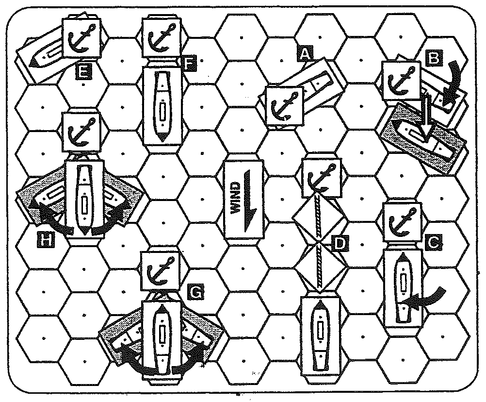

*DIAGRAM 25: Anchoring |*

#### 13.C ANCHORING PROCEDURE

**13.C.1 Plotting.** A ship anchors by having one CS <mark>plot</mark> A. The ship may not plot any MPs on the g-t it anchors (it may drift, since drifting is not plotted). If the ship plots any MPs, the anchoring plot is erased and does not occur.

**13.C.2 Anchoring Procedure.** Anchoring is announced during the Movement Phase, but takes effect in the Drifting Phase of the anchoring g-t. After rolling for drifting, place an anchor counter in the bow or stern hex of the anchoring ship, depending on whether the ship has written PBA or PSA. The ship is now described as either anchored by the bow (AB) or anchored by the stern (AS).

**EXAMPLE (see Diagram 25):** Example A shows a ship which has just anchored by the bow; position E shows a ship which has just anchored by the stern.

**13.C.3 Movement While Anchored.** An anchored ship may not use any MPs until it cuts its anchor cable. Anchored ships may veer in or out, and must drift. Ships anchored with springs may turn.

**13.C.4 Facing the Wind.** After anchoring, a normally anchored ship turns to WF=L (AB) or WF=R (AS). The ship <!-- pdf p.38, Rules Book p.35 --> turns 60° per g-t (during the Drift phase) until it is in the proper WF. If AB, it will <mark>eventually</mark> be positioned as shown in Diagram 25, position C; if AS, as shown in position F. Thereafter it must remain in the appropriate WF. The ship must turn in the direction that will put & in the proper final <mark>WF</mark> in the fewest number of g-t's. <mark>If</mark> a ship is supposed to face WF=L but anchors at WF=R (or vice-versa), roll a d6; on a DR of 1-3 the ship turns to port, on a DR of 4-6 it turns <mark>to</mark> starboard. Once it begins turning in any direction, it continues turning in that direction until it is in the proper WF.

**EXAMPLE (see Diagram 25):** Example A shows a ship which has PBA and just dropped its anchor, making it AB (normally). In the Drift phase of the next g-t the ship both turns 60° (to WF=C) and drifts (position B). On the following g-t it turns again to WF=L (position C), but would not drift again (unless it veers out). The ship is now in its final location, and will not move again unless it prepares springs and chooses to turn, cuts its cable, veers out or in (see <mark>13.E)</mark> or the wind changes direction.

**13.C.5 Drift after Anchoring.** A ship automatically drifts exactly one hex directly to leeward in the Drift sub-phase of the g-t after anchoring.

**EXAMPLE (see Diagram 25, position B):** the white arrow shows the <mark>ship's</mark> drift.

**13.C.6 Anchoring and Changes in Wind Direction.** <mark>If the</mark> wind changes direction, the ship turns (in the Drift sub-phase of the same g-t) to maintain its proper WF. The ship also simultaneously drifts so that the bow (or stern) is directly downwind of the anchor counter. This means the ship will necessarily drift obliquely, at an angle to the wind.

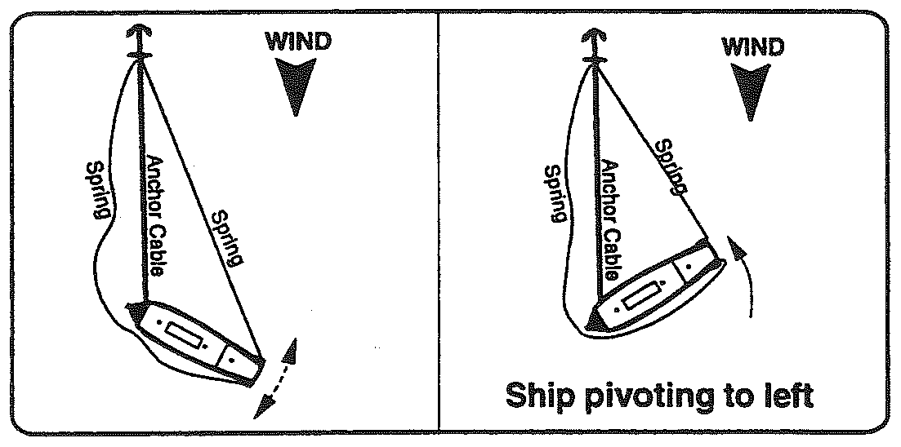

*DIAGRAM 26: Ship Anchored with Springs*

#### 13.D ANCHORING WITH SPRINGS

**13.D.1 Facing the Wind.** Unlike normal anchoring, a ship anchored with springs does not automatically turn to face the wind. Instead, it maintains the WF at which it anchored until the ship voluntarily turns to anew WF. The ship as a whole still drifts one hex downwind of the anchor.

**13.D.2 Turning While Anchored With Springs.** After anchoring with springs, a ship may make one 60° turn per g-t. Like all other movement, these turns must be plotted. If AB, the ship turns on its bow hex (Diagram 25, position G). If AS, the ship turns on its stern hex (Diagram 25, position H); this is different from all other turning rules. Again like other movement, grappled or fouled ships cannot turn.

**13.D.3 Crew Required.** One CS must plot HS (Handle Springs) on each <mark>g-t</mark> that the ship turns while anchored with springs. If no CS is plotted, the ship does not turn.

#### 13.E VEERING

**13.G.1 Veering Out (VO).** Although the normal distance from the anchor to the ship is one hex (as shown in Diagram 25, positions C and F), a ship could pay out more cable to slip downwind; this is called veering out.

a. A ship indicates VO by plotting one CS to VO for a g-t.

b. The ship drifts one hex further downwind for each VO. It automatically drifts to its new position in the Drift Phase of the plotted g-t. !t is suggested that players use tow markers to mark the anchor cable's path just so that players don't lose track of which ship goes with which anchor (NOTE: the anchor cable does not obstruct movement in any way).

c. Aship can have up to 3 VOs in effect simultaneously.

**EXAMPLE:** A ship writes VO on <mark>g-t's</mark> 10 and 11. By the end of <mark>g-t</mark> 11, <mark>it</mark> will be two hexes further downwind from its original location. (See Diagram 25, position D.)

d. <mark>A ship</mark> may not VO on the same g-t that it turns.

**13.E.2 Veering In (Vi).** A ship may "veer in\* (VI) as many times as it has VO; the ship may never VI more times than it has VO. Vi requires one CS to plot for one <mark>g-t.</mark> Like VO, VI takes effect the same g-t as plotted, but during. the Movement Phase. If another ship is blocking the VI, it does not occur; erase the plot from the log. There is no collision. A ship may not VI on the same g-t that it turns.

**13.E.3 Wind Speed 0:** Special rules apply at WS=0. A ship can anchor or cut anchor but it remains wherever it was when the wind speed dropped to 0, since there is no wind to push them downwind (the effects of currents are ignored). Ships at WS=0 do not drift and cannot veer out or use springs. Ships can veer in, however.

#### 13.F CUTTING THE ANCHOR

**13.F.1 Introduction.** There were two methods of getting under way: by weighing the anchor, or by cutting the anchor cable. Anchored ships always cut their cables when confronted by a nearby enemy to save time; thus only cutting is considered in CA.

**13.F.2 Cutting the Anchor Cable.** A ship cuts the anchor cable by plotting one CS to AX. The anchor counter is removed in the Anchoring sub-phase of the same g-t, and the ship may plot movement next g-t. The ship may not turn, Vi or VO on the g-t the cable is cut. If the ship has anchored twice, it may not anchor again during the scenario.

**13.F.3 Not in <mark>Irons.</mark>** A ship in WF=L at the start of the g-t after it cuts its anchor cable is not In lrons for that g-t. In other words, it has one "free\* g-t to turn to WF=C. If it fails to do so, then it will be in Irons at the start of the next <mark>g-t.</mark>

<!-- pdf p.39, Rules Book p.36 -->

#### 13.G SHALLOW WATER & LAND

**13.G.1 Draft.** Each ship's <mark>draft</mark> is indicated on the SDC or scenario OB. The draft is the depth of water (in feet) required to float the ship.

**13.G.2 Running Aground.** A ship runs aground if (a) its bow enters a hex which has a depth of water < its draft, or

(b) its bow or stern enters a <mark>/and</mark> hex. In either case the ship stops and loses rigging just as if it had collided with another ship. Exception: a ship which <mark>drifts</mark> aground loses no rigging.

**13.G.3 Consequences of Running Aground.** A ship which runs aground is unable to fire its guns (it may still use marine fire and board other ships) and may be considered destroyed (see scenario special rules). The ship counter remains on the board.

**EXPLANATION:** Most ships which went aground could not be \_saved and became total losses. Refloating those ships which were not totally lost took many hours or even days of work — far beyond the length of any scenario. Those ships which did survive were <mark>usually</mark> so heeled over their guns could not bear on any targets, and so were useless for combat anyway.

**13.G.4 Casting the Lead.** By "casting the lead" (using a lead-weighted line to check the depth of water under the ship), a ship could (with care and alertness) avoid going aground. A ship casts the lead as follows:

a. The ship plots <2 MPs and writes "cast" in the notes section of the Log during the Plot Phase.

b. The depth of water in each hex is then determined just before the ship enters the hex. (In most scenarios the depth can vary within a given range, and must be determined anew each time a ship enters a shallow water hex.) If the depth is too <mark>shallow</mark> for the ship's draft, the casting ship automatically bears off instead of moving forward into the hex. A casting ship always successfully bears off unless it is Poor Maneuvering (it must then roll on the Poor Maneuvering table).

<mark>NT</mark> | <mark>lela ellalalale:</mark>

### 14. OPTIONAL RULES

#### 14.A <mark>IMPULSE MOVEMENT</mark>

**14.A.1 Introduction.** The standard movement rules are <mark>"front-loaded",</mark> so that slow ships move at the same time as faster ships, allowing them to compete for hexes that in reality would have been reached by the faster ship first. Impulse movement avoids this problem by dividing each Movement Phase into four impulses; a ship uses a proportionate amount of its plotted MPs in each impulse. This greatly reduces the chance that two ships will attempt to enter a hex at the same time. One problem is that impulse movement plays slower than normal movement, since the impulse Movement table (below) must be constantly consulted during Movement. For this reason, impulse movement is most helpful for simulating very small actions, and is emphatically not recommended for fleet actions.

**14.A.2 Impulse Movement.** There are 4 impulses per Movement Phase. Ships use from 0 to 3 MPs per impulse, as shown on the Impulse Movement table.

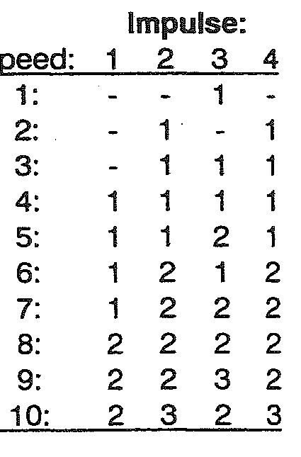

<mark>foOaged ana thie norma'</mark> move-

ment rules apply.

**EXAMPLE:** Ship A plots to use 8 MPs, while ship B plots to use only 6 MPs. On impulse 1, ship A uses 2 MPs, while ship A uses only 1 MP. As with normal movement, both ships use 1 in segment 1 of impulse 1. In segment 2, ship B uses its 2nd MP.

**14.A.5 Overlapping Ships.** A ship may still overlap <mark>with.</mark> another ship so long as the situation is cleared up by the end of the Movement Phase. See 6.B.

**14.A.6 Collisions <mark>&-Bearing</mark> Off.** If two ships are plotted to enter the same hex in the same movement segment in the same impulse, the normal rules of Chapter 6 apply.

**14.A.7 Optional Gunfire.** In medium and large actions, gunfire is resolved normally, after all movement is complete. In actions with only one or two ships per side, however, players may instead allow gun fire at the end of any impulse. This will prevent ships sailing right by each other without being able to fire. If this option is used, the entire move of both ships must be read out at the start of the g-t, so that players know the best impulse on which to fire. Otherwise, play will drag interminably as players ponder exactly when to fire during movement execution.

a. Aship may only fire once per <mark>9-t.</mark>

b. A ship may not fire on consecutive impulses, even in different g-t's. Further, the # of impulses required before the ship can fire again depends on the ship's CQ:

- CQ=A/B ships take 1 impulse to reload.

- CQ=C/D ships take 2 impulses to reload.

- CQ=E/F/G ships take 3 impulses to reload.

**EXAMPLE:** The Pluton (CQ=C) fires at the end of movement for im- \_ pulse 2. <mark>it reloads</mark> on impulses 3, 4, and could thus fire on impulse <mark>4</mark> of the next g-t. If she were CQ=E, she would still be reloading on impulse 1, and could only fire on impulse 2.

<!-- pdf p.40, Rules Book p.37 -->

#### 14.B VOLUNTARY SURRENDERING

**14.B.1 Introduction.** As noted before, it was normal and <mark>honorable</mark> for a ship to surrender when confronted with what her commander judged was an unwinnable situation. However, if the situation changed, ships sometimes ran their flags up again and sailed off! These rules attempt to provide for this situation.

**14.B.2 Voluntary Surrender.** <mark>If</mark> a ship is CQ=F (or G), or has lost at least five sections (of rigging, hull, or crew, in any combination), it may choose to surrender to the enemy before it is forced to strike. A ship which voluntarily surrenders, it is treated exactly like a ship that strikes for other reasons (see 9.B.2). Therefore, the surrendered ship may not do anything except fight fires, and it may not be fired upon. Surrendered ships may be boarded as with other struck ships; success is automatic, and once captured the ship may not rally.

**14.B.3 Rallying.** A surrendered ship may try to <mark>"unsur-render"</mark> (rally) — at any time after it has surrendered. To do so, it must take an MC. If it passes, it has successfully rallied, and may begin moving and fighting again normally. If it fails, the ship drops one CQ level. The ship may continue trying to rally until either it succeeds or strikes due to successive morale failures.

**14.B.4 Repeat Surrenders.** "A ship cannot rally twice, so if it surrenders twice, the ship has <mark>permanenily</mark> struck.

#### 14.C LIMITED INFORMATION

**14.C.1 Limited Information about Damage.** To best simulate historical conditions, only limited information about ship damage should be given to opposing players in all non-tournament multi-player games. Players should only give the following information about their ships to any other player, enemy or friendly:

a. Rigging. Only the number of rigging sections lost.

b. Hull. Only the number of hull sections lost.

c. Crew. Only the number of crew sections lost (and whether the Marine section is one).

d. Guns. All gun data (BGN and modifiers) must be given so that enemy players may check the accuracy of gunfire determination.

**14.C.2 Other Information.** For playability reasons, all other information (critical hits incurred, repairs, etc.) must be revealed to enemy players upon request.

**14.C.3 Tournament Play Situations.** In tournament games (whether single-player or multi-player), ai! Information about all ships is freely available to all players. (Tournament games are primarily tests of skill, and as such are concerned primarily with the game as a game, rather than the accuracy of the simulation).

#### 14.D FATIGUE

**14.D.1 Introduction.** As you can imagine, the physical labor of serving the ship's guns was immense; the heaviest guns weighed as much as four tons, and they had to be <mark>manhandled</mark> around the deck by the sheer physical strength of gun crews of 10 to 15 men, with only block and tackle to <mark>help</mark> them. Add to this the incredible noise of a gun deck in action, and the result was physical and mental exhaustion for the men, which led to slower rates of fire. The following rules add a fatigue factor to produce a more realistic game, at the cost of the usual greater complexity.

**14.D.2 Rule.** After the fifth time a ship has fired her guns in a game, <mark>ali</mark> subsequent fire from that ship is reduced by <mark>—i.</mark> To indicate this, simply add —1 to the "guns dismounted" section of the gunnery modifiers section of the ship's log. Note that this rule requires keeping track of the number of times a ship has fired her guns; use the <mark>"gunfire"</mark> column of the ship log for this purpose.

**14.D.3 Additional Fatigue.** After each additional 10 <mark>g-t's</mark> of gunfire, the firing ship loses an additional —1 to her gunfire from fatigue. This rule occurs on every tenth <mark>g-t</mark> after the first fatigue; in other words, on <mark>g-t's</mark> 15, 25, 35, etc., the ship loses an additional —1 "guns dismounted".

#### 14.E HISTORICAL LIMITS ON GUNFIRE

**14.E.1 Introduction.** The standard rules permit somewhat greater choice in deciding whether to fire high or low than is probably historically correct. The two optional rules below enforce more historically accurate gunfire targetting.

**14.E.2 French <mark>"Historical"</mark> Fire <mark>Doctrine.</mark>** It is known that the French (and Spanish) usually fired high rather than low. One explanation for this tendency was that it was a deliberate choice, with the French wanting to cripple British rigging so as to escape. While this may indeed have been the case, there are apparently no mentions of this in French tactical writings of the period. It is equally likely, therefore, that the problem was the well-known tendency of inexperienced crews to fire high.

**14.E.3 Gunfire Limitation.** A CQ=E/F/G ship that wishes to fire low has only a 50% chance of doing so (firing high is always allowed). The ship <mark>roils</mark> a d6 when it fires; if it roils 4+, it must fire high.

**14.E.4 Alternate Rule.** Another explanation for the French propensity to fire high is that they were usually to leeward, and the leeward fleet had a natural tendency to fire high due to the wind-induced hee! of their ships (the windward fleet had a similar tendency to fire low because of the heel of their ships; see Diagram 21). To simulate this dynamic, a ship in WF=C or WF=B firing to windward and wishing to fire <mark>iow</mark> has only <mark>a50%</mark> chance of being able to do so (firing high is always allowed). The ship rolls a d6 when it fires; on a DR of 4+, it must fire high.

<!-- pdf p.41, Rules Book p.38 -->

### THE CLOSE ACTION RATING SYSTEM

Many wargame players have a strong competitive instinct, and want a way compare themselves against other players. | have created the Close Action Rating System, or CARS, for such people. At the time of publication, there are over 200 rated Close Action players. It works like a typical Chess rating system, with the number of points awarded for each victory depending mostly on the difference in ratings of the two players. Each player starts at 400 (an arbitrary number), and goes up or down for each game won or lost. CARS is primarily intended to rate players for their performance in individual or team tournaments (see below), but it also rewards (to a lesser degree) players who get "best captain" awards at multi-player <mark>("monster")</mark> games.

To become rated, all that is necessary is for two or more players to agree to rate a given scenario or tournament-style game (the latter is recommended, as it usually yields a more balanced situation). After playing the game, they write their names, which player(s) won, and the date the game was played on a <mark>posteard.</mark> All players must sign the card. Then mail the card to me, c/o Clash of Arms (see inside front cover for address), and <mark>ll</mark> record your score in my database! You may also write to me to obtain your current standing; just enclose a SASE. Email is faster and cheaper, and you canreach me at: <mark>mce323@pgstumail.pg.cc.md.us</mark>

The top 20 rated players as of 4 July 1997 were:

1. Chaim D. Kaufmann (653)
2. <mark>John F.</mark> Kolb (632)
3. Carl Nogueira (625)
4. Mark <mark>E.</mark> Hancock (620)
5. Thomas H. Fancher (605)
6. <mark>Ralph Garza (599)</mark>
7. Mark A. Campbell (595)
8. John Erath (572)
9. <mark>Robert C.</mark> Cunningham (567)
10. Steven Finneran (555)
11. Hal J. Eisen <mark>(545)</mark>
12. Richard W. Fancher <mark>(639)</mark>
13. Thomas Kinney <mark>(628)</mark>
14. Dennis Wong <mark>(526)</mark>
15. <mark>Mark G.Mod</mark> (522)
16. Peter Reese (521)
17. Steve Payne <mark>(519)</mark>
18. David Rodgers (517)
19. Paul Kaster (514)
20. Gregory S. Sigler <mark>(512)</mark>

### CLOSE ACTION TOURNAMENT GAMES

The following rules provide a standard format for CA tournament games. They are not intended as comprehensive rules, but rather as a guide (more detailed rules will be available later). These rules provide a consistent and well-tested competition format. Players may also use them for friendly games, as they provide well-balanced actions. No optional rules are used.

#### MAPBBOARD

The <mark>\*standard</mark> wide" layout is used (see Scenario Book). There is no sea room. Any ship that attempts to move either its bow or stern onto a half-hex or off the mapboard is immediately destroyed; the opponent is awarded 100% of the VP value of the destroyed ship. Anchors may be dropped on the 15 lowest-numbered hexes of each hex column; that is, all hexes on both maps which end in xx01 to <mark>xx15.</mark>

#### CHOOSING FORCES

\1. Types of Scenarios. There are two basic types of tournament rounds; Preset Choices or Free Builds. <mark>In</mark> both cases, a side must consist of ships from a single navy on the SDC.

\2. Preset Choice. The gamesmaster provides 3 to 5 different pre-set forces (each of which is a group of one or more ships from the same navy). Each side must choose one of these forces to use in that round of the tournament. The opposing sides may choose identical forces. The GMs goal should be to provide choices which are very close in total value to each other, so that players have to agonize over their choice. There should never be fewer than 3 choices, so that the player's ability to choose the most cost-effective build will be important to the outcome of the battle.

\3. Free Build. The GM sets a specific VP value (350 is a number | use a lot), which each side uses to design a force of their own choice.

a. Each side must choose ships only from a single navy.

b. Both sides may choose the same nationality.

c. As <mark>shown on</mark> the SDC, ships may be sped up or slowed down, but no more than 50% of the ships may be altered in this manner.

#### SETTING UP TOURNAMENT GAMES

\1. Cheesing Squadrons. Each side chooses a squadron from the available choices. They simultaneously reveal their squadrons. Then they secretly determine which ship will be first in line, second, etc., and write this down. Both sides then simultaneously reveal their order of sail.

\2. Placing Ships on the Map. One side (roll randomly to determine which) places the bow hex of its lead ship in hex A3036, pointing in direction <mark>S.</mark> The other side places the bow hex of its lead ship in hex B2836, facing in direction 3. Each side now <mark>places</mark> their other ships in line behind the lead ship, allowing 2 open hexes between each ship. All ships in the same force must point in the same direction.

\3. Nationality & Type Placement Modifiers: Starting positions are modified by the squadrons' nationality, CQ and ship type:

a. Spanish squadrons start 1 hex to leeward of the indicated hex.

b. French squadrons start on the indicated hex.

c. Dutch squadrons start 1 hex to windward of the start hex.

d. British squadrons start 2 hexes to windward of the start hex.

e. American squadrons start 3 hexes upwind of the start hex.

f. Any force containing only Class 3 ships gets one extra hex to windward, in addition to any other modifiers.

g. After the ships are laid out, all ships scatter.

\4. Note on Placement of <mark>Off-Beard</mark> Ships: Since only 5 ships will fit on the map at the start, the sixth and later ships on each side enter the board during the game. They must enter the board directly behind and in line with the last on-board ship, leaving two blank hexes between ships. Each ship expends one MP to enter the map.

\5. Sail State: Each side now writes the starting sail state of each ship above the top line of the Sail column on each ship <mark>log. {f</mark> nothing is written, the ship starts at FS. Ships may start in any sail state desired, including furled. Ships may also start the game partly through a change from one sail state to another.

#### SPECIAL TEAM TOURNAMENT RULES

<mark>4.</mark> Team Organization. Each team must have three players — one admiral and two captains. No player can control more than 150% of the points controlled by any other player on his team. If this is impossible due to the particular ships in the squadron, then players must each receive as even a distribution of VPs <mark>as'possible.</mark>

\2. Number of Ships. Any team squadron must contain at least three ships — at least one per player. Free Build and Bidding choices must take this into account.

\3. Pre-Game Conferences. Each team now has 10 mintues for a pre-game conference. After the conference is over, play begins.

4, Communicating. Members of opposing teams may not discuss anything relevant to the game before or during the game. They may of course talk freely after the game is over. Teammates may communicate with each other by using the standard CA signalling rules (see Chapter <mark>14).</mark>

#### PLAYING THE GAME

<mark>1.</mark> Weather. Wind Direction is always 1 during a tournament scenario. Wind speed should be 2, 3, or 4; 3 should be standard. There is ne Wind Direction or Wind Speed change (because random wind changes during a tournament game would introduce huge luck effects into a test of skill).

\2. Setup Time Limits. There is usually a limit on the length of each round. Time limits for each element of a game are: choosing a squadron, about 10-15 minutes; set <mark>up, the</mark> same; command conference (if any), <mark>10</mark> minutes; and the game, whatever time remains.

\3. Plotting Time Limits. The amount of time for each plot phase should be drastically limited by the GM, and countdown watch timers with audible alarms are the best way to keep track. | suggest NO MORE THAN 4 minutes for plotting; 3 minutes is better.

<!-- pdf p.42, Rules Book p.39 -->

#### VICTORY DETERMINATION

\1. Determining Victory. Tournament games last for 30 <mark>g-t's,</mark> by which time there should be a clear winner. There are three ways to determine the winner: disqualification, agreement, and victory points.

a. Disqualification. If the GM disqualifies one side, the other side wins.

b. By Agreement. In most games <mark>it is</mark> clear to all which side has won.

c. If there is no agreement after 30 g-t's of play, the GM awards VPs to each side according to the VP rules in the Scenario Book. Calculate all VP awards and do NOT round off points. Thus a side could conceivably win a tournament scenario by as little as .01 of a VP.

2, Tie-Breakers. If VP awarded are exactly equal (or if no VPs were scored at all), victory is awarded (in descending order):

a. <mark>To the</mark> side which started with fewer VPs.

b. The side whose lead ship started furthest to leeward.

c. The side that wins <mark>a random</mark> die roll.

\3. Projected VPs. If 30 <mark>g-t's</mark> have not elapsed when the time <mark>limit</mark> for the round is up, the GM scores the game by adjudicating who would win if the game continued until the end of g-t 30. This rule is needed because the situation on a given g-t can be misleading (for example, the side ahead on VPs on <mark>g-t</mark> 17 might be guaranteed to have their most valuable ship strike on the g-t 18, totally changing the VP count). This requires the GM to predict the future, and is only possible because it is often mathematically certain, or at least extremely likely, that a ship will suffer certain damage in a given number of <mark>g-t's,</mark> assuming correct decisions by the enemy. If less than 15 <mark>g-t's</mark> have been played and very few (or no) VPs scored, it may be impossible to tell with certainty who is winning. In these cases the GM may disqualify both sides and award the <mark>winner's</mark> slot to the best losing side from another game from that round.

#### ERRORS DURING PLAY

<mark>1.</mark> Inspecting Enemy Ship Logs. Human nature being what it is, it is <mark>likely</mark> that questions will sometimes arise regarding how accurately opponents record their damage, etc. To avoid arguments, each side may examine enemy ship logs.

a. Players may inspect the damage section of enemy ship logs at any time during the game, including while marking damage. Players should go out of their way to clearly mark all damage done to them.

b. Players may inspect the g-t record area of enemy ship logs at any time except during the <mark>Pilot</mark> phase.

\2. Burden of Proof and Correcting Errors. Since each side can examine the other <mark>side's jogs,</mark> the burden of proof is on each side to catch enemy errors in plotting movement, gunfire calculation, etc. If an error is detected before the end of the phase in which it takes place, try to correct it at all costs. After the phase is over, errors are not corrected.

\3. Disqualification. If the GM becomes certain that one side is cheating, he immediately disqualifies that side and awards victory to the other side.

### <mark>DESIGNER'S</mark> NOTES

<mark>I</mark> first became interested in the "age of fighting <mark>sail"</mark> as a child after reading the incomparable Horatio Hornblower novels by C. S. Forester. Later, after playing every available naval wargame on the age of sail, and becoming disappointed with all of them, | began designing my own game on the subject. The first version of Close Action was released in 1983, and it has been under continuous development since then. | hoped to create the ultimate tactical wargame about the age of sail, but, even after eighteen years of continuous development, I'm not sure | have. | hope, however, that you find CA as realistic, playable, and enjoyable a game as many of my friends and | have.

##### Playability vs. Realism

The major task of every game designer is to achieve a harmonious balance between the contradictory design objectives of realism and playability. On the one hand, a wargame must be reasonably realistic to be worth playing — else why not just play Checkers and call it CA? Ideally, players should have the same restrictions and options as real commanders. Of course, | can't simulate the terror, confusion, and rush of adrenaline produced by real combat ~ and I'm not sure | would want to, if <mark>i</mark> could. However, that is no excuse for doing what some military snobs do, which is to throw their hands up in the air and claim that since it's impossible to truly simulate battle, that one game is as good as (or as bad as) another. This is simply not true.

Rather, it is the game designer's thankless task to incorporate those elements of reality which are essential to recreate the decision-making processes <mark>real</mark> men would have had to make in combat, while avoiding all unnecessary rules, no matter how nice. Thus, the Close Action anchoring rules, were absolutely necessary, despite their length and complexity, because recreating the actions taken by many ships at the Battle of the Nile (a scenario in the game) required them. The Nile could not be realistically simulated without them. For the same reason, | had to make the tacking rules more complex than | would otherwise have wanted. Tacking was a time-consuming and somewhat risky process, even for well-trained crews — especially in the heat of battle. Making tacking perfectly easy would make the behaviors of many captains at many <mark>battles</mark> less understandable.

On the other hand, simulating every cannonball would have made CA too complex to be enjoyed by all but the most diehard wargamers. | therefore included detail where | thought it absolutely necessary to simulate naval warfare under sail, but left out as much <mark>"chrome"</mark> as possible.

##### Luck vs Skill: Picking the Right Period to Simulate

Certain periods and areas of warfare simply make better subjects for wargames than others (that is, they provide both more realism and more enjoyment as games). For example, many gamers prefer skirmish-level games, where a player controls only a handful of men, to games where the player is commanding an army corps or an entire theater. Yet there can be no doubt in the minds of anyone who has studied the subject in any detail that it is much easier to design a realistic strategic or operational-level wargame than at the micro-tactical level. | was lucky enough to pick one of the easiest areas of warfare to simulate at the tactical level. Surprise, one of the most important aspects of land battles, was less of a concern in naval battles in the age of sail. They generally took place in broad daylight <mark>or</mark> moonlight, and the commanders usually knew the composition of the opposing force to a fine degree, sometimes down to the actual names of the enemy ships. In naval warfare in the age of sail, surprise was not the problem. An admiral's main concern was to outmaneuver and outfight a clearly visible enemy; this required getting his captains to maneuver together, as a team; and the famous (or infamous) line of battle lasted so long precisely because it made this difficult task easier.

Close Action really shows its advantages in multi-player games. Most classical board wargames are intended to be played by one player per side. This has two disadvantages. From the simulation <mark>angle,</mark> it provides players with far more knowledge and control than commanders really had. It also fails to satisfy the normal human desire for interaction with other people, rather than with cardboard counters or a computer.

Close Action satisfies both needs. If you once play a CA game with more than one player per side, I'll bet that you'll never want to play any other way, because of its clear advantages. It (a) will give you insight into the real difficulties of naval warfare in the age of sail; (b) will actually speed play, because each player will not be overwhelmed trying to control too many ships; and (c) will be profoundly more satisfying to most gamers than either playing one-to-one or <mark>one-to-none</mark> (i.e., solitaire or computer).

For these reasons, I've had great success hosting CA "monster\* games at various conventions around the country. The largest number of players | have had at one game was 45; and, while | don't recommend that many, 20 to 30 is a perfectly workable number. With this many players, it is possible to get close to a 1:1 ratio of players to ships, and, when this occurs, all of a sudden the real problems of command/control in the age of sail becomes obvious. Even with as few as five or six players, you will find that the easy aquatic "ballet\* movements typical in an individual game become impossible. So remember -- the more players, the better! <mark>I'll</mark> close with a poem that says it all (who else but Rudyard Kipling, from The Song of the Dead):

We bave fed our sea for a thousand years

And she calls us, still unfed,

Though there's never a wave of all ber waves

But marks our English dead:

We bave strawed our best to the weed's unrest,

To the Shark and the sheering gull.

If blood be the price of admiralty,

Lord God, we ba' paid in full!

<!-- pdf p.43, Rules Book p.40 -->

### ACKNOWLEDGEMENTS

Those who know anything at all about the exciting period of naval history covered by Close Action know that Vice-Admiral Sir Horatio, Viscount Nelson, K.B., dominated naval warfare even more thoroughly than Napoleon dominated land warfare. There were many reasons for his astonishing influence upon naval history, but perhaps the most important was his ability to weld his often fractious and quarrelsome subordinates into a smooth-working team. His unique leadership gift was his ability to get his subordinates to want to do their best for him because they admired, respected, and loved him, rather than simply obeying because he was their superior officer. Almost every man in the British navy longed to serve under him, and many remembered his words to them for the rest of their lives. He created his famous "band of brothers" through the sheer force of his personality, and it was the sense of togetherness, of teamwork, which he engendered among his captains, that made fleets led by him so formidable in battle, as the decisive scale of his glorious victories at the Nile, Copen-hagen, and of course Trafalgar, clearly indicates.

Of course, Nelson was fortunate to lead a group of officers who, all in all, were certainly the best group of leaders the Royal Navy had yet seen. Forged in the fire of the American Revolution as junior officers, the still youthful captains who formed the sword that Nelson swung with such skill were at the prime of their powers. Such men as Samuel Hood, Thomas Foley, Thomas Francis Fremantle, Alexander Ball, James Saumarez — they were superb seamen, natural leaders, and had complete confidence in Nelson, as he had complete confidence in them; a true "band of brothers"!

<mark>1</mark> do not for one second claim to compare myself favorably to the glorious Nelson, but | have been blessed with an even more stellar "band of brothers." My <mark>"star-captains"</mark> have collectively done far more to improve Close Action over the last 18 years of development than | have, and they deserve every bit of recognition and praise that | can bestow. They are (in chronological order of involvement with CA):

<mark>33"</mark> Mark E. Hancock. He motivated me to undertake the design and development of CA in 1978, he was instrumental in early playtesting, and he helped me put on CA events at conventions from 1982 to 1986. He also (with Web Ewell) developed the elegant Line of Sight system, a problem which had vexed me for some years.

<mark>#8"</mark> Chaim D. Kaufmann. He, more than any other person, has helped make CA work as a game system. He has been involved in the design of CA since 1981 or so, and has designed the gunfire system, the boarding system, and much of the current maneuver system. He has also been responsible for other, continuing improvements to the game system that have made it light-years better than its original form. If you think CA is an elegant game, praise Chaim.

<mark>a"</mark> Albert C. E. Parker.- Albert started helping me with CA in 1983, and has been enormously helpful in many areas, especially historical research, where his Ph.D in history has undoubtedly helped him identify and correct many early errors of mine concerning historical reality. In addition, he designed the current Gunfire Results table format. He has also helped enormously in proofreading for content, grammar, and consistency. Finally, he has an extraordinary talent for graphics design, and many of the more impressive diagrams in the rules are the product of his suggestions.

<mark>2</mark> Robert G. Lewis. He first assisted me at Origins 91, and has since become my best rules editor. He has been absolutely essential in improving the flow and readability of the rules. He has in the process of aiding the development of CA also become one of the best admirals around. As a friend, he and his wonderful wife Beth have been much nicer to me than | deserve — as any of our mutual friends will surely agree! As proof, <mark>I'm</mark> writing these words in the lower level of their townhouse, where <mark>I've</mark> lived for the past year. After that trauma, it's amazing he still likes me at all!

- Hal J. Eisen. One of my very best friends, | first met Hal in 1986, and we immediately became fast friends. It was not till | moved to the DC area in 1992, however, that he began contributing seriously to the development of CA. In the event, circumstances have prevented him from con-tributing as much time to CA as some others have done, but ! have valued his contributions highly. He was particularly useful in turning his program-ming talents to developing a program to <mark>"fight"</mark> two ships, allowing me to obtain accurate ship values without playing the several thousand tournament-style playtest games that otherwise would have been needed! | am proud to have introduced him to sailing; he is now far better than |.

<mark>&&"</mark> Steven S. Becker. He first stepped into my CA picture in <mark>1998,</mark> and has put more sheer time and effort into rules editing since then than anyone else. <mark>!'m</mark> afraid (but also very thankful) that he has lost more sleep because of CA in the last five months than either of us cares to remember.

A superb rules lawyer (wait, is that a compliment?), he has eliminated more rules loopholes (which <mark>I</mark> really hate) than anyone else. He's a good man, a good sailor in real life (he once crewed on the topsail schooner Alexandria), and, most importantly, a damn good friend.

<mark>5"</mark> Mark J. Bassett. Speaking of friends, | am very lucky to have met this truly wonderful person. He is the designated Close Action victualler; he brings great munchies to games even when we ask him not to! More important for CA, he has been an indefatigable playtester and editor. Yet another real-life sailor in my "band of brothers", Mark has sailed in places as distant as <mark>Ireland</mark> and the Caribbean, as well as the Chesapeake. Smith <mark>Island</mark> is one of his favorite <mark>spots!</mark>

<mark>#2"</mark> Kenneth G. <mark>Acon.</mark> | first met Ken in 1991 or <mark>sc,</mark> when he <mark>played</mark> in one of my convention games, but it wasn't until 1994 that he became one of my best friends. By July 1994 it was crystal clear that my attempt to earn a doctorate in military and naval history was doomed to failure. After resigning, | was lucky enough to quickly find a job in Harrisburg, Pennsylvania, where Ken lives. The company wanted me to start work in four days, leaving me no time to find a place to live. No problem; Ken willingly lent me his spare bedroom for six months — free! — while | got my finances back in order (he <mark>stil!</mark> won't accept payment for his generosity!). He also provided a venue for my <mark>playtest</mark> efforts in Harrisburg for years, much to CA's benefit.

- Stanley A. Sunderwirth. Although Stan has been a stalwart member of my trusty band only for a year or so, he has been most helpful in that short time. Another expert sailor, his experience with his Laser 28 has helped him <mark>help</mark> me write better rules. He is also a superb miniatures worker, and has done amazingly good work in <mark>"refitting"</mark> my 1:1200 scale ships (they have taken quite a pounding over the years).

DRAMATIS PERSONAE:

Principal Rules Editors: James Rumizen, Albert Parker, Robert Lewis, Mark Bassett, Steven Becker, Stan Sunderwirth, Chaim Kaufmann. Assistant Editors: Thomas Ballou, Kenneth Acon, Dale Zartman, James McCourt, Hal Eisen, Todd Green, Jim <mark>O'Neill,</mark> Beth Lewis, Valerie Emerson, Eric Raymond. | > Major <mark>Playtesters:</mark> James Rumizen, Albert Parker, Robert Lewis, Hal Eisen, Steven Becker, Mark Bassett, Stan Sunderwirth, Doran Bowers, Ken Acon, Jack <mark>Thomas,</mark> Scott Kreiser, Robert Gross, Dale Zartman, Lane Hess, Larry Geesaman, Dennis Daughetee, Thomas Ballou, Carl Nogueira, Mitchell Schwartz, David Bush, Todd Green, Chris Carey, Richard Fancher, Greg Sigler, Web <mark>Ewell,</mark> Mark Hancock, Shantanu Saha, Tibor Vari.

Historical Research: Mark Campbell, Albert Parker.

Close Action <mark>Proselytizers:.</mark> Richard Heffner, Jeff Hunt, Shantanu Saha, Thomas Ballou, Mike Fisher, and many, many others.

Support Software Programming: Hal Eisen.

Ship Value Algorithm Development: Chaim Kaufmann, Hal Eisen, Doran Bowers, Richard Fancher, Albert Parker, John Kolb.

Shipwrights: Chris Bell, Stan Sunderwirth.

Most improved Player: James "stay in line!" Rumizen.

Explosives Expert: Shantanu "what, he's blown up AGAIN? Saha. CA Shyster: Chuck Goetz.

CA Victualler: Mark "have some more chicken" Bassett.

CA Hostellers: Bob and Beth Lewis, Ken Acon, Tibor Vari.

CA Lord of Admiralty: My father, who deserved a better son.

Emotional Support (Babe Division): Valerie Emerson, Beth Lewis, and Chiyoko Campbell (Hi MOM)).

In the end, of course, the help | have received from so many good people cannot take the responsibility for <mark>Close</mark> Action from my shoulders — and | would not want it otherwise. | have lived, breathed, and dreamed Close Action for the better part of two decades now, and the publication of my lifework (so far, anyway) makes me both very proud (because | think CA is the most realistic, most enjoyable multi-player wargame you'll ever play) and very humble (because others could have done the job in half or a third of the time it's taken me).

<mark>iam</mark> also keenly aware that CA is not perfect. | know some typos and . other bugs have escaped the keen eyes of my editors! On the other hand, life is a growth process, and | view with pleasure the opportunity of discussing my game with all of you. So please don't hesitate to contact me for any reason: kudos are of course welcome, but so are rational criticisms and suggestions. The best way to reach me is via email, at:

<mark>me323@pgstumail.pg.cc.md.us</mark> | <mark>1</mark> look forward to hearing from you!

- Mark A. Campbell (July 1997)

<!-- pdf p.44 -->

### GLOSSARY

2D: "Two Decker. A ship <mark>nominally</mark> mounting from 44 <mark>to</mark> 60 guns on two complete gun decks (like two-decked SOLs), but too small to be considered a "ship of the <mark>line".</mark>

<mark>2d6:</mark> Abbreviation for "two six-sided dice." Read as a number from 2-12.

2d10: Abbreviation for "two ten-sided dice." Read as a number from 0-18.

AB: Anchored by the Bow.

Accel.: Acceleration.

Ahead: The direction in which a ship's bow b is pointing.

AS: Anchored by the Stern.

BCF: Boarding Combat Factors.

Bdsd.: Broadside. The port & starboard sides of a ship for gunfire.

Boarding: To attack another ship by climbing at aboard it and engaging in hand-to-hand combat.

Bow: The front end of a ship or ship counter.

Broadside: ships mounted their guns along both sides. Each ship in CA thus has a port and a starboard broadside.

C ore: Crew box.

CA: Close Action. The game you are playing!

Class: There are 4 ship classes numbered 1 to 4. Class <mark>1= 3-deck</mark> SOLs; 2= 2-deck SOLs and "two-deckers"; <mark>3= Frigates;</mark> 4= Corvettes.

Counter: Either a <mark>1"x'4"</mark> or a <mark>%4"x'4"</mark> cardboard playing piece; the <mark>1°x'4"</mark> counters represent a single ship each, while the <mark>4'x12"</mark> counters generally are used to track ship status.

CQ: Crew Quality. A letter from A-G representing a ship's crew's skill level, with A being best and G being worst. Struck ships are considered to be CQ=H (but act as CQ=G for some actions).

CR: Carronade. A type of short-barrelled cannon, very effective at short range but ineffective at long range.

<mark>CS:</mark> Crew Section. There are five crew sections: 4 sailor sections (numbered <mark>S1</mark> to S4) and the marine section.

Decel.: Deceleration.

Dismasted: A ship which has no intact rigging boxes is dismasted.

Downwind: The direction that the wind is blowing towards (i.e., that the wind arrow is pointing towards). See Leeward.

DR: Die Roll. All die rolls in CA are made with one or two d6 (six-sided dice) or <mark>d10</mark> (ten-sided dice).

DRM: Die Roll Modifier. A value which if preceded by a <mark>"+"</mark> is added to the die roll, or if preceded by a \*—" is subtracted from the die roll.

FGN: Final Gunfire Number. The row on the GRT which determines gunfire damage. To find the FGN, add a d6 DR to the MGN.

Flag Officer: In history, an admiral or commodore (an officer entitled to fly a special flag). In CA, any player commanding a ship marked with a <mark>Ba</mark> or <mark>B></mark> in the scenario book (allowed to send longer signals).

Freeboard: The distance from the waterline to the sill of the lowest gun-deck's gunports.

Friendly: A ship on the same side as one's own ship. Ships captured by boarding become friendly to the capturing side.

FS: Fighting Sail. So called because it was ideal for fighting, giving enough speed for maneuver while requiring few men to handle.

Furl: A ship with all its sails tied to the masts and yards.

G: On the ship log, the number of guns dismounted for hull section loss. g-t: Game-Turn. The basic unit of time by which CA is played; represents 200 seconds of real time. Each g-t consists of a number of phases.

GCT: Gunfire Calculation Table.

GRT: Gunfire Result Table.

H or <mark>hh:</mark> Hull box.

HC: Hull Check. Roll d6 on the left-hand column of the Hull Critical Hits Table and apply the appropriate result.

<mark>1B: initial</mark> Broadside.

ID: Identification Letter (for ships).

In <mark>Irons:</mark> A ship in wind facing L ("Luffing") for at least two complete g-t's is in irons, and has a worse chance of turning out of WF=L.

Leeward: In the same direction that the wind is blowing (relative to an object under discussion). Also "to leeward", <mark>"Lee</mark> side", "downwind."

Log ("ship log"): Each ship has its own ship data sheet, or "log", on which its status and plotted actions are recorded.

LDG: Lower Deck Guns.

LDGM: Lower Deck Gunfire Modifier.

LG: Long Gun. The standard type of cannon used aboard ship.

LOS: Line of Sight.

- Symbol denoting requirement to take a Morale Check.

<mark>M:</mark> Marine box.

MA: Movement Allowance. The maximum number of MPs a ship may legally plot to use in the course of one g-t.

<mark>MC:</mark> Morale Check. <mark>Adi0</mark> DR to check the crew's desire to keep fighting.

<mark>NMG:</mark> Medium Gun. A type of cannon between long guns and carronades.

WIGN: Modified Gunfire Number.

Stopped ship: A ship that plots 0 MPs in a g-t, or just a turn. Stopped ships may drift.

MP: Movement Point.

MIR: Morale Rating. A number from 2 to 6, which measures a ship's crew's desire to fight. Usually related to CQ.

<mark>MS:</mark> Medium Sail.

OB: Order of Battle; section Vil in each scenario in the Scenario book.

Parent ship: in boarding, the ship from which victorious boarding sections came from.

Prize: The term used to describe a captured ship.

PS: Plain Sail.

Rorr: Rigging Box.

RC: Rigging Check. Roll d6 on the left-hand column of the Rigging Critical Hits Table and apply the specified result.

Rz: Razee. A SOL cut down by one deck, usually with the intent of creating a super-frigate. Most razees were however mediocre ships.

<mark>S:</mark> Sailor box.

<mark>$1...84:</mark> Sailor Section 1, 2, 3, or 4.

SDC: Ship Data Chart. Lists all CA data for over 40 ships from 1793-1815.

SK mod: Skill Modifier. A die roll modifier which reflects a crew's skill in accomplishing tasks. See Boarding Combat and Skill Factors table (red sheet).

SOL: Ship of the Line. Any ship strong enough to "lie in the line of battle"; thus, a battleship. Also "SOL", "Line of battle <mark>ship",</mark> or <mark>"Liner".</mark>

Speed, Actual: The number of MPs a ship actually uses in a <mark>g-t.</mark>

Speed, Plotted: The number of MPs a ship <mark>pilots</mark> to use in a g-t.

Spring: A heavy <mark>line</mark> attached to an anchor which allowed a ship to pivot while anchored.

SS: Sail State.

Stern: The aft (rear) end of a ship or ship counter.

Strike: Short for a ship "striking its flag", or surrendering. Ships strike by losing all hull, crew, or failing a morale check when already CQ=G.

Struck ship: Short for "a ship which has struck its flag", or surrendered. Struck ships count as CQ=G when their CQ must be accounted for.

Task: Any action requiring at <mark>least</mark> one full g-t of effort by at least one CS to accomplish.

TBCF: Total Boarding Combat Factor.

TGF: Total Gunfire Factor.

Turn: <mark>A 60°</mark> change of direction.

Upwind: Opposite the direction the wind arrow is pointing (i.e. towards the wind's source). Also <mark>"to</mark> windward", "to weather", etc.

VP: Victory Point. The value and cost of a ship.

WD: Wind Direction. There are six wind directions, corresponding to the wind arrows on the Close Action mapboards.

WF: Wind Facing. The attitude of the ship with respect to the wind direction. There are four wind facings: L (Luffing), C (Close-Hauled), <mark>B</mark> (Broad-reaching), and R (Running Downwind).

Windward: Opposite the direction that the wind is blowing <mark>(Le.,</mark> closer to the wind's source).

WS: Wind Speed.

<!-- pdf p.45 -->

#### SEQUENCE OF PLAY

**NOTE:** Perform all steps in exactly the order shown.

#### I. REINFORCEMENT & WEATHER PHASE

A. Reinforcements. Place all ships entering on this g-t on their proper entry hexes on the correct map. B. Apply Wind Changes. Apply Wind Direction and Wind Speed changes rolled the previous <mark>g-t.</mark> C. Wind Direction. Roll <mark>2d10</mark> to see if wind direction changes next <mark>g-t.</mark> D. Wind Speed. Roll another 2d10 to see if wind speed changes next g-t.

#### II. PLOT PHASE

A. Plot Movement. Each ship simultaneously plots its movement for the current g-t. B. Plot Crew Use. Each ship may <mark>plot</mark> each crew section to perform one task for the current g-t. All tasks require at least one CS for one or more g-t's. (Unfouling & ungrappling do not require CSs.) C. Write Messages. Each player can write one message.

#### III. MOVEMENT PHASE

A. Turning at MA=0. Each ship with MA=0 which has plotted turning rolls on the Tacking table. B. Movement. Do all other plotted movement. Each ship announces any plotted sail change after it moves and places a "men in rigging" counter. Resolve movement conflicts as they occur, doing the following steps in order: 1. Contested Hex. Determine which ship gets the contested hex (if applicable). 2. Bearing Off. Any ship now about to ram another ship may attempt to bear off if it desires to do so. 3. Collisions. If bearing off is unsuccessful, a collision occurs. Determine rigging loss. 4. Roll for Fouling. Roll to see if the ships involved in the collision are fouled or not.

#### IV. COMBAT PHASE

A. Declaring Boarding. Each ship grappled or fouled to an enemy ship and with at least 1 CS plotted to BA declares "boarders away"; each defending ship now plots marines to FB if they are not already so plotted. <mark>B.</mark> Gunnery and Marine Fire. Each ship may simultaneously fire guns at one or two enemy ships, firing rakes first. Marine CSs not plotted for tasks except FB or BR may be able to use marine fire against one enemy ship. Resolve critical hits and note morale checks. Place a strike marker on all ships which strike due to hull or crew loss. C. Boarding Combat. Resolve boarding attempts.

#### V. MAINTENANCE PHASE

A. Drifting & Veering. Resolve drifting for each stopped ship, working from leeward to windward <mark>(d10</mark> on Drift table).). <mark>If</mark> a drifting ship collides with another ship, roll d10 for fouling. Simultaneously do all plotted veering. B. Anchoring & Towing. Ships plotted to anchor , cut anchor cable, or cut tow cable do'so. Place/remove counters. C. Grappling. Every ship may attempt to grapple each adjacent ship with which it is not already grappled. D. Ungrappling. Every ship may attempt to throw off any grapples desired. E. Unfouling & Fixing. All actions which require rolling on the Unfouling table are rolled for. Some of these actions do not require CSs to be plotted, and may be rolled for on the same g-t that damage occurs. They are: Braces Cut [BC] | Rudder Jammed [RJ] Lines Jammed [LJ] Signal Halyards [SH] Fouled ships | Obscured Broadsides [-2pb/sb] F. Fire & Explosions.

\1. Firefighting. Each burning ship which has a CS plotted to FF rolls <mark>d10</mark> on the Unfouling table to fight the fire. 2. Fire Damage. Each ship still on fire crosses off 1H and 1R for each fire still burning. 3. Fire Growing & Spreading. For each fire burning for five g-t's, add a new fire counter on the same ship. Each ship grappled or fouled to a burning ship catches fire on a DR of 1-3 on a <mark>d6.</mark> 4. Exploding Ships. Burning ships which have no hull boxes remaining roll to explode. The chance to explode is "< 2" on 2d6, with a -1 to the DR for each previous g-t that explosion was checked. G. Reconciliation.

\1. Record Repairs. Each ship which has completed a repair draws a new rigging or hull box on the ship log. 2. Ship Removal. Remove from the map all ships which have escaped or exploded in the previous g-t. 3. Crew Adjustment. Mark changes in crew status due to prize crew formation and completed reorganization. 4. Morale Checks. Roll all morale checks. Place a strike marker on those ships which strike. 5. Signal Delivery. Deliver all signals written in the Plot Phase of this game-turn. 6. Status Update. Make <mark>ceriain</mark> all status counters correctly reflect their ships' status. Make certain that each ship's gunnery modifiers correctly reflect its condition.

<!-- pdf p.46 -->

## Scenario Book

#### CLOSE ACTION™

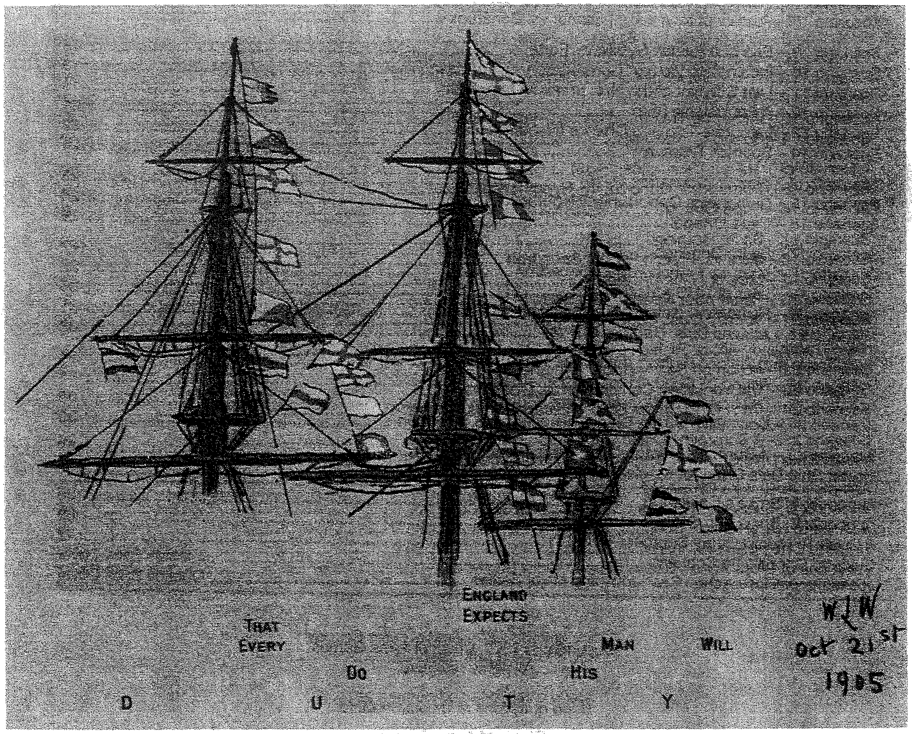

##### By Mark A. Campbell

<!-- pdf p.47 -->

### TABLE OF CONTENTS

- [Introduction](#1-introduction)
- [Using the Scenarios](#using-the-scenarios)
- introduction to the Scenarios: The French Revolutionary and Napoleonic Wars
- Scenario 1 — Squadron Action: Frigates in the Channel Islands
- Scenario 2-— Indian Ocean Challenge: Isle Ronde
- Scenario 3-— Capture of the Alexander
- Scenario 4-— Frigates vs. Liners: Action off Sumatra
- Scenario 5-— Enter the Spanish: Lion vs. Spanish Frigates
- The Nile Campaign (Scenarios 6-8)
  - Scenario 6-— Fleet Action at Sea: Nelson vs. Brueys (Hypothetical)
  - Scenario 7 — Fleet Action at Anchor: Battle of the Nile
  - Scenario 8 — Postscript to Victory: Leander vs. Généreux
  - Scenario 9 <mark>—End</mark> of a Raider: Sybille vs. Forte
  - Scenario 10 — Incomplete Victory: Constellation vs. Vengeance
  - Scenario 11 — Last Survivor of the Nile: Breakout from Malta
  - Scenario 12 — A Formidable Ship
  - Scenario 13 — Latouche-Tréville's Chance (Hypothetical)
  - Scenario 14 — Spanish Treasure!
- Aftermath of Trafalgar (Scenarios 15-16)
  - Scenario 15 — <mark>Dumanoirs</mark> Opportunity (Hypothetical)
  - Scenario 16 — Cape Ortegal
  - Scenario 17 — Santo Domingo
  - Scenario 18 — Mars vs. French Frigate Squadron
  - Scenario 19 — Loss of HMS Africaine
  - Scenario 20 — Remember Nelson! The Battle of Lissa
  - Scenario 21 — Adriatic Duel: Capture of Rivoli
- <mark>"Free</mark> Trade and Sailors' <mark>Rights":</mark> the War of 1812 (Scenarios 22-24)
  - Scenario 22 — Action off Sandy Hook (Hypothetical
  - Scenario 23 — Old Ironsides: Constitution vs. Guerriere
  - Scenario 24 — Don't Give Up the Ship: Chesapeake vs. Shannon
  - Scenario 25 — A Surprising Draw: Cape Verde Islands
- [Master Ship Data Chart for Single-Ship Actions (Scenarios 8, 9, 10, 23, 24)](#master-ship-data-chart-for-single-ship-actions)
- [Appendix A: Broke's Challenge](#appendix-a-brokes-challenge)
- [Appendix B: Ships and Officers](#appendix-b-ships--officers)
- [A Guide to Naval History Sources, 1793-1815](#naval-history-sources-1793-1815)
- [\_ Guide to Choosing a Scenario](#guide-to-choosing-a-scenario)
- [Locations of Close Action Scenarios and Major Battles](#locations-of-close-action-scenarios-and-major-battles)

Copyright © 1997 Clash of Arms Games  
All rights reserved.  
Send questions and comments to:  
Clash of Arms Games  
Attn: CA  
The Byrne Building #205  
Lincoln & Morgan Sts.  
Phoenixville, PA 19460  
Email: clashofarm@acl.com

<!-- pdf p.48, Scenario Book p.1 -->

#### INTRODUCTION

Close Action (CA) includes 25 actual or historically plausible (hypothetical) sea battles spanning the period 1793 to 1815. The scenarios have been selected because they are interesting to play, historically significant, or fascinating "what-if possibilities. The battles are arranged in chronological order, so that the text of the scenarios offers a short narrative history of the entire naval war from 1793 to 1815. The scenarios cover only battles involving British, French (or French-controlled), Spanish, and American warships. Scenarios involving the other navies which fought during the Napoleonic era will be included in future modules.

##### The Scenarios

The scenarios fall into four general categories of size and complexity; single-ship duels, small multi-ship actions, squadron actions, and fleet battles.

Single-ship duels involve only one ship on each side. They are useful for learning the game, but obviously cannot illuminate squadron tactics in the age of sail. Five of the most interesting single-ship actions of the Napoleonic age are included.

Small multi-ship actions contain at least two ships on one of the sides, and can range up to about eight ships total. They are large enough to have an interesting amount of complexity but small enough to be played in 2-3 hours. They are suitable for only two players, but most are even better when more than two people participate. (Almost all CA games are more fun when played by more than one player per side.)

Squadron actions involve approximately 8 to 15 ships. These actions demand several players per side for two reasons: practical workload and historical realism. Just as teamwork among captains was the secret of success in naval combat during the age of fighting sail, teamwork among players is the key to success in CA. Only by playing in teams, using the limited communication rules (signalling), will players gain a realistic feel for the tactical possibilities of fleets under sail. If played with at least the recommended number of players, most games at this level will take about 4-5 hours to finish.

Fleet battles (16 or more ships) are represented only by one historical and one hypothetical scenario, because the average CA purchaser will probably have some difficulty finding enough players to play them in a realistic and enjoyable manner. Close Action recreates the age of sail best at this level, however, and I urge you to experience this ultimate level of reality by participating in <mark>"monster\*</mark> games at various conventions and wargame clubs. (A future module called Battle Fleets will cover all of the major naval battles of the French Revolutionary and Napoleonic wars, including Glorious First of June, St. Vincent, Camperdown, Cape Finisterre, and Trafalgar.)

##### Play Balance

Most historical actions were not even, and usually involved one side running away from the other; thus most scenarios intrinsically favor one side or the other. When both sides were eager and willing to fight, it was almost always because one side had miscalculated! Only rarely was the situation so balanced that each force had an equal chance. Therefore, special victory conditions have often been inserted to allow the players an equal chance to win. These rules encourage historical behavior on the part of the players, but no rules can be made perfectly <mark>\*rules-lawyer'</mark> proof, and common sense is necessary to obtain maximum enjoyment from each scenario.

The hypothetical scenarios, based on plausible historical situations, allow players to explore situations that were not only very possible, but that are also balanced and entertaining. In addition, players can use the Ship Data Chart to create their own balanced games: simply assign each side a given number of points, and <mark>let</mark> them pick their own squadrons.

##### Historical Research and Close Action

These scenarios are the result of over fifteen years of serious research about naval warfare in the age of sail. As the bibliography shows, | have consulted many French and Spanish works as well as English-language sources to provide authoritative orders of battle and scenario starting positions, and the scenarios presented here are believed to contain the most accurate descriptions and orders of battle available to the gaming community. Further, every scenario has been playtested multiple times, and so should be relatively well-balanced. | make no claims to infallability, however, and therefore welcome your questions, comments and suggestions. Finally, | hope you enjoy my game as much as | have enjoyed creating it. It has been a tremendous labor of love, and | trust and hope that the effort shows.

<mark>2</mark> Mark Allen Campbell

<!-- pdf p.49, Scenario Book p.2 -->

#### <mark>USING</mark> THE SCENARIOS

Each scenario description contains all the information necessary to play that scenario, and may consist of up to seven sub-sections. If a scenario does not require a particular sub-section, it is simply omitted. Each subsection is explained below, along with any special scenario conditions which may be encountered.

#### I. HISTORICAL BACKGROUND

This is a brief narrative of the historical circumstances leading to the action described by the scenario, and a description of the battle itself. If the scenario is hypothetical, the text describes the conditions which would have had to occur to bring about a battle. For the best comprehension of the historical situation, | suggest that you first set up the ships on the map, then read the historical background. The map on the back cover, which shows the location of most scenarios, may also be useful.

Times are given in military (24-hour) style, for both clarity and economy of space. Names of officers are usually given in short form (last name only); their full names (when known) are listed in Appendix B. <mark>All</mark> ranks are translated into their British equivalents, for easiest comparison; their native-language titles are also given in Appendix B. Ship names are always given with proper diacritical marks, and the ship's nominal rate is mentioned in parentheses immediately after the first mention of her in the text.

You may notice that | frequently use the terms "SOL," <mark>"liner,"</mark> and <mark>"battleship"</mark> interchangeably to refer to ships of the line. This is done to avoid constant repetition of \*ship of the line", or the even more cumbersome phrase "line of battle ship\*, and with full awareness that they are somewhat anachronistic.

#### II. PLAYERS

A. Introduction. This section gives the minimum and ideal number of players for the scenario. Fewer players than the minimum will slow play and distort the authenticity of the simulation. Each player should command no more than two ships (one is better); <mark>admirals</mark> should command only one ship, as they have to write orders to their subordinates as well. More ships per player means both more work for each player, which slows the game down, and an increase in unrealistic behavior, because each Player "knows\* what certain other ships on his side will do.

<mark>B.</mark> Fewer than Minimum Players. Circumstances will often prevent assembling enough players to meet the recommended minimum number for a scenario. In such cases, any side with fewer than the recommended minimum should use the Poor Leadership optional rules for the excess ships (see Rules Book). Only in this way will players come to understand the historical limitations guiding the actions of historical admirals.

C. Limited Communications. Players who wish to simulate the historical circumstances within which naval officers of the sail era operated must use the Limited Communication rules (see Rules Book). Allowing players to discuss maneuvers during a game might help them understand the historical situation better, and would undoubtedly aid the coordination of their ships, but does not replicate the conditions of naval warfare during the French Revolutionary and Napoleonic wars.

D. Allocating Ships Among Players. Two guiding principles should always be followed in dividing up ships between players on a side:

\1. All players should have about the same amount of force (by VPs) under their command, so that no one player can dominate the battle.

\2. Players should never command adjacent ships in the initial set-up; instead, a single player's ships should be separated by as much as possible. | suggest no less than two intervening ships when possible, but one will do; commanding adjacent ships leads to highly unrealistic combat coordination.

E. Command Conferences. For all games involving two or more players on a side, a command conference should precede the game. This is an opportunity, typically 10 or 15 minutes, for the players on that side to discuss the tactics they will employ in the upcoming battle. Experience has shown that such conferences are vital to ensure teamwork in the battle, and better teamwork (than the enemy) almost guarantees success.

<!-- pdf p.50, Scenario Book p.3 -->

#### III. MAP

A. Introduction. Close Action includes two mapsheets, A and B. The maps have been designed to be geomorphic; they will fit together end-to-end or side-by-side (not all possible configurations will result in the differently colored areas mating smoothly, however). Most of the scenarios only require Map A, but several require both. Note that all single-ship scenarios use only Map A. The two <mark>standard"</mark> arrangements of the maps are shown below: they are referred to in the scenarios that use them as "Standard LONG" and <mark>"Standard</mark> WIDE". (The wind direction indicators are shown much larger than actual size for readability.)

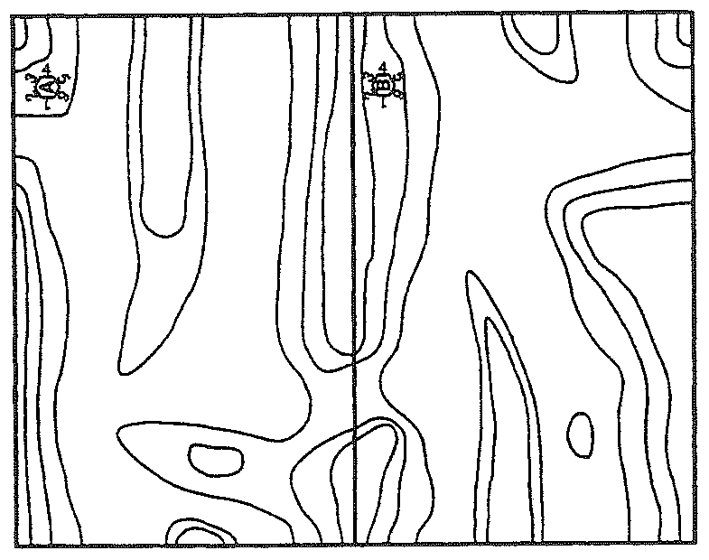

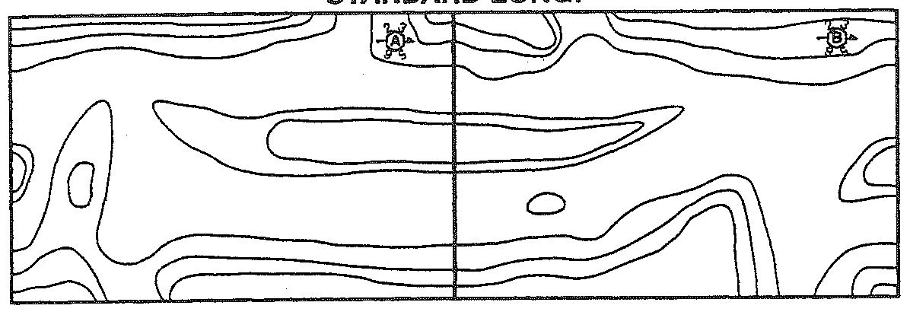

B. Sea Room. Unless the scenario includes land or shallow water, there was more room for ships to maneuver than represented by the two maps. To prevent an unrealistic "edge of the <mark>world</mark> effect, "sea <mark>room"</mark> exists in all directions, "unless otherwise specified in the scenario special rules (section V). This means that ships may move in any desired direction, even off a map edge. In one-map scenarios, it may be <mark>simplest</mark> to place the other mapsheet along the required edge; in two-map scenarios, it will probably be necessary to move each ship an identical distance and direction back towards the center of the map, thus <mark>"centering\*</mark> the ships and allowing continued play. This may also be done for one-map scenarios. The following limitations on the use of sea room must be observed:

a. When both maps have ships on them, sea room cannot be used <mark>until aff</mark> reinforcements have entered the game.

b. Sea room may not be used to push any ship off the board in the course of centering the positions of others.

C. Lack of Sea Room. If a scenario specifies that there is no sea room in the direction of one <mark>or</mark> more map edges, any ship which attempts to move either its bow or stern off one of those edges is immediately removed from the game and is counted as destroyed for victory determination. Ships which drift off the board are also destroyed. (Note that half-hexes are not considered to be part of the playing area, so moving into a half-hex does result in the ship's destruction.) Some scenarios allow ships to escape off certain board edges. In such cases, the ship is removed from the game but is not counted as destroyed. See section V.D.1.

#### IV. WEATHER CONDITIONS

A. Wind Direction. The number indicates the direction the wind is blowing towards at the start of the scenario. If both mapsheets are used, the wind rose on the <mark>"A®</mark> mapsheet is used to determine direction. The wind direction usually has a chance to change during the scenario.

**EXAMPLE:** If the wind is blowing in direction <mark>"1",</mark> it is blowing in the direction pointed to by the "1° arrow on the A mapboard wind rose.

B. Wind Speed. This number represents the Wind Speed at the start of the scenario.

C. Sea State. This number comes immediately after the Wind Speed; the two numbers are separated by a slash <mark>(\*/").</mark> The sea state is cross-indexed with each ship's freeboard to determine when lower-deck guns are unable to fire. Wind Speed may change, but Sea State never changes during a scenario.

<!-- pdf p.51, Scenario Book p.4 -->

D. Wind Direction Change. This will read either Oceanic, Coastal, or None. <mark>"Oceanic"</mark> and <mark>"coastal"</mark> identify the column used to roll for wind direction changes on the Wind Direction Change table (see the red sheet). The notation <mark>"none"</mark> means that there was no serious wind change during the historical <mark>battle,</mark> and no serious chance of variation either. Any game with many novice players should have no wind direction change to make it easier for them to acquire the skill of calculating all movement by reference to the wind direction.

E. Wind Speed Change. This identifies the column used to roll for wind speed changes on the Wind Speed Change table (red sheet). Any value in parentheses indicates the range of allowed wind speeds. A >= (greater than or equal to) or < (less than or equal to) before the number means:

\1. 2 The wind speed may not fall below the specified wind speed (but may vary otherwise).

\2. <= The wind speed may not be higher than the specified wind speed (but may vary otherwise).

#### V. SPECIAL RULES

Special rules are used to better simulate the historical peculiarities of a given scenario. They apply only to the scenario in which they appear.

A. Sail State at Start. If a sail state is specified for some or all ships, those ships must begin the game at that sail state. If no sail state is specified for some or all ships, those ships may begin at any sail state, as chosen by the players commanding them. This is declared by writing the initial sail state in the "SS\* column for g-t 1 on each ship's log sheet. Ships may start a scenario partially changed from one sail state to another.

**EXAMPLE:** If the scenario did not specify an initial sail state, ships could start at PS, MS, FS, furled, or even partway

from MS to PS, PS to MS, MS to FS (for CQ=E ships), etc. If the scenario specifies a sail state for one or more ships,

those ships must start at that sail state.

B. Anchoring. Anchoring is not allowed unless specifically permitted.

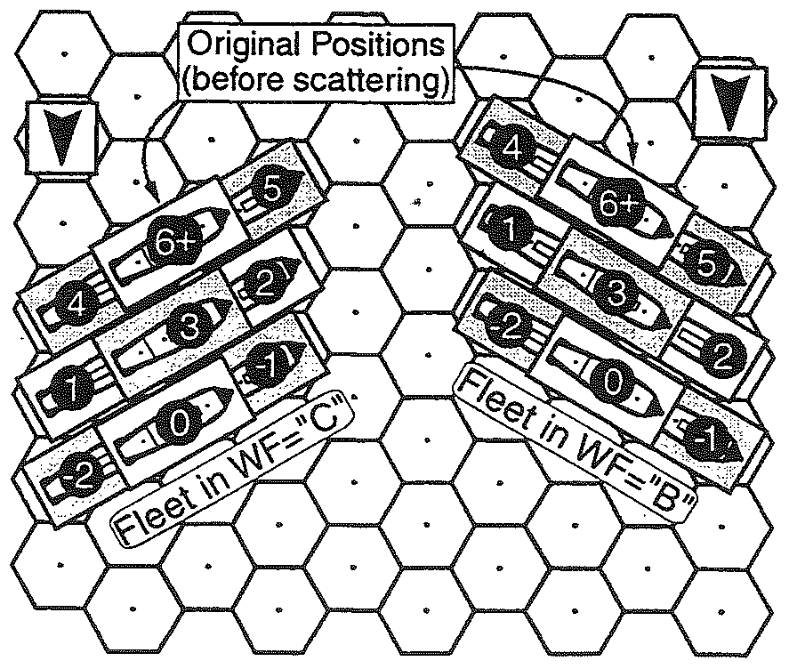

<mark>D.1</mark> Escape Conditions. Ships which are permitted to escape in a given scenario actually escape when they meet any of the following conditions at the end of a g-t.

a. Map Edge. A ship which moves off a specified edge of the mapboard.

b. Distance. Any ship = 31 hexes from the nearest enemy ship.

c. Relative Speed.

(1) The escaping ship is 20-30 hexes away from the nearest enemy ship, and:

(2) The escaping ship's maximum Movement Allowance (MA) in its current Wind Facing (WF) (ie., assuming maximum sail state) is at least as great as any enemy ship 20-30 hexes away of the same or larger class (i.e., a class 3 ship cannot stop a class 1 or 2 ship from escaping).

**NOTE:** for determining escape under V.D.1.c.(2), assume that all applicable enemy ships are in the same WF and at maximum sail state as the escaping ship, even if they are not.

<!-- pdf p.52, Scenario Book p.5 -->

D.2 Escape Procedure. Each ship which desires to escape must write "escape" in the notes section of the ship log during the plot phase. If at the end of that g-t the ship has fulfilled any of the conditions specified in V.D.1 above, it is removed from the mapboard. Note that any ship which has written <mark>°escape"</mark> and which fulfills escape conditions at the end of a g-t must escape, even if it no <mark>longer</mark> wishes to do so.

D.3 Escaped Ships and VPs. Escaped ships do not count as destroyed; however, the enemy Goes receive VPs for damage done to them according to the standard victory determination rules (see section VI.B below). In some scenarios, the escaping ship also provides VPs for its own side for escaping.

D.4 Reporting Escape Attempts. Any ship which has attempted to escape (i.e., writes "escape") must inform the enemy of that fact at the end of every g-t in which it attempts to escape.

#### VI. SPECIAL VICTORY CONDITIONS

A.1 Ending a Scenario. A scenario ends when one of the following conditions is met:

a. One <mark>of the</mark> sides meets its scenario special victory condition (if any).

b. Both sides agree to end the game.

c. All of the ships on one side have struck, except those that have escaped.

##### B. Standard Victory Determination

B.1 Victory Points. Each ship has a victory point (VP) value listed in the scenario order of battle. VPs are scored for enemy ships which are significantly damaged, destroyed, or captured. The portion of each ship's VP value which is scored depends on the amount of damage suffered by the ship.

B.2 Struck vs. Damaged Ships. All ships are divided into two categories for VP determination purposes:

(a) ships which <mark>are'damaged</mark> and <mark>(b)</mark> ships which have have surrendered, been destroyed, or been captured by boarding. (Henceforth the terms <mark>"struck\*</mark> or "forced to strike" are used to describe the latter category.) Each ship can yield VPs under either the <mark>struck</mark> or damaged categories, but never both.

<mark>B.3</mark> VPs for Struck Ships. A struck ship yields 100% of her VP value to the enemy.

B.4 VPs for Damaged Ships. The VP yield of a damaged ship depends on how much damage it has <mark>suffered</mark> in hull, rigging, and crew. Ships can yield VPs in more than one area. VPs for damaged ships are awarded only for complete sections destroyed; no VPs are awarded for boxes marked off in sections which are not completely destroyed, or for sections destroyed at one time but in which at least one box has been subsequently repaired (and still exists).

B.5 Victory Points Yielded by Damaged ships. The following are the proportions of her VP value that a damaged ship yields to the enemy:

a. Rigging sections 1-3 destroyed: 5% VP value for each section destroyed.

b. Rigging section 4 destroyed: 10% VP value.

c. Hull sections 1-3 destroyed: 10% VP value for each section destroyed.

d. Each Crew section destroyed (up to 4): 10% VPs each for each section destroyed.

B.6 Escaping and VP Awards. A ship may yield VPs for its own side by escaping and VPs to the enemy from damage it has suffered. Both may occur simultaneously.

B.7 Determining Victory. Each side's VP total is the sum of all VPs yielded by all enemy ships. Do not round fractions of VPs off! The side that has scored more VPs by the end of the scenario is the winner.

**EXAMPLE:** The Excellent is a British 74 worth 93 VPs, and is heavily damaged in a battle. She is completely dismasted, has lost hull sections 1, 2, and 3, sailor sections 1 and 2, and her marine section. Her total VP loss is:

- Rigging sections 1-3 destroyed: <mark>3x5%</mark> = | 15%

- Rigging section 4 destroyed: 1x10% = | 10%

- Three hull sections destroyed: 3x10% = | 30%

- Three crew sections destroyed: 3x10% = | 30%

As can be seen, the Excellent has lost 85% of her nominal VP value. 85% of 93 is 79.05; so the enemy receives 79.05 VPs for the <mark>Excellent's</mark> damage.

<!-- pdf p.53, Scenario Book p.6 -->

C. Special Victory Conditions.

C.1. Introduction. As noted before, the opposing forces are noticeably unbalanced in many of the historical scenarios. In such cases, special victory conditions (SVCs) are defined to give both sides a more equal chance of winning. Order of battle changes may also be listed for those players who want to fight a more <mark>"naturally\*</mark> even battle and avoid the use of special victory conditions.

C.2. Format. The SVCs are listed in the format country: victory condition. If one side achieves its special victory conditions, it immediately and automatically wins. This does not prohibit a side with special victory conditions from winning simply by scoring more VPs than the other side; however, in most scenarios the side with special victory conditions will be at a disadvantage unless it can achieve its SVC.

**EXAMPLE:** "Spanish: Any two ships escape" would mean that if the Spanish accomplish this they will win automatically, regardless of the fate of the other Spanish ships or the VPs totalled by each side. The Spanish would also win in the unlikely event that they scored more VPs than the enemy.

#### VII. ORDER OF BATTLE

All the information for each ship that is necessary to play the scenario is listed in the Order of Battle (OB) section of the scenario description. Each of the data columns has the following meaning:

Start: The leftmost column in the OB table gives a listing which looks like this: <mark>A1635:3%.</mark> The letters and numbers indicate the following:

a. First letter (either <mark>"A"</mark> or <mark>"B")</mark> — the mapboard on which the ship's bow is placed.

b. Four-digit number (i.e., "1635") — the hex in which the <mark>ship's</mark> bow is placed.

c. A colon (:), followed by a one-digit number <mark>("1\*</mark> to \*6") — the direction which the ship's bow points towards, using the Wind Rose for Map A (this matters when Map B is oriented differently from Map A).

d. Superscripted number (if present) — game-turn of arrival on the map. <mark>ff</mark> there is no such number, the ship is set up on the map at the start of the game.

**EXAMPLE:** A1635:3° means that the ship is placed on map A, on hex 1635, facing in direction 3, at the reinforcement entry phase of g-t 2.

Rate: A ship's rate refers to the number of guns she nominally carried. Smaller letters sometimes appear before and after the number. If before, they indicate the original nationality of the ship (F= French, S= Spanish, B= British). If after, they indicate ships larger or smaller than the norm for that rate (L= large, S= <mark>small;</mark> M= medium [this term was used to describe some British 74s larger than the standard type).

Ship Name: The name of the ship, as it would have been listed in its own country's navy list. Ships marked with either a <mark>B&</mark> or ® are flagships. Flagships are important for multi-player games, or when using the Poor Leadership optional rule. <mark>A</mark> —& means that the ship is the fleet flagship. A P indicates a subordinate flagship. The players who best understand teamwork — usually but not always the most experienced players — should be the admirals (and thus command the flagships).

CQ: This lists the initial Crew Quality and Morale Rating of the ship, representing their experience, confidence, and motivation in a combat situation.

- All other columns have exactly the same meaning as they do on the SDC.

Missing Sections: In several cases ships begin scenarios missing entire rigging, hull, or crew sections. No rigging checks, hull checks, morale checks, or automatic "guns dismounted" losses are taken from these missing sections. However, missing rigging sections do reduce movement, and missing sailor crew sections do cause negative gunfire modifiers.

**<mark>EXAMPLE:</mark>** A ship missing sailor section #1 subtracts -3 from her BGN for <mark>"each</mark> sailor section missing."

Reinforcements: All ships which enter a scenario after the start of the game are called "reinforcements." They enter at PS unless otherwise specified in the scenario, and are always assumed to have moved straight ahead at their maximum PS speed on the g-t previous to that on which they enter the board. They must accelerate, decelerate, and turn based on this limitation.

**EXAMPLE:** Penelope <mark>(F-f)</mark> enters the game on g-t 2 at WF=B at WS=3, On <mark>g-t "1</mark> she is assumed to have used 10 MPs;

thus on g-t 2 she must use at least 7 MPs.]

<!-- pdf p.54, Scenario Book p.7 -->

Introduction to the Scenarios: The French Revolutionary and Napoleonic Wars

On 1 February 1793, the embattled French Republic declared war on Great Britain, precipitating the last great maritime war in the age of sail. For the next 22 years Europe was wracked by nearly continuous wars, fought to determine whether France could conquer the rest of the continent. The war was waged not only on land, but also at sea; and not only in European waters, but on all the seas of the world.

On land the armies of the young Republic, after some inevitable teething troubles, pushed back the armies encircling France on all sides, aided by the invigorating spirit of Liberté, Egalité, Fraternité, by the levée en masse, and by able young generals like Napoleon Bonaparte.

The naval war went far less well. While it took only a matter of weeks or months to train a passable in-fantrymen, and only a matter of days to make his musket, it took several years to train an able seaman or build a ship of the line. Four years of revolutionary chaos — from the storming of the Bastille in July 1789 to the outbreak of war in February 1793 — reduced the French navy from a standard of efficiency almost equal to the British navy to one hardly better than the inept Spanish navy. France needed years of peace to restore its navy to competence, but the outbreak of war denied that vital recovery time. To make matters worse, the British Navy was better prepared for this war than for any previous war in the last hundred years. Britain wanted to avoid her unpleasant experience in the American Revolution, when France's temporary command of the seas off the Chesapeake had forced the surrender of a British army at Yorktown in 1781, resulting in the loss of the war.

Given these factors, it was inevitable that the French navy would not do as well as it had in the last war. But the effect of personality upon history cannot be entirely discounted by the serious historian, and two particular individuals — John Jervis and Horatio Nelson — played a significant role in ensuring that the French would suffer the greatest naval defeats of their history.

Jervis was responsible for creating a better-trained and better-disciplined fleet than ever before, and it was the peerless Nelson who wielded the weapon that Jervis created to destroy <mark>Englana's</mark> enemies at sea. He played a pivotal role at St. Vincent (1797), annihilated the French Mediterranean Fleet at the Nile (1798), achieved a narrow victory at Copenhagen (1801) by disobeying direct orders to withdraw, and was the only man who could so thoroughly have wrecked the combined Franco-Spanish fleet at <mark>Trafaigar</mark> (1805). Without him, the only significant naval victories were Lord Howe's victory at the Glorious First of June (1794) (seven French liners captured or sunk), and <mark>Duncan's</mark> great victory over a clearly outmatched Dutch fleet at Camperdown (1797). More typical outcomes included Hotham's victory off Genoa (1795), where only two French ships of the line (SOLs) were captured (Nelson was responsible for both), and Cape Finisterre (1805), where only two Spanish SOLs out of 20 Franco-Spanish line of battle ships were captured.

Without Nelson's victories, then, the French and Spanish might just have mustered enough sea power by 1805 to actually accomplish the invasion of England. Had such an event come to pass — <mark>France's</mark> greatest and most resourceful enemy eliminated — it is hard to imagine how Napoleon could have been stopped in his career of conquest. But Nelson did exist, and he led his fleet to victory at Trafalgar, where he died a dramatic <mark>hero's</mark> death at the moment of his greatest triumph.

In a sense, the rest of the naval history of the Napoleonic era was anticlimatic; with his battle fleets destroyed, all chance of Napoleon challenging Britain for naval supremacy was gone. But Napoleon did not give up his dream of defeating Britain, and laid down new battleships at an ever-increasing pace. The French navy belatedly adopted new technologies which the British had pioneered, finally installing carronades on a wide scale after 1806, for example. And French naval officers gradually became more professional, understanding that both good seamanship and good gunnery were necessary for victory.

French squadrons continued to sail after 1806, and their record was at first routinely dismal, with almost every action ending in British victory. But as the years passed, the French occasionally began to fight the British to bloody draws and even score some victories. The principal reason was the increased competence of the French Navy; another was the post-Trafalgar expansion of the Royal Navy to meet the renewed French threat, which saw some British officers promoted into commands they were not competent to hold. One addi tional factor which stimulated the French navy was the <mark>example</mark> of the young American navy, which in three years of conflict (1812-1814) shocked England — and the rest of the world — by winning almost every single-ship duel against the British. Like many conquerors, the Royal Navy had grown complacent, and in addition had to strain every nerve to meet its world-wide commitments for ships and men. When it ran into a small navy of superior ships manned by able-bodied volunteers, the result was inevitable. But the minor stings inflicted by the Americans could not alter the larger story, and by 22 June 1815, when Napoleon fell for the second and last time, Britain had used its naval supremacy to add to its previous conquests and build the solid foundation for an empire which would last for over a century.

<!-- pdf p.55, Scenario Book p.8 -->

### SCENARIO 1 — Squadron Action: Frigates in the Channel Islands (23 April 1794)

#### I. HISTORICAL BACKGROUND

Immediately after the start of the war, the French formed several frigate squadrons to attack British shipping in the English Channel and its approaches. These were so successful that the British formed their own Squadrons to find and destroy the French raiders. At dawn on 23 April 1794, one such force of five frigates under Sir John Borlase Warren sighted one of the French squadrons. Both sides closed to investigate, and the French opened fire at very long range as the two squadrons crossed on opposite tacks. Realizing that the British force was much more powerful, the French then fled. The British naturally pursued, and, aided by a favorable wind shift, were able to obtain the wind gage and bring the retreating French to action. The British ships were strung out from the chase and came into action one at a time, but superior British gunnery soon told, and <mark>Pornone,</mark> Babet, and Engageante were all captured after an honorable resistance against four more powerful ships (one of Warren's ships, the Nymphe (36) was too slow to arrive in time to contribute). The French cause wasn't helped by the bad conduct of <mark>Résojue,</mark> which initially refused to take her place in the line of battle and then fled to Morlaix (her captain was appropriately cashiered for misconduct).

This action was important chiefly because of the capture of Pomone, then one of the most powerful frigates in the <mark>world.</mark> Although probably designed to mount 18-pdr. long guns on her gun deck, she actually mounted 24-pdrs when captured. Since most French frigates carried only 12-pdrs at the time, the British were understandably impressed, and reacted by (a) copying her (the Endymion) and (b) cutting off the topmost deck ("razing") of three old 64's, making them very powerful frigates ("razees"). The Endymion was reputedly one of the best frigates in the Royal Navy for almost 20 years (and was copied herself in 1813 when the American super-frigates gave the Royal Navy another shock), while the most famous of the razees, the Indefatigable, went on to have a stellar career (see scenario 14).

This action was also notable because of the presence of two rising young stars among the British captains. Sir Edward Pellew of Arethusa and Sir Richard John Strachan of Concorde would go on to do great things. Warren did not achieve the fame of Pellew and Strachan, but rose to high rank, later commanding British naval operations against the United States in 1812 and 1813.

<mark>ll.</mark> PLAYERS | lil. MAP CONFIGURATION Minimum: 4 (2 British, 2 French) | Map A

Ideal: 6 (3 British, 3 French)

#### IV. WEATHER CONDITIONS

Wind Direction: 3 | Wind Direction Change: Oceanic Wind Speed / Sea State: 3/3 | Wind Speed Change: Steady

#### V. SPECIAL RULES

A. Sail Status. All French ships begin the game at MS; all British ships start at PS. B. Scattering. Both sides scatter.

C. French ships may escape. All escaped ships give 50% of their VP value to the French <mark>side's</mark> VP total.

#### VI. SPECIAL VICTORY CONDITIONS

A. French: force any British ship to strike.

#### VII. ORDER OF BATTLE

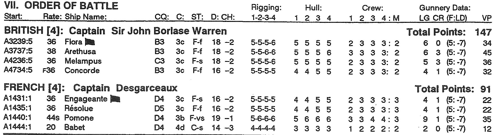

<!-- pdf p.56, Scenario Book p.9 -->

### SCENARIO 2 — Indian Ocean Challenge: Isle Ronde (22 October 1794)

#### I. HISTORICAL BACKGROUND

The fighting quickly spread to all the seas of the world, even the distant Indian Ocean. News of war took some <mark>months</mark> to arrive, but in October 1794 a small British force (two obsolete two deckers) appeared at Isle de France (now Mauritius), the main French base in the Indian Ocean, to contest French control of their own waters. The available French force was only two frigates and a brig, but the senior French officer, Captain Jean-Marie Renaud, pugnaciously decided to challenge the British force anyway. He sailed on 19 October, and at 1100 on 22 October the two sides spotted one another about 30 miles to the east of Isle Ronde, a small islet off the NE coast of Mauritius. Both sides closed, but with the unusually light breeze it was about 1500 before the <mark>battle</mark> began.

The French force consisted of frigates Cybéle (40) and Prudente (36), the brig Coureur (14), and the Rosalie (20), a privateer (i.e., a privately owned warship) which volunteered to assist the French squadron. Even counting Rosalie, the British were the superior force; the Centurion and Diomede were clearly more powerful than Cybéle and Prudente, and the two French corvettes were too small to make up the difference. The British also enjoyed a slight edge in discipline and seamanship, although to a much lesser degree than would be typical in later years. (One reason for this was that the best ships and officers were reserved for the vital Atlantic and Mediterranean theaters.)

The battle began with the British to windward; as usual they closed, but Diomede did not support Centurion as closely as ordered, and the French were able to concentrate somewhat on the larger ship. Firing continued until around 1800, when the approach of darkness forced an end to the battle, with both sides drawing off to repair. The battle was a tactical draw in the sense that neither side lost a ship. The British claimed a win because French casualties (120 killed and wounded) were far higher than British (27 total), while the French claimed a strategic victory because the British had to return to Bombay to refit, removing the threat to French commerce. Captain Smith of Diomede was eventually court-martialled for his failure to close at this action and other misdeeds. He was found guilty and dismissed from the Navy, but returned to England, hired a lawyer and sued. The Admiralty retreated and reinstated him to his rank, but he was never employed again.

<mark>il.</mark> PLAYERS | <mark>ll.</mark> MAP CONFIGURATION Minimum: 2 (1 British, 1 French) | Map A

Ideal: 4 (2 British, 2 French)

#### IV. WEATHER CONDITIONS

Wind Direction: 2 | Wind Direction Change: Oceanic Wind Speed / <mark>Sea State:</mark> 2/2 | Wind Speed Change: Steady (<3)

#### V. SPECIAL RULES

A. Sail Status. Both sides start at MS.

B. French may escape after g-t 25.

C. Diomede's Guns. Diomede is armed with 4 long gun factors and 3 medium gun factors. D. Alternate Sea State [optional]: to balance the scenario and demonstrate the freeboard problems of the obsolete 44-gun two-deckers, use a sea state of 3 instead of 2; such sea states are normal around Mauritius, and would have prevented the Diomede from using her leeward lower deck guns.

#### VI. SPECIAL VICTORY CONDITIONS

A. French: British lose at least 5 total sections (of any type), and both French frigates escape.

#### VII. ORDER OF BATTLE

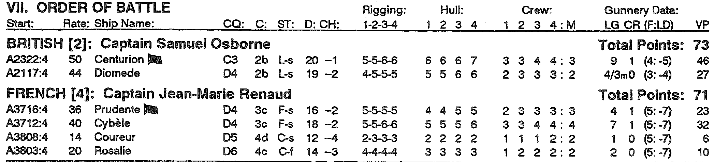

<!-- pdf p.57, Scenario Book p.10 -->

### SCENARIO 3 — Capture of the Alexander (6 November 1794)

#### I. HISTORICAL BACKGROUND

Although minor naval operations in European waters had taken place since the declaration of war.in 1793, the first major naval campaign occurred in the Atlantic in May 1794. A huge French convoy was bringing thousands of tons of grain from America to a hungry France; it was so important that its capture might mean the fall of the French revolutionary government. Britain dispatched her Channel fleet to intercept it, and France sent its Brest fleet to protect it. The result was a series of engagements culminating in the first great naval battle of the war — the Glorious First of June (1 June 1794), where 25 British SOLs captured or destroyed 7 of 26 French liners, losing none themselves (every merchantman in the convoy entered port safely, however, enabling France to claim a strategic victory).

This battle set the pattern for all that followed, and later would be practically unremarked among the greater glories achieved by Nelson; but before June 1st the British had not yet understood just how thoroughly the Revolution had ravaged the French navy. British sea officers then still largely regarded the French navy as the hard-fighting and competent force of 1781, not the patriotically inspired (but less competent) fleet of <mark>1784.</mark> Thus the battle was among the most important events solidifying British confidence in victory, and French expectations of defeat, factors which greatly contributed to the nearly unbroken string of British successes and French defeats in the two decades to follow.

In the months following the battle the French Atlantic fleet mostly remained in its home port of Brest, cowed by its defeat; but in the fall it began to show some signs of life. On September 12th a squadron of six sail of the line under the command of Rear-Admiral Nielly left Brest to cruise against British commerce. After resupplying, he sailed again on 22 October with five SOLs to intercept the British homeward-bound Lisbon convoy. He missed his prey, but instead spotted two British 74s, Alexander and Canada, at about 0200 on 6 November 1794. When national identity became clear, the French chased the British, who naturally <mark>fled,</mark> given the impossible numerical odds against them. The Alexander had a well-deserved reputation as a very <mark>slow</mark> ship, however, and unfortunately for the British she lived up to it here. The French quickly closed, and by about 0830 Alexander and Droits de <mark>I'Homme</mark> were exchanging shots; by 0900 Canada and Tigre were doing the same. The two British ships had become somewhat separated from each other during the chase, and Canada now tried to support Alexander. Nielly saw what was happening, interposed between them, and forced Canada to sheer off.

From that moment Alexander was doomed. The first French ship to get in close was the brand-new Droits de <mark>I'Homme,</mark> at about 1130, but she soon had some rigging shot away and dropped astern. The Jean- Bart replaced her, and at 1215 Marat arrived, gave Alexander a stern rake, and joined Jean-Bart in the fight. By 1300 the Alexander, having fought alone against three French SOLs for over an hour, was in bad shape. Her rigging was cut to pieces, her hull had suffered moderate damage, and she had been on fire. She had only lost about 40 men killed and wounded, but was clearly no longer in any condition to continue the fight, and her captain accordingly surrendered — a perfectly honorable course of action.

<mark>ll,</mark> PLAYERS | <mark>ill.</mark> MAP CONFIGURATION Minimum: 3 (1 British, 2 French) | <mark>MapA</mark>

Ideal: 6 (2 British, 4 French)

#### IV. WEATHER CONDITIONS

Wind Direction: 2 | Wind Direction Change: NONE Wind Speed /Sea State: 3/3 | Wind Speed Change: NONE

#### V. SPECIAL RULES

A. British ships may escape.

#### VI. SPECIAL VICTORY CONDITIONS

A. \_ If any British ship strikes before the end of g-t 18, the French automatically win. B. Otherwise, if the British get 60 points, they win a marginal victory; => 80 VPs = decisive victory. <mark>C.</mark> Each French ship which strikes yields 150% of her normal value to the British. D. <mark>Each</mark> British ship which escapes yields 100% of her value to the British side.

<!-- pdf p.58, Scenario Book p.11 -->

#### VII. ORDER OF BATTLE

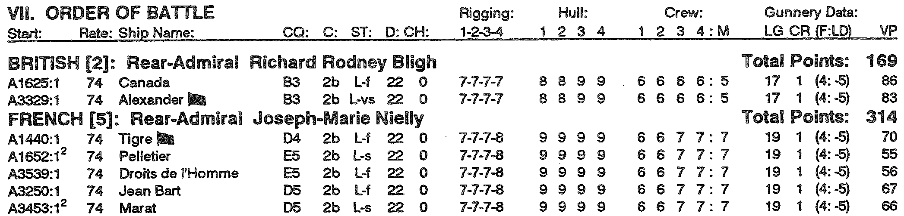

### SCENARIO 4 — Frigates vs. Liners: Action off Sumatra (9 September 1796)

#### I. HISTORICAL BACKGROUND

By the beginning of 1796 France had already lost 37 SOLs since the beginning of the war, and with them any chance to seriously challenge British naval supremacy. But the French still desired to strike at their ancient enemy, and the Indian Ocean looked like a logical place to hurt England. With Europe compelling attention, British warships sent to distant seas were often the dregs of the Royal Navy, either old and small, like Centurion and <mark>Diornede</mark> (see scenario 2), <mark>poorly-commanded,</mark> or both.

The French government also needed to send political agents to the independently minded French island colonies of Mauritius and Isle de Bourbon (now Reunion) to bring them back under central control; accordingly, it dispatched a strong frigate squadron under Rear Admiral Sercey to carry the agents out and then operate against British merchant shipping. He put to sea from Rochefort on 4 March 1796, with four frigates and two corvettes under his command. His flagship was the powerful Forte, rated 44 guns but actually mounting 52, including 30.24-pdrs. on the gun deck — the same number and size of gun carried by the American 44 Constitution and her sisters. In addition, though less stoutly built than the American ships, Forte was almost as large as the American super-frigates and her crew was equally numerous. Thus in 1796 the Forte class were clearly the most formidable frigates in the world (the American 44s were not launched until 1797).

Arriving at Mauritius on June 18th, Sercey sailed again on 14 July 1796 with six frigates, having added Cybéle (40) and Prudente (36) to his force. The latter ships badly needed to go to France for a major refit, but Sercey took them along anyway, presumably because they were a sizeable addition to his squadron. Briefly hunting British merchantmen around Ceylon, he then headed towards Sumatra to see what prey he might find there. The local British naval commander, Captain Lucas of the Arrogant (74), heard that Sercey was in the area but was reluctant to go in search of him, as many of his ships desperately needed dockyard work as well. Lucas decided to go to Trincomalee, Ceylon, with the 74s Arrogant and Victorious, refit there, then return with reinforcements to hunt for Sercey. On the morning of September 8th, the two squadrons sighted each other off the western tip of Sumatra. Lucas, despite some concern about the combat-worthiness of his ships (the Victorious had 90 of her crew away in prizes), decided to chase the French, because he knew it would be difficult to find them again. The British liners chased Sercey the rest of that day in light and shifting winds, gradually closing. At dawn on the <mark>Sth,</mark> the French, finding that the British had continued to gain during the night, were forced to accept action. The resulting battle was perhaps the most fascinating squadron action of the entire period 1793-1815, as it is one of very few balanced SOL-vs-frigate engagements.

The battle began at 0720, with the squadrons passing on opposite courses; the French had the wind gage. The initial broadsides were at surprisingly close range — about 240 yards (3 CA hexes) — but despite this, the fighting did not proceed well for the British, mainly because Victorious displayed a level of ineptitude astonishing for the Royal Navy. Arrogant had routinely cleared for action the previous morning, when the French squadron was first identified, but Victorious was still unready 20 hours later! Only at <mark>0710</mark> did she discover that moisture had gotten into the charges in her guns, and she then requested permission to stand inshore and reload them; this was naturally denied, but indicates an amazing lack of preparedness. Further, Victorious' first broadside missed all French ships, but some of the shots did hit Arrogant; indeed, one shot pierced the hull of the latter ship "between wind and <mark>water"</mark> (i.e., at or slightly below the water line).

<!-- pdf p.59, Scenario Book p.12 -->

The French fired high, as usual, and the concentrated fire of their four leading ships (Cybéle and Prudent were behind and to windward of the other ships, and took little part in the action) soon crippled the Arrogant's rigging. Then they shifted fire to Victorious; her captain was soon wounded, and command devolved upon the second lieutenant, <mark>Waller</mark> (the first lieutenant was away with the prizes). <mark>Waller</mark> imprudently "wore without any Signal or Order," with the unfortunate result that "he got the ship raked by most of the Enemy's ships as they passed." Not content with this mistake, Waller then chased the retreating French frigates alone (Arrogant was so damaged aloft that she could only follow slowly).

Thus, from about 0900 to 1100, Victorious engaged all six French frigates by herself. This unequal struggle was finally terminated by the approach of Arrogant, which persuaded the French (who had suffered considerable damage as well — 146 French casualties compared to 108 British) to sail away, leaving the British to claim victory. In fact, considering that firing high usually produced only a fraction as many casualties as firing low, the French likely inflicted at least as much damage as they received, and would have won had they fired low. The Vertu (as might be expected from her position at the head of the French line) had suffered most, but all six frigates had suffered some damage, and Sercey was forced to put into Dutch ports to repair. After this ignominious start to his raiding voyage, Sercey put to sea again, only to meet — and run away from — some unescorted British East Indiamen near Java — the very sort of target he had been sent to the Indian Ocean to attack! Having accomplished nothing of significance, Sercey then dispersed his squadron to hunt merchantmen individually. Some of the ships, like Forte, were quite effective, but all either returned to France or were captured (see Scenario 9).

<mark>ll.</mark> PLAYERS | ill, MAP CONFIGURATION Minimum: 3 (1 British, 2 French) | Map A

Ideal: 6 (2 British, 4 French)

#### IV. WEATHER CONDITIONS

Wind Direction: 6 | Wind Direction Change: Oceanic Wind Speed / Sea State: 2/2 | Wind Speed Change: <mark> Gusty</mark> (<2)

#### V. SPECIAL RULES

A. Sail State. All ships start at PS.

B. Scattering. All ships scatter. | \* <mark>C.</mark> Optional Wind Speed: The English historian William James claimed that if there <mark>had. been</mark> more wind, the British would have done much better. To explore this possibility, set the initial WS and sea state to 3: the Wind Speed Change becomes (<3).

#### VI. SPECIAL VICTORY CONDITIONS

A. British: strike => 4 French frigates.

B. French: strike at least one British SOL, while losing < 2 frigates.

#### VII. ORDER OF BATTLE

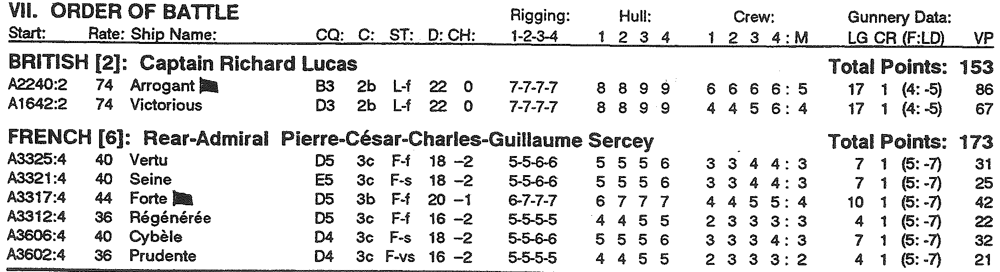

<!-- pdf p.60, Scenario Book p.13 -->

### SCENARIO 5 — Enter the Spanish: Lion vs. Spanish Frigates (15 July 1798)

#### I. HISTORICAL BACKGROUND

By 1798 France had lost any chance to challenge Britain at sea by herself, but she coerced her neighbors to join her: the Netherlands went to war with Britain in 1795 and Spain switched sides in 1796. The Spanish fleet was quite formidable on paper; in fact the Armada <mark>Espafiola</mark> was then the second largest navy in the world, due both to a major recent building program and the heavy French losses since 1793. The Spanish navy was nowhere near so formidable in quality, however. While her navy possessed many good officers, <mark>Spain's</mark> financial weakness and lack of a large merchant marine to serve as a training school for sailors meant that Spanish warships were usually crewed by unskilled landsmen. The unsurprising result was that the Spanish navy's performance in the Napoleonic era was one of almost unbroken failure in combat. This weakness was first revealed to the world on St. Valentine's day (14 February) 1797, when 15 British liners met and defeated 23 Spanish opponents off Cape St. Vincent, capturing four of them. This battle also cemented Nelson's fame; he took two Spanish SOLs by boarding after leaving the line of battle without orders to sail to the vital point of the battle.

The Spanish battle fleet was quiet for some time after this disaster, but Spanish frigate squadrons continued to sail, and in July 1798 one such squadron ran into Lion (64) in the Mediterranean just east of Cartagena. Surprisingly, the Spanish commodore did not run away, but willingly engaged, possibly because Santa Dorotea (34) had just lost her main topmast in a storm, and would have been easily captured by Lion if not supported. The Spanish squadron was considerably superior in total force to the British ship, but failed to cooperate. When Lion attacked Santa Dorotea, the other Spanish frigates, instead of supporting their comrade closely, tacked to get to windward but then gradually drew away, engaging Lion at medium and longer ranges, finally leaving altogether. This doomed Santa Dorotea, which surrendered after a respectable resistance; she suffered 52 killed and wounded, while Lion lost only 2 men wounded.

#### II. PLAYERS

#### III. MAP CONFIGURATION

Minimum: 2 <mark>(4</mark> British, 1 Spanish) | Map A

Ideal: 3 (1 British, 2 Spanish)

#### IV. WEATHER CONDITIONS

Wind Direction: 2 | Wind Direction Change: Oceanic

Wind Speed / Sea State: 3/3 | Wind Speed Change: Steady

#### V. SPECIAL RULES

A. Sail State. All Spanish ships start at MS.

B. Scattering. Spanish ships scatter.

C. Escape. Spanish ships can escape.

D. Remember that Santa Dorotea may not repair her first rigging section.

#### <mark>VL</mark> SPECIAL VICTORY CONDITIONS

A. Spanish: if no <mark>VP's</mark> are scored by g-t 30, the Spanish win.

B. Spanish: all Spanish ships escape.

#### VII. ORDER OF BATTLE

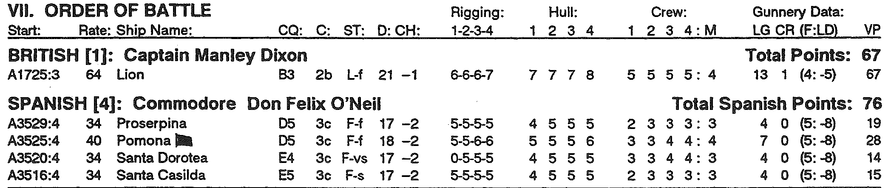

<!-- pdf p.61, Scenario Book p.14 -->

THE NILE CAMPAIGN (SCENARIOS 6-8) | June-August 1798

"By this time tomorrow I shall <mark>have</mark> gained a Peerage or Westminster Abbey."

- Nelson, on his prospects just before the battle of the Nile.

On 19 May 1798, a tremendous French armada of 70 warships and over 300 transports set sail from Toulon, carrying an army of over 30,000 men led by a rising young Corsican general, Napoleon Bonaparte. He intended to seize Egypt as a staging point for the conquest of distant India: his long-term goal apparently to establish an empire to rival that of Alexander the Great. The escorting force was the French Mediterranean fleet (13 SOLs and 6 frigates), under the brave but not particularly competent Vice-Admiral Brueys.

His opponent was Rear-Admiral Horatio Nelson — like Napoleon, a rising young star in his chosen service. When the British government heard about the preparations for the mysterious French expedition (its destination was unknown, but its enormous size was clear), it became alarmed and ordered John Jervis, Earl St. Vincent, commanding the British Mediterranean Fleet, to detach a squadron to deal with the French threat, recommending Nelson to command it. St. Vincent, recognizing Nelson's potential for greatness, agreed, and gave him command over the heads of several more senior admirals. Jervis went even further and gave Nelson the pick of the 74s in his fleet; the captains of these well-commanded ships became the famous "band of brothers." Nelson's job was simple — to stop the French expedition, and, if possible, destroy it.

Nelson immediately sailed to blockade Toulon, but on his way his flagship, Vanguard, lost her foremast in a gale on 20 May. Before she was ready to sail again on the 27th, Brueys and Napoleon had gotten clean away, their destination still a mystery to the British. Now occurred one of the great dramas of history. For the next two months Nelson diligently searched the central and eastern Mediterranean for the French, but, aided by good luck and the unfortunate absence of <mark>Nelson's</mark> frigates, Brueys was able to deliver <mark>Napoleon's</mark> army safely to Egypt, arriving on July ist. Napoleon speedily conquered the great city of Alexandria, then marched south to Cairo. There, near the pyramids, Napoleon addressed his Army of the Orient. "Soldiers! Forty centuries look down upon you!", he proclaimed; then, with the pyramids and the Sphinx looking on, Napoleon decisively defeated the Mamelukes in an afternoon and thus conquered Egypt. Unfortunately, Napoleon either did not understand, or underrated, the importance of the French fleet to his future. To hold Egypt he needed uninterrupted communications with France, and this in turn depended on the continued existence of the French fleet. | <mark>5</mark>

After escorting the transports to Alexandria, Brueys was faced with the difficult problem of where to base his fleet. Napoleon had ordered it to remain nearby, and the only possible bases fitting this requirement were the old harbor of Alexandria, the island of Corfu, and Aboukir Bay. The first two had serious disadvantages; Alexandria would require an unknown amount of dredging to deepen the harbor mouth sufficiently for the larger liners to enter, while Corfu was two weeks sail away.

Faced with these unpleasant alternatives, Brueys chose to anchor his fleet in what he thought was a good defensive position in Aboukir Bay, some 20 miles east of Alexandria. But the position lacked shore batteries and was thus vulnerable to attack. This weakness would have been serious in any case but was fatal against Nelson who, still desperately scouring the Mediterranean for his elusive foe, finally found him on the afternoon of 1 August 1798. He and his "band of brothers" attacked at once, and in one night the French fleet ceased to exist; 11 ships of the line (out of 13) and 2 frigates were taken or destroyed. While some French ships, especially Guerrier, Franklin, and Tonnant, fought very well, others behaved indifferently. This was partly <mark>Napoleon's</mark> fault. He had taken some sailors from each ship of the line with him into Egypt, and these men — about 1000 in all — crewed a river flotilla of gunboats on the Nile which greatly aided Napoleon's operations. Unfortunately, many of the best gunners were among those taken, which seriously reduced the combat effectiveness of the French fleet.

Incompetence among some French officers was a problem, too. Brueys failed to make his position as strong as possible, the indecisive Villeneuve, commanding the unengaged French rear (he was later commander-in-chief of the Franco-Spanish fleet at Trafalgar), took no action to help the rest of the French fleet at any time, and one French captain, Trullet Jr. of the <mark>Timoléon,</mark> ran his ship aground instead of escaping (despite having suffered very little or no damage), due either to complete incompetence or panic. The battle raged all night and into the next day, and was marked by the spectacular explosion of the French flagship, Orient (120), which caught fire and blew up around 2200. In the end only four French ships (two SOLs and two frigates) got away. This "Battle of the Nile," as it came to be called (the Canopus mouth of the Nile emp-ties into Aboukir Bay) was the most decisive battle during the entire 300 years of the age of fighting sail, measured by the percentage of ships captured or destroyed. Thus, at almost the same moment that Napoleon conquered on land, Nelson negated his triumph by destroying French power at sea.

<!-- pdf p.62, Scenario Book p.15 -->

### SCENARIO 6 — Fleet Action at Sea: Nelson vs. Brueys (23 June 1798)

#### I. HISTORICAL BACKGROUND

On the afternoon and evening of 22 June, while the French armada was off Cape Passaro, the two fleets were within a few miles of each other. Two French frigates were actually in sight of the British fleet on that day, but Nelson did not chase them since he had no frigates of his own, and sending SOLs after them would probably have accomplished nothing but splitting his own fleet. Later that night, the French reportedly heard the signal cannons of the British fleet. But luck was not with Nelson, and the French armada evaded the British, allowing Napoleon to land in Egypt without incident.

However, if either fleet had held a slightly different course, perhaps forced by a slightly different wind speed or direction, or if Nelson had chased the French frigates, the fleets would have met on the 22nd or 23rd, and Nelson would certainly have attacked immediately. He had planned carefully for every possibility; his plan for attacking the French fleet at sea was to detach 4 of his 13 liners to destroy as many transports as possible, while he himself led the remaining 9 SOLs and the 50-gun Leander against the French battle fleet of 13 sail of the line. Scenario 6 presents this situation. However, even the peerless Nelson would have had trouble against such odds, and he could easily have lost. Even if the British had won, the victory would certainly have been less complete than the triumph at Aboukir Bay (see Scenario 7).

#### II. PLAYERS

#### III. MAP CONFIGURATION

Minimum: <mark>12</mark> (5 British, 7 French) | Standard LONG

Ideal: 18 (7 British, 11 French)

#### IV. WEATHER CONDITIONS

Wind Direction: <mark>1</mark> | Wind Direction Change: Oceanic

Wind Speed / Sea State: 3/3 | Wind Speed Change: Steady

#### V. SPECIAL RULES, |

A. Sail Status. The French start at MS.

B. Scattering. Both sides scatter.

<mark>Cc.</mark> Alternate Orders of Battle. As noted above, this scenario is not balanced. For a more even game, try one of the following alternatives:

<mark>1.</mark> The Leander was really too small to fight in the line of battle, and when Nelson discovered Bruey's strength, he might well have substituted a 74 for Leander. Use Goliath for this purpose, putting her in Leander's place.

\2. The Conquérant was so weak that Brueys might easily have detached her from the line of battle. Delete her from the OOB and move each of the following ships forward four hexes.

<mark>3.  {f</mark> Nelson had been really concerned about the disparity of force between his 10 ships and the French 13, he might well have added another liner to his battle fleet. To represent this, add <mark>Goliath</mark> to the British force, in the starting location listed.

#### VII. ORDER OF BATTLE

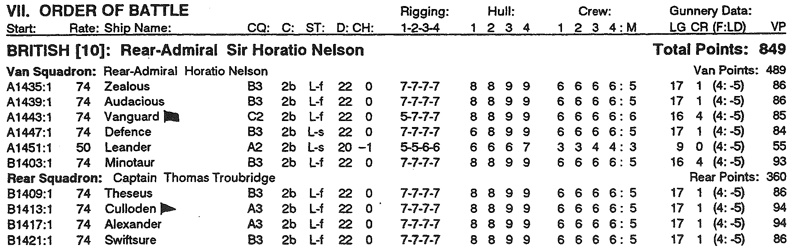

Optional Ship:

(Continued on next page)

<!-- pdf p.63, Scenario Book p.16 -->

FRENCH [13]: Vice-Admiral Frangois-Paul Brueys <mark>d'Algalliers</mark> | Total Points: 926 Van: Rear-Admiral Blanquet du Chayla

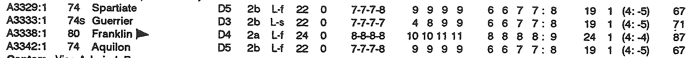

##### Center: Vice-Admiral Brueys

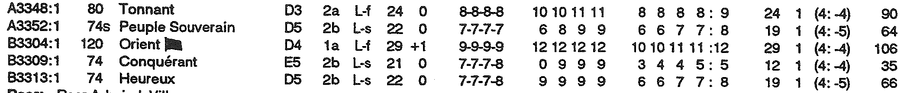

##### Rear: Rear-Admiral Villeneuve

### SCENARIO 7 — Fleet Action at Anchor: Battle of the Nile <mark>(1-2 August 1798)</mark>

#### I. HISTORICAL BACKGROUND

Brueys has been castigated by some authors for choosing Aboukir Bay as his fleet anchorage, but such criticism is at least partially unfair. The best course would probably have been to go to Corfu, a healthier, well-protected anchorage which was also reasonably close to Egypt, but Napoleon desired the fleet to remain closer if possible. Napoleon also crippled the fighting power of the fleet by taking some of the relatively scarce trained seaman and gunners, understandably making Brueys even more reluctant to risk a sea voyage which could well result in meeting the British fleet.

Brueys can be blamed, however, for failing to make his chosen anchorage as secure as possible. He could, and should, have created much heavier shore batteries on Aboukir Island than he actually did, and at least one of his frigates should have been permanently stationed out to sea to give early warning of the approach of any enemy force. Finally, when Nelson hove in sight, Brueys should have had contigency plans for just such a circumstance — as Nelson did.

But he apparently had no such plans, and the result was the single most decisive fleet battle in the age of sail. At least one French work has recently argued that it was this battle, rather than "Trafalgar, which doomed the French Navy to failure for the rest of the Napoleonic era, and there is much to this point. The loss, both in materiel (ships, sailors, and some very competent officers) and morale (due to the crushing nature of the defeat) was worse than for any previous battle. Finally, it changed Nelson's status from a rising young flag officer to the most prominent admiral of the Royal Navy.

<mark>ll.</mark> PLAYERS | | <mark>ll.</mark> MAP CONFIGURATION Minimum: 1 <mark>(i</mark> British, <mark>0</mark> French) | See below

Ideal: <mark>10</mark> ( British, 5 French)

#### LAND

<!-- pdf p.64, Scenario Book p.17 -->

IV. WEATHER CONDITIONS Wind Direction: 4 | Wind Direction Change: Oceanic Wind Speed/Sea State: 3/3 | Wind Speed Change: Steady

<mark>V.</mark> SPECIAL RULES A. Sail State. The French begin at Furled. <mark>8.</mark> SeaRoom. There is no sea room. C. Anchoring. Anchoring is allowed anywhere on the board. D. Shallow Water. The shaded area on the map above is shallow water. The depth of the shaded area "A"

Is 21+d6, area °B' is <mark>18+06,</mark> and area °C' is 15+d6. When a ship enters any shaded hex, roll one d6 and add the DR to the number for that area; the result is the depth of the hex. E. Escape. French ships may escape off the board edges so indicated on the map. F. French Unpreparedness. The following rules depict the French <mark>fleet's</mark> unreadiness for battle:

\1. All French ships begin at normal anchor; one anchor is placed in the hex ahead of each ship's bow. Any French ship may become anchored with springs by preparing for the necessary length of time. 2. Raising sail to FS takes much longer than normal: the time required is 8 + SK g-ts. 3. <mark>No French</mark> ship can fire guns until it clears for action. Each broadside requires 3 consecutive turns (using all 4 sailor CSs) to be cleared, and is noted in the Log by writing CP or CS. Note: This scenario is completely unbalanced in favor of the British, as was historically the case. Fora more balanced game, assume that the French are completely ready to fight, and ignore this section. Also assume that all French ships are anchored with springs. G. Solitaire Rules. This is the only CA scenario which is at all <mark>feasible</mark> for solitaire play. <mark>If</mark> played solitaire, every French ship simply sits still, firing at its best single target <mark>(ie.,</mark> its highest MGN) in its field of fire.

#### VI. SPECIAL VICTORY CONDITIONS

A. French: receive 125% VP value for each French ship that escapes.

#### VII. ORDER OF BATTLE

<!-- pdf p.65, Scenario Book p.18 -->

### SCENARIO 8 — Postscript to Victory: Leander vs. Genereux <mark>(18 August 1798)</mark>

- HISTORICAL BACKGROUND

After the battle of the Nile, Nelson wrote a dispatch announcing his amazing victory, and sent off two copies, one by the corvette Mutine (16), and one by Leander. The Mutine got through to Gibraltar safely, but Leander had the bad luck to run into Généreux, one of the two French liners which got away from Aboukir Bay. Leander fled, but the French battleship was faster, and easily caught her. At about 0900 a battle began which, barring unusual luck, could have only one outcome, given the enormous superiority of the big French 74 over the small British two-decker. Indeed, after a notable and prolonged resistance lasting over five hours, including repelling several French boarding attempts, Leander was dismasted and forced to strike. Généreux's captain, Le Joille, hated the English, and treated his captives so badly that one of the British tars later swore, "Give us back our little ship, and we'll fight you again till we sink!"

Le Joille never got his prize back to France. After proceeding to Corfu to reprovision, both ships were blockaded by a combined Turkish and Russian force. Généreux eventually escaped after some skirmishes with Russian SOLs (only to be captured near Malta), but Leander was taken over by the Russians when Corfu surrendered in 1799, and returned to England at the end of the war.

#### IV. WEATHER CONDITIONS

Wind Direction: 1 | Wind Direction Change: Oceanic Wind Speed / Sea State: 2/2 | Wind Speed Change: Gusty (<2)

**NOTE:** For ship data for this and all other single-ship actions, see section [MASTER SHIP DATA CHART FOR SINGLE-SHIP ACTIONS:](#master-ship-data-chart-for-single-ship-actions).

### SCENARIO 9 — End of a Raider: Sybille vs. Forte (1 March 1799)

#### I. HISTORICAL BACKGROUND

The huge French frigate Forte had cruised in the Indian Ocean since 1796 (see scenario 4). In the spring of 1799, under the incompetent Captain Beaulieu-Leloup, she was again hunting British merchantmen in the Bay of Bengal. Tiring of her depredations, the British sent Sybille <mark>(38</mark> [a captured French 40]) to take her. Recognizing the difficulty of the task, Sybille's crew was augmented by 100 soldiers. Sybille was a fortunate choice, because her captain, Edward Cooke, had spent his two years in command rigorously training his men in both seamanship and gunnery; events proved that he had done a magnificent job.

But Cooke was also lucky in facing a very unprepared opponent. Forte was quite undermanned, having just put prize crews aboard two British merchantmen captured the same day, and thus had one fewer man than <mark>Sibylle.</mark> Even more important, Beaulieu-Leloup did not take proper notice of Sybille, assuming she was merely another merchantman, and so was rudely surprised when she was finally identified as a British frigate. To compound his error, <mark>Forte's</mark> captain did not wait to clear for action before engaging Sybille, but accepted battle eagerly, coming into gunnery range at about midnight. The Sybille was to windward, came downwind and passed Forte on the opposite course, then wore behind her, raking her stern in the process. Sybille then drew. up next to Forte at point-blank range, and commenced an effective and destructive fire.

Aboard Forte confusion reigned. Her gunners had lost track of Sybille, thought she was still to windward, and actually fired on one of the French prizes by mistake! This error was.no sooner sorted out, when another disaster occurred. The anchor cable, laid out on deck preparatory to anchoring, had been hastily triced up to the deckhead to clear the guns when the fight began. It now fell and entangled them, and required some minutes to clear before fire could be resumed. Finally Forte got some of her guns back into action, but her fire was high and wild, and her senior surviving officer (the captain and second in command having been killed) decided to make sail and escape. But as soon as the sails filled, all three masts fell, leaving her a dismasted hulk. There was nothing left to do but surrender, which he forthwith did, at about 0230.

Unsurprisingly, the damage to the two ships was entirely disproportionate. Sybille was largely unhurt, suffering only 22 casualties (but among these was Cooke, mortally wounded). In contrast, the Forte was completely dismasted, had 300 round shot in the hull, and had over 170 killed and wounded.

#### IV. WEATHER CONDITIONS

Wind Direction: 6 | Wind Direction Change: Oceanic Wind Speed / Sea State: 2/2 | Wind Speed Change: Steady

##### <mark>Vv.</mark> SPECIAL RULES

A. Both ships start at FS.

B. Forte begins with crew section 4 reorganizing (until end of g-t 5, unless she fails any Morale checks).

<!-- pdf p.66, Scenario Book p.19 -->

### SCENARIO 10 — Incomplete Victory: Constellation vs. Vengeance (1 February 1800)

#### I. HISTORICAL BACKGROUND

Across the Atlantic, the American republic was expanding into the unsettled interior of North America, and her merchantmen sailed to all the corners of the world. American traders often took business away from British and French merchantmen, and in addition many British sailors took every opportunity to desert to American ships, where the pay and food were better and the discipline less severe. Understandably, both the British and French were annoyed with the United States for trading with the enemy, and both nations put increasing pressure on America to stop.

In 1798 the United States, exasperated by French attacks on American merchant ships, finally authorized the infant U.S. Navy to take or destroy French shipping. The first major action between two national warships was the capture of the French frigate Insurgente (86) by the USS Constellation (38), commanded by Thomas Truxton. Constellation completely outmatched her opponent in size and gunpower. Nevertheless, Truxton (an excellent officer but a relentless self-promoter) made it appear that he had won a victory against superior force. (Distorting the truth in after-action reports in favor of one's own side was a long-hallowed tradition in every navy of the period.)

<mark>Consteilation's</mark> second battle was a far different affair. The Vengeance (44) was one of only four 24-pdr. frigates France built during the entire Napoleonic era, but was armed only with 18-pdrs by 1800. Nevertheless, she was still a match for the American frigate <mark>(especially</mark> since the latter did not yet have her later complement of carronades), and gave Constellation a tough fight. After a nighttime battle lasting almost five hours, Vengeance crawled away, while Constellation's rigging was too damaged for her to pursue; her mainmast fell shortly after the end of the action. Truxton later claimed that the Vengeance tried to surrender two or three times, but that the signals were not seen in the darkness. Regardless, Vengeance was undoubtedly heavily damaged, and had clearly lost the duel, as is shown by their respective casualties: 39 for the <mark>Conste/ lation,</mark> and an uncertain number (probably about 90) for the French ship. A few months later (20 August

<mark>1800)</mark> the British frigate Seine <mark>(38)</mark> ran into Vengeance and took her after an action of about three hours, losing 42 men. This comparison suggests that under Truxton's tutelage Constellation had reached a relatively high state of efficiency.

#### IV. WEATHER CONDITIONS

Wind Direction: 6 | Wind Direction Change: Oceanic Wind Speed / Sea State: 3/3 | Wind Speed Change: Steady

### SCENARIO 11 — Last Survivor of the Nile: Breakout from Malta (31 March 1800)

#### I. HISTORICAL BACKGROUND

The victories of St. Vincent, Camperdown, and especially the Nile, together eliminated 25 enemy SOLs, and gave Britain unquestioned command of the seas once again. The British Mediterranean fleet's principal task was now to capture the remaining French possessions in that sea. The most important of these was Malta, a centrally located island with a superb harbor and extensive dockyards. Napoleon had captured it on his way to Egypt in 1798, and had left a French garrison there. It had been under siege since 1799, and the last survivor of the 13 French SOLs present at the Nile, the powerful Guillaume Tell (80), was blockaded there.

The French commander decided to send Guillaume Tell out to try to run the British blockade. He chose the dark and squally night of 30-31 March. However, the British forces on blockade were alert, and a patroll-ing frigate, Penelope <mark>(36),</mark> saw Guillaume Tell running out. She immediately pursued and shot off rockets and flares to alert the other ships of Guillaume Tell's escape. Penelope easily caught the larger, slower SOL, and began a series of S-shaped maneuvers behind her stern, repeatedly raking Guillaume Tell as she ran; the French battleship was able to reply to this devastating fire only with her stern chasers, and the Penelope suffered little. Guillaume Tell could easily have avoided this damage by turning and fighting, but <mark>Decrés</mark> chose to continue on course, because he could see other British ships coming up astern. This was unfortunate, because in about five hours Penelope succeeded in shooting away Guillaume Tell's main and mizzen topmasts, greatly reducing her speed.

At this point Lion (64) arrived, and she was able to take advantage of Guillaume <mark>Tells</mark> dismantled state to get ahead and rake her bow. Guillaume <mark>Teli,</mark> noticing the lack of men on Lion's deck, tried to board. She succeeded in ramming Lion (losing her bowsprit in the collision), but the two ships drifted clear of one another before the Frenchmen could board. For a while the two ships engaged in a broadside-to-broadside duel, but Lion (having many men absent) was outfought, suffered heavy rigging damage, and dropped astern to repair.

<!-- pdf p.67, Scenario Book p.20 -->

Now the third and most powerful British ship, Foudroyant (80), <mark>unskilffully</mark> commanded by Edward Berry, arrived. The British ship came up at high speed, under far too much sail, overshot Guillaume Tell, and took many minutes to rejoin the fight. When she did reengage, however, the combined fire of the three ships soon proved overwhelming, and at about 0830 Guillaume Tell surrendered, after a defense that many have described as <mark>"heroic."</mark> Heroic it may have been, but one cannot help questioning the French tactics. Had Guillaume Tell taken the time to disable Penelope, she would have been caught by Lion and Foudroyant sooner than she actually was. On the other hand, she would have had more rigging remaining, and would have been in better shape to fight the British SOLs when they came up. In such a circumstance, given Lion's crew shortage and Foudroyant's indifferent performance, there is no telling what might have happened.

#### II. PLAYERS

#### III. MAP CONFIGURATION

Minimum: 2 (1 British, 1 French) | Standard LONG

Ideal: 3 (2 British, 1 French)

#### IV. WEATHER CONDITIONS

Wind Direction: 6 | Wind Direction Change: NONE

Wind Speed / Sea State: 3/3 | Wind Speed Change: NONE

#### V. SPECIAL RULES

A. Sail Status. Both sides start at PS.

B. Additional French Ships [Optional]. Two French frigates, Justice and Diana (the surviving frigates from the Nile), were also at Malta at the time of Guillaume Tell's escape, but remained in port until August, when they made a last-ditch escape attempt just before the city fell (one got away). Since they were almost certainly in better condition in March than in August, it is puzzling that they did not sail with Guil- <mark>Jaume</mark> Tell, both for mutual support and to use her to aid their own escapes. To simulate this option, use the alternate order of battle and victory conditions <mark>below.</mark>

#### VI. SPECIAL VICTORY CONDITIONS (STANDARD SCENARIO)

A. French: win if any of the following three conditions are met:

\1. The Guillaume Tell exits off board edge 1 of map A.

\2. Any British ship strikes.

\3. The British lose a total of 45 victory points of damage.

#### VII. ORDER OF BATTLE

VI SPECIAL VICTORY CONDITIONS (ALTERNATE SCENARIO) A. French: win by satisfying either of the following two victory conditions: <mark>1. Allthree</mark> French ships exit off board edge 1 of Map A.

\2. The British lose a total of 100 victory points of damage.

#### VII. ORDER OF BATTLE

<!-- pdf p.68, Scenario Book p.21 -->

### SCENARIO 12 — A Formidable Ship (13 July 1801)

#### I. HISTORICAL BACKGROUND

After the battle of the Nile, Napoleon's grandiose plans for conquering the Middle East collided with reality. British sea power cut off his communications with France, and, unable to get either reinforcements or supplies, his army <mark>began'to</mark> wither away. Napoleon, for seeing the army's inevitable defeat, abandoned it and returned home in 1799, where he staged a coup which made him First Consul (effectively <mark>dictator)</mark> of France. Another war broke out between France and Austria, but French armies were repeatedly victorious, and by spring 1801 the war had reached a static point; France was triumphant on land, Britain supreme at sea, but neither side seemed able to succeed in the <mark>other's</mark> element. Additionally, both combatants were weary of the war. Britain sincerely wanted peace: in February the Pitt government had resigned and the Addington ministry, elected on a peace platform, came to power. Napoleon, on the other hand, still dreamed of world conquest, but he needed peace to consolidate his power and reorganize France for a new war. In the next months negotiations began in earnest; meanwhile, more hard fighting remained.

In June 1801, a French squadron of three ships of the line and a frigate commanded by RADM Durand- Linois was sent from Toulon to Cadiz to join a combined Franco-Spanish fleet there. While passing through the Straits of Gibraltar, Linois learned that a stronger British squadron was blockading Cadiz. Linois naturally changed course and anchored at the town of Algeciras, just four miles across the bay from Gibraltar. As soon as Sir James Saumarez, commander of the British squadron blockading Cadiz, heard about the French squadron, he sailed immediately for Algeciras and attacked the French squadron there on the morning of 6 July 1801. Astonishingly, the result was a clear British defeat. Of the five SOLs which Saumarez led into the bay that morning, one (Hannibal, 74) was captured after running aground, two others (Caesar, 80, and Pompee, 74) were severely damaged (mostly rigging), and the other two both suffered some damage.

This result shocked both sides, and in fact was the only time in the entire Napoleonic era that a British SOL was captured in a fair fight. But Saumarez was not disheartened, and immediately began repairing his ships at Gibraltar, Linois also began repairs, and sent a plea to Cadiz asking for help from the Spanish fleet. The Spanish responded by sending a powerful squadron (including the huge 112-gun three-deckers San Hermenegildo and Real Carlos). They sailed to Algeciras, met the French squadron, and the combined squadron, numbering nine SOLs and several frigates, weighed anchor on July 12th to return to Cadiz.

The British had just completed repairs, and Superb (a \*medium" 74) had joined, giving Saumarez four SOLs (Pompee was not ready). With this meager force, Saumarez could not possibly fight nine Franco- Spanish SOLs in a standup battle; but the Allied fleet ran, and the British obligingly pursued. It was dark when the British caught up, and in that summer night occurred one of the most amazing feats of arms ever recorded. The Superb (commanded by Richard Goodwin Keats), having caught up with the rear-most allied ships, opened fire on one of the 112s. That ship was panic-stricken by the unexpected attack and fired both broadsides; her port broadside hit her compatriot, who responded in kind, and the two huge Spanish three-deckers became locked in a death duel. Eventually the two ships fouled one another, both caught fire, and eventually both blew up! Superb had long since left them to pursue another ship, and she went after, caught, and captured Saint Antoine (74) after a short fight. Thus one British 74 destroyed two 112s and captured a 74 in a single night.

By dawn, the remaining Franco-Spanish ships were nearing Cadiz. Only one British ship, the Venerable (74), was able to close with the enemy, and she engaged the rearmost enemy ship, the Formidable (80), for two hours in very light winds, aided for part of that time by Thames (32). Surprisingly, the British ship, though commanded by the competent Samuel Hood, was clearly outfought by the much larger French 80, and by about 0700 was completely dismasted. Helpless, she drifted onto some rocks and would have been captured but for the arrival of the rest of the British squadron, and even then there was a struggle to save her from being wrecked. The Formidable continued on to Cadiz, and entered port to the cheers of the rest of the combined squadron, which had witnessed her fight. When her commander returned to France, he was interviewed by Napoleon himself, who introduced him to his staff with these words: \*Messieurs, | present to you the French Horace [i.e., Horatio at the bridge], the brave Captain Troude."

#### II. PLAYERS

#### III. MAP CONFIGURATION

Minimum: 2 (1 British, 1 French) | Standard WIDE Ideal: 2 <mark>(i</mark> British, 1 French)

#### IV. WEATHER CONDITIONS

Wind Direction: 5 | Wind Direction Change: NONE Wind Speed / Sea State: 2/2 | Wind Speed Change: Gusty (<2)

<!-- pdf p.69, Scenario Book p.22 -->

<mark>Yy.</mark> SPECIAL RULES A. Sail Status. Formidable starts at MS, and may not use PS (due to her weak jury-rigged masts). <mark>B. Sea Room.</mark> There is no sea room. C. British Reinforcements. Thames enters on g-t 4, as indicated, but Caesar has a variable entry schedule.

On each g-t starting with <mark>g-t</mark> 2, the British player rolls 2d6; if the # rolled is < the g-t, the Caesar will enter the board on the 10th game-turn after the roll. Thus if the trigger turn is g-t 4, the Caesar will enter the board on g-t 14.

Vi. SPECIAL VICTORY CONDITIONS A. French: exit off Board Edge 1.

#### VII. ORDER OF BATTLE

### SCENARIO 13 — Latouche-Tréville's Chance (15 June 1804)

#### I. HISTORICAL BACKGROUND

On 1 October 1801 a preliminary peace treaty was signed in Paris, and Europe was at peace for the first time in a decade, But the peace, officially encoded in the Treaty of Amiens (27 March 1802) did not last. <mark>Napoleon</mark> proved unwilling to give back the gains he had won in war, and in addition continued to interfere in the internal affairs of neighboring states. By the spring of 1803 Britain was thoroughly disillusioned by his increasingly clear intentions for European hegemony. In such an atmosphere war could not be long post-poned, and on 18 May 1803 Britain declared war on France. There would be no peace in Eurdpe again while the <mark>"Corsican</mark> Tyrant" ruled France. | °

As soon as war came again, Napoleon planned to invade and conquer England, and so forever end the threat from <mark>"Perfidious</mark> Albion." The French Mediterranean fleet based at Toulon was an integral part of those plans, and was placed under the command of the bold and courageous Vice-Admiral Latouche-Tréville, generally held to be <mark>France's</mark> best living admiral. Though still recovering from the disaster at the Nile, this fleet had eight ships of the line ready for sea by the summer of 1804, and several more almost ready.

The British Mediterranean fleet was commanded by Vice-Admiral Horatio Nelson. He had a total of ten SOLs in June 1804, but he often split his command into two parts, with an inshore squadron of five ships under his direct command stationed in clear sight of the coast, and the other five SOLs (under Rear-Admiral Bickerton) stationed about 60 miles offshore, well out of sight of land. Nelson hoped to tempt the French to come out and fight an apparently weaker force, but calculated that Bickerton could arrive in time to participate, thus assuring both numerical and qualitative superiority over the French, with the probable result a crushing victory.

On the afternoon of 13 June Nelson's squadron spotted two unknown French ships under sail inshore near Toulon; Nelson sent the frigates Amazon and Phoebe to investigate. The winds were light and the British frigates were still far inshore at noon of the next day, when Nelson ordered the line-of-battle ship Excellent

(74) to support the frigates. Before she arrived, Latouche-Tréville, seeing the Excellent sailing in, sailed out to meet her with his whole fleet. Upon observing this, Nelson recalled his ships, formed line of battle, and waited for the French to make the next move.

Latouche-Tréville later claimed that he "chased the British until nightfall, and they were not in sight the next morning." The British argued instead that the French peacefully retired back into Toulon, followed respectfully by the inferior British force (Bickerton had not yet arrived). Given the tendency of the French navy in this period to exaggerate wildly to conceal their naval failures, it seems probable that, after driving off the British frigates, Latouche-Tréville retired back to port.

<!-- pdf p.70, Scenario Book p.23 -->

Whatever the truth, <mark>Latouche-Tréville's</mark> official report recounted his side of the story to Napoleon, who believed it, published it in the French newspapers, and granted him several honors. Nelson was understandably incensed when he heard of the French official account, and now longed even more for a chance to fight Latouche-Tréville (for whom Nelson had lost all respect). A letter to his brother expressed <mark>Nelson's</mark> feelings perfectly: "You will have seen M. Latouche's letter, of how he chased me, and how | ran. | keep it; and, by God, if | take him, he shall <mark>eaf</mark> it." Unfortunately, such an interesting battle was not to be; Latouche-Tréville died soon afterwards, on 18 August 1804, probably from the delayed effects of a disease he had contracted the previous year while commanding the squadron sent to Haiti. His death was doubly unfortunate for France, because his replacement was Vice-Admiral Villeneuve, who, while intelligent, completely lacked the moral courage required to command a fleet. A year later Villeneuve led the combined French and Spanish fleets to disaster at Trafalgar.

##### Hypothetical Situation

<mark>Lf</mark> Latouche-Tréville had taken his fleet out to meet the British, it is unlikely that Nelson would have waited for Bickerton to arrive; instead, Nelson probably would have accepted battle immediately, for fear that the French would run back to port if he waited, counting on Bickerton to mop up when he arrived. With odds of 8 to 5 against him, however, even Nelson would have had trouble beating a well-handied French fleet.

#### II. PLAYERS

#### III. MAP CONFIGURATION

Minimum: 6 (2 British, 4 French) | Standard LONG

Ideal: 9 (3 British, 6 French)

#### IV. WEATHER CONDITIONS

Wind Direction: 5 | Wind Direction Change: Oceanic

Wind Speed / Sea State: 3/3 | Wind Speed Change: Steady

#### V. SPECIAL RULES

A. Sail Status. Both sides start at MS.

B. Scattering. Both sides scatter.

#### VI. SPECIAL VICTORY CONDITIONS

A. Because of Bickerton's imminent arrival, the British would have captured any French cripples. Accordingly, all French rigging sections lost yield 10% VP value for each rigging section, instead of the normal 5% (of course, damaged French ships never yield more than 100% of their VP value).

#### VII. ORDER OF BATTLE

FRENCH [8]: Vice-Admiral Louis-René-Levassor Latouche-Tréville | Total Points: 597 Van Division: Vice-Admiral Latouche-Tréville

##### Rear Division: Rear-Admiral Dumanoir <mark>ie</mark> Pelley

<!-- pdf p.71, Scenario Book p.24 -->

### SCENARIO 14 — Spanish Treasure! (5 October 1804)

#### I. HISTORICAL BACKGROUND

In 1804, Britain was at war with France, but still at peace with Spain. However, there were suspicions that Spain was plotting to break off relations with Britain as soon as the annual treasure fleet (actually a small frigate squadron) from South America was safe in a Spanish port. Britain decided to seize this treasure fleet and hold it to compel Spanish neutrality, and a powerful frigate squadron was dispatched for this purpose. The squadron intercepted the Spanish squadron off Cape St. Vincent, and demanded that the Spanish ships permit themselves to be escorted to a British port. The Spanish commander quite correctly refused, and a battle commenced. There could be no question about the outcome; the Spanish were vastly outgunned and outmanned. They fought bravely, but the battle was over in less than an hour. One Spanish frigate, the Mercedes, <mark>blew</mark> up; the other three were captured.

In direct reaction to this provocation, the previously wavering Spanish crown declared war on Britain on 12 December 1804. Thus the British action rebounded upon themselves. The infusion of cash to the English treasury was obviously quite welcome, and was enormously harmful to the nearly bankrupt Spanish government, but these benefits did not offset the augmentation of the French fleet by about 20 Spanish sail of the line (Spain possessed many more SOLs, but could only afford to equip and man this number).

At <mark>atime</mark> when Napoleon was straining every nerve to amass the naval power to invade England, such a provocation would seem to have been most unwise. Napoleon could now muster about 75 French, Dutch, and Spanish SOLs operational in European waters, versus about 80 for Britain, and the temporary naval supremacy ~ or at least parity — that Napoleon required for the invasion of Britain to be possible was now much closer to realization than ever before.

#### II. PLAYERS

#### III. MAP CONFIGURATION

Minimum: 2 (1 British, 1 Spanish) | <mark>Map A</mark>

<mark>Ideal:</mark> 4 (2 British, 2 Spanish)

#### W. WEATHER CONDITIONS

Wind Direction: 2 | Wind Direction Change: Oceanic

Wind Speed / Sea State: 3/3 | Wind Speed Change: Steady

#### V. SPECIAL RULES | '

A. All ships start under MS.

<mark>B.</mark> Scattering. Spanish ships scatter.

C. Spanish ships may escape.

D. Spanish Ready for Action [optional setup]. Given the existing tensions between England and Spain, it would not have been too much to expect the Spanish frigates to have been ready for action. Assume that they were so:

\1. Make all Spanish CQs D4.

\2. Allow the British ships free setup, but at least 18 hexes from all Spanish ships.

#### VI. SPECIAL VICTORY CONDITIONS

A. Spanish: win if either of the following conditions are met:

<mark>I. 2orf</mark> more Spanish ships escape.

\2. The British lose at least 20 VPs of damage.

B. Draw: <mark>1 Spanish</mark> ship escapes.

#### VII. ORDER OF BATTLE

<!-- pdf p.72, Scenario Book p.25 -->

<mark>a</mark> SCENARIOS 15 & 16 — Aftermath of Trafalgar | 4 November 1805

#### I. HISTORICAL BACKGROUND

Part of the Allied vanguard at Trafalgar, four French sail of the line under the command of Rear-Admiral Dumanoir le Pelley, managed to escape from that disaster, partly by luck and partly by avoiding close action. The Formidable having nevertheless suffered considerable battle damage (she was leaking heavily and had to throw a dozen guns overboard to stay afloat), Dumanoir needed to quickly find a port of refuge. Learning that the seas around Gibraltar were filled with English warships, Dumanoir eventually decided to return to a French port in the Bay of Biscay. He chose to go by way of Cape Finisterre, which was often used to obtain a navigation fix. For this reason, however, it was also a standard rendevous point for British squadrons, and there were usually several frigates patrolling nearby.

It was hardly surprising, then, that on the morning of November 2nd, <mark>Dumanoir's</mark> squadron encountered several British frigates, including Phoenix <mark>(86).</mark> The French chased her and she ran south before them, hoping to lead them to Captain Richard Strachan's squadron, which was known to be in the vicinity. Sure enough, four hours later Phoenix spotted a number of sails on the horizon ahead, and they indeed turned out to be Strachan's force. As soon as Dumanoir also sighted the British squadron, he turned and fled eastwards, towards France (and the Spanish ports of <mark>Corufia</mark> and Ferrol). Strachan immediately chased the French, but his ships were very widely scattered and when the moon set that night, he lost sight of Dumanoir.

Fortunately, the British sighted the French again at 0900 on the 3rd. The chase continued <mark>all</mark> that day, with the slow Bellona (74) falling behind and several faster ships closing. At one point the only British ships in sight were Caesar (80), Hero and Courageaux (74), Santa-Margarita (36), and Aeolus (321), but they were far enough away that Dumanoir could reasonably hope to escape during the night, so there was no need to think of desperate measures, But the night of the 3rd was clear, and by then the leading British ships, the fast frigates Santa Margarita and Pheonix, were close enough that there was no hope of evasion. By daybreak on the 4th, the two frigates were only a mile behind the French, and soon began a harassing fire upon Scipion. Moreover, far behind the leading British ships, two more British ships could be discerned. These were Namur

(74) and Revolutionnajre (40, armed mainly with carronades), and with these ships added, the formerly long odds against Dumanoir became impossible.

It was becoming clear to Dumanoir that he could not escape. At this point he had an opportunity to tack (thus gaining the wind gage) and fall upon the leading British ships before Namur and Revolutionnaire could come up, thus making the best of a bad situation. Dumanoir belatedly sent signals ordering this, but a sudden shift in the wind from ESE to SSE made the proposed maneuver meaningless, and the order was can-celled. Now there was no alternative but to accept battle on British terms. If he had been more prompt, however, he might have tacked at dawn; this assumption forms the basis of scenario 15. It would have been a desperate battle, because the French would still have faced three large liners and three frigates, but was Dumanoir's best chance, since Strachan surely would not have run away, or even waited for Namur and Revolutionnaire, before attacking.

After running for a while longer, at 1145 the French formed line of battle close-hauled on the starboard tack, awaiting the British attack. At 1215 the British SOLs engaged the three rearmost French, while the frigates did the same on the leeward side of the French line, thus "doubling" them and adding to their discomfiture. The French tried to escape by tacking in succession, a difficult maneuver to execute under enemy fire, but all their ships succeeded, and it took an hour for the British to reverse course and get back into action. When Namur finally got into action at 1445 (but so tardily that Strachan fired two guns at her to hurry her <mark>up!),</mark> the French began to surrender; by 1600 the last of them had struck. Their resistance had been marginally respectable; they surrendered after having lost only about 700 casualties total, averaging 170 per ship (for comparison, see <mark>Rivol''s</mark> loss of about 400 in 1812 [Scenario 21]). On the other hand, the hulls of all but the Duguay-Trouin were so shattered that only calm weather prevented some of them from sinking, and their masts were mostly shot away (by the next evening only two masts were standing among the four ships).

In comparison, the British lost only 135 killed or wounded among all their ships. French gunfire was apparently even more ineffectual than normal; indeed, it was so bad that even Dumanoir complained of it. Speaking of Dumanoir, he had conducted himself poorly at both <mark>Calder's</mark> Action and Trafalgar, showing himself to be at best an indecisive officer. A bolder admiral and a better leader would have engaged when the British were not superior in force. Dumanoir waffled. Eventually (1809) courts of inquiry were held upon his conduct at both Trafalgar and Cape Ortegal. The board found him innocent of all charges at Trafalgar, but guilty of misjudgment at Cape Ortegal. Napoleon then had him court-martialled for Cape Ortegal; but the members of the court found him innocent of any malfeasance. This was probably an over-generous assessment, but the poor condition of his ships, especially Formidable, certainly reduced his options and negates some of the criticism directed at him.

<!-- pdf p.73, Scenario Book p.26 -->

**NOTE:** Sections <mark>Il</mark> through V below apply <mark>to</mark> both scenarios <mark>il,</mark> PLAYERS | | | <mark>it.</mark> MAP CONFIGURATION Minimum: 4 (2 British, 2 French) | Standard WIDE ideal: 7 (4 British, 3 French)

IV. WEATHER CONDITIONS Wind Direction: 5 | Wind Direction Change: Oceanic Wind Speed <mark>/Sea State:</mark> 3/3 | Wind Speed Change: Steady

V. SPECIAL RULES A. Sail Status. All French ships begin the game at MS. B. Scattering. All ships scatter. C. Escaping. French ships can escape on g-t 20 and after. D. <mark>SeaRoom.</mark> There is no sea room until g-t 10.

### SCENARIO 15 — Dumanoir's Opportunity <mark>(4 November 1805)</mark>

Vi. SPECIAL VICTORY CONDITIONS A. French: All VPs scored by the French are doubled (except escaping ships, which remain at 100%). B. British: win if no VPs are scored by either side by g-t 20.

#### VII. ORDER OF BATTLE

### SCENARIO 16 — Cape Ortegal (4 November 1805)

#### VI. SPECIAL VICTORY CONDITIONS

A. French win: force any one British SOL or any two frigates to strike. B. French win: Any French ship escapes.

#### VII. ORDER OF BATTLE

<!-- pdf p.74, Scenario Book p.27 -->

### SCENARIO 17 — Santo Domingo (6 February 1806)

#### I. HISTORICAL BACKGROUND

After the disaster of <mark>Trafalgar,</mark> one might have expected the French to avoid naval adventures for a while, but Napoleon was undaunted. Ignoring the destruction of one of his major fleets, Napoleon ordered most of the Brest fleet to sea in November 1805, only days after hearing about the great debacle. Two squadrons totalling 11 sail of the line left Brest on 13 December, taking advantage of the absence of the British blockading squadron due to a winter storm, and immediately separated into two squadrons. One went south to raid British commerce in the South Atlantic, while the other, five SOLs under the command of Vice-Admiral <mark>Leissegues,</mark> went west, carrying 1000 troops to reinforce the beleagured French army on Santo Domingo — one of the few remaining French overseas possessions.

After some problems due to storms — Brave and Alexandre became separated from the others, and several ships suffered serious rigging damage — <mark>Leisségues</mark> anchored at Santo Domingo on 20 January 1806; the two missing ships arrived on the 25th. The troops were landed, and the squadron was refitting from the hard westward passage when a British squadron under the command of Vice-Admiral Duckworth, which had been hunting for the French since December, finally found them. The French hastily got under way and formed their line of battle running before the light easterly breeze; the British pursued and quickly overhauled the French force. But the chase caused the British to become somewhat strung out by the time Superb opened fire at about <mark>1010.</mark>

The French began the battle in unusually good order, but this did not last long. Shortly after the first broadsides were exchanged, <mark>Leisségues</mark> gave the order for all ships to turn sharply to port and pass through the British line; but only Alexandre obeyed. As a result, she was bow-raked by Spencer, who then engaged her in a one-on-one duel. In addition, Alexandre was bow-raked in succession by each ship of Rear-Admiral Louis' division as it came up. She was dismasted by about 1040, and surrendered about 1100, having been in close action for less than an hour.

After raking <mark>Alexanore,</mark> the British lee division <mark>(Donegai/,</mark> Canopus, Atlas) attacked the previously unengaged rear of the French line. Donegal performed particularly well, but Atlas suffered a jammed rudder at an unfortunate moment and rammed Canopus as a result; she lost her bowsprit, but did not become fouled. Another collision occurred when the hapless French Jupiter rammed Donegal, which immediately grappled her tightly; Jupiter then quickly surrendered, without making even a token effort to board.

Thus, less than 90 minutes after the opening of the battle, the only French SOLs still fighting were the flagship Impérial and the staunch Dioméde. Leisségues now ordered Imperial run aground, so that her crew could escape to shore rather than be captured by the British. Dioméde followed her flagship's example, and by about 1200 both ships had run themselves hard aground on the rocky coast, where they were burned two days later by the British. The other three French SOLs had already surrendered.

This was an amazing battle of annihilation. All the French SOLs were taken or destroyed, while only one British ship lost a mast. It was an easy victory for the British: the French suffered an estimated 1500 killed and wounded, while the British lost only 338 casualties.

The unusually poor performance of the French at this battle was due to several factors. First, these ships had not been to sea since the declaration of war (over two years), and their first experience with North Atlantic gales had caused much damage. Second, the ships were still repairing these damages, and their gun-decks <mark>were</mark> encumbered with stores, not all of which had been cleared by the start of the battle. Third, the ships were all somewhat undercrewed due to having carried troops out. Finally, the devastating news of <mark>Trafalgar</mark> probably had infected this squadron with an air of fatality which might not have been the case five months earlier.

Three of the French ships, the Imperial, Dioméde, and Brave, fought honorably. Brave did not surrender until she was nearly in a sinking condition (she did sink six days later, at Jamaica), while the <mark>/mpérial</mark> and Dioméde ran themselves aground rather than allow themselves to be taken. On the other hand, the Alexandre and especially the Jupiter did not behave with the same spirit; they both surrendered after only about an hour of close combat. None of the French ships fought with much competence, perhaps due to their lack of trained gun crews (it is noteworthy that <mark>a//</mark> of the French captains complained about the conduct of their crews). Another factor may have been the heavy casualties among French officers.

This battle proved more than that 7 British would beat 5 French SOLs — an obvious conclusion, after Trafalgar and Cape Ortegal. What was astonishing was the completeness of the victory and the disparity in losses. Santo Domingo should have ended any lingering dreams Napoleon may have had about seizing naval supremacy from the Royal Navy; but, as we shall see, he persevered.

<!-- pdf p.75, Scenario Book p.28 -->

#### II. PLAYERS

#### III. MAP CONFIGURATION

Minimum: <mark>5</mark> @ British, 2 French) | See below

<mark>Ideal: 8 (6</mark> British, 3 French)

- LAND | | <mark>}—ESCAPE—e|</mark>

#### IV. WEATHER CONDITIONS

Wind Direction: 1 | Wind Direction Change: Oceanic Wind Speed / <mark>Sea</mark> State: 2/2 | Wind Speed Change: Steady

#### V. SPECIAL RULES

A. Sail State. Both sides start at PS.

B. <mark>SeaRoom.</mark> There is no sea room.

C. Land and Shallow water. The shaded areas above represent land and shallow water. The depth of the area marked <mark>\*A\*</mark> is 23+d6; the depth of area <mark>"B"</mark> = 20+d6; and area °C' is land. D. French ships may escape off the board edges so indicated <mark>on the</mark> map above. \* E. French Disorganization [optional]. All French ships start with sailor section 4 disorganized, and must im- mediately begin reorganizing them. This recreates the historical French confusion and unpreparedness for the British attack, but makes the game even more unbalanced.

#### VI. SPECIAL VICTORY CONDITIONS

A. French. Each French ship which escapes gives 90% of her VP value to the French. <mark>B. If</mark> the British do not eliminate at least one section of any type from any French ship by the end of g-t 11, the French automatically win.

#### VII. ORDER OF BATTLE

BRITISH [7]: Vice-Admiral Sir John Thomas Duckworth | Total Points: 599 Windward Division: Vice-Admiral John Duckworth

##### Leeward Division: Rear-Admiral Thomas Louis

<!-- pdf p.76, Scenario Book p.29 -->

### SCENARIO 18 — Mars vs. French Frigate Squadron (28 July 1806)

#### I. HISTORICAL BACKGROUND

After Trafalgar, the remnants of the Franco-Spanish fleet returned to Cadiz, where they were promptly blockaded again. While most of the SOLs had suffered serious battle damage which would require weeks or months to repair, the French frigates had not been engaged at all, and were ready to sail. On the evening of 26 February 1806, therefore, a French squadron consisting of the four frigates Hortense, Hermione, Rhin, Thémis, and the brig Furet, under the command of Captain La Marre la Meillerie of the Hortense, took advantage of a storm to evade the British blockade and slip out to sea. Their mission was to take French troops to the West Indies, then raid British commerce as long as possible, returning to France when out of supplies.

They escaped undetected by all British ships except Hydra <mark>(38),</mark> who spotted them and followed. Furet fell behind; significantly, La Marre la Meillerie ignored her plight and did nothing to help her, and the corvette was captured. The French frigates proceeded to the West Indies, delivered the troops and revictualed at Puerto Rico, and at the end of May sailed again. After hunting British merchantmen while returning across the Atlantic, La Marre la Meillerie decided to return to France at the end of July, although he had plenty of supplies remaining. His force was spotted in the Bay of Biscay on 27 July by a British blockading squadron of five SOLs, including the fast Mars (74L). The British squadron immediately chased the French, who ran; by the next morning the only British ship in sight was Mars, who gained on the Rhin, a very slow ship. At one point La Marre <mark>la</mark> Meillerie apparently decided to support Rhin, and formed line of battle. Mars ignored this gesture and kept coming, and La Meillerie lost his nerve and fled, just as he had off Cadiz, merely signalling Rhin that she was free to "take all measures for the safety of the ship." But, although Rhin dumped overboard two of her anchors and six guns, Mars continued to gain and at about 1800 overtook her, after a chase of 150 miles; Rhin surrendered without firing a shot.

La Marre la <mark>Meillerie's</mark> conduct illustrates perfectly the main reason the British consistantly won action after action during the wars: poor French leadership. No British frigate force in this position would have given up Rhin without a stiff fight, and even French historians are baffled by La Marre la Meillerie's behavior. The four French frigates combined would have probably beaten Mars, and it is indicative of British moral superiority that both sides ignored these odds. La Marre la Meillerie's excuse was that he was reluctant to engage because any serious rigging damage suffered would have made his ships that much more vulnerable to being caught by other British blockading ships. This is reasonable; a fight to the death which left all his ships crippled was clearly undesirable. But he did not in fact meet any English men-of-war later, and even had he had, he might have beat them off. It is his failure to even try to save Rhin which marks his cowardice most clearly; he lost Rhin on nothing but fear.

li. PLAYERS | <mark>lll.</mark> MAP CONFIGURATION Minimum: 3 (1 British, 2 French) | Map A

Ideal: 4 (1 British, 3 French)

#### IV. WEATHER CONDITIONS

Wind Direction: 6 | Wind Direction Change: Oceanic Wind Speed / <mark>Sea</mark> State: 3/3 | Wind Speed Change: <mark>\_Gusty</mark> (23)

#### V. SPECIAL RULES

A. Sail Status. <mark>Ail</mark> ships start at MS.

#### VI. SPECIAL VICTORY CONDITIONS

A. British: Two French frigates strike.

B. Draw: One French frigate strikes.

#### VII. ORDER OF BATTLE

<!-- pdf p.77, Scenario Book p.30 -->

### SCENARIO 19 — Loss of HMS Africaine (13 September 1810)

#### I. HISTORICAL BACKGROUND

After the disaster of Santo Domingo, only 31 <mark>line-of-batile</mark> ships remained to France. Disappointed in his navy, Napoleon turned his attentions to Britain's allies, and his successive land victories over Austria (1805), Prussia (1806) and Russia (1807) won him the mastery of Europe. By the fall of 1807 Napoleon was supreme on land; but Britain was supreme at sea, safe behind her \*moat\* — the English Channel.

Unable to attack Britain directly, Napoleon sought to attack Britain economically, via the Berlin Decree (21 November 1806). This inagurated the "continental system," which prohibited all trade between European and British ports. When Emperor Alexander of Russia signed the Treaty of Tilsit under duress on 9 July 1807, it looked like Napoleon had won; from Moscow to Lisbon, all of Europe except Sweden and Portugal was united against Britain. If Napoleon could keep his alliance intact, England would soon be bankrupt; and this elusive goal was <mark>Napoleon's</mark> guiding star for the remaining seven years.

But the continental system proved hard to enforce, because it was in the economic self-interest of every merchant from St. Petersburg to Naples to trade with Britain. In addition, <mark>Napoleon's</mark> desire for closer control of his subject lands led him to his <mark>ill-fated</mark> invasion of Spain in May 1808, and finally to his fatal Russian campaign of 1812. But it took some time for these events to become serious drains on the Napoleonic empire, and in the meantime Napoleon devoted enormous resources to renewing his fleets. While his battle fleets were building, he sent frigate squadrons out to cruise against British commerce and resupply the dwin-dling number of French colonies.

In the Indian Ocean Réunion was captured by a British expeditionary force on 8 July 1810, leaving only Mauritius as a French possession. But a month later British fortunes in that theater took a turn for the worse. On August 22nd, Captain Samuel Pym rashly led a squadron of four British frigates deep into the French harbor of Grand Port to attack an inferior French squadron, but by bad luck and lack of planning, two of his frigates ran aground and the other two were overpowered. The result was an amazing French victory; all four British ships — Sirius <mark>(86),</mark> Iphigenia (86), Magicienne <mark>(36),</mark> and Néreide <mark>(32)</mark> — were lost! However, only the Iphigenia proved of any use to her captors; Néreide was in a sinking condition when captured, and the British blew up Magicienne and Sirius to keep them from falling into enemy hands.

Nonetheless, the local balance of power was completely altered. Rowley, the British commander, now had only Boadicea <mark>(36)</mark> at his disposal, while the French had four frigates (including <mark>Iphigénie [ex-iphigenia])</mark> operational. Thus <mark>Africaine''s</mark> arrival a few weeks later was a godsend, and somewhat.restored the balance. However, Africaine was an unhappy and inefficient ship. Her commander, Robert Corbett, had such a well-deserved reputation as a martinet that the crew had mutinied when they heard he was to take command. Almost as bad, he had ignored the opportunity of a long voyage out from England to train his men at the guns.

Nevertheless, his arrival gave Rowley a squadron of two frigates (Africaine and Boadicea) and two corvettes, Otter (16) and Staunch (14). This force sighted a French squadron — Asirée (40), <mark>Iphigénie,</mark> and Victor

(18) — off Réunion, and immediately chased the French, who ran for Mauritius. Africaine gained, but Boadicea fell behind, and the two slow corvettes were soon out of sight. The chase continued into the night, and, as the French neared home <mark>/ate</mark> that night, Africaine and the two French frigates suddenly sighted each other at close range. Africaine immediately attacked Astrée, and after only 15 minutes of combat <mark>Astrée</mark> made sail to leeward, leaving <mark>Iphigénie</mark> to fight alone. Unlike most single-ship actions of the age, in this case the French ship possessed the better captain and better gunnery. While Africaine's fire went high, <mark>Iphigénie's</mark> went directly into the British <mark>ship's</mark> hull, and after about two hours of increasingly unfavorable fighting, and with Astrée having returned to the fight, Africaine surrendered.

A comparison of the casualties suffered by each side is instructive. Africaine lost 163 casualties (including Corbett killed); in contrast, the French ships lost only 45 <mark>casualties</mark> in total.. Such a disparity indicates beyond doubt that Africaine was not an efficient fighting ship, and shows that the French, given good <mark>leadership,</mark> could be as effective in battle as the British. Unfortunately the French did not reap the full rewards of their bravery. With the morning came <mark>Boacicea,</mark> and a few hours later Otter and Staunch. Afraid of being attacked before having repaired their damage, the French abandoned Africaine. The British recaptured her, leaving the French with only a moral victory.

Demonstrating that this victory was no fluke (at least not in the Indian Ocean), only four days later the French frigate <mark>Venus</mark> garnered more glory by capturing the British frigate Ceylon (of somewhat inferior force). Within hours, however, the ubiquitous Boadicea and her two consorts Otter and Staunch recaptured the Ceylon and went on to take the Vénus, whose masts had been shot to pieces by <mark>Ceylon's</mark> fire. This was the last French success, however; three months later a massive expedition including the <mark>/Ilustrious</mark> (74), a dozen frigates, and about 10,000 troops, arrived off Mauritius. The invasion's result was a foregone conclusion, and on 4 December 1810 Mauritius, the last French possession in the Indian Ocean, surrendered.

<!-- pdf p.78, Scenario Book p.31 -->

<mark>ll.</mark> PLAYERS | <mark>ll.</mark> MAP CONFIGURATION Minimum: 2 (1 British, 1 French) | Map A Ideal: 3 (1 British, 2 French)

<mark>IV.</mark> WEATHER CONDITIONS Wind Direction: 5 | Wind Direction Change: Oceanic Wind Speed /Sea State: 3/3 | Wind Speed Change: Gusty (<3)

V. SPECIAL RULES A. Sail Status. All ships on the board at the beginning of the game start at MS. B. French ships may escape, but only after destroying a total of two sections of any type or types from any enemy ship or ships, or after g-t 20, whichever comes first. C. As Iphigénie still had her British guns, use British gunnery data when filling out her ship <mark>log.</mark>

Vi. SPECIAL VICTORY CONDITIONS A. French win: Both frigates escape.

#### VII. ORDER OF BATTLE

### SCENARIO 20 — Remember Nelson! The Battle of Lissa (13 March 1811)

#### I. HISTORICAL BACKGROUND

After Trafalgar, Napoleon bent every effort to building new battle fleets, and set shipyards to work wherever he controlled a port. One such place was the city of Venice, and in 1806 a large construction program of corvettes, frigates, and even ships of the line was begun there. By 1810 a squadron of five frigates and several corvettes was in existence, and was threatening to take control of the Adriatic Sea; to counter it Britain detailed a force of a few frigates and smaller craft under the command of Captain William Hoste of the Amphion <mark>(82L),</mark> who had been stationed in the Adriatic since 1808. Hoste successfully harassed French commerce and protected British trade, using the island of Lissa (now Vis) as his base. In March 1811, the Franco- Italian Adriatic squadron, augmented to six frigates and one corvette under the command of the aggressive Captain Bernard Dubourdieu, was ordered to capture Lissa, and met Hoste's squadron of three frigates and a large corvette near that island on the merning of the 13th.

The French squadron had almost every factor in its favor: it had superior force, the wind gage, and the British squadron was on a lee shore, which seriously cramped its ability to maneuver. The French squadron was also carrying 550 troops to take possession of the island, and these troops might have proved useful in boarding actions. In addition, Cerberus was seriously undermanned, with many of her crew away in previously captured prizes. The only advantage the British possessed was the tremendous leadership of Hoste, who (not coincidentally) had been a favorite midshipman of <mark>Nelson's.</mark> His last signal before battle, "Remember Nelson," was an inspiration to every man in his squadron.

The battle began with the French enjoying the rare advantage of the wind gage. Even more atypically, they attacked aggressively; according to some accounts, Dubordieu, whose flagship was Favorite, planned to emulate Nelson and break the British line. But the British line proved too well-formed, and Dubordieu, seeing the impractability of his proposed maneuver, decided instead to reach ahead of the British line and cross their <mark>"T.</mark> This proving impractical too, he finally tried to board Amphion. But Hoste was ready for this, and grapeshot and marine fire decimated the boarding party before it ever left Favorite, killing Dubourdieu, the captain and second-in-command, and many sailors and soldiers. Favorite, temporarily uncommanded and almost entirely disabled aloft, then ran hard aground on the coast of Lissa.

The remaining French ships came into action singly, and their numerical superiority was thus never properly utilized. Flore was the next to engage, and was in the thick of the action against Amphion, but was clearly losing the fight when her ensign was apparently shot away. The British, believing that she had sur- <!-- pdf p.79, Scenario Book p.32 --> rendered, abandoned her to chase other French ships, and Flore was <mark>abie</mark> to creep away to Lessina, the nearest friendly island. The British were indignant over this French <mark>"perfidy,"</mark> and Hoste sent a letter <mark>demanding</mark> that Flore be handed over. The senior French officer remaining replied that the flag had been shot away, not hauled down. He further added that if Hoste wasn't satisfied with this answer, he should write to the French government! Needless to say, that was the end of the matter.

Some of the French ships did not fight well; Danaé abandoned the battle early, and Carolina never engaged at all. However, the French defeat was mainly the result of overconfidence on the part of Dubourdieu, an unusually able and energetic officer who had previously experienced considerable success, including capturing a British frigate off Toulon in 1809. At Lissa he was so confident that he did not bother to gather his squadron into a good line of battle before attacking. Instead, his ships fought individually, and were defeated individually. Together they would <mark>almost</mark> certainly have overwhelmed the British.

Lack of coordination among the French squadron, and superb shiphandling by the British, decided the battle. The French lost three frigates. Favorite was burnt by her own crew, and Bellona and Corona were captured, the latter after a particularly long and <mark>honorable</mark> resistance. The British lost none. Overall, this was one of the most impressive victories of the two decades of war. In retrospect, this battle was the death blow for any French chance to obtain naval superiority in the Adriatic, <mark>although</mark> Napoleon kept building ships at Venice (see Scenario 21).

A. Anchoring is allowed anywhere on the board. B. <mark>SeaRoom.</mark> There is no sea room.

C. Scattering. British ships roll for scattering. D. Land. See map above. Areas <mark>"A"</mark> and "B\* are shallow water. The depth of area "A\* is 17+d6; the depth of area <mark>"B"</mark> is 14+d6. Area <mark>°C\*</mark> is land.

Vi. SPECIAL VICTORY CONDITIONS A. <mark>British</mark> [optional]: If no British ship has lost any section at the end of game-turn 10, the British automati- cally win. (This rule forces the French to be as audacious in attack as was historically the case.)

#### VII. ORDER OF BATTLE

<!-- pdf p.80, Scenario Book p.33 -->

### SCENARIO 21 — Adriatic Duel: Capture of Rivoli (22 February 1812)

#### I. HISTORICAL BACKGROUND

The Venetians had been building warships for the new navy of the French-controlled Kingdom of Italy since 1806, and Napoleon had hoped that at least one liner, the Rivoli (74), would be ready in time to form part of the French squadron attacking Lissa (see Scenario 20). However, she was not completed until early 1812. After taking on her crew and stores, she sailed to join the rest of the French Adriatic squadron at Pola on 21 February 1812, accompanied by 2 corvettes and several smaller vessels.

The British ships Victorious (74) and Weazie (18) had been placed off Venice specifically to watch Rivoli. They spotted the small French squadron the same day, and immediately chased. The British warships gradually closed during that afternoon and night, and early in the pre-dawn darkness of the next morning, <mark>Weazie</mark> caught up to and engaged Mercure, which had lagged behind the rest of the French ships. Shortly thereafter Victorious opened fire on Rivoli. <mark>1éna</mark> supported Mercure only half-heartedly, and after 40 minutes of combat the outmatched Mercure <mark>blew</mark> up.

After repairing her rigging, Weazie went to help Victorious, which was locked in a vicious short-range duel with Rivoli. The tiny <mark>Weazie</mark> helped effectively by bow-raking Rivoli several times, and at 0900 Rivoli finally surrendered, after an action lasting <mark>47%</mark> hours. She had performed quite creditably, considering that it was her maiden voyage. While 150 Dalmatian recruits apparently deserted their posts at the first broadside (these men are therefore not counted in <mark>Rivoli's</mark> crew), the remaining 650 crewmen lost the astronomical total of 400 casualties before surrendering. This was quite a stalwart resistance, and she inflicted 126 casualties on her (undermanned) British opponent. Compared to the pathetic showing of Dumanoir's ships at Cape Ortegal (see scenario 16), one is again struck by how much harder French ships were fighting in the last years of the war.

<mark>il,</mark> PLAYERS | <mark>il.</mark> MAP CONFIGURATION Minimum: 2 <mark>(4</mark> British, 1 French) | Standard LONG Ideal: 3 (1 British, 2 French)

#### IV. WEATHER CONDITIONS

Wind Direction: 2 | Wind Direction Change: Oceanic Wind Speed / <mark>Sea State:</mark> 2/2 | Wind Speed Change: Steady (<2)

##### <mark>Vv.</mark> SPECIAL RULES

A. French ships may escape.

#### VI. SPECIAL VICTORY CONDITIONS

A. French: all three ships escape.

B. French: force any British ship to strike.

#### VII. ORDER OF BATTLE

<!-- pdf p.81, Scenario Book p.34 -->

"FREE TRADE AND SAILORS" RIGHTS": THE WAR OF 1812

After the United States gained its independence from Britain, several matters continued to vex relations' between the two nations. One of the most contentious was the issue of British seamen serving in American ships. Britain, beset on all sides by Napoleon's Continental System, and straining to outfit an ever-increasing number of warships, was infuriated by the ease with which America provided British deserters with false documents certifying the holders to be American citizens. The United States was in turn outraged by the British practice of searching American merchantmen for British deserters. Not only did British naval officers impress British sailors when found aboard such vessels, but they often forced Americans to serve aboard British warships as well.

Relations deteriorated sharply after 22 June 1807, when the British warship Leopard (50) demanded the right to search the American frigate Chesapeake (38), commanded by Captain Barron, for British deserters. When Barron properly refused, the Leopard fired upon the Chesapeake; the latter, completely unprepared for battle (which forever was a black mark against Barron), had no option but to surrender. In retaliation for this outrage, President Jefferson could have <mark>declared</mark> war with the support of the entire nation, but chose instead to institute the infamous embargo (22 December 1807), forbidding all trade with Great Britain or British possessions by American ships. Although the embargo did in fact injure Great Britain's economy substantially, it hurt the American economy even more, and in 1809 Congress repealed the act.

Relations between the two nations seemed to improve for a while, but took a sharp nosedive again in 1811, partially due to the Little Belt affair. On 16 May the President (44), one of three American super-frigates, engaged and forced the surrender of the British sloop Little Belt (22). The American account was that the Little Belt fired first, the British argued the reverse, and the end result was a considerable intensification of the <mark>ill-will</mark> which already existed between the two nations. After this, events proceeded steadily towards war.

Ironically, Great Britain finally took the necessary step of rescinding the most odious of her decrees regarding American ships, but by that time it was too late: before this news arrived in the United States, Congress declared war on Great Britain on 18 June 1812. The war which followed was not militarily significant, "compared to the vast on-going struggle between Napoleon and the rest of Europe, including Britain; but it was enormously important politically. The war was not universally popular within the United States; indeed, the New England states were extremely disenchanted during most of the war, and there was even talk of secession, culminating in the infamous Hartford Convention. | \*

But in the end the war strengthened the unity of the nation, and the young U.S. navy played a part in this. Although the young U.S. Navy had previously distinguished itself against the French navy and the Barbary pirates, before 1812 it had not measured itself against the dominant naval power of the day. Indeed, the prospects of naval success were so dim — at <mark>least</mark> to the civilian leadership — that President Madison had to be talked out of ordering American warships to stay in port. In contrast, by March 1815 the Navy could look back on a mostly successful war. On the oceans and on the lakes, the American navy, and the American nation, could look back with pride at having clashed with the greatest sea power on Earth, and emerged more often than not the victor.

### SCENARIO 22 — Action off Sandy Hook (Hypothetical) (15 July 1812)

#### I. HISTORICAL BACKGROUND

The United States <mark>declared</mark> war on Britain on 18 June 1812. On June <mark>2ist</mark> Commodore John Rodgers sailed from New York with the frigates President, United States (44s), Congress <mark>(88),</mark> and corvettes Hornet

(18) and Argus (16), without waiting for orders. On June 23rd they met HMS Belvidera (36) near the Nantuck-et shoals and chased her for eight hours. The President, a very fast ship, quickly closed the <mark>Belvidera,</mark> but then the wind fell and the Belvidera was able to keep her distance, so the President began firing her bow-chasers, hoping to cripple the Belvidera's rigging. After only ten minutes of firing, however, one of the bow chasers burst upon firing. This accident did great damage; it killed or wounded 16 men (including Rodgers), tore up the deck, and caused a minor explosion. To continue firing at the Belvidera, President now had to yaw and fire complete broadsides, losing ground each time. Belvidera took this opportunity to jettison some anchors and pump some water overboard. Thus lightened, she escaped, proceeded to Halifax and warned the rest of the British ships on the North American station that war had begun.

<!-- pdf p.82, Scenario Book p.35 -->

After this inauspicious beginning, Rodgers, correctly estimating that the British would now concentrate their own forces to match his squadron, took his ships out into the Atlantic on a raiding voyage, well away from the soon-to-be-dangerous American coastline. For the next ten weeks the American squadron traversed the North Atlantic hunting for British merchantmen, but Rodgers was not as daring as many other American officers and did not venture into the more well-patrolled (and lucrative) British sea lanes. Rodgers was also unlucky, and for these reasons captured only seven merchantmen. After this dismal beginning, Rodgers brought his squadron back to Boston to resupply.

In the meantime the British had done exactly as Rodgers had feared. A squadron of four frigates and the small ship of the line Africa (the last active 64 in the Royal Navy), led by the famous Philip Broke (see scenario 24 and Appendix A), came south to hunt for him and begin the blockade of the American coast. But the two squadrons did not meet, because Rodgers was by then in the middle of the Atlantic. Instead, the British force encountered Constitution on 17 July. This frigate managed to escape from the British after an epic chase lasting three days and nights, and went on to capture Guerriere a month later — the first of many single-ship victories for the young American navy.

##### Hypothetical Situation

Immediately upon the declaration of war, Secretary of the Navy Paul Hamilton sent orders to Rodgers to cruise off New York and Long Island to protect returning American merchantmen, who would be ignorant of the outbreak of war. If these orders had been sent in advance of the declaration of war, or if Rodgers had waited for orders before sailing, Rodgers would have been cruising off Sandy Hook, and the American and British squadrons would have met on about 15 July. Given the notoriously slow sailing of the United States, it is unlikely that Rodgers would have been able to avoid an engagement without giving her up, and with the addition of the Essex, which sailed on 3 July under orders to join Rodgers, and the corvettes Hornet (18), Argus (16), and <mark>Nautilus</mark> (12), he would have had enough force to justify fighting. This scenario depicts such a meeting; the corvettes are not included, for they would have been of limited use.

<mark>li.</mark> PLAYERS | <mark>lll.</mark> MAP CONFIGURATION Minimum: 4 (2 British, 2 American) | Map A

#### Ideal: <mark>6</mark> @ British, 3 American)

#### IV. WEATHER CONDITIONS

Wind Direction: 2 | Wind Direction Change: Oceanic Wind Speed / Sea State: 3/3 | Wind Speed Change: Steady

#### V. SPECIAL RULES

A. Scattering. Both sides scatter.

#### VI. SPECIAL VICTORY CONDITIONS

A. American. Any British ship entirely dismasted yields 100% of her VPs to the American side. (This simu- lates the presence of the corvettes, which would have been abie to rake any disabled British ships.)

#### VII. ORDER OF BATTLE

<!-- pdf p.83, Scenario Book p.36 -->

### SCENARIO 23 — Old <mark>Ironsides:</mark> Constitution vs. Guerriere (19 August 1812)

#### I. HISTORICAL BACKGROUND

This was the first of a series of five single-ship actions in the space of only five months which together shook the faith of the Royal Navy in itself, and showed the <mark>world</mark> that the British could be beaten at sea. Later victories demonstrated that this first victory was not a fluke, and that twenty years of nearly uninterrupted success had led the Royal Navy to become careless, believing itself invincible.

The importance of the battle was not in the British loss of a single frigate (there were more than 120 active Cruising frigates in the Royal Navy in 1812), but in the enormous boost it gave to American morale. <mark>Hull's</mark> victory "proved" to Americans that the U.S. Navy could successfully fight the British on the seas. (Of course, the Guerriere was much smaller, more lightly gunned, and had 20 men absent, and so had little chance from the beginning; but French and Spanish ships had not been able to take advantage of similar circumstances in the past.) The battle also gave rise to a famous legend. When some of Guerriere's opening shots bounced off the thick oak sides of the big American frigate, one American sailor supposedly yelled, "Hurrah! Her sides are made of iron!"

#### IV. WEATHER CONDITIONS

Wind Direction: 6. | Wind Direction Change: Oceanic Wind Speed / <mark>Sea</mark> State: 3/3 | Wind Speed Change: Steady

### SCENARIO 24 — Don't Give Up the Ship: Chesapeake vs. Shannon (1 June 1813)

#### I. HISTORICAL BACKGROUND

On 20 May 1813, James Lawrence, newly promoted for his victory over the British corvette Peacock while commanding Hornet, took command of the U.S. frigate Chesapeake (a small 38) at Boston. Several other officers and about 30 percent of her crew were new, having joined since the end of the previous cruise. Despite being well aware of these deficiencies, after only ten days of training Lawrence sailed out to face the British frigate Shannon, unable to resist the implicit challenge of the British ship flaunting herself off Boston Harbor day after day. Ironically, on the day before Lawrence sailed out to meet his fate, Broke had sent Lawrence a letter formally challenging him to come out and fight, and even guaranteeing Chesapeake's safety while she got as much training time at sea as Lawrence desired! This remarkable document, one of the last examples of true chivalry in naval warfare, is reproduced in Appendix A. Unfortunately, the' message did not reach Boston until the morning of June 2 — just 20 hours after Lawrence had sailed.

The American crew-was <mark>well-led</mark> and enthusiastic, but was inexperienced and lacked the cohesion that could only come from plenty of practice at sea. On the other hand, the British captain, Philip Broke, had been in command of the Shannon for nearly seven years, and had drilled his crew in every aspect of naval warfare (especially gunnery, by 1812 an often neglected art in the Royal Navy) to the point that the Shannon was almost certainly the best frigate, pound for pound, in the entire Royal Navy, and quite possibly the world. In hindsight it is clear that Chesapeake had no chance, although neither Broke nor Lawrence knew it. Nevertheless, even in her untrained state, Chesapeake would likely have beaten a normal British 38-gun frigate such as Guerriere or Macedonian. <mark>It</mark> was Lawrence's misfortune to run into the very best British frigate.

The battle shows the lethality of the Shannon (and Chesapeake) clearly. In an action lasting only 15 minutes (4-5 Close Action game-turns), beginning at a range of <mark>only. 50</mark> yards (one hex), the Chesapeake suffered 148 casualties, and Shannon 83. Lawrence was struck down early in the action, and was carried below mortally wounded. His brave dying words, "Don't give up the ship," became a rallying cry for the young U.S. Navy in this war. Unfortunately, the Shannon's crew, led by the redoubtable Broke, boarded and captured the Chesapeake less than 10 minutes later. It was unfortunate for his country that Lawrence was not prudent enough to wait until his crew was thoroughly trained for, if he had, this action might well have been recorded as another American victory, instead of merely a gallant defeat.

#### IV. WEATHER CONDITIONS

Wind Direction: 1 | Wind Direction Change: Oceanic Wind Speed / Sea State: 3/3 | Wind Speed Change: Steady

##### <mark>Vv.</mark> SPECIAL RULES

A. [Optional] Assume that Lawrence received Broke's note, and took advantage of the opportunity to train his men at sea, or alternatively that Lawrence simply chose to spend much more time training in port. Given Lawrence's excellent leadership, the Chesapeake should be rated a CQ of A3, and the result is an evenly matched fight.

<!-- pdf p.84, Scenario Book p.37 -->

### SCENARIO 25 — A Surprising Draw: Cape Verde Islands <mark>(23 January 1814)</mark>

#### I. HISTORICAL BACKGROUND

In November 1813 the French frigates Etoile and Sultane put out <mark>from-France</mark> on a commerce-raiding voyage. They eventually made their way to the Cape Verde islands, where they were spotted at anchor by the British 36-gun frigates "Creole and Astraea. Upon identifying the approaching ships as enemies, the French frigates cut their anchor cables and stood away from land, pursued by the British. Early in the afternoon, the leading British ship, Creole, drew abreast of Sultane and began the action. Creole did not distinguish herself this day; after suffering only 36 casualties, she abandoned the battle, leaving Astraea (who had had her wheel shot away) to be overwhelmed by the two French ships. But the French did not take advantage of this opportunity. Instead, they were content to get away, having caused as many casualties (82) as they suffered (about 90). This drawn battle was obviously a successful outcome for the French, who in an earlier battle of this sort would normally have lost both ships. The major reasons for French success here were luck (each British ship was set on fire twice); improved French armament (both French ships carried many carronades); better French gunnery; and worse English gunnery.

However, although they fought better than usual, the French were still not quite equal to the British in skill and courage. Instead of sticking together, each French ship abandoned the other during the action, and they were fortunate to face inferior foes. A more typical French performance occurred only a week later, when the British razee Majestic (56) came upon the French frigates Atalante and Terpsichore near the Azores. Atalante ran away, and Majestic caught and beat Terpsichore in a very short fight; the French frigate lost only nine casualties, while Majestic lost not a single man wounded or killed.

#### II. PLAYERS

#### III. MAP CONFIGURATION

<mark>Minimum/ldeal:</mark> 2 <mark>(1</mark> British, 1 French) | Map A

#### IV. WEATHER CONDITIONS

Wind Direction: Wind Direction Change: Oceanic.

Wind Speed /Sea State: 3/3 | Wind Speed Change: Steady

#### VII. ORDER OF BATTLE

#### MASTER SHIP DATA CHART FOR SINGLE-SHIP ACTIONS:

#### VII. ORDER OF BATTLE

##### SCENARIO 8 — Postscript to Victory: Leander vs. Genereux

##### SCENARIO 9 — End of a Super-Frigate: Sybille vs. Forte

##### SCENARIO 10 — Incomplete Victory: Constellation vs. Vengeance

##### SCENARIO 23 — Old lronsides: Constitution vs. Guerriere

##### SCENARIO 24 — Don't Give Up the Ship!: Chesapeake vs. Shannon

<!-- pdf p.85, Scenario Book p.38 -->

#### APPENDIX A: BROKE'S CHALLENGE

Sir,

As the Chesapeake appears now ready for sea, I request you will do me the favor to meet the Shannon with her, ship to ship, to try the fortune of our respective flags. To an officer of your character, it requires some apology for proceeding to further particulars. Be assured, Sir, that it is not from any doubt I can entertain of your wishing to close with my proposal, but merely to provide an answer to any objections which might be made, and very reasonably, upon the chance of our <mark>receiving unfair</mark> support.

After the diligent attention which we had paid to Commodore Rodgers; the pains I took to detach all force but the Shannon and Tenedos to such a distance, that they could not possibly join in any Action fought in sight of the Capes, and the various verbal messages which had been sent into Boston to that effect; we were much disappointed to find the commodore had eluded us by sailing on the first change, after the prevailing easterly winds had obliged us to keep an offing from the coast; he, perhaps, wished for some stronger assurance of a fair meeting. I am therefore induced to address you more particularly, and to assure you, that what I write I pledge my honour to perform, to the utmost of my power.

The Shannon mounts 24 guns upon her broadside, and one light boat gun; 18-pounders upon her main-deck, and 32-pound carronades on her quarter-deck and forecastle; and is manned with a complement of 300 men and boys, (a <mark>large</mark> proportion of the latter), besides 30 seamen, boys, and passengers, who were taken out of recaptured vessels lately. I am this minute [i.e., J go into such detail] because a report has prevailed in some of the Boston papers, that we had 150 men, additional, lent us from la Hogue which never really was the case. La Hogue is now gone to Halifax for Provisions; and I will send all other ships beyond the power of interfering with us, and meet you wherever it is agreeable to you, within the limits of the undermentioned Rendevous. viz. "from Six to Ten Leagues East of Cape Cod Light House; — "from Eight to Ten Leagues East of Cape Ann's Lights; — "on Cashe's ledge, in latitude 43 north; at any bearing and distance you please to fix off the South breakers of Nantucket, or the Shoal on St. George's bank.

If you will favor me with any plan of signals or telegraph, I will warn you (if sailing under this promise) should any of my friends be too nigh, or any where in sight, until I can detach them out of my way; or I will sail with you under a truce Flag, to any place you think safest from our Cruizers, hauling it down when fair to begin hostilities.

You must, Sir, be aware that my proposals are highly advantageous to you, as you, cannot proceed to sea singly in the Chesapeake, without imminent risque of being crushed by the superior force of, the numerous British squadrons which are now abroad; where all your efforts, in case of a rencontre, would, however gallant, be perfectly hopeless.

I entreat you, Sir, not to imagine that I am urged by mere personal vanity to the wish of meeting the Chesapeake; or that I depend only upon your personal ambition for your acceding to this invitation: we both have nobler motives. You will feel it as a compliment if I say, that the result of our meeting may be the most grateful service I can render my country; and I <mark>doubt</mark> not that you, equally confident of success, will feel convinced, that it is only by repeated triumphs in even combats, that your little navy can now hope to console your country for the loss of that trade it can no longer protect. Favor me with a speedy reply. We are short <mark>of</mark> provisions and water, and cannot stay long here.

I have the honor to be, Sir, Your obedient humble Servant, Captain of His Britannic Majesty's Ship Shannon P. B. V. Broke

N.B. For the general service of watching your coast, it is requisite for me to keep another ship in company, to support me with her guns and boats when employed near the land, and particularly to aid each other, if either ship in chase should get on shore. You must be aware that I cannot, consistently with my duty, wave [sic] so great an advantage for this general service, by detaching my consort, without an assurance on your part of meeting me directly; and that you will neither seek or admit aid from any other of your armed vessels, if 1 detach mine expressly for the sake of meeting you. Should any special order restrain you from thus answering a formal challenge, you may yet oblige me by keeping my proposal a secret, and appointing any place you like to meet us (within 300 miles of Boston) in a given number of days after you sail; as, unless you agree to an interview, I may be busied on other service, and, perhaps, be at a distance from Boston when you go to sea. Choose your terms, but let us meet.

Many challenges of this type were issued throughout the Napoleonic age. Examples include Stephen Decatur's challenge to the British blockading squadron off New London in 1814 and Sir Peter Parker to the French frigate Atalante in Concarneau Bay, also in <mark>1874.</mark>

<!-- pdf p.86, Scenario Book p.39 -->

#### APPENDIX B: SHIPS & OFFICERS

#### SHIP NAMES

Unlike the United States Navy of the first half of the twentieth century, with its strict nomenclature rules, navies of the age of sail used a variety of sources to name their numerous warships: inspiring nouns and adjectives in their native tongues; gods, goddesses and heroes of classical history and mythology; their own national geographies, <mark>histories</mark> and institutions; and, in some countries, saints and religious terms. Many of the names listed perpetuated the names of previous ships in the same navy, especially those which had enjoyed particularly illustrious careers.

Every ship participating in each scenario is listed on section [Scenario 1: Action in the Channel (23 April 1794)](#scenario-1-action-in-the-channel-23-april-1794), **TODO** (check this is the right section) by scenario. After the ship name comes the meaning of the name (unless it is a common English noun or adjective or a recognizable French cognate such as Formidable), the name of the admiral on board (if the ship was a flagship), and the name of the captain (first names are sometimes unavailable, and in a few cases even last names could not be ascertained). If the ship was captured, that fact, and the original nationality and name (if different) are also noted. Usually the original name was retained by the captor as a mark of pride, which explains why a large proportion of British ships listed have foreign-sounding names!

Note that French and Spanish ship names do not include the definite article (/e, <mark>Ja,</mark> ef). Although often seen, such usage is incorrect; it would be the same as the Constitution being officially named "The Constitution," instead of the correct Constitution. Authors with a poor understanding of French or Spanish have sometimes used the article where they do not use it with the names of British or American ships.

#### OFFICER RANKS

Listed below are the officer ranks used by the British, American, French, and Spanish navies during the Napoleonic period., One British and American rank, "commodore," requires additional description. Commodores were captains who were temporarily granted this title. There were two types of commodores in the British navy. The first type was a sort of junior admiral: he was <mark>entitied</mark> to fly a broad pendant on his flagship, he received salutes from other ships on ceremonial occasions, and his flagship was commanded by another officer, the "flag captain," leaving the commodore free to worry about the operations of his squadron. The other sort of commodore was strictly a courtesy title, and was sometimes used to designate the senior captain of any chance grouping of ships. American officers referred to as commodores were almost always of the second type.

The corresponding ranks in the French and Spanish navies, "chef de division" and "brigadier," respectively, were different in that they were real ranks, not temporary titles. Chefs de division and brigadiers usually did not command any ships other than their own. On the other hand, chefs de division and brigadiers were usually given the most important individual ship commands in the fleet's line of battle, such as the first and last ships of the fleet or division (important because signalling delays meant these ships sometimes decided the course of the fleet as a whole). Note that French ranks in the first chaotic years of the Revolution changed frequently; this list applies from about 1795 on, when they stabilized.

Note: in some cases it has not been possible to determine the precise rank of French and Spanish captains <mark>(i.e.,</mark> whether CV or CF). In such cases, the generic CAPT has been used to indicate that the officer was a captain of some sort.

#### OTHER ABBREVIATIONS USED:

Bt. | Baronet. | Sir Knight bachelor.

KB Knight of the [Order of the] Bath. | myth. Mythology or mythological

actg. Acting. | ex- Former nationality or name follows. cap. Captured (with year) | t Killed or mortally wounded in this action.

<!-- pdf p.87, Scenario Book p.40 -->

**NOTE:** <mark>"S\*</mark> inside parentheses with a number means that the same ship appears in a previous scenario, and the explanation for the ship's name can be found in that previous scenario.

##### Scenario 1: Action in the Channel (23 April 1794)

British [4]: Flora (Roman goddess of flowers), CAPT Sir John Borlase Warren; Arethusa (Nymph in Greek myth.), CAPT Sir Edward Pellew; Melampus (Seer in Greek myth.), CAPT Thomas Wells; Concorde (ex-Fr., cap. 1783), CAPT Sir Richard John Strachan, Bt. Other ships: 36 Nymphe (ex-Fr., cap. 1793), CAPT George Murray.

French [4]: Engageante <mark>("Charming"),</mark> CAPT Desgarceaux; <mark>Resolve ("Determined"),</mark> CAPT Puillon Villeon; Pomone (Pomona, Roman goddess of fruit), CAPT Etienne Pevrieu; Babet (Feminine nickname), LT Pierre-Joseph-Paul Belhomme. Other ships: none.

##### Scenario 2: isle Ronde (22 October 1794)

British [2]: Centurion, CAPT Samuel Osborne; Diomede (Greek hero in Iliad), CAPT Matthew Smith. Other vessels: none.

French [4]: Prudente, CAPT Jean-Marie Renaud; Cybéle (Phrygian goddess, adopted in Greek & Roman myth.), CAPT Pierre Tréouart; Rosalie (feminine name), [unknown]; Coureur <mark>("Scout"),</mark> LT Garraud. Other vessels: dispatch boat Sans-Culotte.

##### Scenario 3: Capture of the Alexander (6 November 1794)

British <mark>[2]:</mark> Alexander ("the Great", Macedonian conqueror), CAPT Richard Rodney Bligh; Canada, CAPT Charles Powell Hamilton. Other ships: none.

French (5}: Tigre, RADM Joseph-Marie Nielly, [unknown]; Jean Bart (Fr. privateersman, early 18th C.), [unknown]; Droits de <mark>Homme</mark> ("Rights of Man"), CAPT Trenqualéon; Pelletier (Fr. rev. figure, assassinated <mark>20/2/1793; ex-Séduisant),</mark> [unknown]; Marat (famous Fr. rev. author, member Committee Public Safety; assas-sinated by Charlotte Corday), CAPT Le Frang. Other ships: three frigates, probably including Gentille.

##### Scenario 4: Action off Sumatra (9 September 1796)

British [2]: Arrogant, CAPT Richard Lucas; Victorious, CAPT William Clark. Other ships: none.

French [6]: Vertu <mark>("Virtue"),</mark> CV Jean-Mathieu-Adrien <mark>"Hermitte;</mark> Seine (River in N. France), CAPT <mark>Bigot;</mark> Forte ('Strong"}, RADM Pierre-César-Charles-Guillaume Sercey, CAPT Beaulieu-Leloup; Cybéle <mark>(G2),</mark> CAPT Pierre Tréouart; Régénérée ('Regenerated\*}, CV Jean-Baptiste-Philibert Willaumez; Prudente (S2), CV Charles-René Magon de Médine. Other ships: none.

##### Scenario 5: Lion vs. Spanish Frigates (15 July 1798)

British [1]: Lion, CAPT Manley Dixon. Other ships: none. Spanish [4]: Pomona (Roman goddess of fruit), BRIG Don Felix O'Neil, CAPT Don F. Villamil; Proserpina (Greek goddess), CAPT Don Quaj. Bial; Santa Dorotea (Saint Dorothy, martyr, early 4th C. AD), CF Don Manuel Guerrero y Seron; Santa <mark>Casiida</mark> (unknown), CAPT Don D. Errara. Other ships: none.

##### Scenarios 6-8: The Nile Campaign, June - August, <mark>1798</mark>

British [14]: Goliath (Biblical giant), CAPT Thomas Foley; Zealous, CAPT Samuel Hood; Orion (Hunter in Greek myth., killed by Diana), CAPT Sir James Saumarez; Audacious, CAPT Davidge Gould; Theseus (Greek myth. hero who slew Minotaur), CAPT Ralph Willett Miller; Vanguard, RADM Sir Horatio Nelson, KB, CAPT Edward Berry; Minotaur (Greek myth. monster in Labyrinth), CAPT Thomas Louis; Defence, CAPT John Peyton; Bellerophon (Greek myth. hero who rode Pegasus), CAPT Henry <mark>d'Esterre</mark> Darby; Majestic, CAPT George Blagden Westcottt; Leander (Greek myth. hero, swam Hellespont), CAPT Thomas Boulden Thompson; Culloden (English land victory vs. Scots rebels, 1746), CAPT Thomas Troubridge; Alexander (S3), CAPT Alexander John Ball; Swiftsure, CAPT Benjamin Hallowell. Other ships: 16 Mutine (ex-Fr. cap. <mark>29/5/1797;</mark> Fe. <mark>"Rebel),</mark> CAPT Thomas Masterman Hardy.

French [13]: Guerrier (Warrior), CV <mark>Jean-Frangois-Timothée</mark> Trullet <mark>Sr.;</mark> Conquérant ("Conquering"), CV S. <mark>Dalbaradet;</mark> Spartiate <mark>((Spartan"},</mark> CD Maurice-Julian Emériau; <mark>Aquilon</mark> (Poetic term for north wind), CV Henri-Alexandre <mark>Thévenard';</mark> Peuple Souverain (Sovereign People"; ex-Souverain), CV Pierre-Paul Raccord; Franklin (Benjamin Franklin, American rev. leader), RADM Armand-Sim.-Mar. Blanquet du Chayla, CV M. Gilet; Orient (East, renamed in honor of <mark>Napoleon's</mark> expedition to <mark>Eaypt; ex Sans</mark> Culottes, <mark>ex-Dauphin-Royal),</mark> VADM Frangois-Paul Brueys d'Aigallierst, CD <mark>Honoré-Joseph-Antoine</mark> Ganteaume (Chief of Staff), CV L. de <mark>Casabianeat;</mark> Tonnant ("Thundering"), CD Aristide-Aubert Du Petit <mark>Thouars';</mark> Heureux ("Happy"), CD J-P Etienne; Mercure (Mercury, Roman messenger god, symb. of speed), CAPT Cambon; Guillaume Tell (William <mark>Tell,</mark> legendary Swiss leader), RADM Pierre- Charles-Jean-Baptiste-Silvestre Villeneuve, CAPT Saunier; Généreux <mark>(Generous"),</mark> CD Le <mark>Joille;</mark> Timoleon (Greek political & military leader; ex-Commerce de Bordeaux), CAPT Jean-Frangois- Timothée Trullet Jr. Other ships: Frigates; 40 Diane (Diana the Huntress), RADM Denis <mark>Decrés,</mark> CAPT <mark>E-~J-N</mark> Solen; 40 Justice, CAPT Jean Villeneuve; 36 <mark>Artémise</mark> (Artemis, another name for Diana), CAPT P-J Standelet; 36 Serieuse, CAPT C-J Martin; brigs Alerte and Railleur Joker').

##### Scenario 9: Sybille vs. Forte (1 March 1799)

British: Sybille (Roman female oracle; ex-Fr. cap. 1794), CAPT Edward <mark>Cooket.</mark> Other ships: none.

French: Forte <mark>($4),</mark> CAPT Beaulieu-Leloup\*. Other ships: two recently captured merchantmen.

##### Scenario 10: Incomplete Victory (1 February 1800)

American: Constellation ("New constellation® of 13 stars in U.S. flag), CAPT Thomas Truxton. Other ships: none.

French: Vengeance, CV A-M Pitot. Other ships: none.

##### Scenario 11: Last Survivor of the Nile (31 March 1800)

British [3]: Penelope <mark>(Odysseus'</mark> wife in the <mark>Iliad),</mark> CAPT Henry Blackwood; Lion, CAPT Maniey Dixon; Foudroyant (Fr. "Terrifying"; named after Fr. 80 cap. 28/7/1758), CAPT Edward Berry. Other ships: 18 Vincejo <mark>("Martlet®;</mark> ex-Span., cap. 19/3/1799), CDR G. Long; 16 Minorca <mark>(\\sland</mark> cap. by Br. 1799; ex-Fr. Alerte (S6) cap. <mark>18/6/1799),</mark> [unknown].

French [1-3]: <mark>Guillaume</mark> Tell <mark>(S6y,</mark> RADM Denis Decrés, CV Saunier. Other ships: Diane <mark>(S6),</mark> CAPT E-J-N Solen; Justice (S6), CAPT Jean Villeneuve.

##### SCENARIO 12: A Formidable Ship (13 July 1801)

British [3]: Venerable, CAPT Samuel Hood; Thames (Thames R.), CAPT W. Lukin; Caesar (Roman general & dictator, 102-44 BC), RADM Sir James Saumarez, CAPT Jahleel Brenton. Other ships: 74 Superb, CAPT Richard Goodwin Keats.

French [1]: Formidable, CF Amable-Gilles Troude. Other ships: none.

##### SCENARIO 13: Latouche-Tréville's Chance (15 June 1804)

British <mark>[5]:--Victory,</mark> VADM Sir Horatio Nelson, KB, RADM George Murray (Chief of Staff}, CAPT Thomas Masterman Hardy; Donegal (ex-Fr. Hoche, cap. 10/12/1798, near Irish county of Donegal), CAPT Sir Richard John Strachan; Excellent, CAPT Frank Sotheron; <mark>Belleisie</mark> (ex-Fr. Formidable, cap. 23/6/1795 near Belle Isle), CAPT William Hargood; Canopus (ex-Fr. Franklin (S6), cap. 8/1/1798 at Nile, near Canopus mouth of Nile R.), RADM George Campbell, CAPT John Conn. Other ships: 38 Amazon (Female warrior race in Greek myth.), CAPT William Parker; 36 Phoebe (Grandmother of Apollo in Greek myth.), CAPT Hon. Thomas Bladen Capel.

French [8]: An nibal (Hannibal Barca, Carthaginian gen. & Rome's greatest enemy, 247-183 BC; ex-Br. Hannibal cap. 12/7/1801 at Algeciras), CV Julien-Marie Cosmao-Kerjulien; Bucentaure (name of Venetian <mark>ceremonial!</mark> galleys), VADM Louis-René-Levassor de

Latouche-Tréville, CV Esprit-Tranquille Maistral; Neptune (Roman god of sea), CAPT Jean-Joseph Hubert; Swiftsure (ex-Br., cap. 1795), C-E <mark>L'Hospitalier</mark> Vilemadrin; Scipion (Scipio, name of several famous Roman generals), CAPT Charles Berrenger; Formidable (S12), RADM Pierre-Etienne-René-Marie Dumanoir Le Pelley, CAPT Jean-Marie Letellier; Intrépide ("intrepid", ex-Sp. Intrepido), CAPT Leonore Deperonne; Mont Blanc ("White

<!-- pdf p.88, Scenario Book p.41 -->

Mountain'; French mountain in Alps), CV Guillaume-Jean-Noel La Villegris. Other ships: six frigates, including 40's Hortense (Hortense de Beauharnais; step-daughter of Napoleon & wife of Louis Bonaparte, King of Holland), CAPT Louis-Charles-Auguste La Marre La Meillerie; Hermione (Daughter of King Menelaus of Sparta in Odyssey}, CAPT Mahé; Ahin (Rhine R.), CAPT Chesneau; 36 Thémis (Consort of Zeus in Greek myth., mother of Fates and Seasons), CAPT Jugan.

##### SCENARIO 14: Spanish Treasure! (5 October <mark>1304)</mark>

British [4]: <mark>indefatigable,</mark> CAPT Graham Moore; Lively, CAPT Graham Eden Hamond; Amphion (Son of Zeus in Greek myth), CAPT Samuel Sutton; Medusa (Greek myth. monster, turned anyone who looked at her to stone), CAPT John Gore. Other ships: none.

Spanish [4]: Fama ("Fame"), CAPT Miguel Zapiain; Medea (Sorceress, helped Jason search for Golden Fleece in Greek <mark>myth.),</mark> BRIG Josef Bustamente, CAPT Francisco Piedrolo; Mercedes (Graces), CAPT Jose Goicoa; Clara (Fem. name), CAPT Diego Aleson. Other ships: none.

##### SCENARIOS 15-16: Aftermath of <mark>Trafalgar</mark> (4 November 1805)

British [8]: Caesar (S12), CAPT Sir Richard John Strachan, Bt; Hero, CAPT Hon. Alan Hyde Gardner; Courageux <mark>("Courageous";</mark> named for Fr. 74 cap. 1761), CAPT Richard Lee; Namur (Fr. city cap. by British, 1695), CAPT Lawrence William Halsted; Santa Margarita (St. Margaret, martyr beheaded at Antioch AD 275; ex-Span. 34, cap. 11/11/1779) CAPT Wilson Rathborne; Phoenix (Myth. bird reborn from own ashes), CAPT Thomas Baker; Revolutionnaire (ex-Fr. 44 cap. 21/10/1794), CAPT Hon. Henry Hotham; Aeolus (Greek god of winds), CAPT Lord William Fitzroy. Other ships: none.

French [4]: Mont Blanc (S13), CAPT Guillaume-Jean-Noel la Villegris; Formidable <mark>(612-13),</mark> RADM Pierre-Etienne-René-Marie Dumanoir Le Pelley, CAPT Jean-Marie <mark>Letellier;</mark> Scipion <mark>(S13),</mark> CAPT <mark>Charlies</mark> Berrenger; Duguay Trouin (René Duguay Trouin, French adm. & buccaneer, 17th & 18th cent.), CAPT Claude <mark>Toffett'.</mark> Other ships: none.

##### SCENARIO 17: Santo Domingo (6 February 1806)

British [7]: Superb, VADM Sir John Thomas Duckworth, KB, CAPT Richard Goodwin Keats; Northumberland (County in N. England), RADM Hon. Alexander Forester In glis Cochrane, CAPT John Morrison; Spencer (Earl Spencer, <mark>ist</mark> Lord of Admiralty 1797-1801), CAPT Hon. Robert Stopford; Canopus (ex-Fr. Franklin; <mark>$6),</mark> RADM Thomas Louis, CAPT Francis William Austen; Donegal (S13), CAPT Pulteney Malcolm; Atlas (Titan [giant] from Greek myth., held up sky), CAPT Samuel Pym; Agamemnon (Greek leader in <mark>Jliad),</mark> CAPT Sir Edward Berry, Bt. Other ships: 40 Acasta (sea-nymph, one of the Oceanids, daughters of Oceanus in Greek myth.}, CAPT Richard <mark>Dalling</mark> Dunn; 36 Magicienne (ex-Fr., cap. 1781), CAPT Adam Mackenzie; 16 Kingfisher, CDR Nathaniel Day Cochrane; 14 Epervier (Fr. <mark>"Sparrowhawk",</mark> LT Thomas Higginson.

French [5]: Alexandre (Alexander the Great), CAPT Pierre-Elie Garreau; <mark>Impérial,</mark> VADM Corentin-Urbain Leisségues, CAPT Julien- Gabriel Bigot; Dioméde (Greek hero in Iliad), CAPT Jean-Baptiste Henry; Jupiter (chief Roman god), CAPT Gaspard Laignel; Brave, CD Louis-Marie Coudé. Other ships: 40 Félicité <mark>("Congratulated"),</mark> [unknown]; 40 <mark>Cométe ("Comet"),</mark> [unknown]; 20 Diligente, CF Raymond Cocault.

##### SCENARIO 18: Mars vs. French Frigate Squadron (27 July 1806)

British [1]: Mars (Roman god of war), CAPT Robert Dudley Oliver. Other ships: none.

<mark>French.[4}:</mark> Hortense (S13), CAPT Louis-Charles-Auguste La Marre La Meillerie; Hermione (S13), Capt Mahé; Thémis (S13), CAPT Jugan; <mark>Rhin</mark> (S13), CAPT Chesneau. Other ships: none.

##### SCENARIO <mark>19:</mark> Loss of the Africaine (13 September 1810)

British [2]: Africaine (African'; ex-Fr. 40, cap. 1801), CAPT Robert Corbett'; Boadicea (Celtic chieftainess in Eng., led revolt vs. Romans in AD 62), CAPT Josias Rewley. Other ships: 16 <mark>Offer,</mark> CDR James Tomkinson; <mark>"14</mark> Staunch, LT Benjamin Street.

French [2]: <mark>iphigénie</mark> (Iphigenia, daughter of Agamemnon; ex-Br. Iphigenia, cap. 1810), CF Pierre-Frangois-Henri-Etienne Bouvet; Asirée (Astraea, Roman goddess of <mark>innocence</mark> and purity, daughter of Themis), CAPT René Lemarant.

##### SCENARIO 20: Remember Nelson -- <mark>Lissa</mark> (13 March 1811)

British [4]: Amphion (S14), CAPT William Hoste; Active, CAPT James Alexander Gordon; Volage ("Fickle"; ex-Fr. privateer cap. 1798), CAPT W. M. Phipps Hornby; Cerberus <mark>(3-headed</mark> dog guarding underworld in Greek myth.), CAPT Henry Whitby. Other ships: none. -

French [3]: Favorite, CV Bernard Dubourdieut, CF Antoine- Frangois-Zavier La Marre La <mark>Meilleriet;</mark> Flore (Flora, Roman goddess of flowers), CV Jean-Alexandre Péridier; Danaé (Greek myth., mistress of Zeus & mother of Perseus), CF Villon.

lallan [4]: Corona ("Crown"), CF Nicolo Pasqualigo; Bellona (Roman goddess of war), CF Giuseppe Duodo; Carolina (Caroline, sister of Napoleon, wife of Joachim Murat, Marshal of France and King of Naples), CF Vinzenz Buratovich; Principessa Augusta (Augusta of Bavaria, wife of Prince Eugene Beauharnais, son-in-law of Napoleon & viceroy of Italy), LT Bolognini. Other ships: 10 Princessa de Bologne, LT <mark>Roegiot; xebee</mark> 6 Eugenio (Prince Eugene), LT Rosenquet; aviso 2 Alouette (Lark'), EV Cotta; dispatch-boat Gazelle, LT Pelosi.

##### SCENARIO 21: Adriatic Duel (22 February 1812)

British [2]: Victorious, CAPT John Talbot; <mark>Weaz/e,</mark> CDR John William Andrew. Other ships: none.

French <mark>[3]:</mark> Rivoli (land victory of Napoleon, 1796), CV Jean- Baptiste Barré; <mark>/éna</mark> (Jena, land victory of Napoleon, 1806), [unknown]; Mercure (Mercury), [unknown]. Other ships: 10 Mamelouck, [unknown]; two gunboats.

##### SCENARIO 22: Sandy Hook (15 July 1812)

British [5]: Shannon (River in Ireland), CAPT Philip Bowes Vere Broke; Africa, CAPT John Bastard; Belvidera <mark>(heroine from</mark> tragedy "Venice Preserved" [1682] by English playwright Thomas Otway, 1652-1685), CAPT Richard Byron; Guerriere (ex-Fr., cap. 1806; Fr. "Warrior"), CAPT James Richard Dacres; Aeolus (Greek god of winds), CAPT Lord James Townshend. Other ships: none.

American [4]: President, CAPT John Rodgers; United States, CAPT Stephen Decatur; Congress, CAPT John Smith; Essex (county in Massachusetts where built), CAPT David Porter. Other ships: 18 Hornet, CDR James Lawrence; 16 Argus (Greek myth. giant with 100 eyes), CDR Arthur Sinclair; 12 Nautilus (Greek <mark>\*"Sailor'),</mark> LT William M. Crane.

##### SCENARIO 23: Old lronsides - Constitution vs. Guerriere

British: Guerriere (S22), CAPT James Richard Dacres, Other ships: none.

American: Constitution (Constitution of the United States), CAPT Isaac Hull. Other ships: none.

##### SCENARIO 24: Don't Give Up the Ship - Chesapeake & Shannon

British: Shannon (S22), CAPT Philip Bowes Vere Broke. Other ships: none.

American: Chesapeake (Chesapeake Bay), CAPT James <mark>Lawrencet,</mark> Other ships: none.

##### SCENARIO 25: A Drawn Battle - Cape Verde Islands

British [2]: Creole (person of mixed race; named for French 40 cap. 1803), CAPT George Charles Mackenzie; Astraea (S19), CAPT John Eveleight. Other ships: none.

French [2]: Etoile ("Star"), CAPT Pierre-Henri Philibert; Sultane, CAPT Georges <mark>Dupetit-Thouars,</mark> Other ships: none.

<!-- pdf p.89, Scenario Book p.42 -->

#### A GUIDE TO

#### NAVAL HISTORY SOURCES, 1793-1815

This essay is intended to provide a starting point for those interested in doing further research. Obviously only a tiny fraction of the naval history available on the Napoleonic wars can be listed in here, so | have used several principles to guide my choices.

The first principle is that the works listed must be valuable as naval history; Time-Life books, other <mark>"coffee-table"</mark> works, and il-lustrated histories are usually not mentioned because they are generally bland and uninformative. Second, the works listed should be available in most large reference libraries; thus manuscript sources or other archival collections are not mentioned. Third, articles are not listed (except for the section on individual battles), because most readers will have greater access to books than to scholarly journals. Fourth, | have <mark>listed</mark> only a few French and Spanish-language sources, because most readers will probably not have access to them. Fifth, there is a strong bias towards tactical and technical works (as opposed to strategic/operational and organizational studies), since CA is a tactical game and naval warfare in the age of sail was an extraordinarily technical subject. Finally, note that | generally give the full author and title of each work cited and the date of first publication; other publication data is omitted to save space. When multiple editions are available, | <mark>stongly</mark> recommend that you use the most recently printed edition, because it will incorporate the greatest number of errata corrections and other changes.

General Histories:

Although of less use to the serious researcher than the other categories listed below, these works have the advantage of being both available and concise. A short modern general naval history on the Napoleonic period is C. <mark>Northcote</mark> Parkinson, Britannia Rules: the Classic Age of Naval History, 1793-1815 (1977). An often inaccurate but quite readable little book which is specifically about frigates is James Henderson, The Frigates: an Account of the Lesser Warships of the Great French Wars 1793-1815 (1970). <mark>It</mark> covers several actions represented by CA scenarios, is widely available, and seems always to be in print. Although nominally dealing only with the War of 1812, the best general description about sailing warships in battle | have yet found is C. S. Forester, The Age of Fighting Sail: The Story of the Naval War of 1812 (1956).

Unless you cannot find any other sources in your area, avoid Otto von Pivka, Navies of the Napoleonic Era (1980). Although containing much of value, there are also numerous errors and omissions, with the result that one cannot rely on it.

Naval Chronologies:

The field of naval history about the period 1793-1815 is defined by several different genres of works. The first type were \*naval chronologies," <mark>muli-volume</mark> works whose authors attempted to chronicle all significant naval events of their respective countries in a given time period. All were written during the 19th century, and many were published while most participants in the actions they describe were still alive, with consequent limitations on the authors' ability to honestly describe events. Further, national pride, combined with proximity in time to emotionally charged events, led to all of them being biased to some degree.

The three standard British works of this genre are William James, The Naval History of Great Britain: from the Declaration of War by France in 1793 to the Accession of George IV (6 vols., 1826); Edward Pelham Brenton, The Naval History of Great Britain, from the year 1783 to 1836 (2 vols., 1836 [first ed. ca. <mark>1825]),</mark> and William Laird Clowes, The Royal Navy: A History from the Earliest Times to the Present (6 vols., 1897-1903).

James is the most useful single source for descriptions of naval tactics in the period, because his aim was to write a comprehensive operational and battle history of the Royal Navy in the Napoleonic era, listing every engagement (no matter how small). He largely succeeded, and in six volumes offers more detail about each engagement — such as the precise numbers of ships, their names, armament, crew size, and order of sail, and also wind speed and direction — than any other single source. These details are essential, but often ignored or glossed over by other naval historians.

However, James' hidden purpose was to glorify the British Navy rather than write an objective naval history, and he accordingly altered the <mark>tuth</mark> whenever the reputation of his precious Royal Navy was threatened. For this reason, his treatment of the War of 1812 is essentially worthless: to explain away the repeated British defeats by the upstart U.S. Navy, James had to make it appear that every American victory was due to some materiel advantage, not a superiority in skill or elan. (James often committed the same errors when describ-ing actions in which the Royal Navy came off in an unflattering light against other nations, as well.) James also suffers from numerous technical inaccuracies, such as incorrect armament data for enemy ships (particularly French 74s), and his data on foreign warships is thus a useful starting point but cannot be relied upon. However, he did go further in verifying data than his principal contemporary, Edward Brenton.

Brenton was an active British navy officer and sometimes had useful insights that James, a lawyer by training, missed. However, he was both a sloppy historian and also less detailed than James, and is accordingly much less valuable overall.

Clowes came 50 years after James, and had a more ambitious aim; he desired to write the entire naval history of Britain, from 55 BC to about <mark>1800.</mark> To accomplish this aim he recruited other notable naval historians to assist him, including Theodore Roosevelt, Alfred Thayer Mahan, and H. W. Wilson. By recounting in only two volumes what James takes six volumes to cover, Clowes had to omit much tactical detail, and is thus much less useful for our purposes than James or Brenton. However, Clowes wrote a full century after the events covered, could thus be more objective, and is therefore often a useful corrective to the other two.

The French had their own chroniclers. The most important are Charles Théodore Beauvais de Préau [ed.], Victoires, <mark>Conquetes,</mark> Désastres, Revers et Guerres Civiles des Frangais, de 1792 <mark>4</mark> 1815 (27 vols: 1817-22); O. Troude, Batailles Navales de la France (4 vols: 1867-68); and the two works of Louis Edouard Chevalier, Histoire de la Marine <mark>Frangaise</mark> sous la Premiére République and Histoire de la Marine Frangaise sous <mark>le</mark> Consulat et "Empire (both 1886). All (especially Préau) contain numerous inaccuracies. Troude wanted to be the British James, but was less <mark>accurate</mark> in his description of ship armament. Chevalier is génerally conceded to be the best of the French historians and is <mark>sometimes</mark> better than James, but is generally not as detailed as one would wish.

Despite their errors, however, they are important reading for anyone trying to better understand naval battles of the period, because important details about events on board French ships often appear only in French accounts, being totally ignored by James, Brenton, and Clowes.

For the Spanish the standard work is Cesare Fernandez Duro, Armada Espafiola desde la <mark>Unién</mark> de los Reinos de Castilla y de <mark>Aragén</mark> (1801). This nine-volume work is a surprisingly balanced treatment of the Spanish navy, eschewing the jingoistic bombast common <mark>te</mark> many of the British and French works. And, while British authors such as James usually consulted at least the French official accounts, they often ignored the Spanish side entirely, with corresponding distortions to the historical record. For example, most English-language sources continue to credit the Spanish with 27 ships of the line at Cape St. Vincent, whereas we know from Duro that no more than 23 (and perhaps only 22) actually took part.

The American navy is unsurprisingly the subject of numerous works. The starting point is James Fenimore Cooper, History of the Navy of the United <mark>States</mark> of America (1839). Although containing some of the usual nationalistic bias, Cooper offers reasonably detailed <mark>descriptions</mark> of all American naval actions for our period.

##### Later Works on Specific Navies

The chronologies were the first histories, but later studies have typically taken a more analytical approach, attempting to analyze the reasons underlying the performance of the navies, rather than simply enumerating their accomplishments.

A quite useful modern study of the Royal Navy in our period is Brian Lavery, Nelson's Navy: The Ships, Men and Organisation 1793- 1815 (1989). Although hardly a comprehensive study (an impossible task for a single volume), it is a superb general overview. Another <!-- pdf p.90, Scenario Book p.43 --> work of value is <mark>Ludovic</mark> Kennedy, Nelson's Captains (1951). This work focuses on Nelson's famous "band of brothers," and illuminates the personalities involved.

Unfortunately, there are few books in English about the French and Spanish navies during the Napoleonic era. A recent spurt of articles has partially filled this gap, but the best single monograph on the French Navy remains Ernest H. Jenkins, A History of the French Navy (1973), despite being both too general in scope (it covers the French navy from its beginnings through World War Two) and outdated. A very rare but very useful work is Jurien de <mark>la</mark> Graviére, Sketches of the Last Naval War (1848 in the English translation}, which presents a relatively dispassionate French observer's view of his own country's conduct of the naval war during the Napoleonic era.

Overall, French naval historians since the Napoleonic period have been hampered by the understandable desire to focus on French successes rather than the all-too-numerous defeats; to gloss over the failures and concentrate on the victories. Unfortunately, that approach has produced unreliable history.

The Spanish Navy is even less well covered, perhaps unsur- prisingly given its miserable fighting performance during our period. The only modern book in English is John D. Harbron's disappointing Trafalgar and the Spanish Navy (1988). Another mistitled book, it is actually a poorly organized history of the Spanish Navy in the 18th century. Edward Fraser, The Enemy at Trafalgar: An Account of the Battle From Eye-Witnesses' Narratives and Letters and Despatches from the French and Spanish Fleets (1905), is a useful work which does just what it says, but is anecdotal in tone and lacks footnotes and bibliography.

There are numerous works on the American navy. One recent example of a <mark>"popular®</mark> treatment of the subject is William M. Fowler, Jack Tars and Commodores: The American Navy 1783-1815 (1984). <mark>kis</mark> a sound introduction'to the subject, although unreliable on some technical details, especially ship armament. On a very detailed level, Theodore Roosevelt's superb The Naval War of 1812 (1882) is a very important work, surprisingly modern for having been written over a century ago. An analytical account of the naval actions between British and American warships during the War of 1812, itis a necessary corrective to James" mistakes. | strongly recommend the multi-volume official U.S. Navy documentary collections: Quasi-War with France, Barbary Wars, and The Naval War of 1812: A Documentary History (all by the U.S. Government Printing Office). There you can find the actual letters of the principal officers involved. They are essential reading for the serious researcher.

##### Strategy and Tactics

The starting points for understanding the specialized fields of naval strategy and tactics are the two works by Alfred Thayer Mahan; his monumental The Influence of Seapower Upon History, 1660-1783 <mark>(1890),</mark> and his follow-on work The Influence of Seapower upon the French Revolution and Empire (1893).. <mark>Although</mark> written primarily to advocate a stronger American navy and for that reason sometimes incorrect in their lessons, these are still the best available primers on naval strategy and fleet tactics in the Age of Sail. Although not specifically covering our period, the first of the works is the more interesting, and should be read first.

More recently, Brian Tunstall, Naval Warfare in the Age of Sail: The Evolution of Fighting Tactics 1650-1815 (1991) discusses the evolution of fleet tactics, with particular emphasis on how the limitations of signalling systems constrained fleet maneuvers. Two other sources for the aspiring CA admiral are Julian Corbett, Fighting Instructions 1530-1816 (1905) and Signals and Instructions 1776-1794 (1910). These two works together trace the development of naval signalling systems and tactical instructions in the British Navy and are invaluable. A work of associated interest is John Creswell, British Admirals of the Eighteenth Century: Tactics in Battle (1972).

##### Technical History: Warship Design and Construction

It is impossible to understand naval warfare in the age of sail without some understanding of warship design and construction. For many years this was a very neglected field, with only a few good works available. Prominent <mark>among</mark> them are Howard <mark>I.</mark> Chapelle, The History of American Sailing Ships (1935), The History of the American Sailing Navy (1949) and The Search for Speed Under Sail 1700-1855 (1967). The second work listed will prove of greatest value to someone interested in the U.S. Navy in our period. (There are some questions about the precise historical fidelity of a few of Chapelle's ship reconstructions, but on the whole his work is sound.)

In the past decade or so, a number of excellent volumes along the same general lines as <mark>Chappelle's</mark> work have appeared. These works deal exclusively with warship design and construction in the age of sail. While profusely illustrated, they are serious analytical works, and moreover are easily comprehensible to the lay reader.

Brian <mark>Lavery's</mark> two-volume The Ship of the Line (1983-84) is an excellent example of this genre. The first volume explains the development of the SOL itself in the British Navy, while the second volume deals with the ship's fittings, including guns, anchors, boats, etc. Volume one will be more interesting to most readers. A new work on the same topic, but dealing with all navies and reflecting the most recent research, is The Line of Battle: The Sailing Warship 1650-1840 (1992). This multi-authored work has separate chapters on ships of the line, frigates, corvettes, etc., and is well executed.

More recently, a spate of such works concentrating on individual ships or classes of ships has added greatly to our understanding. The Anatomy of the Ship series, published by Conway Maritime Press, is especially useful. Each describes a single ship: examples include The <mark>100-Gun</mark> Ship Victory, The 74-Gun Ship Bellona, The [38- Gun] Frigate Diana, and The Bomb Vessel Granado, 1742. Each work is about 120 pages long, of which 15-20 pages is text and data tables, the remaining pages being filled with very detailed scale drawings of the ship, its rigging, armament, and other equipment. While obviously invaluable to the modelmaker, these volumes are also surprisingly useful to the naval historian, because they specify the operational history of the subject ship as well.

Two works which have radically revised our understanding of frigates are Robert Gardiner, The First Frigates: Nine-pounder and Twelve-pounder Frigates 1748-1815 (1992) and The Heavy Frigate: Eighteen-Pounder Frigates, Vol. |, 1778-1800 (1994). He shows that the supposed superiority of French frigates was more illusory than real — that British frigates were both <mark>better-built</mark> and better-designed for heavy-duty usage (such as the Royal Navy required) than the more lightly constructed French frigates.

A much expanded treatment of the same general approach is Jean Boudriot's definitive study of a typical French 74-gun ship of the line. This work, The 74 Gun Ship (4 vols; 1986-1989) contains over 1000 pages of text and drawings. Boudriot has since produced numerous other books and articles, each <mark>concentrating</mark> on a single type of French warship, which together present the first coherent picture of French warship design in our period. All his other works are available only in French.

One work to avoid is C. Nepean <mark>Longridge's</mark> The Anatomy of Nelson's Ships (1955). This misleadingly titled work is really just a <mark>modelmaker's</mark> guide to HMS Victory; lacking sufficient text to place the drawings in context, it is useless to anyone else.

Finally, a recent superlative effort is Jan Giete, Navies and Nations: Warships, Navies and State Building in Europe and America, 1500-1850 (2 vols., 1993). Apparently fluent in at least seven languages, Glete examined the navies of each of the major and minor sea powers of the age, and then characterized their effort statistically. Though very dry reading, the depth of his research is staggering, and his conclusions convincing.

##### Individual Ship <mark>Operational</mark> Histories

Recently, a number of detailed operational {as opposed to design and construction) histories of individual ships have appeared. The French have particularly excelled in this field, and two examples of this genre are Roger Lepelley, La Manche: Frégate Frangaise 1803-1810 (1989), and Jakez Cornou and Bruno Jonin, L'Odyssée du Vaisseau: "Droits de <mark>I'Homme"</mark> & <mark>l'expedition d'Irlande</mark> <!-- pdf p.91, Scenario Book p.44 --> de 1796 (1988). An English-language example is the disappointing Nelson's Favourite: <mark>HMMS</mark> Agamemnon at War 1781-1789 (1996), by Anthony Deane. An amateur effort, it, and many others of the same type, seem to have been written primarily to illuminate the deeds of ancestors, rather than for more serious historical reasons; nevertheless, they often contain useful snippets of information.

##### Seamanship and Sailing

Knowing how the great sailing warships of the Napoleonic wars were designed and constructed is only part of the story; the other part is knowing how they were sailed and fought. John Har-land, Searnanship in the Age of Sail: An Account of the Shiphandling of the Sailing Man-of-War 1600-1860 (1984) is simply invaluable in this regard. James Lees discusses the rigging of ships in his The Masting and Rigging of English Ships of War 1625-1860 (1984) in even more detail than Harland.

Armament

Except for infrequent cases of boarding, battles were won by gunnery, and the study of the "great guns" is accordingly very important. Sir Howard Douglas, A Treatise on Naval Gunnery (1820), is an invaluable but very rare source; there were numerous subsequent editions, of which the 1855 edition is the most widely available. Of course, the art of naval gunnery had changed enormously in the intervening 40 years, so much of the the 1855 edition is necessarily anachronistic; however, it remains useful because Douglas continued to use examples from the Napoleonic wars to justify his conclusions about <mark>"modern"</mark> armament.

Peter Padfield's Guns at Sea (1974) is still the best single-volume history of the development of naval guns from the Armada to World War Two, and is highly recommended. Frederick L. Robert-son's The Evolution of Naval Armament (1920) is outdated but still useful. Spencer Tucker's Arming the Fleet: U.S. Navy Ordnance in the Muzzie-Loading Era <mark>(1989)</mark> is slightly useful, but mostly focuses on the post-1815 period. Robert Wilkinson-Latham's British Artillery on Land and Sea 1790-1820 (1973), is too brief to cover his topic adequately, but addresses issues not covered by other sources. Jean <mark>Boudriot</mark> wrote an excellent series of articles on French guns during the age of sail, <mark>"L'Artillerie</mark> de Mer de la Marine Frangaise, 1674-1860" in various issues of <mark>Neptunia</mark> (a French naval history journal) from vol. 84 on.

##### Journals & Magazines

Several scholarly journals routinely publish well-researched and well-written articles on the age of sail. The two leading periodicals are <mark>Mariner's</mark> Mirror, the leading British scholarly nautical history journal, and American Neptune, its U.S. counterpart. They should both be available at many large city or university libraries. In addition, the Journal of Military History, while concerned mostly with land warfare, occasionally publishes naval articles. The United States Naval Institute, a private book publisher which publishes many of the books listed here, publishes Proceedings and Naval History. The former is concerned almost exclusively with modern matters, but the latter frequently has articles on the age of sail.

##### Naval Fiction

Although clearly not able to substitute for non-fiction sources for <mark>"hard"</mark> data, good works of naval fiction are often excellent ways to obtain the <mark>"feel\*</mark> of life aboard the warships of the period. Two series stand out in this respect: the Horatio Hornblower series by C. S. Forester, and the ongoing Jack Aubrey series by Patrick O'Brien. They each have their own advantages and disadvantages, but | confess to a greater appreciation for C. S. Forester's work.

#### SPECIAL SOURCES FOR SCENARIOS

The sources given here are all in addition to the "standard® works given at the start of the bibliography (i.e., Brenton, James, Clowes, Troude, Chevalier, and <mark>Dure),</mark> David Lyon, The Sailing Navy List: <mark>Alf</mark> the Ships of the Royal Navy, Built, Purchased and Captured 1688- 1860 (1993), does just what it says, and is of great importance in tracking down basic data for all the British ships in the scenarios.

##### Scenario 2: isle Ronde. Rémy-Jacques Petit, La Cybéle et <mark>la</mark>

Prudente: Combat du 22 Octobre 1794 (1985), though an amateur effort, offers more detail than any other source.

Scenario 3: Loss of Alexander. Cornou & Jonin, <mark>L'Odyssée</mark> du Vaisseau: "Droits de <mark>I'Homme"</mark> discusses this action in some detail, and is a useful supplement to the brief standard accounts.

Scenario 4: Sumatra. C. Northcote Parkinson, War in the Eastern Seas, 1793-1815 (1954), offers fascinating details, including

reproducing most of the British senior captain's official letter.

Scenarios 6-8: The Nile Campaign. There are several secondary accounts of the battle in English, all of them flawed in various ways. | suggest supplementing James, Naval History, with Oliver Warner, The Battle of the Nile (1960), and Christopher Lloyd, The Nile

Campaign (1973). Do not rely on their maps however; instead, see Fitzhugh Green and H. <mark>Holloway</mark> Frost, Some Famous Sea Fights (1927). J. Christopher Herold, Bonaparte in Egypt (1962), is overly critical of Napoleon, but is a useful corrective to other worshipful accounts.

Scenarios 15-16: Aftermath of Trafalgar. James, Naval History, has the best account of this action, which includes diagrams (rare for him). The battle of Cape Ortegal has been relatively obscured in historical consciousness by the fact that it came so soon after the decisive battle of Trafalgar: thus, there has been little of more recent vintage written about it. Another valuable account is Eastwick's

translation of Edouard Desbriére, The Naval Campaign of <mark>1805:</mark>

Trafalgar (2 vols., 1933), which contains the French official reports on the battles, as well as the records of Dumanoir's courts of inquiry and court-martial.

Scenarios 19: Less of Africaine. Roger <mark>Lepeiley's</mark> La Manche: Frégate Frangaise 1803-1810, contains much useful material be-

cause many of <mark>Manche's</mark> crew served aboard Iphigénie during this battle.

Scenarios 20-21: Lissa & Adriatic <mark>Duel. .Henderson,</mark> The Frigates, devotes a chapter to the battle of Lissa; if is an illuminating account for those without access to James. An excellent source for insights into the war in the Adriatic is Tom Pocock, Remember Nelson (1977), a biography of William Hoste, the British commanding officer at

Lissa. Lawrence Sondhaus, <mark>"Napoleon's</mark> Shipbuilding Program at Venice and the Struggle for Naval Mastery in the Adriatic, 1806-

1814," Journal of Military History <mark>83</mark> No. 4 (October 1989), and The Hapsburg Empire and the Sea: Austrian Naval Policy, 1797-1866 (1989), gives some information about the Franco-ltalian squadron not found elsewhere. Additional technical data about Carolina and Bellona can be found in Karl Klaus <mark>Korner,</mark> "Die Carolina 1808-1832: Schicksal und <mark>Rekonstruktion,"</mark> in Marine-Gestern, Heute: Die

Zeitschrift der Arbeitsgemeinschaft fur Osterreichische Marineges-chichte 13 (1986)., Finally, "Documents Describing the Battle of

Lissa, 1811," Mariner's Mirror 52 (1966), 193-198, reprints a series of letters by Phipps Hornby, captain of Volage.

Scenarios 22-24: The War of 1812. The starting point is Roosevelt, who is the best single authority on the actions involving American ships during the War of 1812. John Jennings, Tattered Ensign. The story of America's most famous fighting Frigate, U.S.S. Constitution (1966) and Tyrone G. Martin, A Most Fortunate Ship (1980), are <mark>use-tul</mark> for Scenarios 22 and 23. James E. Valle, "The Navy's Battle Doctrine in the War of 1812," American Neptune 44, No. 3 (1984), 171- 178, is of minor help.

The battle between Chesapeake and Shannon has been the subject of innumerable books and articles, due no doubt to its

dramatic nature; the best of them is Peter Padfield's superb Broke and the Shannon (1968).

##### Scenario 25: A Drawn Battle. The basis for the decision to

downgrade Creole's quality was an anonymous letter written by an officer on the Astraea and published without comment in the Naval Chronicle, vol. 31, pp.495-496.

<!-- pdf p.92, Scenario Book p.45 -->

#### GUIDE TO CHOOSING A SCENARIO

Explanation of the column headings:

Scen.#: The scenario number, in chronological order. There are 25 scenarios in total.

Name: Obvious.

Date: § The date on which the battle was actually fought.

- of ships: This gives you an idea of the size and complexity of the scenario. Generally, scenarios with liners will tend to take more time than those with only frigates and corvettes.

The columns represent the following:

T = total number of ships on that side.

S-F-C = the number of ships of the line, frigates, and corvettes respectively on that side.

Min: Minimum recommended number of players. Note: scenarios especially appropriate for play with only two players are noted in bold. This column is intended to be taken very seriously. Trying to play a scenario with fewer players may sometimes be necessary, but recruiting more players is highly advised, as otherwise the workload per player will quickly escalate to undesirable levels.

Best: Best number of players. Note that the maximum number of players is one player per ship. If you have not experienced this, | advise you to try it!

<!-- pdf p.93 -->

### Locations of Close Action Scenarios and Major Battles

<!-- pdf p.94 -->

## Ship Logs and Forms

### Ship Log (blank form, copy 1)

<!-- pdf p.95 -->

### Ship Log (blank form, copy 2)

<!-- pdf p.96 -->

### Ship Log (blank form, copy 3)

<!-- pdf p.97 -->

### Sample Ship Log (completed example)

<!-- pdf p.98 -->

##### A NARRATIVE OF "MAJESTIC''s BATTLE

The ship log on the other side represents a "Free build" tournament game, with 93 VPs per side. One side chose a British 74 (L-f, CQ=B3, 93 VPs) and named it Majestic. The other chose a French 74 (L-f, CQ=D4, 70 VPs) anda French 36 (F-f, CQ=D4, 23 VPs, naming the 74 Heureux and the 36 Régénérée. As with most tournament games, the WS=3, there are no WD or WS changes, and anchoring is allowed. The following paragraphs primarily explain the more unusual events in the "game".

<mark>GT 14:</mark> All ships start at Plain Sail, and are assumed to have been moving at maximum speed ahead on the "previous g-t". Majestic plots her marines to Prepare Stern Anchor. Majestic is \*close-hauled" (WF=C) and plots "6".

G-T 4: Majestic, seeing Régénérée charging impetuously towards her. plots <mark>"P282"</mark> to keep her distance. With the range closing, Majestic begins lowering sails to avoid excess damage later. Majestic uses <mark>S3</mark> and <mark>S4</mark> to bring down the sails instead of the marines so that they don't have to abandon the anchoring preparation, which is completed at the end of this g-t.

G-T 5: Majestic is still cautious about Régénérée and so only plots 5 <mark>ishe</mark> could have done P2S2 again but chose not to). <mark>Régéneérée's</mark> gun fire is a <mark>halt-chance ("h/c")</mark> hit; a DR 3 yields a hull hit, S3 and S4 complete altering sail to MS at the end of the g-t.

G-T 6: To take advantage of the French splitting their ships, Majestic tacks <mark>i.e.,</mark> turns into WF=L). She plots "S", a normally <mark>illegal</mark> move (her deceiera-tion of 3 would normally require her to use 2 MPs), but since MA=0 in WF=L, Majestic may exceed deceleration limits. The marines plot to lower sails to <mark>=$. Majestic</mark> fires her port "initial broadside" (and crosses off her port side <mark>1B),</mark> but range=6, so she does not get any IB bonus. Majestic has a BGN=20, her CQ=B crew adds +4 for an MGN of 24; the d6 DR of 3 makes FGN=27 against Régénérée, inflicting a one box each of <mark>r-h-e</mark> (roll on the Crew Loss table to see whether the crew loss is a sailor or a marine box), Régénérée gets one h and a half chance for an r hit (because Majestic is still at MS until the end of the g-t). Régénérée rolls another critical hit. It is a 7 with 2d6 on the Hull Critical Hit table; but #7 says ¢rigging damage", so Majestic rolls 2d6 again and consults the Rigging Critical Hits table; the result is 6, causing a <mark>"falling</mark> rigging obscures broadside"; another d6 makes it a -2 gunnery modifier on the starboard side. In the unfouling phase, Majestic's CQ=B crew successfully clears the <mark>-2SB</mark> with a <mark>D10</mark> = 3, The DRMs are -2 for skill and +1 for "marines not available" (they are altering sail), so the final DRM is ~1, which reduces the DR to 2, which is just good enough to unfoul on the first attempt. Majestic rolls for but does not drift.

G-T 7: Majestic plots "S" (completing the tack), and assigns three CSs (the marines and two sailor sections) to "T" to maximize chance of success. Régénérée charges in, and Majestic only has a range 4 half broadside (-8), which, with 2 <mark>sailor. sections</mark> unavailable (-6), gives a MGN of only 11. Majestic rolls for drift and does.

G-T 8: Majestic's marines plot RR. The movement plot of <mark>"1S"</mark> is Majestic's maximum move (acceleration of 2); and she fires her starboard broadside for \_the first time at range=3 (IB bonus of +3), <mark>foran</mark> MGN of 34! The d6 = <mark>6,</mark> thus FGN = 40, resulting in <mark>3r-4h-3c.</mark> There is a chance for a critical hit. At an FGN of 40, a DR of <5 on d6 yields a CH; but Régénérée's CH mod is —2, so Majestic inflicts the critical hit automatically. An 11 on 2d6 on the Hull <mark>Critt</mark>

(class 3) send 2 sailor boxes to the pumps for the rest of the battle (mark as casualties). In turn Majestic receives <mark>2r-2h-c</mark> from her two opponents.

G-T 9: Majestic plots 3. The frigate takes a range 5 stern rake from Majestic, with a MGN of 28, to get away next turn. Heureux gets a critical hit on Majestic, causing "Braces <mark>Cut",</mark> reducing her <mark>accel /decel.</mark> to 1/1 until <mark>fixed</mark> by unfouling. After combat she rolls d10 to fix braces, but fails (DR= 8).

G-T 11: Majestic's marines complete rigging repairs, so one box is added to <mark>the</mark> current (first) rigging section. Note that the "RR" notation is circled to show that it has been completed. Majestic also repairs "Braces Cut".

G-T 13: Majestic would like to do "S1P" again, but cannot due to turning limitations. She plots "3" instead. <mark>Heuteux</mark> scores a "Shrouds Severed" critical nit on <mark>Majesuc,</mark> causing <mark>-1 iViF in</mark> aii <mark>Guecivis anu evely</mark> sal <mark>ovate wit</mark> repaired. Majestic also lost her first hull section, thus causing a -1 guns dismounted on both broadsides automatically, and the hull Check (d6 = 6) causes another -2 guns dismounted on the engaged (port) broadside. She passes her MC for the hull section loss.

G-T 14: Majestic keeps the marines "RR" (or would lose their progress), and assigns $4 to "RS" (3 g-ts with CQ=B). The -1 MP won't allow for any more <mark>zig-zags</mark> until repaired, so Majestic plots "2°. Majestic's gunfire at range 8 <mark>is</mark> down to a MGN of 13 with the -3 guns dismounted on the port side, -3 for sailor section unavailable (repairing shrouds), and +4 for CQ.

G-T 15: Majestic's marines finish repairing another rigging box.

G-T 16: Majestic's marines plot more rigging repairs. <mark>Heureux</mark> had "pulled ahead, and now turns in to close, scoring an 2r-h, causing the <mark>joss</mark> of the first rigging section as well as a critical hit. The result of the critica! hit is "crew becomes disorganized", which immediately cancels S4's <mark>"RS"</mark> just before <mark>completion:</mark> S4 must now plot "RO" for the next 5 g-ts + SK. The rigging check DR =6 on <mark>dé</mark> ("sheets cut") - causing -1 MP and —1 accel. for one g-t only (automatically fixed).

G-T 17: Majestic now has only 3 rigging sections remaining, is -1 for shrouds severed, and another -1 for sheets cut. Combined, this yields an MA=0, and so she can only plot <mark>"0"</mark> or attempt a turn. She plots <mark>$3</mark> to "RS" (starting again), and <mark>$1</mark> & S2 te <mark>"T"</mark> (work the lines to assist difficult turns) to reduce the penalty on the "tacking" table (the turn attempt fails on <mark>a 9).</mark> All the sailor sections are busy so the guns can't be fired. Heureux's gunfire causes a hull critical hit, but the die roll of 7 changes that to a rigging critical hit, with the result being "stays cut". Fortune now abandons Majestic, the <mark>d10</mark> DR is 0. This result means that the current rigging section (the almost fresh 2nd rigging section) is crossed out, and a morale check must be taken; after crossing out the rigging section, one additional rigging <mark>box</mark> is marked out from the now-current 3rd rigging section. The rigging check for losing the second section results in "signal halyards cut". In the maintenance phase Majestic does not drift, and she passes the morale check,

G-T 18: "Sheets cut" lasts only one <mark>g-t,</mark> so Majestic should have one MP now, because at WF=C with 2 rigging sections remaining equates to an MA=1, but the "shrouds severed" causes <mark>—-1</mark> MP, leaving MA=0. So Majestic plots "S" but most roll to succeed at <mark>MA=O</mark> again. Only one CS is plotted to <mark>"T"</mark> this g-t because Majestic would rather devote crew to work the guns. Nevertheless Majestic succeeds in turning this g-t. A "minor <mark>explosion"</mark> CH causes another hull box of damage and adds another -2 guns dismounted to the engaged (still port) broadside. The ship catches fire from the explosion and must take another MC. As no CSs are plotted to FF, there is no chance to put out the fire this turn, and the fire accordingly causes one additional rigging box and hull box of damage. This eliminates the second hull section, so a -2 guns dismounted is added to both broadsides (now -7 port and -3 starboard), and a second MC must be taken. Majestic needs 3+ to pass, but the MC DRs are 2 and 6, so Majestic fails one and is now CQ=C. The "CQ gunnery modifier" goes from +4 to +2 and the SK mod. goes from -2 to -1 (extending RR <mark>and.RO</mark> times by a g-t).

G-T 19: Heureux plots BR for his S1 and Marine CSs, and in movement rams Majestic; she loses rigging and fouls Majestic, and is thus stuck in a range 1 bow rake. Majestic, with only half a broadside, has only one sailor section available (one CS must be assigned to fight the fire), so the MGN.is.only 13. Heureux has no battery bearing on Majestic, but her marines shoot and kill a British marine box. Majestic fails to put out the <mark>fire,.so</mark> another rigging box and hull box of damage is incurred, and she also fails to unfou! from Heureux <mark>batio</mark> wanted to <mark>grapple</mark> but could not because of the fire)

G-T 20: Both ships are fouled, so neither can plot movement. Majestic plots <mark>S1</mark> to FB, but keeps the marines RR (as they finish repairing another rigging box at the end of this g-t), in case Heureux decides not to try <mark>tc</mark> board. In the event the French ship does plot BA for <mark>$1</mark> and M, and FB for <mark>S2</mark> and <mark>$3.</mark> As a result the British marines automatically abandon their repairs (losing all their progress) and form boarders in defense. Crew section S2 continues fighting the fire, and finally puts it out.

G-T 20-28: For the description of the boarding action, see Chapter -10. which describes it in detail. After the Boarding combat, Majestic's crew sec- \_tions have to reorganize, which takes until g-t 26. Majestic then unfouls from Heureux, and at this point Régénérée, which has been plinking at Majestic from long range, gives up.

<!-- pdf p.99 -->

## Fleet Preservation Rule

#### Fleet Preservation Rule for Age of Sail Games

From

Admirals and Commodores: Hypothetical Scenarios for "Close Action": Squadron Actions, <mark>1793-1815</mark>

Copyright © 1985 Albert C.E. Parker

##### Preservation Levels

Fleets never fought to the last ship, just as armies never fought to the last battalion. After a number of ships had been lost, one side would try to break off the action and retreat to the nearest friendly port. At that point the victors would usually be too tired, too badly damaged, or too disorganized to pursue (common phenomena among land armies also). The battle would end with the victors in possession of "the field" and some of the enemy's ships.

\1. All actions take place between "battle fleets" or "mixed squadrons." A battle fleet

Includes only ships of the line on the scenario ship data chart; a mixed squadron includes smaller ships—frigates and corvettes—and sometimes one or a few ships of the line. (Admirals and Commodores Scenarios 1795B, 1812B, and 1812C are between "mixed squadrons;" all other Admirals and Commodores scenarios are between "battle fleets.")

\2. Each ship in a fleet or squadron has a preservation point value as follows:

##### Battle Fleets

Three-deckers (type | ships) | 3 Flagships, regardless of ship size | 3 Two-deckers, including 50s and razees (type 2 ships) | 2 Mixed Squadrons Ships of the line, 50s, razees (types 1—2) | 3 Flagships, regardless of ship type | 3 Frigates or corvettes (types <mark>3-5)</mark> | 2 Smaller vessels (type 6, if in scenario ship data chart) | <mark>1</mark>

\3. The preservation level of a fleet is the proportion of the total preservation point values the fleet can lose without trying to disengage and retreat. If not specified in the scenario, the level varies by period and nationality <mark>as fallawe:</mark>

<!-- pdf p.100 -->

Fleet Preservation Rule from Admirals and Commodores | Albert C.E. Parker

These differences reflect both general national fleet morale levels and differences in doctrine (both the French and the British were more cautious before 1793; after that date, the British became increasingly daring in seeking decisive actions).

\4. Whenever the total preservation point value of ships lost or dismasted exceeds a fleet's preservation level, all the ships in that fleet must try to retreat. The ship's entire preservation level is counted if the ship strikes, sinks, burns up, explodes, or <mark>is</mark> captured by boarding. One <mark>Jess</mark> than the ship's preservation value is counted if the ship is dismasted (loses all rigging squares). The extra point is added if a dismasted ship strikes, etc., later. For example, suppose that in 1808 a French squadron composed of a 120 (flagship) and four 74s is in action with a British squadron composed of a 98, an 80 (flag), and three 74s. The French would have 11 preservation points: 3 for the flagship/120 and 2 each for the 74s. The British would have 12: 3 for the 98, for the 80 because it is a flagship, and 2 for each of the 74s. Therefore, the French preservation level would be 3.3; a loss of 4 points would cause the survivors to flee. The British preservation level would be 6.0; a loss of 6 points would cause the British to retreat. The French, therefore, would reach their preservation level if: 1) the flagship/120 struck (3 preservation points or PP) and a 74 were dismasted (2 — 1 = 1 PP); 2) two 74s struck (2 x 2 = 4 PP); 3) all four 74s were dismasted [4 x (2 — 1) = 4 PP]; 4) the flagship/120 were dismasted (2 PP) and a 74 blew up (2 PP). The British would have to lose 6 pp, which they would do if: 1) the flagship struck (3 PP), the 98 were dismasted (2 PP) and a 74 were dismasted (1 PP); both the 98 and the flagship struck (6 PP); or 3) one 74 blew up, one was carried by boarding, and one sank (6 PP). There are other possible combinations of 4 or 6 PP for each fleet.

\5. Unless the players have agreed beforehand to play an extended scenario, or the scenario is designated as an extended one, play ends when one side exceeds its preservation level, and the other side becomes the winner. Extended scenarios are recommended for tournament play.

\6. In an extended scenario, on the turn immediately after a fleet exceeds <mark>is</mark> preservation level all of the ships of that fleet must attempt to exit the board through one of the following board edges, called the refuge edge, in order of priority:

\1. The board edge from which any ships that began the game off the board entered or the edge away from which ships that began the game on the board were headed in the initial placement.

\2. The board edge toward which the fleet was headed in the initial placement.

\3. The board edge directly down wind (the one toward which the fleeing ships would be headed in wind attitude B). This edge may change if the wind direction changes.

Ships must exit the refuge edge with priority 1 unless it is a land or shoal hex or t hey have no movement points if they head directly toward that edge (at a 90° angle to it) or on a course up to

<!-- pdf p.101 -->

Fleet Preservation Rule from Admirals and Commodores | Albert C.E. Parker

60° to either side of such a direct course. For example, if board edge <mark>1</mark> had first priority, the losing ships would have to sail for it if they had any movement points when headed in directions 1, 2, o 6. Ships must sail toward the priority 2 refuge edge in these conditions unless the conditions also apply to that edge; only if the first 2 priority edges are land or shoal or cannot be reached may ships head for the priority 3 refuge edge.

\7. Retreating ships do not have to move in a straight line directly toward the refuge edge regardless of the presence of other ships or the possibility of rakes. However, any ship which does not, during its movement phase, reduce the distance between it and its highest priority refuge edge by at least one hex must take a morale check in the morale phase.

\8. Retreating ships must plot full sails in the first plot phase <mark>in</mark> which there <mark>is</mark> no enemy ship within short range (1-3 hexes), if they still have sufficient rigging squares for full sails. Once they have set full sails, they may not reduce them to battle sails except as required by rigging damage.

\9. Extended scenarios end when all retreating ships have struck, sunk, burned, blown up, or been captured by boarding, or have exited the map. The sea room rules does not apply once one side has reached its preservation level, <mark>i.e.</mark> the map may not be moved or extended once one fleet starts to retreat.

<!-- pdf p.102 -->

## Charts & Tables

### Close Action Signal Form

<!-- pdf p.103 -->

### Ship Log (alternate layout A)

<!-- pdf p.104 -->

### Ship Log (alternate layout B)

<!-- pdf p.105 -->

### Ship Log (alternate layout C)

<!-- pdf p.106 -->

### Ship Data Chart 1793-1815

<!-- pdf p.107 -->

#### SHIP DATA CHART (SDC) — NOTES AND EXPLANATIONS

Rate: This is the nominal number of guns carried by the ship. However, in most cases the number of guns actually carried was higher than this figure, especially in the British and American navies. "L" after the rate means Large (meaning that the ship was both larger and more heavily armed than normal ships of that rate). <mark>"RZ"</mark> indicates a razee, a ship converted from an old SOL to a frigate by removing the top deck. In some cases a single ship type occupies two lines, with one line being indicated by a <mark>"c\*</mark> next to the rate. These ships were armed especially heavily with carronades, compared to other ships of otherwise identical design.

Year Avail.: This is the first year that the rate was historically in service: This is important for tournament "free build" games, which often restrict ship purchases to those available during a specific year.

C-M [Class - Maneuver Type]: The number is the ship's class (three-decked ships of line = class 1, two-decked SOLs and "two-deckers" = class 2, frigates.and razees = class 3, and corvettes = class 4). The letter indicates the ship's maneuver type, which usually (but not always) corresponds to the class. Only class 1, 2 and 3 ships are included on the SDC; class 4 ships (corvettes) are found in several scenarios.

Speed Type: This shows the intrinsic speed capability for each ship listed on the SDC. See the Movement Table to understand how the various Speed Types affect movement in different wind speeds. The abbreviations listed in the SDC have the following meanings:

Abbr: \_ Meaning: Abbr: \_ Meaning: Abbr: \_ Meaning:

D [Draft]: The greatest draft of the ship (in feet) in average load condition.

CH [Critical Hit DRM]: This number is the Critical Hit Die Roll Modifier. A +1 mean the ship has thicker sides and so is more resistant to damage; negative numbers mean the ship is more easily critically damaged.

RIGGING (1-2-3-4): Each ship has 4 rigging sections, which are listed in order from left to right. The number in each column is the number of boxes each rigging section initially possesses. See Ship Log.

HULL (1-2-3-4): Each ship has 4 hull sections, which are listed in order from left to right. The number in each column is the number of boxes each hull section initially possesses. See Ship Log.

CREW <mark>(s1-s2-s3-s4:M):</mark> Each ship has 5 crew sections, 4 sailor sections ("S") and one marine section ("M").

GUNS: The gunnery section is divided into the following parts:

- LG: The number of Long Gun factors the ship has on each side of the ship (i.e., port and starboard).

- CR: The number of Carronade factors the ship has on each side of the ship (i.e., port and starboard). ¢ F [Freeboard]: The ship's freeboard number abstractly represents the height of the lowest gun-deck's gunport sills above the water in moderate load condition. The higher this value, the better.

- L [Lower Deck Gunfire Modifier]: This number is a BGN gunfire modifier which is used whenever the ship cannot use her <mark>fower</mark> deck guns.

Cost to purchase...: The cost to purchase the ship in "free build" games; also the value of that ship in Victory Points. Note that certain nationalities cannot purchase ships at certain CQ/MR ratings. This is because those nationalities historically did not possess any ships of the indicated qualities. Note also that the point values are skewed by nationality. For example, it is much more expensive for the French to buy a B3 ship than it is for the British. This bias is intentional, and reflects the historical fact that most French ships were D4 or D5, with only a handful of better-quality ships serving in the French navy in the period 1793-1815. Thus, it should not be easy to put together a squadron of all B3 French ships, when no such squadron ever existed!

However, the point values have also been carefully balanced so that at a given number of points <mark>(850</mark> is one standard level), it is possible to purchase British, French, Spanish, and American squadrons with approximately the same chances of victory in a tournament game. To maximize the probability of victory in such games, players should mostly purchase ships which fall in the most efficient CQ/MR levels for each nationality, which are:

American = A3, B3; British = <mark>B3,</mark> C3; French= <mark>D4, D5;</mark> Spanish = E4, E5.

<!-- pdf p.108 -->

### Movement Chart

<!-- pdf p.109 -->

### Boarding Combat and Skill Factors Chart

<!-- pdf p.110 -->

### Gunfire Results Chart

<!-- pdf p.111 -->

### Gunnery Factor Calculation Table

<!-- pdf p.112 -->

### Rigging Critical Hits Table

<!-- pdf p.113 -->

### Hull Critical Hits Table

<!-- pdf p.114 -->

## Counters

### Counter Sheet 1

<!-- pdf p.115 -->

### Counter Sheet 2

<!-- pdf p.116 -->

## Mapboards

### Mapboard 1

<!-- pdf p.117 -->

### Mapboard 2

